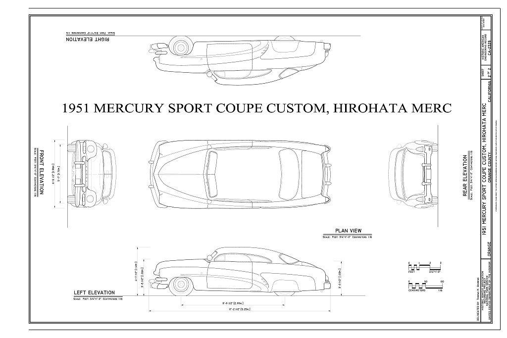

# Techniques & Styles

*Period-correct traits, and who got there first*

<figure markdown>
{ loading=lazy }
<figcaption markdown>A 1941 Ford V8-11A flathead in a Super DeLuxe. The uploader notes the tubes may come from a 1939 91A engine. This is a stock engine, the starting point for the speed-equipment era. Photo: Mr.choppers, 2015-07-12. Source: [Wikimedia Commons](https://commons.wikimedia.org/wiki/File:1941_Ford_V8-11A_flathead_engine_in_a_Super_DeLuxe.jpg). License: [CC BY-SA 3.0](https://creativecommons.org/licenses/by-sa/3.0).</figcaption>
</figure>

## A fake Cord, not a hot Ford (c.1935–1946)

Early customizing was called "restyling," and the goal was a "fake Cord," not a hot Ford. Grilles, bumpers and trim were swapped from more expensive makes, and insignias were removed.[^k]

The vocabulary: chopped tops, DuVall windshields, padded Carson tops, solid or leaded-in rear fenders, fadeaway fenders.[^k] And channeling: Summers is credited with the first channel job by *Motor Life*, 1955 ◐.[^k]

Techniques were spread by Dan Post's *Blue Book of Custom Re-Styling* and a pamphlet from Pennsylvania's [Ed Almquist](../people/ed-almquist.md).[^revs]

## Metal-finish vs. lead

Roy Hagy "didn't like to use much lead; he'd metal-finish everything" (Tom Sparks via Pat Ganahl).[^hagy] See [Roy Hagy](../people/roy-hagy.md).

## The lead-sled era (c.1949–1955)

Lowering, de-chroming, deep metallic paint, reshaped fenders, top chops and sectioning, with seams and holes finished in tin and lead (hence "lead sleds").[^revs] The chopped '49–'51 Mercury became the defining canvas after Sam Barris's '49.[^revs]

## Flathead talk

"Semi," "three-quarter," and "full race" cam grades come from Winfield's master cams ([Ed Winfield](../people/ed-winfield.md)).[^w] Add multi-carb intakes (Thickstun, Weiand, Edelbrock Slingshot, Navarro), milled or aluminum heads, and the GMC blower by 1948.[^ahrf]

## Pro Street, 1979–late 1980s

See [Pro Street](../eras/1980s-pro-street.md).

## Images

<figure markdown>
{ loading=lazy }
<figcaption markdown>HAER CA-2328, sheet 2: measured elevations of the Hirohata Merc, a reference for the chopped, lowered early-'50s custom profile (see [Hirohata Mercury](../customs/hirohata-mercury.md)). Creator: Historic American Engineering Record (NPS), delineated by Thomas M. Behrens; with the Historic Vehicle Association. Date: 2017. Source: [Library of Congress](https://www.loc.gov/item/ca4307/). License: [No known restrictions (U.S. Government work, HAER/NPS)](https://www.loc.gov/rr/print/res/114_habs.html).</figcaption>
</figure>

<figure markdown>
{ loading=lazy }
<figcaption markdown>A scale model of a 1940 Mercury custom showing the smoothed fat-fender look. It is a model, not a full-size car. Creator: JOHN LLOYD from Concrete, Washington, United States. Date: 2016-02-28 10:32. Source: [Wikimedia Commons](https://commons.wikimedia.org/wiki/File:1940_Mercury_based_custom_(25173334639).jpg). License: [CC BY 2.0](https://creativecommons.org/licenses/by/2.0).</figcaption>
</figure>

[^k]: Kustomrama, "Jimmy Summers." https://kustomrama.com/wiki/Jimmy_Summers
[^revs]: Ken Gross, "Emerald Icon from a Lost Era," Revs Institute. https://automedia.revsinstitute.org/emerald-icon-from-a-lost-era-the-saga-of-the-hirohata-mercury
[^w]: Hemmings, "Ed Winfield: The Master of Hot-Rodding and Performance." https://www.hemmings.com/stories/ed-winfield-2/
[^ahrf]: Tony Thacker, "Barney Navarro," AHRF. https://ahrf.com/pioneer/barney-navarro/
[^hagy]: Kustomrama, "Roy Hagy." https://kustomrama.com/wiki/Roy_Hagy
