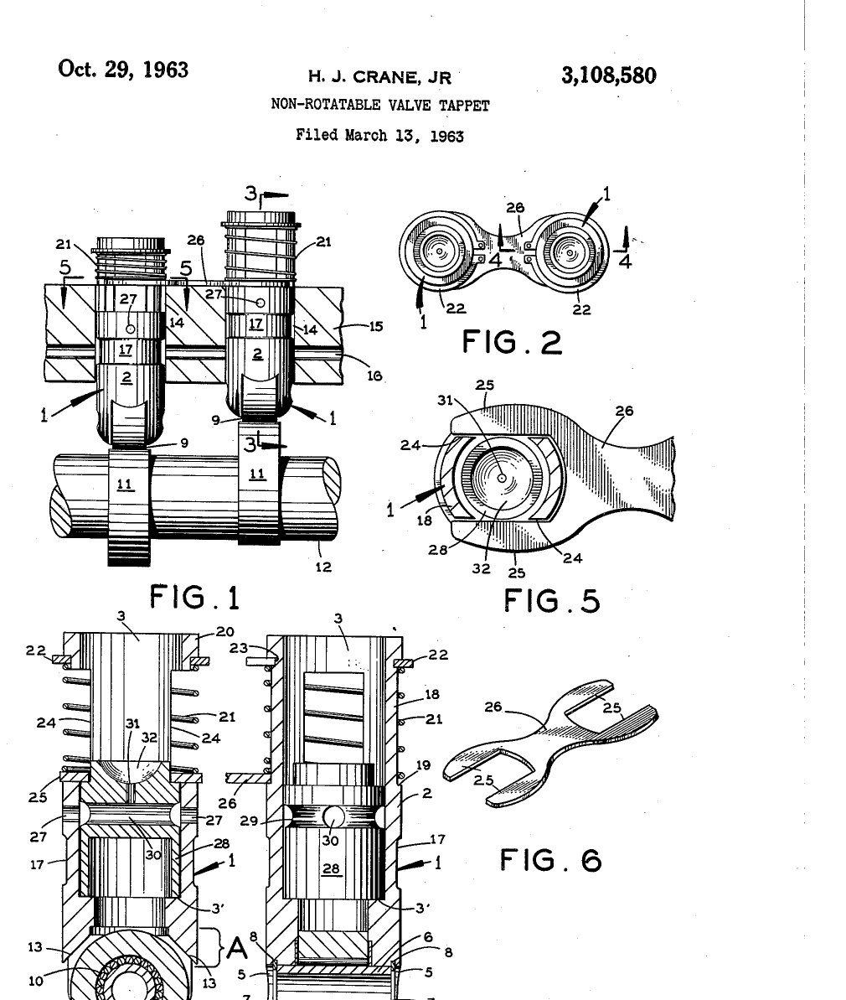

# Crane Cams: The Machinist's Son Who Ground His Own

*Hallandale, a bad cam from California and a refund for the little guys*

!!! abstract "Article record"
    **Confidence:** Medium · **Source types:** Grassroots local-newspaper obituary (*Orlando Sentinel*, 2013), funeral-home obituary (Lohman Funeral Homes, 2013), SEMA News obituary and heritage pieces, a patent, wiki pages built on racer-journalist sources · **Last verified:** 2026-10-16 (Round 15) · **Open issues:** ⚠ birthplace (Ojus vs Hallandale); ⚠ "retired" vs ousted in 1989; ⚠ when computer cam design began; ⚠ number of first-show exhibitors; the unnamed California cam maker is unidentified · [How we rate this](../reference/source-standards.md)

!!! quote "In their own words"
    "I always want to keep my mind busy and stay curious of the amazing new developments we are seeing every day in this industry."

    — Harvey Crane Jr., shortly before his 80th birthday, as quoted in SEMA's obituary (2013).[^semaob]

Harvey Crane bought a camshaft from a California company, hoping it would make his hot rod go. He found it "wasn't accurately made." So, the *Orlando Sentinel* says, he ground one to his own exacting specifications, and made that his life's work.[^os]

It was a skill he had grown up with. He was a machinist's son. His father repaired and fabricated parts, and Harvey learned the equipment young. As a teenager in South Florida he raced his own 1939 Ford coupe in the illegal drag races held at airstrips and secluded streets, and learned to build engines to be more competitive.[^os] SEMA says he discovered hot rods at 13, was known for fast, reliable flathead V-8s by his teens, and at 18 left home to tour the Midwest's rough dirt tracks, tuning a pair of flathead-powered "jalopy" racers.[^semaob] SEMA's later heritage piece says he ground his first camshaft in 1946, at 15, for a Henderson motorcycle engine in a midget racer.[^first]

On **January 1, 1953**, per his funeral-home obituary and SEMA, he opened Crane Engineering in a rented corner of his dad's machine shop in Hallandale.[^lohman][^semaob] He told the *Sentinel* in 1987 that his first year did $10,000 in business.[^os] The early customers he named, as the paper reports them, were some of the best-known track racers in the Carolinas and Virginia, "including Junior Johnson, A.J. Foyt and Ralph Earnhardt."[^os] SEMA adds that although many thought of Crane as a drag-racing cam company, his earliest business was selling flathead cams to early NASCAR heroes.[^semaob]<a href="#q-1" title="Sources disagree: see Open questions">⚠</a>

## The little guys at the Nationals

The business grew fast. By the mid-1960s, SEMA and the funeral-home obituary say, Crane Cams had "caught and surpassed its competitors" to become the largest racing cam company in the industry. In **1966** he took what SEMA calls "the unprecedented step of rewarding the little-guy weekend racers who had supported him in his early days": refunding the price of the Crane cam and kit to the winner of each class at the Nationals, which he thought built even more loyalty.[^semaob][^lohman]

That is the piece of Crane's story the wiki already knew from the Ohio side. Jim Hill, the racer-journalist who also wrote SEMA's obituary, said in *Hot Rod* that "a class winner displaying all the correct decals could collect nearly $2,000" by 1969, and Hill adds that he "wrote all the hot copy for Harvey Crane."<a href="#q-2" title="Single source so far: see Open questions">◐</a> A Cleveland gasser racer, **Ron Hassel**, left Ohio in 1965 to become Crane Cams' sales manager in South Florida, and won B/Gas at the 1966 Nationals in a '48 Anglia. See [The Ohio Gassers](../places/ohio-gassers.md).[^og]

## The first SEMA show and a roller tappet

Crane was one of SEMA's earliest members. In January 1967 about 100 aftermarket companies set up booths on the Club Level of Dodger Stadium for what was then just "the trade show," and Crane, SEMA says, demonstrated his wares with a "hand-operated engine simulator." The wiki's [Dick Wells page](../people/dick-wells.md) gives the same show **98 booths**<a href="#q-3" title="Sources disagree: see Open questions">⚠</a>.[^first]

He was also an inventor. SEMA lists his firsts: patenting the design for mechanical roller tappets; roller-tip rocker arms with needle-bearing fulcrums and gold anodizing; an extra-high-lift (0.669-in.) cam; the "Fireball" budget cams (1972); the 1965 technique of measuring duration "at 50" so cams could be compared. It says that in 1967 he drafted his first computerized cam design "using a timeshare computer and a program sent from Michigan through telephone lines." The *Sentinel* quotes his son David that he "pioneered computer camshaft designs in the early to mid-'60s."<a href="#q-4" title="Sources disagree: see Open questions">⚠</a>

The patent is checkable. **US 3,108,580**, "Non-rotatable valve tappet," by Harvey J. Crane Jr. of Hallandale, was filed March 13, 1963, and issued October 29, 1963. It describes a roller lifter held from turning by a plate across two adjacent lifters, and among the patents it cites is Ed Iskenderian's 1958 "Guide means for non rotatable valve lifters" (US 2,846,988), which is on the wiki's [Patents page](../reference/patents.md). Google's "cited by" list for Crane's patent includes a 1991 Crane Cams "Roller tappet" patent and a 1998 Competition Cams "Anti-rotation valve lifter guide apparatus" patent, so the idea ran from Isky's 1958 lifter guide, through Crane in 1963, into the 1990s COMP and Crane designs. It also lists a 2004 roller-valve-lifter application by "Schubeck Joseph J"<a href="#q-5" title="Single source so far: see Open questions">◐</a>

<figure markdown>
{ width="320" loading=lazy }
<figcaption markdown>US 3,108,580, "Non-rotatable valve tappet," sheet 1. Inventor: Harvey J. Crane Jr. Filed 1963-03-13, issued 1963-10-29. Source: [Google Patents](https://patents.google.com/patent/US3108580A/en) (drawing from the USPTO image). License: public domain (U.S. patent drawing).</figcaption>
</figure>

## From Hallandale to Daytona, and out

Crane Cams built a new Daytona Beach facility in 1980 and closed the Hallandale plant in 1985, per SEMA and the funeral-home obituary; the *Sentinel* says "in the 1980s."[^semaob][^lohman][^os] Then came 1989. The funeral-home obituary says Crane "retired." The *Sentinel* says he "left the company and started his own work." SEMA says that "following a disagreement with his board of directors" he was "ousted as chairman" and "dismissed," and that "he refused to remain quietly 'retired.'"[^lohman][^os][^semaob]<a href="#q-6" title="Sources disagree: see Open questions">⚠</a>

He started a **cam school** at his Port Orange home, and more than 100 students from racing, automotive, industrial and marine work came; SEMA says many of the leading racing cam designers today are graduates.[^semaob] A Carolina cam-shop owner told the *Sentinel*: "He had an excellent reputation for integrity."[^os] Crane died May 31, 2013, at 81, was inducted into the SEMA Hall of Fame (1981, per SEMA News) and the East Coast Drag Racing Hall of Fame in Henderson, North Carolina (per SEMA's obituary), and the family asked that memorial gifts go to the Darrell Gwynn Foundation.[^semaob][^first][^lohman]

## Connect the dots

[The Ohio Gassers](../places/ohio-gassers.md) tells of Ron Hassel's move to Crane Cams in 1965 and Hill's story of the 1966 class-winner refunds. [Ed Iskenderian](../people/ed-iskenderian.md) and [Patents](../reference/patents.md) cover the lifter-guide patent that Crane's tappet patent cites. Crane's shop foreman Tom Woitesek left for Memphis in 1972 and became a founder of [COMP Cams and RHS](comp-cams-rhs.md), and Cam Dynamics ended up with Crane Cams. In the *Sentinel*'s story, the inaccurate cam came from the California trade of [The Camgrinder Wars](../eras/1950s-camgrinder-wars.md), though the maker is unnamed. The first SEMA show at Dodger Stadium, where Crane exhibited, is on the [Dick Wells](../people/dick-wells.md) page. And [Moroso](moroso.md), South Florida's other big performance name, owned the Palm Beach raceway that appears in Hill's Hassel photo.

*See also:* [The Web of Influence](web-of-influence.md).

## Open questions & disputed details

*From the detective's notebook: where the sources disagree, where we have only one, and what we are still looking for. Each item links back to its place in the story.*

**Disputed.** **Where was he born?** The *Sentinel* says Ojus, "a small community in what is now Miami-Dade County," where his father was a machinist. SEMA says Hallandale, as the Hallandale shop would suggest. SEMA and the funeral home give his birth date as August 17, 1931; the *Sentinel* says only 1931. All three say he was 81 when he died.[^os][^semaob][^lohman] <a class="hr-q-back" href="#qr-1" title="Back to the story">↩</a>

**Single source so far.** An interested party, and the figures are his.[^hr15] <a class="hr-q-back" href="#qr-2" title="Back to the story">↩</a>

**Disputed.** **How many booths at the first show?** SEMA News says "about 100" companies set up at Dodger Stadium in January 1967;[^first] the sources on our [Dick Wells](../people/dick-wells.md) page give **98 booths**. The two are close, and "about 100" may simply round 98. Lead: the 1967 show program. <a class="hr-q-back" href="#qr-3" title="Back to the story">↩</a>

**Disputed.** The year differs.[^first][^os] <a class="hr-q-back" href="#qr-4" title="Back to the story">↩</a>

**Single source so far.** (a name match we have not tied to Lakewood's Joe Schubeck).[^pat] <a class="hr-q-back" href="#qr-5" title="Back to the story">↩</a>

**Disputed.** That is three words for one event. <a class="hr-q-back" href="#qr-6" title="Back to the story">↩</a>

[^os]: "Harvey J. Crane Jr.: His exacting work boosted race cars' power," *Orlando Sentinel*, Jun 20, 2013 (updated Nov 3, 2021). https://www.orlandosentinel.com/2013/06/20/harvey-j-crane-jr-his-exacting-work-boosted-race-cars-power/ (accessed 2026-10-16)
[^lohman]: "Harvey J. Crane Obituary," Lohman Funeral Homes, May 31, 2013. https://obituaries.lohmanfuneralhomes.com/obituaries/harvey-crane (accessed 2026-10-16)
[^semaob]: Jim Hill, "Racing Industry Pioneer Harvey Crane Passes Away," SEMA eNews, 2013. https://www.sema.org/news-media/enews/2013/23/racing-industry-pioneer-harvey-crane-passes-away (accessed 2026-10-16)
[^first]: Drew Hardin, "Crane's First SEMA Show," SEMA News, Nov 2013. https://www.sema.org/news-media/magazine/2013/44/cranes-first-sema-show (accessed 2026-10-16)
[^hr15]: Jim Hill, "Sportsman Racers Winning Class at Indy Was Their High Mark," *Hot Rod*, Nov 23, 2015, as summarized on [The Ohio Gassers](../places/ohio-gassers.md). https://www.hotrod.com/news/sportsman-racers-winning-class-at-indy-was-their-high-mark
[^og]: See [The Ohio Gassers](../places/ohio-gassers.md) (Hill, East Coast Drag Times Hall of Fame, 2016).
[^pat]: US 3,108,580A, "Non-rotatable valve tappet" (Harvey J. Crane Jr.), Google Patents, incl. its "Patent citations" and "Cited by" lists, which Google generates by computer. https://patents.google.com/patent/US3108580A/en (accessed 2026-10-16)
