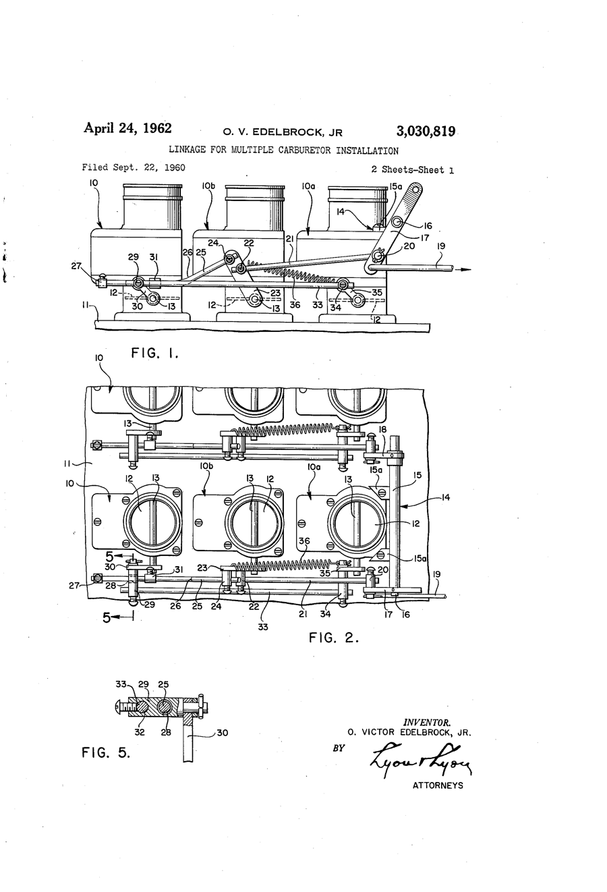
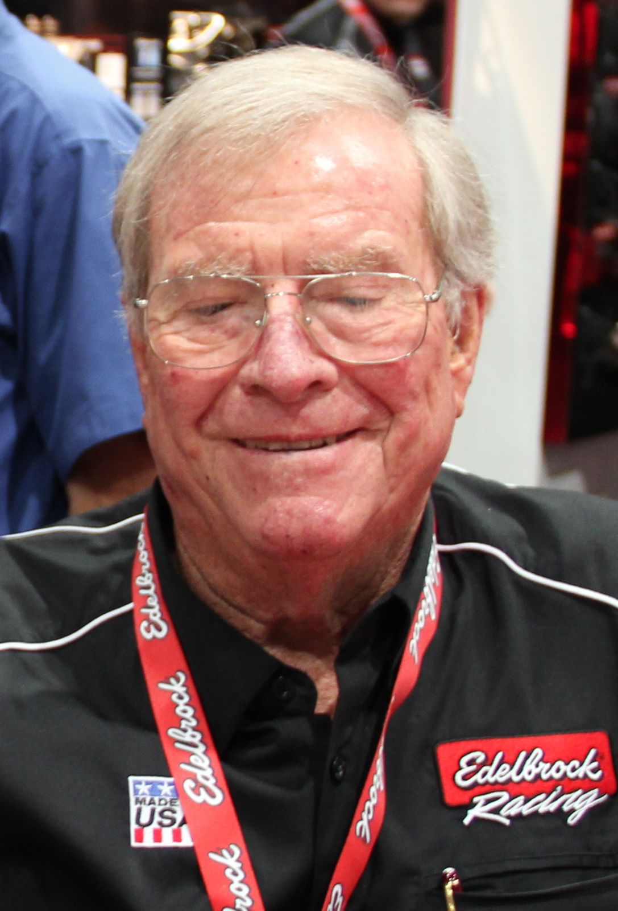

# Edelbrock's Slingshot

*A mechanic becomes a manufacturer*

!!! abstract "Article record"
    **Confidence:** Medium · **Source types:** secondary, primary (patent) · **Last verified:** 2026-10-13 (Round 4) · **Open issues:** 1941 speed conflict open · [How we rate this](../reference/source-standards.md)

<figure markdown>
{ width="300" loading=lazy }
<figcaption markdown>US3030819, "Linkage for multiple carburetor installation," sheet 1. Inventor: Otis Victor Edelbrock Jr., filed 1960-09-22, issued 1962-04-24. Source: [Google Patents](https://patents.google.com/patent/US3030819A/en). License: public domain (U.S. patent drawing). See [Patents](../reference/patents.md).</figcaption>
</figure>

Vic Edelbrock drove his roadster to Muroc, pulled the fenders and windshield, raced, and bolted them back on to drive home.[^ed]

## A kid from Kansas

Vic Edelbrock Sr. (1913–1962) was born in Kansas; the year is the company's,[^ed] and the International Drag Racing Hall of Fame list gives 1912.[^idrhof]<a href="#q-1" title="Sources disagree: see Open questions">⚠</a> He went to work full time at 14 after a fire destroyed his father's grocery store, and came to California in 1931.[^enc][^ed] He opened a repair shop on Wilshire Blvd. in Beverly Hills with his brother-in-law, then moved to Venice & Hoover in 1934.[^ed]

## The Thickstun detour

The roadster came first. In **1938** he bought a '32 Ford roadster. He first worked with Tommy Thickstun on the "Thickstun" manifold, wasn't satisfied, and designed his own: a 180° aluminum two-Stromberg-97 flathead manifold called the **Slingshot**, the first product with the Edelbrock name. About 100 were made before the war.[^ed][^enc]<a href="#q-2" title="Sources disagree: see Open questions">⚠</a>

After the war Edelbrock modified "Denver" iron heads, introduced the first aluminum heads and a 1946 catalog, and fielded a flathead midget credited with breaking the Offenhauser midgets' streak in the late '40s.[^hemm]

*See also:* [Beast III](../cars/beast-iii.md).

## Open questions & disputed details

*From the detective's notebook: where the sources disagree, where we have only one, and what we are still looking for. Each item links back to its place in the story.*

**Disputed.** **1912 or 1913?** The company's history gives Vic Sr.'s birth year as 1913;[^ed] the International Drag Racing Hall of Fame list gives 1912.[^idrhof] A Kansas birth record would settle it. <a class="hr-q-back" href="#qr-1" title="Back to the story">↩</a>

**Disputed.** **How fast was the roadster?** Edelbrock's own history says "racing speeds of 112 mph";[^ed] Encyclopedia.com says over 120 mph;[^enc] Wikipedia cites 121.45 mph on November 16, 1941 in one article and puts a 121.42 run at **Bonneville** in another.[^wp] Bonneville seems unlikely for a lakes roadster in 1941 and needs a period SCTA record source. <a class="hr-q-back" href="#qr-2" title="Back to the story">↩</a>

## Images

<figure markdown>
{ loading=lazy }
<figcaption markdown>Vic Edelbrock Jr. at the 2012 SEMA Show. He is the inventor on the 1960 linkage patent shown above. Creator: Nick Ares from Auburn, CA, United States. Date: 2012-10-30 16:17. Source: [Wikimedia Commons](https://commons.wikimedia.org/wiki/File:Vic_Edelbrock_Jr..jpg). License: [CC BY-SA 2.0](https://creativecommons.org/licenses/by-sa/2.0).</figcaption>
</figure>

[^ed]: Edelbrock, "The History of Edelbrock Performance." https://www.edelbrock.com/about-us
[^enc]: Encyclopedia.com, "Edelbrock Corporation." https://www.encyclopedia.com/books/politics-and-business-magazines/edelbrock-corporation
[^wp]: Wikipedia, "Edelbrock" and "Vic Edelbrock." https://en.wikipedia.org/wiki/Edelbrock ; https://en.wikipedia.org/wiki/Vic_Edelbrock
[^hemm]: Hemmings, "Edelbrock celebrates 75 years of go-fast goods." https://www.hemmings.com/stories/edelbrock-celebrates-75-years-of-go-fast-goods/
[^idrhof]: Don Garlits Museum, International Drag Racing Hall of Fame list (Class of 1994). https://garlits.com/hall-of-fame-inductees-2011/
