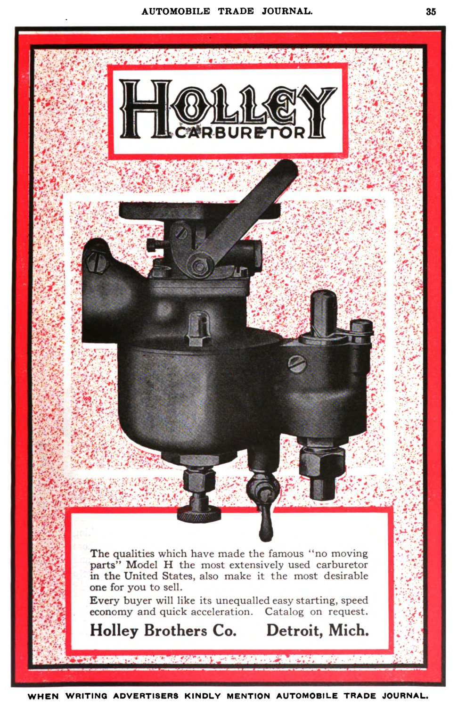
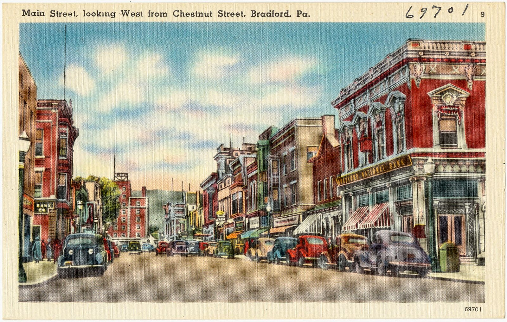

# Holley: A Bicycle Motor from Bradford and the Carburetor That Followed Everybody

*An oil-boom hotel, a Pan-American track and a state historical marker*

!!! abstract "Article record"
    **Confidence:** Medium (stronger for the Bradford years than for the aftermarket years) · **Source types:** state historical marker essay (Pennsylvania Historical and Museum Commission, 2008), university heritage feature built with the company foundation's help (Penn State, 2010–11), a 1916 trade-journal ad, company brand pages, SEMA Hall of Fame · **Last verified:** 2026-10-16 (Round 15) · **Open issues:** ⚠ 1901 vs 1903 for the carburetor licence; ⚠ "almost half" vs "more than half" of WWII carburetors; ⚠ when Holley bought Hooker (1990s vs 2000); the Holley Foundation history pages returned 404 · [How we rate this](../reference/source-standards.md)

On a summer day in 1901 at the Pan-American Exposition in Buffalo, twenty-three-year-old George Holley was out to break the world five-mile record on a motor bicycle he had designed. The August 22, 1901, *McKean County Miner*, as quoted by the Pennsylvania marker essay, reported what happened on one attempt: Holley "lost control of his whirling engine close at the finish and went bounding off the board platter. The only damage was a stir up of the officials. Holley never lost presence of mind nor attempted to dismount, but shut off the power and continued the trip over sod." He broke "all existing marks for five miles" that day.[^mk]

## The hotel keeper's boys

Holley came to Buffalo from **Bradford, Pennsylvania**, an oil boomtown in McKean County, where his father Frank ran the Holley House, a four-story, 70-room hotel. The marker essay says the boomtown culture "spawned a host of refiners, dealers, brokers, and others all seeking to 'strike it rich'," and that in that "fertile environment for entrepreneurial innovation" George and his brother Earl, "natural-born mechanics and tinkerers," did the rest.[^mk]

It started with bicycles. In 1896 George attached a motor to a bicycle, making the motor "an integral part of the bike frame." In 1897, he was nineteen and Earl sixteen, they built a three-wheeled single-cylinder car they called the Runabout, which hit thirty miles an hour. They formed the Holley Motor Company two years later, with Earl on administration and George on engineering, building engines on Davis Street and then whole motorcycles "in response to customer demand." George raced them to promote the business, and in July 1902 he won the first Motorcycle Endurance Contest, Boston to New York.[^mk]<a href="#q-1" title="Sources disagree: see Open questions">⚠</a>

<figure markdown>
{ width="360" loading=lazy }
<figcaption markdown>Holley Brothers Co. advertisement for the Model H carburetor, *Automobile Trade Journal*, vol. 20, 1916, p. 35. The ad claims "no moving parts" and calls the Model H "the most extensively used carburetor in the United States." That is advertising copy. Creator: Holley Brothers Company. Date: 1916. Source: [Wikimedia Commons](https://commons.wikimedia.org/wiki/File:Holley_Brothers_Co_advert_in_Automobile_Trade_Journal_1916.png). License: public domain.</figcaption>
</figure>

## Detroit, and a war

Then the business followed the car industry. The brothers moved their headquarters to Detroit in 1907 and opened their first plant there late that year. In 1917 they sold Ford the car-carburetor business and refocused on tractors, selling to International Harvester and Chevrolet as the Holley Carburetor Company. Aviation followed in 1927. The marker says that during World War II "almost half the vehicles in the U.S. armed forces had a Holley carburetor and fuel-metering device." Penn State says "more than half" of all the carburetors and carburetion devices used in the war carried the Holley trademark, and adds Holley fuel-metering on the B-25s of the Doolittle raid.<a href="#q-2" title="Sources disagree: see Open questions">⚠</a>

## Into the aftermarket

The part of the story hot rodders know begins in **1948**, when Holley "entered the automotive aftermarket, supplying service stations and garages with Holley carburetor repair kits and parts," and added plants in Tennessee and Kentucky. Headquarters moved to Warren, Michigan, in 1951, with a 250,000-square-foot plant at Bowling Green, Kentucky. The 1968 merger with Colt Industries, a 1979 replacement-parts division, and the 1994 sale of the original-equipment division to Borg-Warner follow in the marker's chronology.[^mk]

Penn State calls Holley "the first American company dedicated to designing performance carburetors"<a href="#q-3" title="Single source so far: see Open questions">◐</a>

Then came the roll-up. The marker says that in the 1990s Holley "expanded to include **Hooker Headers**, Flowtech Exhaust, Earl's Performance Plumbing, and NOS." SEMA's Hall of Fame profile of Hooker's founder says Gary Hooker "sold Hooker Headers to Holley Performance Products in **2000**."<a href="#q-4" title="Sources disagree: see Open questions">⚠</a> Holley's brand page says **Lakewood**, the Ohio bellhousing maker, is "now part of Holley Performance."[^lkw] Holley bought **Mr. Gasket** in September 2015, per the wiki's [Mr. Gasket page](mr-gasket.md). Holley filed for bankruptcy in February 2008, and, the marker adds, "promised that employees would not be affected."[^mk]

The marker closes on a line that is now dated. In 2008 it says "every NASCAR Sprint Cup team and every National Hot Rod Association (NHRA) Pro-Stock champion" used Holley carburetors.[^mk] Treat that as a 2008 statement.

<figure markdown>
{ loading=lazy }
<figcaption markdown>Main Street, looking west from Chestnut Street, Bradford, Pa. Linen postcard, c. 1930–1945 (Tichnor Bros., Boston, for the Bradford News Co.). Later than the Holleys' years there; context only. Source: [Wikimedia Commons](https://commons.wikimedia.org/wiki/File:Main_street,_looking_west_from_Chestnut_Street,_Bradford,_Pa_(69701).jpg). License: public domain.</figcaption>
</figure>

## Connect the dots

[Mr. Gasket](mr-gasket.md), Cleveland's Hrudka brothers' company, was sold to Holley in 2015. [Hooker Headers](hooker-headers.md), Gary Hooker's header shop, has been a Holley brand since 2000 (or earlier, per the marker); the sale date is a<a href="#q-5" title="Sources disagree: see Open questions">⚠</a> conflict. [Lakewood Industries](lakewood-industries.md), the Ohio bellhousing maker, is now a Holley brand too. And the company of [Stu Hilborn](../people/stu-hilborn.md), the fuel-injection pioneer, is reported to have been acquired by Holley (2019,<a href="#q-6" title="Single source so far: see Open questions">◐</a> per that page's Wikipedia summary).

*See also:* [The Web of Influence](web-of-influence.md).

## Open questions & disputed details

*From the detective's notebook: where the sources disagree, where we have only one, and what we are still looking for. Each item links back to its place in the story.*

**Disputed.** **When did the carburetor start?** The marker essay says that in **1903** the brothers "secured American rights to a French-designed carburetor" and built about 600 four-wheeled Holley Motorettes in Bradford over the next three years.[^mk] The Penn State feature, which also quotes local sources, says the brothers saw the French Longuemare carburetor in Paris in **1901**, bought the licence immediately, and "in 1903" went into the carburetor business.[^psu] Both agree on 1903 for the business. The licence date is the difference. <a class="hr-q-back" href="#qr-1" title="Back to the story">↩</a>

**Disputed.** Those two statements measure different things, and neither is a count.[^mk][^psu] <a class="hr-q-back" href="#qr-2" title="Back to the story">↩</a>

**Single source so far.** (a heritage feature built with the company foundation's help; we have no independent source for "first").[^psu] <a class="hr-q-back" href="#qr-3" title="Back to the story">↩</a>

**Disputed.** That is a decade-boundary disagreement the two sources do not explain; see [Hooker Headers](hooker-headers.md).[^mk][^hooker] <a class="hr-q-back" href="#qr-4" title="Back to the story">↩</a>

**Disputed.** **When did Holley buy Hooker?** SEMA and Hagerty say 2000; the Pennsylvania historical marker for Holley says "the 1990s." The sources are on [Hooker Headers](hooker-headers.md#q-4). <a class="hr-q-back" href="#qr-5" title="Back to the story">↩</a>

**Single source so far:** [Stu Hilborn](../people/stu-hilborn.md): the fuel-injection pioneer's company is reported to have been acquired by Holley (2019, per that page's Wikipedia summary). <a class="hr-q-back" href="#qr-6" title="Back to the story">↩</a>

**Ford's request:** Both the marker essay and the Penn State feature place Henry Ford's request for a Model T carburetor before the 1907 move to Detroit. The marker says that Ford asked them to produce a carburetor "for his new Model T," and that it "soon became standard on all Ford automobiles."[^mk] We have not checked that sequence against a Ford source.

[^mk]: "Holley Motor Company Historical Marker," Pennsylvania Historical and Museum Commission, Explore PA History (marker at 57 Holley Ave., Bradford, dedicated Sept 13, 2008; "Behind the Marker" essay). https://explorepahistory.com/hmarker.php?markerId=1-A-3A3 (accessed 2026-10-16)
[^psu]: Pierre LeClair, supplemented by Christine A. Hawthorne, "From Motorized Bicycle to Muscle Car," Pennsylvania Center for the Book, Penn State University Libraries (McKean County, Spring 2010, Spring 2011); illustrated with the Holley Foundation's help. https://pabook.libraries.psu.edu/literary-cultural-heritage-map-pa/feature-articles/motorized-bicycle-muscle-car (accessed 2026-10-16)
[^hooker]: "HOF – Gary Hooker," SEMA Hall of Fame, 2016. https://www.sema.org/hof/2016/gary-hooker (accessed 2026-10-16)
[^lkw]: "Lakewood Bellhousings, Traction Bars & Suspension," Holley (brand page, "About Lakewood"). https://www.holley.com/brands/lakewood/ (accessed 2026-10-16)
