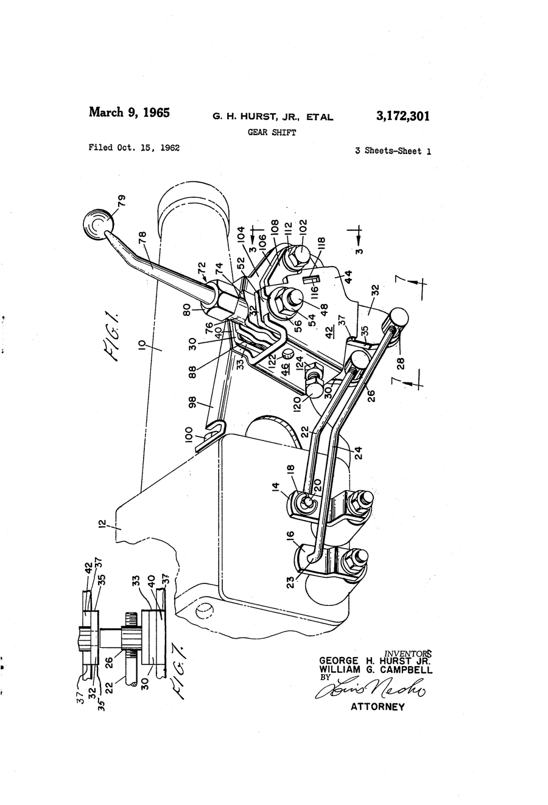
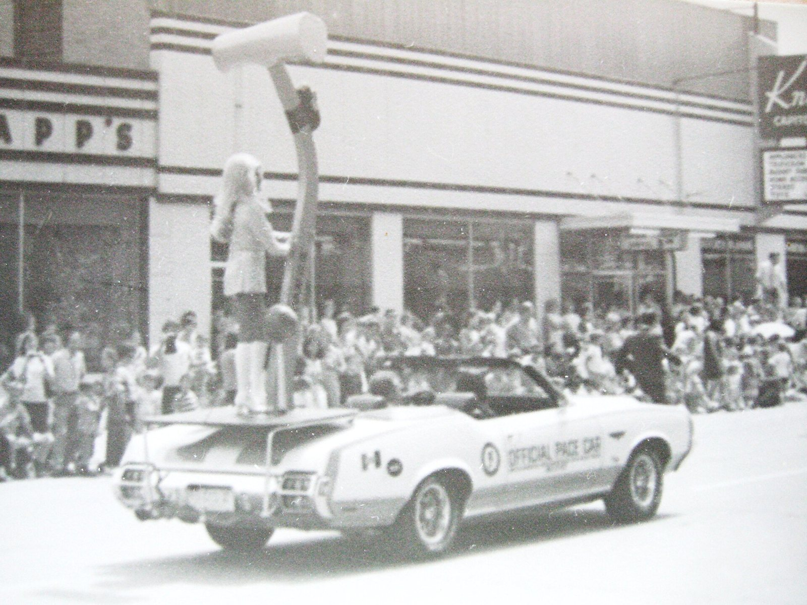

# Hurst-Campbell: The Shifter King's Two-Car Garage

*Abington, Warminster, and the Bucks County magazines that watched it happen*

!!! abstract "Article record"
    **Confidence:** Medium · **Source types:** Grassroots two Bucks County magazines (*Panorama*, Oct 1965; *Bucks County Life*, Nov 1965 and Jan–Feb 1966), a family account from Bill Campbell's daughter, an enthusiast-press history (Ate Up With Motor), trade press (*Hot Rod*, 2020), patents, and a Round 17 paper trail (a 1962 Dodge brochure, 1962–63 federal copyright registrations and a 1966 AMC parts list); a small-town Indiana paper (*Rushville Republican*, 1971) · **Last verified:** 2026-10-22 (Round 21; the Warminster move resolved to 1965) · **Open issues:** ⚠ incorporation date; ⚠ 1965 sales figure; ⚠ who conceived the rescue tool; ◐ Almquist's role · [How we rate this](../reference/source-standards.md)

Hurst-Campbell, Inc., a Doylestown magazine told its Bucks County readers in October 1965, "has no employees." Everyone was an associate. The company had just opened a new 58,000-square-foot plant across from the Johnsville Naval Air Station in Warminster, and the founder and his partner swung open the doors to "welcome back their 250 vacationing associates."[^pan]

The magazine was proud of the contrast. The "small converted two-car garage in Abington" that had been Hurst-Campbell's first home was only a few miles from the new gold-brick building, and the "10-year journey from dream to reality" had, it said, felt about as short as the drive between the two.[^pan]

## A bumper guard and a nationwide tour

George H. Hurst Jr. was 38. He had spent 11 years in the Navy and laid the groundwork for the company while stationed at Willow Grove Naval Air Station, where, says *Panorama*, he became "a source of service and information for the entire base," from tune-ups on his buddies' cars to a complete body restoration on a commanding officer's imported classic.[^pan] He put late-model engines into pre-war Lincoln Continentals. Then a friend wanted a custom bumper guard for a Volkswagen, dozens of orders followed, and the magazine says it was that bumper guard that launched him on the road to being known as "The Shifter King."[^pan]

The bumper guards lasted until Volkswagens began arriving in the U.S. already carrying a very similar unit. Creditors "began to talk of voluntary bankruptcy." Hurst loaded his old car with order blanks, samples and "personal courage" and drove a nationwide tour, and "when he returned, he had enough orders for motor mounts to put the company back on solid ground."[^pan]

Ate Up With Motor tells the same early years from the enthusiast side. Hurst settled in eastern Pennsylvania in 1954 after the Navy and "became very active in the local drag racing scene." In the mid-fifties he and Bill Campbell started a garage in Abington building aftermarket engine mounts. His formal training was limited, the piece says, but he was "a natural showman with a flair for clever promotions."[^auwm]

The best story about that showmanship comes from *Hot Rod*. Petersen's chief photographer Bob D'Olivo met George before the original Hurst-Campbell promoted its kits for converting "three on the tree" to floor shift: "A well-dressed gent walked through the front door on Hollywood Blvd. carrying motor mounts and asking for any editor who happened to be there."[^hr20]

## From Anco to Warminster

After some setbacks Hurst and Campbell teamed with Jonas Anchel and **Ed Almquist**, "founders of the speed shop Anco Industries," on an engine mount called Adjusta-Torque and a floor-mounted linkage for three-speed transmissions. George installed the first in his own 1956 Chevrolet. Almquist and Anchel would not put up the capital to market it, so Hurst and Campbell borrowed $20,000 and set up their own company, Hurst-Campbell, Inc. It "opened for business in 1959," says Ate Up With Motor.[^auwm] That history puts the new company in Warminster, but Warminster is where it ended up, not where it started. *Panorama* calls its first home a "small converted two-car garage in Abington,"[^pan] and the earliest address we have found, on a 1962 Dodge brochure, is 341 W. Glenside Ave., Glenside, a place that lies partly in Abington Township.[^dodge62][^glen] The company moved to its Warminster plant in 1965 (see [The paper trail](#the-paper-trail-where-to-send-your-order)).

Almquist's own page, built on his Milford, Pennsylvania, obituary and a Port Jervis paper, says a 1959 partnership with Hurst and Campbell on floor shifters dissolved, and that the paper calls him co-designer of the Hurst shifter<a href="#q-1" title="Single source so far: see Open questions">◐</a>. That is a single local-press source. The patent record is suggestive and no more: Almquist Engineering's gear-shift patent was filed in September 1962, a month before Hurst and Campbell filed theirs.[^alm][^pat]

<figure markdown>
{ width="300" loading=lazy }
<figcaption markdown>US 3,172,301, "Gear shift," by George H. Hurst Jr. and William G. Campbell, filed 1962-10-15, issued 1965-03-09. Source: [Google Patents](https://patents.google.com/patent/US3172301A/en). License: public domain (U.S. patent drawing). Compare Almquist Engineering's US 3,082,639 on [Ed Almquist](../people/ed-almquist.md).</figcaption>
</figure>

| Item | Local magazines | Other sources |
|---|---|---|
| Warminster | The plant is "new" in Oct 1965; *Bucks County Life* (Jan–Feb 1966) says "This past year the Hurst-Campbell company breezed into Warminster and started production of gear shifts and other equipment for auto builders."[^pan][^bclj] | "Opened for business in 1959," placed in Warminster (Ate Up With Motor)[^auwm]; the date fits the company's start, and the Warminster address came in 1965 (see [The paper trail](#the-paper-trail-where-to-send-your-order)) |
| Incorporation | — | May 1958, "after two years" of part-time die design, per Campbell's daughter <a href="#q-2" title="Single source so far: see Open questions">◐</a>[^jacg]; "opened for business in 1959"[^auwm] |
| Sales | "in excess of six million dollars per year" (1965)[^pan] | "more than $20 million a year" by "the mid-sixties"[^auwm] |
| Partners' names | — | Anco Industries (Ate Up With Motor)[^auwm]; Almquist's page says Sparkomatic, with Anchel (obituary)[^alm] |

The $6 million and $20 million figures may be different years, since "mid-sixties" is loose. The magazine has the earlier, contemporary number, and the history has the bigger one.

## The paper trail: where to send your order

The surest way to place a mail-order speed company is to find the address it printed for customers. Four dull documents settle the Warminster question.

The first is a 1962 Dodge Dart 440 magazine-insert brochure, scanned by a Facebook group of brochure collectors, closes with "Additional high performance equipment available from independent manufacturers." Among them is "Hurst-Campbell Inc., 341 W. Glenside Ave., Glenside, Pa. (shift conversions)."[^dodge62] The company was in good company. The same list names Edelbrock Equipment Co. in Los Angeles (manifolds), Ed Iskenderian in Inglewood ("adj. push rods"), Weiand in Los Angeles (manifolds), Offenhauser Sales Corp., Howard Cams, Hedman Hedders, Camcraft of Detroit, ForgeTrue Pistons and Auto Marine Laboratories of Wyckoff, New Jersey. Hurst-Campbell is the only Pennsylvania firm on it.[^dodge62] See [Edelbrock](edelbrock-slingshot.md), [Ed Iskenderian](../people/ed-iskenderian.md) and [Barney Navarro](../people/barney-navarro.md) (for Weiand).

Glenside is a census-designated place split between **Abington** and Cheltenham townships.[^glen] So a 1962 Glenside address fits *Panorama*'s "converted two-car garage in Abington," though we can't tell from the address alone which township No. 341 was in, or whether it was the garage.

The second is the copyright office. For 1962–63 the *Catalog of Copyright Entries* shows Hurst-Campbell, Inc., registering its own instruction sheets and folders: a "CV-2-202 conversion mount for '58-'62 Chevrolet 348-409 cubic inch engines" (June 29, 1962); "Competition/plus four speed floor shift" instructions; "Hurst dual pattern S/L shifter instructions"; a Hurst Fiberglas floor tunnel kit for '62 Dodge/Plymouth and Lancer/Valiant (Sept. 26, 1962); and "Hurst mystery shifter instructions" (Dec. 5, 1962).[^cce62] In the first half of 1963 came "Adjustatorque engine conversion mounts" (March 20), a sheet called "Instant success" (March 27), a folder titled "Spotlighting Hurst floor shifts," "Transmission mounts," and a rear crossmember for 1953–57 Studebakers.[^cce63]<a href="#q-3" title="Single source so far: see Open questions">◐</a>

The third comes from American Motors. AMC's own "Performance Activities" booklet for 1966–68, which lists outside suppliers of performance parts for its cars, gives "Hurst-Campbell, Inc. 50 West Street Road Warminster, Pa." under shift linkage.[^amc66]

The fourth is the company's own mail address after the Post Office brought in ZIP codes on July 1, 1963.[^zip] The spring 1965 issue of *Ward's Quarterly* (Vol. 1, No. 2) lists "Hurst Performance Products, Glenside, Pennsylvania, 19038," and a *Car and Driver* ad reprinted in a book on the 1964–67 GTO gives the same "Glenside, Pa. 19038."[^wq65][^gtoad]<a href="#q-4" title="Single source so far: see Open questions">◐</a> So Hurst was still printing a Glenside address in the spring of 1965.

Put the four together and the move lands in 1965. The company sold from Glenside from at least the 1962 model year into the spring of 1965. In October 1965 *Panorama* called the Warminster plant "new," the next winter *Bucks County Life* said "This past year the Hurst-Campbell company breezed into Warminster," and AMC's 1966–68 list gives the Warminster address.[^pan][^bclj][^amc66] Ate Up With Motor's "opened for business in 1959" fits the company's start, not its Warminster address.[^auwm]

## Detroit says yes

Detroit "tended to ignore or disdain the aftermarket," Ate Up With Motor says, until a former GM man named **Jack Watson**, who traveled to drag meets with a portable machine shop and became "Shifty Doc," got Hurst a 1961 meeting with Pontiac's Bunkie Knudsen and Pete Estes. Estes had read a favorable *Hot Rod* write-up on the Hurst shifter. The deal put a Hurst linkage and shifter in the Super Duty Catalina, and many high-performance Pontiacs later carried them as standard, the GTO among them.[^auwm] *Hot Rod* says the Catalina deal was the moment "the speed equipment aftermarket's penetration of Motor City really began to take off."[^hr20] Hurst opened a Hurst Performance Center in Detroit in 1965 and put Watson in charge.[^auwm]

Back home, the local press noticed. *Bucks County Life*'s editor attended the open house at the new plant, was shown around, found himself talking to "business people from all over the country," and called Hurst-Campbell "the leading designer and manufacturer of original equipment for these Detroit auto builders." He added that "we of this area, should count ourselves most fortunate indeed to have this industry pick Bucks County to settle in."[^bcl] *Panorama* put it more bluntly: the name Hurst on a shifter handle was "the only trademark name to appear inside a Detroit product."[^pan]

A 1961 offer from the family account is a good small detail<a href="#q-5" title="Single source so far: see Open questions">◐</a>: Campbell's daughter says George put up **$1,000** for anyone who could design a better 4-speed in-line shifter than the one they were then using in Detroit, and that Bob Kenny won it.[^jacg]

## Guaranteed forever

"Every Hurst product is guaranteed forever," *Panorama* wrote, and the promise shaped the product: when the firm moved into custom wheels, it chose forged aluminum rather than a conventional design, because nothing else would hold up to the guarantee.[^pan] Hurst "tied his promotional activities strongly into the auto racing fraternity," supplying services "at no cost to the participants" at major events and sponsoring cars, from the Indianapolis 500 runner-up Agajanian Special to an in-line four-Chrysler land-speed project whose two transmissions, 18 feet apart, were shifted together by Hurst controls. Panorama does not name the car or the driver<a href="#q-6" title="Single source so far: see Open questions">◐</a>.[^pan]

The same article, in October 1965, describes a **hydraulic Line/Loc** for hill-holding and drag-strip safety, and a rescue device "under development," built to take a wrecked car apart "in a matter of seconds" to reach an injured driver, already on hand "but fortunately unneeded" at recent racing events.[^pan] *Panorama* never calls it the Jaws of Life; that this was the tool's ancestor is our inference<a href="#q-7" title="Single source so far: see Open questions">◐</a>.<a href="#q-8" title="Sources disagree: see Open questions">⚠</a>

The promotion also had a face. Ate Up With Motor says Hurst hired beauty queen Linda Vaughn as "Miss Hurst Golden Shifter."[^auwm] A small-town Indiana paper shows that job at street level. For the 13th annual Rushville National Bank Auto Show in May 1971, the *Rushville Republican* put "Miss Hurst—Linda Vaughn" at No. 49 in a parade of 72 units, between a Shrine mini-bike patrol and a Chevrolet dealer's entry. Its auto show edition called her "a dedicated and hard working associate of Hurst Performance, Inc.," who followed "Hurst's busy racing schedule," spearheading "Hurst's vigorous PR efforts at more than 100 major races and events each year."[^rr710520] SEMA's Hall of Fame piece on Joe Schubeck says George Hurst talked the Ohio bellhousing maker into driving the Hurst Hairy Oldsmobile, by laying down photographs of "the new girl I've hired for Miss Golden Shifter."[^sema13] George Hurst died in 1986, at 59.[^hr20] Hagerty's later summary says Hurst-Campbell went public in 1968 and that appliance maker Sunbeam bought Campbell's stock in 1970, after which Hurst walked out in December 1970. It adds that in 1986 "the Mr. Gasket company purchased what was left of Hurst Performance," and that those remains "made their way to Holley in 2015."[^hag]<a href="#q-9" title="Single source so far: see Open questions">◐</a>

<figure markdown>
{ loading=lazy }
<figcaption markdown>A giant Hurst shifter handle on an Oldsmobile pace car. The Commons file is titled "Linda Vaughn and Hurst" and the uploader's description says it shows a parade in Lansing, Michigan, for Oldsmobile's 75th anniversary, 1972 ◐ (we cannot confirm the date or the person from the photo itself). Creator: JOHN LLOYD. Uploaded: 2008-10-18. Source: [Wikimedia Commons](https://commons.wikimedia.org/wiki/File:Linda_Vaughn_and_Hurst_(2952061787).jpg). License: [CC BY 2.0](https://creativecommons.org/licenses/by/2.0).</figcaption>
</figure>

## Connect the dots

[Ed Almquist](../people/ed-almquist.md) was the Milford mail-order man who built shifters with Hurst and Campbell in 1959, per his local paper, and filed his own gear-shift patent a month before theirs; [Patents](../reference/patents.md) lists both Hurst and Campbell shifter patents (US 3,172,301 and 3,192,793) and Almquist's US 3,082,639. [Mr. Gasket](mr-gasket.md) bought what was left of Hurst Performance in 1986, per Hagerty<a href="#q-10" title="Single source so far: see Open questions">◐</a>. Hurst's hired driver for the Hairy Olds was "Gentleman Joe" Schubeck of [Lakewood Industries](lakewood-industries.md). Pontiac ad man Jim Wangers, who appears on the [Woodward Avenue](../places/woodward.md) page driving Woodward GTOs, helped Hurst put together the 1967 Firebird pitch for Pontiac's John DeLorean.[^auwm] And [Midwest & East Threads](../places/midwest-east.md) and [Leonard Miller](../voices/leonard-miller.md) cover the Bucks County drag scene of the 1960s, the same county and decade as the Warminster plant. No source ties Miller to Hurst; the link is place and time.

*See also:* [The Web of Influence](web-of-influence.md).

## Open questions & disputed details

*From the detective's notebook: where the sources disagree, where we have only one, and what we are still looking for. Each item links back to its place in the story.*

**Single source so far.** **Was Almquist a co-designer of the Hurst shifter?** Only one source says so: the Port Jervis *Times Herald-Record* obituary, via [Ed Almquist](../people/ed-almquist.md).[^alm] The Hurst and Campbell patents name only the two of them,[^pat] though Ate Up With Motor has Almquist and Anchel in on the first floor linkage before the company was formed.[^auwm] Lead: Almquist Engineering's 1962 patent file and any 1959 agreement among the three. <a class="hr-q-back" href="#qr-1" title="Back to the story">↩</a>

**Single source so far:** In the table, row *Incorporation*: May 1958, "after two years" of part-time die design, per Campbell's daughter ; "opened for business in 1959" <a class="hr-q-back" href="#qr-2" title="Back to the story">↩</a>

**Single source so far.** We have not seen any of these pieces, and we don't know what the "mystery shifter" was. <a class="hr-q-back" href="#qr-3" title="Back to the story">↩</a>

**Single source so far.** *Both come to us only as search excerpts from lending-library books we cannot open in full, so we quote nothing beyond the address lines. The resolution above does not depend on them alone.* <a class="hr-q-back" href="#qr-4" title="Back to the story">↩</a>

**Single source so far.** **The $1,000 prize.** George's offer for a better 4-speed in-line shifter, and Bob Kenny's win, come only from Campbell's daughter's email, as printed by Just A Car Guy.[^jacg] We have found no period report of the prize. Lead: *Hot Rod* or the trade press for 1961–62. <a class="hr-q-back" href="#qr-5" title="Back to the story">↩</a>

**Single source so far:** Panorama does not name the car or the driver . <a class="hr-q-back" href="#qr-6" title="Back to the story">↩</a>

**Single source so far:** *Panorama* never calls it the Jaws of Life; that this was the tool's ancestor is our inference . <a class="hr-q-back" href="#qr-7" title="Back to the story">↩</a>

**Disputed.** **Who thought of it?** *Hot Rod* calls the Jaws of Life "George's greatest contribution to society."[^hr20] Campbell's daughter writes that her father read a Philadelphia *Bulletin* story about a dump-truck driver who bled to death in a train-crossing wreck, sketched a cutting tool that would not throw sparks, and that George added the spreading tool over a hamburger. She says the tool "never really got off the ground" until after Campbell left Hurst in 1969.[^jacg] ◐ A family account, with no second source yet. <a class="hr-q-back" href="#qr-8" title="Back to the story">↩</a>

**Single source so far.** That is a single trade-press summary; the corporate paper trail is on the [Research Trail](../research-trail.md). <a class="hr-q-back" href="#qr-9" title="Back to the story">↩</a>

**Single source so far.** **Mr. Gasket and Hurst, 1986.** That Mr. Gasket bought what was left of Hurst Performance in 1986 rests on one Hagerty feature.[^hag] Lead: 1986 trade press; see also [Mr. Gasket](mr-gasket.md). <a class="hr-q-back" href="#qr-10" title="Back to the story">↩</a>

## Images

Patent drawing and the Lansing parade photo are credited above and in [Image Credits](../reference/image-credits.md).

[^pan]: "Warminster Firm" feature (cover story and continuation), *Panorama: The Magazine of Bucks County* (Doylestown, Pa.), October 1965, pp. 3–6. Internet Archive scan "Panorama 1965.10 October." https://archive.org/details/panorama-1965.10-october (accessed 2026-10-16)
[^bcl]: Editor's column, *Bucks County Life*, November 1965, p. 18, on the Hurst-Campbell open house and dedication. Internet Archive scan "Life 1965.11 November." https://archive.org/details/life-1965.11-november (accessed 2026-10-16)
[^bclj]: "Warminster Industry Expands," *Bucks County Life*, January–February 1966, p. 18. Internet Archive scan "Life 1966.1 Jan and Feb." https://archive.org/details/life-1966.1-jan-and-feb (accessed 2026-10-16)
[^auwm]: "George Hurst and the Hurst Olds," Ate Up With Motor, Mar 6, 2010. https://ateupwithmotor.com/model-histories/hurst-olds-history/ (accessed 2026-10-16). Comments on the page contradict each other on Hurst's birthplace and are not used.
[^hr20]: Dave Wallace, "From the Archives: How George Hurst became Synonymous with Performance," *Hot Rod*, Jun 1, 2020. https://www.hotrod.com/news/hurst-performance-shifters-marketing (accessed 2026-10-16)
[^jacg]: "Bill Campbell, the quiet engineer partner with George Hurst…," Just A Car Guy, Jan 14, 2023 (an email from Campbell's daughter, quoted). http://justacarguy.blogspot.com/2023/01/bill-campbell-quiet-engineer-partner.html (accessed 2026-10-16)
[^sema13]: Mike Imlay and Carr Winn, "Four Who Made a Difference" (Joe Schubeck), SEMA News, Aug 2013. https://www.sema.org/news-media/magazine/2013/31/four-who-made-difference (accessed 2026-10-16)
[^alm]: See [Ed Almquist](../people/ed-almquist.md), citing his obituary and the Port Jervis *Times Herald-Record*.
[^pat]: See [Patents by Hot Rod Figures](../reference/patents.md): US 3,082,639 (filed 1962-09-11) and US 3,172,301 (filed 1962-10-15).
[^hag]: Don Sherman, "These 6 performance parts are true hot rod heroes" ("The Hurst shifter"), Hagerty Media, Dec 3, 2020. https://www.hagerty.com/media/magazine-features/these-6-performance-parts-are-true-hot-rod-heroes/ (accessed 2026-10-16)
[^dodge62]: *1962 Dodge Dart 440* magazine insert brochure, final page list of independent manufacturers; scanned and uploaded by the Car Brochures & Adverts Facebook Group. https://archive.org/details/1962-dodge-dart-440-magazine-insert-brochure (accessed 2026-10-18)
[^glen]: "Glenside, Pennsylvania," Wikipedia. https://en.wikipedia.org/wiki/Glenside,_Pennsylvania (accessed 2026-10-18)
[^cce62]: *Catalog of Copyright Entries*, Third Series, Part 1: Books and Pamphlets, July–Dec. 1962 (vol. 16, no. 2), entries under "Hurst-Campbell, Inc." https://archive.org/details/catalogofcopyrig3161lib (accessed 2026-10-18)
[^cce63]: *Catalog of Copyright Entries*, Third Series, Part 1: Books and Pamphlets, Jan.–June 1963 (vol. 17, no. 1), entries under "Hurst-Campbell, Inc." https://archive.org/details/catalogofcopyrig31711lib (accessed 2026-10-18)
[^amc66]: American Motors Corporation, "1966 1968 Performance Activities," supplier list ("Shift Linkage"). https://archive.org/details/1966-1968-performance-activities (accessed 2026-10-18)
[^zip]: "ZIP Code," Wikipedia (ZIP codes introduced July 1, 1963). https://en.wikipedia.org/wiki/ZIP_Code (accessed 2026-10-22)
[^wq65]: Search excerpt (◐) from *Ward's Quarterly*, Vol. 1, No. 2 (Spring 1965), in the Internet Archive's lending library; the full text is not open to us. https://archive.org/details/wardsquarterlysp0000unse (accessed 2026-10-22)
[^gtoad]: Search excerpt (◐) of a *Car and Driver* Hurst ad reprinted in a book on the 1964–67 Pontiac GTO, Internet Archive lending library; the full text is not open to us. https://archive.org/details/gto196419670000zaza (accessed 2026-10-22)
[^rr710520]: "Expect Throng Here For Car Show, Parade," parade line-up, and "'First Lady Of Auto Racing' To Be Here," Auto Show Edition, *Rushville Republican* (Rushville, Ind.), May 20, 1971. Page OCR. https://archive.org/details/rushville-republican-1971-05-20 (accessed 2026-10-22)
