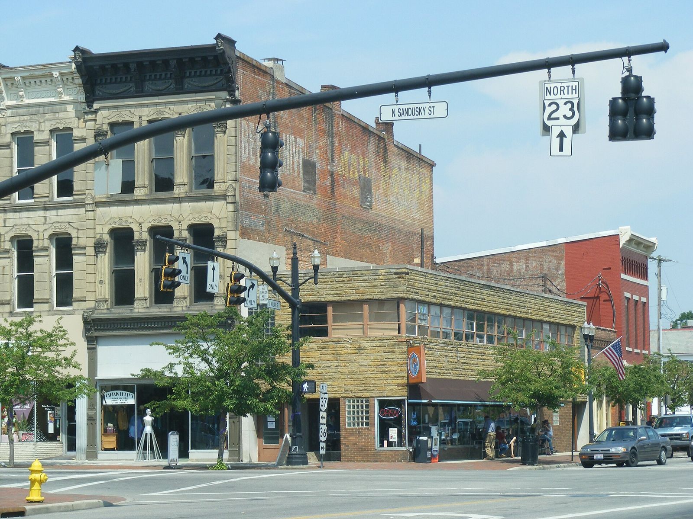

# JEGS: A Columbus Racer Who Got Tired of Waiting for the Mail

*Jeg Coughlin Sr., a West Coast parts habit, a shop on 11th Avenue, and a county resolution that put the story on the record*

!!! abstract "Article record"
    **Confidence:** Medium · **Source types:** Delaware County (Ohio) Commissioners resolution (Aug 12, 2010), company history pages (TeamJEGS "JEGS 101," the same text as the JEGS help center's "JEGS Story"), trade feature (Chevy Hardcore, 2015), see also [Midwest & East Threads](../places/midwest-east.md) · **Last verified:** 2026-10-20 (Round 18) · **Open issues:** When Jeg Sr. handed the business to his sons; headcount and warehouse-size figures that vary by year; the paywalled *Columbus Dispatch* anniversary story is unread · [How we rate this](../reference/source-standards.md)

!!! quote "In their own words"
    "He would show up at drag races and people would ask where he got his parts."

    — Ray Stagg, JEGS advertising since 1970, on Jeg Coughlin Sr.'s early racing, quoted in Chevy Hardcore, 2015.[^chc]

## The problem was the mailbox

In the late 1950s, JEGS' own history says, Jeg Coughlin Sr. "was consumed by the burgeoning hot rod culture," and to go faster he had to order parts from "some faraway place, usually located on the West Coast, and then suffering through an agonizing wait to get them in the mail." Being in the Midwest, "there simply weren't any other options, so Coughlin played the mail-order game and, bit by bit, began dominating everyone at the local drag strip with his newly-acquired parts."[^hc] People noticed, and he realized there was a demand that wasn't being met.

It is a neat origin story and the company tells it that way. What the independent record adds is who he was on the strip. Chevy Hardcore says he "drove a blown Chevy-powered 1955 two-door that won him his first national event in 1959," later raced Top Fuel, Top Alcohol, Funny Car, Pro Stock, Pro Comp and Super Eliminator, and won four NHRA North Central Division championships (Pro Comp in 1976, AA/Fuel Dragster in 1977 to 1979). Stagg, who has handled the advertising since 1970, remembers Jeg "would modify his '55 Chevy and an Austin gasser."[^chc] The Austin gasser is on the wiki already: see [The Ohio Gassers](../places/ohio-gassers.md), whose Columbus row lists "Jeg Coughlin (JEGS; blown Hemi Austin A/GS)" alongside Gil Kirk's Rod Shop team.

## 751 East Eleventh Avenue

The best-sourced date in the whole JEGS timeline comes from a local government. On August 12, 2010, the Delaware County Board of Commissioners adopted Resolution 10-1059, "recognizing Jeg's High Performance Automotive Parts for fifty years of business." Its first "Whereas": "in 1960, Jeg Coughlin, Sr., founded Jeg's Automotive, Inc., at **751 East Eleventh Avenue, Columbus, Ohio**." Then, in order:[^res]

- 1989: "the premier issue of Jegs Mail Order Catalog is printed";
- 1996: "Jegs goes on-line with jegs.com";
- 1999: JEGS "opened a state-of-the-art distribution and headquarters at 1 Jegs Place in Delaware, Ohio";
- 2003: the Coughlin family established the JEGS Foundation, "Racing for Cancer Research";
- 2004: "Jegs Mail Order ships over one million packages to customers";
- 2006: "Sameday Shipping for orders placed before 9:00 PM" debuts, and, "in recognition of Jeg's National Hot Rod Association leadership and racing on home turf," during the Spring Nationals in Kirkersville that May, "Delaware Mayor Windell Wheeler proclaimed Jegs Week throughout the city of Delaware";
- 2010: "currently, JEGS generates over $200 million in annual revenue."

The company's own history (TeamJEGS, the same text as its help center) says Coughlin "opened JEGS Speed Shop in 1960 on 11th Avenue in downtown Columbus," with "two employees and a big dream" (Jeg Jr.), and that the small shop on 11th Avenue "is still serving customers" and makes a line of suspension parts.[^hc] JEGS' "About Us" page, as quoted on [Midwest & East Threads](../places/midwest-east.md), describes the first shop as 4,000 square feet, "half garage, half parts store."

<figure markdown>
{ loading=lazy }
<figcaption markdown>North Sandusky Street at the U.S. 23 corner in downtown Delaware, Ohio, the city where, per the county resolution, JEGS opened its headquarters in 1999. The photo shows the town, not the company's buildings. Creator: Ben Turover. Date: 2010-06-04. Source: [Wikimedia Commons](https://commons.wikimedia.org/wiki/File:SanduskyStDelawareOhio.JPG). License: [CC BY-SA 3.0](https://creativecommons.org/licenses/by-sa/3.0/).</figcaption>
</figure>

## From walk-in shop to catalog

Stagg's account of the shop is of a place that was not a catalog at all: "We started with a retail store, sold wholesale, and operated a chassis/engine shop." Mail order was an afterthought until it wasn't: "When desktop publishing became popular, JEGS purchased a computer, printer, and page-making program to create the JEGS catalog," and the first issue (1989) printed 34,000 copies.[^chc] A toll-free 800 number came in 1991, a full-color catalog in 1992, around-the-clock ordering in 1994, and one-to-two-day nationwide delivery in 1995, per the same article. The name sold what the shop sold: Chevy Hardcore lists "K&N, B&M, Moroso, Mickey Thompson, and MSD" as the top brands, and notes drag racer Gordon Collett worked in the JEGS machine shop, "helping Jeg build engines as well as customer loyalty."[^chc] (See [Moroso](moroso.md) and [Mickey Thompson](mickey-thompson.md).)

Jeg Sr.'s own recollection ⚠: "I ran the thing for 27 years and then sold it to them," his four sons, John, Troy, Mike and Jeg Jr., who "increased annual sales from about $20 million-a-year to a several hundred million-a-year."[^hc] Twenty-seven years from 1960 puts the handoff in 1987, the same help-center page says the company "thrived for nearly 30 years" before the sale, and JEGS' "About Us" page (via our Midwest page) says the early 1990s. No document we can read gives a closing date.

**⚠ From the detective's notebook: the numbers that move.** The company history (written for the 60th anniversary, 2020) says "more than 400 associates" and an "85,000 square-foot facility" that "eventually gave way to" a headquarters of "more than 225,000 square feet."[^hc] Chevy Hardcore (2015) says "about 350 associates" and "250,000-square-foot warehouse."[^chc] These are five-year-apart snapshots from company-fed pieces; treat them as order-of-magnitude figures. The county's $200 million in 2010 is the one number a body with no sales interest wrote down, and even that is "currently" in a *whereas*.

The story behind the founder's retail instincts comes from Stagg: "Jeg Sr.'s dad was an executive at a large retail store in Columbus, Ohio, that ended up being bought by Macy's. Their philosophy was to provide ultimate customer service."[^chc]

## Connect the dots

- [Midwest & East Threads](../places/midwest-east.md): the original JEGS section, including the paywalled *Columbus Dispatch* 50th-anniversary article we have not read.
- [The Ohio Gassers](../places/ohio-gassers.md): Coughlin's Austin A/GS and the Columbus teams around him.
- [Moroso](moroso.md) and [Mickey Thompson](mickey-thompson.md): two of the brands JEGS built its catalog on, both founder-racer companies too.
- [Holley](holley.md): the other road a speed-parts name can take, ending up as the parent of other garage-born brands; JEGS's own history says its founder sold to his sons.

[^res]: Delaware County (Ohio) Board of Commissioners, Resolution No. 10-1059, "Recognizing Jeg's High Performance Automotive Parts for Fifty Years of Business," Commissioners Journal No. 54, Aug 12, 2010. https://co.delaware.oh.us/wp-content/uploads/commissioners/journal/2010/08_12_10.pdf (accessed 2026-10-20)
[^hc]: "JEGS 101" (the "JEGS Story," written for the 60th anniversary, 2020), TeamJEGS. https://teamjegs.com/jegs-101/ (accessed 2026-10-20). The same text is on the JEGS help center, "How did JEGS get started?" https://helpcenter.jegs.com/hc/en-us/articles/360053580694-How-did-JEGS-get-started (read 2026-10-18; behind a bot check on 2026-10-20)
[^chc]: "Observing The History Of The JEGS Product Catalog," Chevy Hardcore, June 6, 2015. https://www.chevyhardcore.com/features/observing-the-history-of-the-jegs-product-catalog/ (accessed 2026-10-20)
