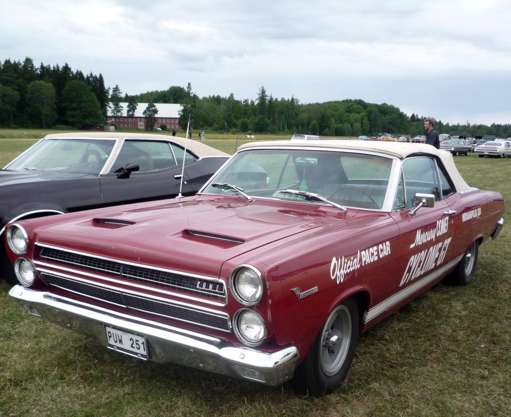

# Logghe Stamping: Fraser's Flip-Top Chassis Shop

!!! abstract "Article record"
    **Confidence:** Medium · **Source types:** MMSHOF bio, Garlits Museum HOF, enthusiast press · **Last verified:** 2026-10-14 (Round 9) · **Open issues:** Company founding year 1946 vs 1947 · [How we rate this](../reference/source-standards.md)

!!! quote "In their own words"
    "I said, 'What the hell is this?' It was a dragster with a body on it and the driver in the back seat..."

    — Eddie Schartman on his first Logghe flip-top Comet, Dec 1965 (NHRA.com, 2016). [Context](../people/eddie-schartman.md)

Gene Logghe was burned in the brothers' own dragster at **Ubly Dragway** on a **187 mph** run in **1962**. Their father then forbade them to drive diggers.[^mms][^gar]

They kept building them. The **Logghe Stamping Company** of Fraser, Michigan, turned a Big Three bracketry shop into the chassis house that defined early Funny Cars. Brothers **Ron** and **Gene Logghe** built the first series of tube-frame, coil-over, one-piece flip-top cars for Lincoln-Mercury in 1966. Customers included [Eddie Schartman](../people/eddie-schartman.md), Dyno Don Nicholson, Jack Chrisman, Connie Kalitta, Gene Snow, [Al Bergler](../people/al-bergler.md), and many others.[^mms][^gar]

## Morris Logghe's shop

It began as their father's business. Morris Logghe, a Belgian immigrant, founded Logghe Stamping as an automotive bracketry company serving Detroit's Big Three.<a href="#q-1" title="Sources disagree: see Open questions">⚠</a>

Ron and Gene began working for their father in **1955** (Gene about 17, Ron about 15).[^mms] They first tried sports-car racing, then attended the drag races at the long-defunct strip in **New Baltimore, Mich., in 1958**, where they met local racer Connie Kalitta.[^mms][^gar]

## From Kalitta rails to Competition Products

That meeting led to their first chassis. In **1961** Kalitta asked them to build a dragster chassis, their first customer chassis. Success brought more orders; they added clutch cans, steering parts, and axles.[^gar]

Soon they had cars of their own on the strip. Partnership with employees **Jim Marsh** and **Roy Steffey** produced the injected Chevy digger nicknamed **"the Giant Killer."** MMSHOF: in **1964** it became the first non-supercharged car into the sevens.<a href="#q-2" title="Single source so far: see Open questions">◐</a>[^mms]

In **1965** Maynard Rupp drove their blown Chrysler **"the Prussian"** (tuned by Steffey) to what Garlits Museum calls the first NHRA points championship for that team.<a href="#q-3" title="Single source so far: see Open questions">◐</a>[^gar]

The race-car side became a business of its own. They formed a **Competition Products** division for race cars and parts. Garlits Museum: the shop later turned out **over 600** race cars (Funny Cars, diggers, Pro Stocks, Altereds, Bonneville cars, even go-karts).<a href="#q-4" title="Single source so far: see Open questions">◐</a>[^gar] *Car Craft* named Logghe Funny Car Chassis Builder of the Year **1967–70**.<a href="#q-5" title="Single source so far: see Open questions">◐</a>[^gar]

## The 1966 flip-top Comets

Then the factory called. Lincoln-Mercury's **Al Turner** (with [Fran Hernandez](../people/fran-hernandez.md) in the factory program) asked for cars that could beat Chrysler's altered-wheelbase match racers. The Logghes delivered a **chromoly tube chassis**, **ladder-bar** rear, **four-corner coil-overs**, and a **one-piece flip-top** fiberglass body, first for Nicholson and Schartman on normally aspirated **427 SOHC** engines, then a blown SOHC car for Chrisman.[^mms][^gar][^hr]

Ron Logghe told MMSHOF they "literally introduced the coil-over design to the racing industry."<a href="#q-6" title="Single source so far: see Open questions">◐</a> [Al Bergler](../people/al-bergler.md) did the aluminum tinwork on Logghe cars.[^mms]

Schartman won NHRA's first Funny Car eliminator at the **1966 World Finals** in Tulsa in a Logghe Comet.[^nhra]

Demand outran the shop. Wikipedia (citing secondary histories) notes other builders (Don Hardy, Ronnie Scrima, Dick Fletcher) joined the chassis trade as Logghe could not fill every order.<a href="#q-7" title="Single source so far: see Open questions">◐</a>

## Later

It did not last. Racing chassis work at Logghe Stamping was **discontinued in 1975**.[^mms] The stamping company itself closed in **2013**.[^gar]

Ron Logghe died **May 27, 2020**; Gene died **August 2021** (MMSHOF).[^mms][^gar]<a href="#q-8" title="Sources disagree: see Open questions">⚠</a>

The honors came later: inducted MMSHOF **2010**; Garlits Museum / IDRHOF class of **2021**; NHRA Hot Rod Reunion honorees **2006**.[^mms][^gar]

*See also:* [Eddie Schartman](../people/eddie-schartman.md), [Fran Hernandez](../people/fran-hernandez.md), [Al Bergler](../people/al-bergler.md), [Detroit Dragway & Cordova](../drag-racing/detroit-cordova.md), [Malcolm Durham](../people/malcolm-durham.md) (later Logghe Camaro), [Gene Snow](../people/gene-snow.md) (Logghe-chassis Charger *Rambunctious*, 118-in. wheelbase, per *Hot Rod* June 1969).

## Open questions & disputed details

*From the detective's notebook: where the sources disagree, where we have only one, and what we are still looking for. Each item links back to its place in the story.*

**Disputed.** **The founding year.** The Michigan Motor Sports Hall of Fame says **1947** in Fraser; Hot Rod's family feature says **1946**, starting in a home garage before moving to a Fraser plant.[^mms][^hr] <a class="hr-q-back" href="#qr-1" title="Back to the story">↩</a>

**Single source so far:** Partnership with employees **Jim Marsh** and **Roy Steffey** produced the injected Chevy digger nicknamed **"the Giant Killer."** MMSHOF: in **1964** it became the first non-supercharged car into the sevens. <a class="hr-q-back" href="#qr-2" title="Back to the story">↩</a>

**Single source so far:** In **1965** Maynard Rupp drove their blown Chrysler **"the Prussian"** (tuned by Steffey) to what Garlits Museum calls the first NHRA points championship for that team. <a class="hr-q-back" href="#qr-3" title="Back to the story">↩</a>

**Single source so far:** Garlits Museum: the shop later turned out **over 600** race cars (Funny Cars, diggers, Pro Stocks, Altereds, Bonneville cars, even go-karts). <a class="hr-q-back" href="#qr-4" title="Back to the story">↩</a>

**Single source so far:** *Car Craft* named Logghe Funny Car Chassis Builder of the Year **1967–70**. <a class="hr-q-back" href="#qr-5" title="Back to the story">↩</a>

**Single source so far.** *A strong claim; treat as self-attribution.*[^mms] <a class="hr-q-back" href="#qr-6" title="Back to the story">↩</a>

**Single source so far.** *Verify against period ads before treating as settled.*[^wp] <a class="hr-q-back" href="#qr-7" title="Back to the story">↩</a>

**Disputed.** Garlits Museum bio still said Gene "resides in Michigan" at the time of that page's text; the MMSHOF update is the stronger death record. <a class="hr-q-back" href="#qr-8" title="Back to the story">↩</a>

## Images

<figure markdown>
{ loading=lazy }
<figcaption markdown>A modern Top Fuel display engine based on the Ford 427 SOHC. The first Logghe flip-top Comets ran injected (then blown) SOHC 427s—this is a later blown example, not a 1966 race engine. Creator: Auge=mit. Date: 2025-06-22. Source: [Wikimedia Commons](https://commons.wikimedia.org/wiki/File:Top_Fuel_Engine_Ford_427_SOHC_Display_noBG.jpg). License: [CC BY-SA 4.0](https://creativecommons.org/licenses/by-sa/4.0).</figcaption>
</figure>

<figure markdown>
{ loading=lazy }
<figcaption markdown>A stock 1966 Mercury Comet Indy 500 pace car. Logghe's first flip-tops used fiberglass Comet-style bodies for Lincoln-Mercury—not this production car. Creator: MGSpiller. Source: [Wikimedia Commons](https://commons.wikimedia.org/wiki/File:Mercury_Comet_1966_Indy_500_pace_car.jpg). License: [CC BY-SA 2.0](https://creativecommons.org/licenses/by-sa/2.0).</figcaption>
</figure>

<figure markdown>
{ loading=lazy }
<figcaption markdown>The 1985 Detroit Autorama. Michigan Hot Rod Association's show was the off-season place where Detroit builders and Logghe customers often debuted cars (see [Al Bergler](../people/al-bergler.md)). Creator: Joetregembo. Date: 2023-02-03. Source: [Wikimedia Commons](https://commons.wikimedia.org/wiki/File:1985_Detroit_Autorama.jpg). License: [CC BY-SA 4.0](https://creativecommons.org/licenses/by-sa/4.0).</figcaption>
</figure>

## Visual references (external)

*These are copyrighted or rights-restricted images, so we link to them instead of copying them.*

- [Hot Rod, "How the Logghe Family Changed the Face of the Funny Car Class"](https://www.hotrod.com/features/logghe-family-changed-face-funny-car-class-drag-racing)
- [MMSHOF Logghe Brothers inductee page](https://www.mmshof.org/index.php/inductees/inductees/251-logghe-brothers)

[^mms]: Michigan Motor Sports Hall of Fame, "Logghe Brothers" (2010). https://www.mmshof.org/index.php/inductees/inductees/251-logghe-brothers
[^gar]: Don Garlits Museum of Drag Racing, "Ron & Gene Logghe" (Hall of Fame). https://garlits.com/hall-of-fame/ron-gene-logghe/
[^hr]: Hot Rod, "How the Logghe Family Changed the Face of the Funny Car Class in Drag Racing." https://www.hotrod.com/features/logghe-family-changed-face-funny-car-class-drag-racing
[^nhra]: Phil Burgess, "'Fast Eddie' Schartman," NHRA.com, Feb 12, 2016. https://www.nhra.com/news/2016/fast-eddie-schartman
[^wp]: Wikipedia, "Logghe Stamping Company" (secondary synthesis; verify before relying on detail). https://en.wikipedia.org/wiki/Logghe_Stamping_Company
