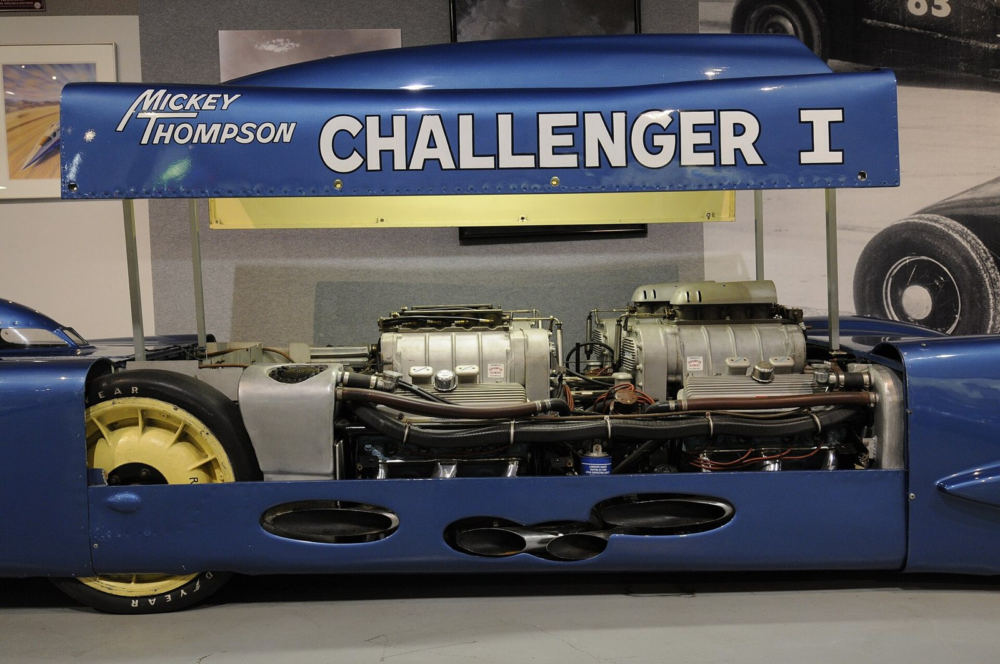

# Mickey Thompson: The Pressman Who Dug the Post Holes Himself

*From a Los Angeles Times pressroom to the Lions strip, the slick, the slingshot and a mail-order wheel in Ohio*

!!! abstract "Article record"
    **Confidence:** Medium · **Source types:** *Hot Rod* profile (Dec 1978; Thompson in his own words), NHRA *National Dragster* editor's photo feature (2013, quoting a 2013-era biography), SEMA Hall of Fame (1984), Wikipedia (secondary), a RACER company history that names Thompson's wheels · **Last verified:** 2026-10-16 (Round 15) · **Open issues:** ⚠ who deserves credit for the slingshot dragster and when it debuted; ⚠ the Brighton 1963 story; ◐ nearly every "first" below is Thompson's own claim; the Mickey Thompson tire and wheel brand's later ownership was not traced; no Alhambra or El Monte local-paper coverage found yet · [How we rate this](../reference/source-standards.md)

!!! quote "In their own words"
    "I didn't have the money to buy what few hop-up pieces there were then, so I had to build my own boxed rods, grind my own cam, and fabricate my own quick-change rearend ... When you don't have any money, you learn to do it yourself."

    — Mickey Thompson, in *Hot Rod* (Dec 1978), on growing up in El Monte, California.[^hr78]

"I dug the post holes by hand, scrounged up the pipe I used for the fence posts, nailed together the timing tower, and sold pit passes," Mickey Thompson told *Hot Rod* in 1978, remembering the drag strip he built after his shift at the *Los Angeles Times*. "I was really excited when 10,000 people showed up for opening day."[^hr78]

The man who became one of the best-known names in the aftermarket started out as a pressman with a garage and no money.

## El Monte, Alhambra and the garage

Wikipedia says Marion Lee Thompson was born December 7, 1928, in Alhambra, California, where his father, Captain Marion L. Thompson, was a police officer. Thompson himself told *Hot Rod* he was "growing up in El Monte," where "my dad was a cop, and you know what cops thought about hot rods 35 years ago."[^wp][^hr78] In his early 20s he worked as a *Los Angeles Times* pressman while pursuing hot rodding, per Wikipedia and his own 1978 account: "I was a pressman at the Los Angeles Times, had my own garage, and constructed a drag strip in my spare time."[^wp][^hr78]

Without parts he could afford, he built everything: a hot A-bone roadster, a twin-flathead '32 Bantam coupe, and then, for Bonneville, a coupe with a $40 Chrysler Hemi and a $10 4-71 blower. "I was probably the first guy around that put together a blown Chrysler hemi," he said.[^hr78]<a href="#q-1" title="Single source so far: see Open questions">◐</a>

## The slingshot, and a Santa Ana name

Thompson is "widely credited," NHRA's *National Dragster* editor wrote in 2013, with the slingshot dragster design on his 1954 car, "although there's some fuzziness on the issue." NHRA quotes Thompson's explanation of the layout and then adds that "a Santa Ana hot rodder, LeRoy Neumayer, said it reminded him of a slingshot, and the name not only stuck, but the design was quickly adapted by everyone else."[^nhra] That Santa Ana tie is the one that pulls Thompson into this wiki's [Santa Ana Drags](../eras/1950s-santa-ana-drags.md) story, the strip where Hart ran the show until 1959 and later, in 1965, succeeded Thompson at Lions.<a href="#q-2" title="Sources disagree: see Open questions">⚠</a>

**Lions.** Thompson says he "built and ran Lions Drag Strip for eight years."[^hr78] Wikipedia calls him the strip's first manager, in 1955.[^wp] The same strip is where, *Hot Rod* writes, Don Garlits "lost a portion of his foot from an exploding 2-speed transmission," which "ended the popularity of Thompson's famed slingshots."[^hr78] Explosions of drivetrain parts are the hazard that [Lakewood's steel bellhousing](lakewood-industries.md) was marketed against, though SEMA describes flywheel-and-clutch failures, not a transmission case.

## The tire, the wheel and the testing

In 1963, per SEMA and Wikipedia, he launched **Mickey Thompson Performance Tires**. SEMA lists among his innovations "S/S Cheater Slicks and raised white letter tires," and he told *Hot Rod* he "built some of the first, if not the first set of drag slicks out of recapped '47 Indy tires" and "used the first super-wide, low-profile tires."[^sema][^wp][^hr78]<a href="#q-3" title="Single source so far: see Open questions">◐</a>

Wikipedia adds that he "went into the performance aftermarket business in the early 1960s." Don Prudhomme, quoted by NHRA from a biography, said Thompson "was the first guy I ever heard who would take his cars to the dragstrip during the week to test. None of us could afford to test, so when Mickey showed up on the weekend, his cars were ready to kick ass."[^nhra] That is a racer's view of what a parts maker with a test fleet could do.

His name also reached Ohio. RACER's company history says that, three years after Summit Racing opened its first Akron store in 1969, Summit tested mail order "by placing small ads for Mickey Thompson ET wheels in *Hot Rod* and *Car Craft* magazines."[^racer] See [Summit Racing](summit-racing.md).

## The Pontiac years

In July 1961, NHRA says, Thompson "trailered these four Pontiac-powered cars" to Southern California's March Air Force Base and broke eight FIA international records and six of 10 American national records. At the 1962 Nationals, NHRA says, Jack Chrisman drove his 432-cubic-inch aluminum Pontiac-powered Dragmaster to an 8.76, 171.75-mph win over Don Garlits in the Top Eliminator final.[^nhra] In 1978 Thompson called his biggest drag racing thrill "entering 10 Pontiac-powered cars back in '62 and winning all 10 classes they competed in."[^hr78]<a href="#q-4" title="Single source so far: see Open questions">◐</a>

And a grassroots footprint appears in the wiki's [Houston Freeway Dragstrip page](../drag-racing/houston-freeway-dragstrip.md): in 1961, strip owner Carl Gay booked Hayden Proffitt and his "Mickey Thompson–owned, 421-powered aluminum Pontiac Catalina" at the Houston strip, and within a year the Gay brothers were racing Catalinas of their own. That page's source is an NHRA.com feature on the Gay brothers, not the 1978 profile.

<figure markdown>
{ loading=lazy }
<figcaption markdown>Challenger I, Thompson's 1960 Bonneville record car, at the Wally Parks NHRA Motorsports Museum (2008). Creator: Wally Parks NHRA Motorsports Museum. Date: 2008-07-07. Source: [Wikimedia Commons](https://commons.wikimedia.org/wiki/File:Mickey_Thompson_Challenger_I_(2967316249).jpg). License: [CC BY-SA 2.0](https://creativecommons.org/licenses/by-sa/2.0).</figcaption>
</figure>

## Friends and a mix-up

*Hot Rod* opens its 1978 profile by calling Thompson and Ed Iskenderian "close personal friends" who "happen to be the ultimate parts magnates." [^hr78] See [Ed Iskenderian](../people/ed-iskenderian.md). Elsewhere, a Brighton, England, speed-trial story is told twice: Wikipedia has Thompson and Dante Duce demonstrating Thompson's Harvey Aluminum Special dragster there in 1963, while *THE SHOP* has Dean Moon sending his own dragster and a sports car with Duce.<a href="#q-5" title="Sources disagree: see Open questions">⚠</a>

## Late career and an ending

After the Indianapolis years and the Ford-backed Mustang Funny Cars of the late 1960s, Thompson founded the off-road sanctioning body SCORE; "Hell, the best part of the show was out there in the desert," he said.[^hr78] SEMA says he later formed SCORE International and the Mickey Thompson Entertainment Group.[^sema] Thompson and his wife Trudy were murdered at their Bradbury, California, home on March 16, 1988, in a case SEMA says went unsolved until 2007.[^sema][^wp]

## Connect the dots

- [Santa Ana Drags](../eras/1950s-santa-ana-drags.md): where a local hot rodder named the slingshot, and where Hart later succeeded Thompson at Lions.
- [Great Bend and the SRCA](../drag-racing/great-bend-srca.md): the 1955 Nationals where Wikipedia says the Panorama City Special debuted.
- [Houston Freeway Dragstrip](../drag-racing/houston-freeway-dragstrip.md): Proffitt's Mickey Thompson-owned Pontiac Catalina.
- [Moon Equipment](moon-equipment.md): the Brighton mix-up and the California shops of the era.
- [Ed Iskenderian](../people/ed-iskenderian.md): the friend *Hot Rod* paired with Thompson as a parts magnate.
- [Summit Racing](summit-racing.md): the Akron company whose first mail-order ads were for his wheels.
- [Lakewood Industries](lakewood-industries.md): the Ohio bellhousing maker, another response to drivetrain explosions at the strips.
- [Moroso](moroso.md): another racer-turned-parts-maker who ended up owning a track.

## Open questions & disputed details

*From the detective's notebook: where the sources disagree, where we have only one, and what we are still looking for. Each item links back to its place in the story.*

**Single source so far.** A boast, not a documented first. <a class="hr-q-back" href="#qr-1" title="Back to the story">↩</a>

**Disputed.** Thompson's 1978 account says he "built the first slingshot-style dragster" and, of that '54 car, that "we turned over 150 with Brown's Chrysler at San Fernando, which wasn't too bad for 1955." Wikipedia says the Panorama City Special debuted at the first NHRA U.S. Nationals at Great Bend, Kansas, in 1955, citing a Thom Taylor *Hot Rod* piece we did not see.[^hr78][^wp] See [Great Bend and the SRCA](../drag-racing/great-bend-srca.md). ◐ We found no Great Bend entry list naming the car. <a class="hr-q-back" href="#qr-2" title="Back to the story">↩</a>

**Single source so far.** Again, his own claims. <a class="hr-q-back" href="#qr-3" title="Back to the story">↩</a>

**Single source so far.** That one is his recollection. <a class="hr-q-back" href="#qr-4" title="Back to the story">↩</a>

**Disputed.** See [Moon Equipment](moon-equipment.md); the sources do not reconcile.[^wp] <a class="hr-q-back" href="#qr-5" title="Back to the story">↩</a>

[^hr78]: Gray Baskerville, "Mickey Thompson: The Speed King's Unstoppable Legacy," *Hot Rod*, Dec 1978 (online Feb 2, 2024). https://www.hotrod.com/features/speed-king-mickey-thompson-december-1978-982-1390-78-1 (accessed 2026-10-16)
[^nhra]: Phil Burgess, "The Thompson Files," NHRA, Mar 1, 2013 (quoting Erik Arneson's *Mickey Thompson: The Fast Life and Tragic Death of a Racing Legend*). https://www.nhra.com/news/2013/thompson-files (accessed 2026-10-16)
[^sema]: "HOF - Mickey Thompson," SEMA Hall of Fame, 1984. https://www.sema.org/hof/1984/mickey-thompson (accessed 2026-10-16)
[^racer]: "IHRA: Summit Racing Equipment the definition of invested series partner," RACER, Aug 9, 2016. https://racer.com/2016/08/09/ihra-summit-racing-equipment-the-definition-of-invested-series-partner (accessed 2026-10-16)
[^wp]: Wikipedia, "Mickey Thompson" (secondary). https://en.wikipedia.org/wiki/Mickey_Thompson (accessed 2026-10-16)
