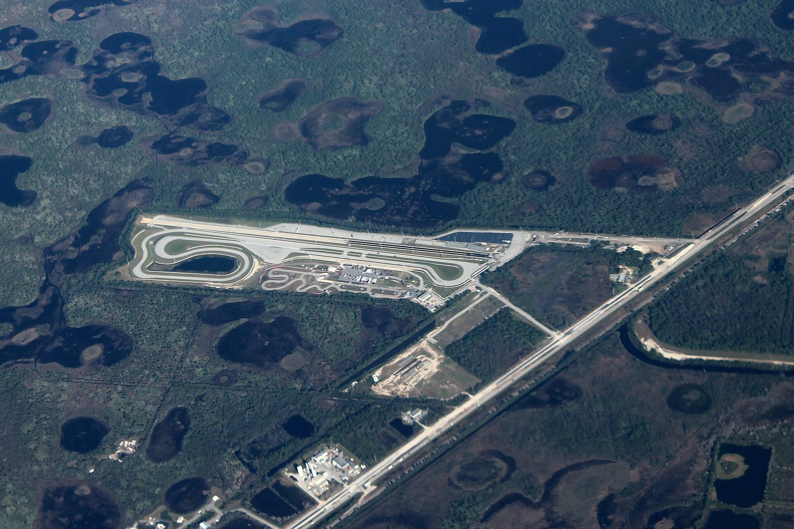

# Moroso: A Basement in Greenwich and a Dragstrip He Bought on a Whim

*A Connecticut racer who sold racers what they needed, then bought the track they needed*

!!! abstract "Article record"
    **Confidence:** Medium · **Source types:** *Hot Rod* feature (Nov 1983), wire obituary (CBS Sportsline, 1998), company history page, Wikipedia (secondary, citing a 1990 *Chicago Tribune* profile and a 2003 book we did not see) · **Last verified:** 2026-10-22 (Round 21) · **Open issues:** ⚠ what the basement made; ⚠ the year of the track purchase and how much he spent; ◐ innovation "firsts" rest on the company's own page; the Hemmings profile and the company's "Where It All Started" PDF were unreadable here; no Connecticut local paper found yet · [How we rate this](../reference/source-standards.md)

!!! quote "In their own words"
    "I bought and rebuilt the track as an investment in the future of racing. I sell race parts."

    — Dick Moroso, in *Hot Rod* (Nov 1983), on why a parts maker spent a fortune on a dragstrip.[^hr83]

Ask Dick Moroso in 1983 why he had bought a falling-down dragstrip in Florida and, *Hot Rod* wrote, "he will look distracted, avert his eyes, and mutter something about 'brain fade' and 'Florida sun.'"[^hr83] Then he would give the real answer: "We have too many industrial parks and not enough racetracks."[^hr83]

The rest of the story begins in a basement in Connecticut.

## Greenwich

Richard D. Moroso grew up in Old Greenwich, Connecticut, per Wikipedia (born in New Rochelle, New York, in 1939). CBS's 1998 obituary says he "began racing cars while still in his teens" and, "by the time he was in his early 20s," was "designing car engines in his parents' basement in Greenwich, Conn."[^cbs][^wp] Wikipedia says that in the early 1960s he was *selling speed parts* out of the family basement under the name **Speed Associates**, and that in the mid-1960s he and partner Hank Dietrich opened Performance Automotive in Stamford.[^wp]<a href="#q-1" title="Sources disagree: see Open questions">⚠</a>

He raced as he built. CBS says he won his class at the 1966 Labor Day U.S. Nationals in Indianapolis; Wikipedia gives it as D/Modified Production, in a 1961 Corvette, at 13.32 seconds and 103.21 mph, citing Larry Davis's 2003 *Gasser Wars*.[^cbs][^wp]<a href="#q-2" title="Single source so far: see Open questions">◐</a>

A wire report from that meet, printed in a Marin County, Calif., daily, shows he went further than his class, to the Street Eliminator final, where he lost to a Memphis racer who would also put his name on parts: "Joe Lunati of Memphis, Tenn., captured the Street Eliminator in a dash against Richard Moroso, Old Greenwich, Conn." Lunati ran 10.244 seconds to Moroso's 13.61.[^ij660906] See [Joe Lunati](../people/joe-lunati.md), whose cam shop opened in 1968 or 1969, depending on the account; the Moroso company dates itself to 1968.

The company's own history says "Moroso was started in 1968 by Dick Moroso, one of the most successful modified production drag racers on record," who "left his racing career to design, test and manufacture specialized products aimed exclusively at racer's needs." Its slogan: "designed and built for racers - by a racer!" CBS says he stopped competing in 1971 to concentrate on Moroso Performance Products in Guilford, Connecticut.[^co][^cbs]

## What the company says it invented

The company credits Dick Moroso with "many innovations": it says he was "instrumental in nurturing the warehouse distribution (WD) network" that supplied "the growing number of speed shops appearing in every corner of the country," and that he pioneered "deep-sump oil pans, electric water pumps, tall valve covers, lightweight front drag tires, racing vacuum pumps, and others."[^co]<a href="#q-3" title="Single source so far: see Open questions">◐</a>

At its 30th anniversary, the company says, he "lost a year-long battle with cancer" in November 1998; his son Rick became president in 1997. CBS says Dick died at 59 in a hospice in Branford, Connecticut, and that *Hot Rod* had named him one of the 100 most influential people in drag racing.[^co][^cbs] The company still makes oil pans, ignition wire and more in Guilford, with the chassis brand Competition Engineering.[^co]

## The track he bought

CBS says that in 1982 he "bought the neglected Palm Beach International Raceway on a whim and turned it into Moroso Motorsports Park."[^cbs] *Hot Rod* says "January '82" and "nearly half a million dollars" in rehabilitation, and notes that the previous owner already planned to turn the land into an industrial park. Moroso signed a contract promising to keep it a raceway for at least 10 years and said, "It's my intention to keep it a racetrack forever."[^hr83]<a href="#q-4" title="Sources disagree: see Open questions">⚠</a>

What the magazine saw is grassroots drag racing at its most routine. The track ran "every Wednesday and Saturday night" with "150-200 cars," where before "it was operating once a month for a small, local crowd." On a Wednesday night in the summer "more than 100 racers showed up towing everything from doorslammers to fuel bikes to a full-on nitro Funny Car," and Wednesdays were "strictly for testing and grudge racing." The photos name local racers: Tom Wright of "Boca Baton" [sic] with an '68 El Camino running 8.68 at 157; Doug Bryant, who "does dry hops in his 11-second Hornet"; Paul Smith, whose "Entertainer" Funny Car used the park as its home track; and Jack Woltemar's "Daytona replica." The track also hosted SCCA national and regional meets, a 650-car Bracket Championship, a December "Citrus Nationals" for fuelers, and NHRA Division 2's season opener.[^hr83]

One local detail made it work: across the highway stood a large **Pratt & Whitney** jet-engine plant whose 4-mile "noise zone" included the raceway, "so the track does not have to worry about decibel counts and has no curfew on night racing."[^hr83]

<figure markdown>
{ loading=lazy }
<figcaption markdown>Aerial view of Palm Beach International Raceway (2016), the site Moroso bought and renamed in the early 1980s. Creator: formulanone. Date: 2016-02-12. Source: [Wikimedia Commons](https://commons.wikimedia.org/wiki/File:Palm_Beach_International_Raceway.jpg). License: [CC BY-SA 2.0](https://creativecommons.org/licenses/by-sa/2.0).</figcaption>
</figure>

## South Florida neighbors

[The Ohio Gassers](../places/ohio-gassers.md) page has a Cleveland gasser racer, Ron Hassel, who ran a '48 Thames in South Florida; Jim Hill's photo of it comes from Palm Beach International Raceway, the track Moroso later bought. Hassel's employer, [Crane Cams](crane-cams.md), was a South Florida performance company in the same corner of the state. [Midwest & East](../places/midwest-east.md) is the wiki's regional page for the Northeast and Midwest scenes Moroso sold into. The 1953 "Safety Second" item in [Indiana's small-town clubs](../drag-racing/indiana-small-town-clubs.md) concerns a different Connecticut town, Manchester, a decade before Moroso's start and with no documented tie to him; it shows what Connecticut teenage car clubs looked like in his youth. And [Mickey Thompson](mickey-thompson.md) was another racer-turned-manufacturer-turned-track-promoter.

*See also:* [The Web of Influence](web-of-influence.md).

## Open questions & disputed details

*From the detective's notebook: where the sources disagree, where we have only one, and what we are still looking for. Each item links back to its place in the story.*

**Disputed.** Designing engines or selling parts is a real difference; Wikipedia's account cites a 1990 *Chicago Tribune* profile we have not read. <a class="hr-q-back" href="#qr-1" title="Back to the story">↩</a>

**Single source so far.** The numbers are from the book, which we did not see. <a class="hr-q-back" href="#qr-2" title="Back to the story">↩</a>

**Single source so far.** These are the firm's own claims and we have not checked them against patents, magazine tests or catalogs. <a class="hr-q-back" href="#qr-3" title="Back to the story">↩</a>

**Disputed.** Wikipedia says he bought it in **1981** and spent **$100,000** to ready it for the 1983 SCCA Trans Am opener.[^wp] We trust the 1983 magazine, written within a year of the purchase, over the later summary, but note the gap. <a class="hr-q-back" href="#qr-4" title="Back to the story">↩</a>

[^hr83]: "Property Value: Manufacturer Dick Moroso Buys a 'Fixer-Upper' Raceway and Invests in Drag Racing's Future," *Hot Rod*, Nov 1983 (online Jan 1, 2023). https://www.hotrod.com/features/property-value-november-1983-982-1220-72-1 (accessed 2026-10-16)
[^cbs]: "Drag-Racing Giant Moroso Dies," CBS SportsLine / CBSNews.com, Nov 10, 1998. https://www.cbsnews.com/news/drag-racing-giant-moroso-dies/ (accessed 2026-10-16)
[^co]: "About Moroso," Moroso Performance Products (company site). https://www.moroso.com/about-moroso (accessed 2026-10-16)
[^wp]: Wikipedia, "Dick Moroso" (secondary). https://en.wikipedia.org/wiki/Dick_Moroso (accessed 2026-10-16)
[^ij660906]: AP report from the NHRA national championships, Indianapolis, *Daily Independent Journal* (San Rafael, Calif.), Sept. 6, 1966. Page OCR. https://archive.org/details/san-rafael-daily-independent-journal-1966-09-06 (accessed 2026-10-22)
