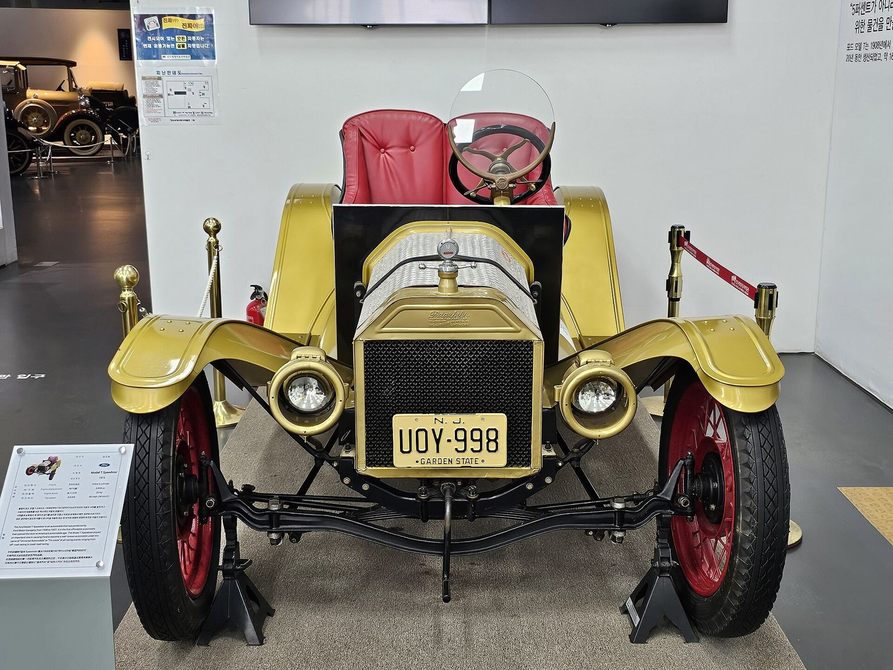
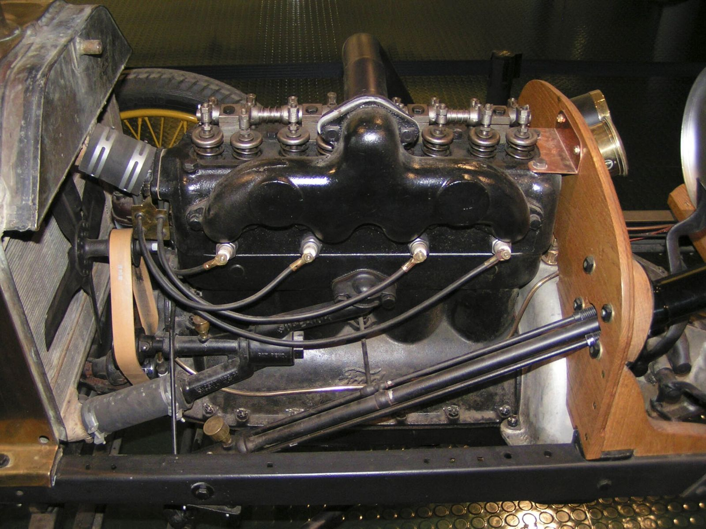

# Before Everyone Got into the Act

*The prewar speed shops: Bell, Lee's, Orr, and Jim White*

!!! abstract "Article record"
    **Confidence:** Low–Medium · **Source types:** secondary, oral · **Last verified:** 2026-10-12 (Round 1) · **Open issues:** Wight/Wright spelling open · [How we rate this](../reference/source-standards.md)

Dean Batchelor wrote in *The American Hot Rod*: "First there was George Wight, then Lee Chapel, then Karl Orr, and then everyone got into the act."[^hem] Hemmings' Daniel Strohl adds a fourth name Batchelor left out.

## George Wight and the junkyard (Bell Auto Parts, 1923)

George Wight started a junkyard in Bell, California in **1923**, noticed many incoming Model Ts carried speed equipment, and resold it cleaned up. The building at **3633 Gage Ave.** came in 1928.[^hem] (The Jalopy Journal spells his name "Wright";[^jj] Batchelor and Hemmings use **Wight**.)

Per the Jalopy Journal, hot rodders brought back reports on parts they ran, and Wight kept notes on what worked. When **Cragar** (Harlan Fengler and Crane Gartz's company, which had taken over the Miller-Schofield/Goossen "Valve-in-Head" Model A head) failed in 1932, Wight bought the heads, patterns and tooling after six months of negotiation. He got the price under $100 by 1933 and introduced an "Improved Cragar Head" in 1935.[^jj]<a href="#q-1" title="Single source so far: see Open questions">◐</a>

Wight died in 1943. His widow ran the shop until **Roy Richter** bought it in 1945. Richter built it into an early mail-order speed shop and sold it to Chuck Strader in 1978; Strader ran it in Huntington Beach until 1987.[^hem][^jj]

## Lee Chapel, c. 1929

A c.1950 catalog posted on the H.A.M.B. claims 21 years in business for Lee's Speed Shop, which implies **1929**.<a href="#q-2" title="Single source so far: see Open questions">◐</a> Lee's was at 3263 San Fernando Rd., LA (sharing a junkyard), moved in 1933 to 4557 Alhambra Ave., closed in 1937 while Chapel toured with a midget, and reopened in 1939 at 1143 E. 14th St., **Oakland**.[^hem]

## Karl and Veda Orr, 1940

The Orr Speed Shop opened in 1940 at **11140 Washington Place, Culver City**. It closed sometime in the 1950s and reopened in the 1960s on Sierra Highway in Mint Canyon.[^hem] See [Veda Orr](../people/veda-orr.md). Veda Orr also photographed for *California Timing News* (Feb 1947 photos of the Summers Merc).[^k]

## Jim White, 1932

Based on Roger Harrell's book: Jim White's Speed Shop opened in 1932 near San Pedro & 99th in South Central LA, moved mid-1933 to 11006 S. Main, then in 1940 to 10924 S. Main, run with brother Nick Harrell until **1976**.[^hem]<a href="#q-3" title="Single source so far: see Open questions">◐</a>

## Open questions & disputed details

*From the detective's notebook: where the sources disagree, where we have only one, and what we are still looking for. Each item links back to its place in the story.*

**Single source so far:** He got the price under $100 by 1933 and introduced an "Improved Cragar Head" in 1935. <a class="hr-q-back" href="#qr-1" title="Back to the story">↩</a>

**Single source so far.** *This is an inference from a catalog.* <a class="hr-q-back" href="#qr-2" title="Back to the story">↩</a>

**Single source so far:** Main, run with brother Nick Harrell until **1976**. <a class="hr-q-back" href="#qr-3" title="Back to the story">↩</a>

## Images

<figure markdown>
{ loading=lazy }
<figcaption markdown>A 1915 Ford Model T Speedster at the Gyeongju World Automobile Museum. It shows the stripped Model T type whose speed parts fed Bell Auto Parts' early trade. It is not linked to any shop named here. Creator: Damian B Oh. Date: 2025-08-31 09:53:23. Source: [Wikimedia Commons](https://commons.wikimedia.org/wiki/File:1915_Ford_Model_T_Speedster_(1).jpg). License: [CC BY-SA 4.0](https://creativecommons.org/licenses/by-sa/4.0).</figcaption>
</figure>

<figure markdown>
{ loading=lazy }
<figcaption markdown>A Model T racing engine with an overhead-valve conversion. The uploader notes it "has overhead valves, whereas the standard T engine had side-mounted valves." **The maker of the head is not identified.** Creator: dave_7 from Lethbridge, Canada. Date: 2008-05-20 14:47. Source: [Wikimedia Commons](https://commons.wikimedia.org/wiki/File:Ford_Model_T_racer_engine_(2534461425).jpg). License: [CC BY-SA 2.0](https://creativecommons.org/licenses/by-sa/2.0).</figcaption>
</figure>

[^hem]: Daniel Strohl, "Lost Speed Shops: Bell, Chapel, Orr," Hemmings, Nov 23, 2009. https://www.hemmings.com/stories/lost-speed-shops-bell-chapel-orr/
[^jj]: Ryan, "The History Of Bell Auto," The Jalopy Journal, May 12, 2010. https://www.jalopyjournal.com/?p=8704
[^k]: Kustomrama, "Jimmy Summers." https://kustomrama.com/wiki/Jimmy_Summers
