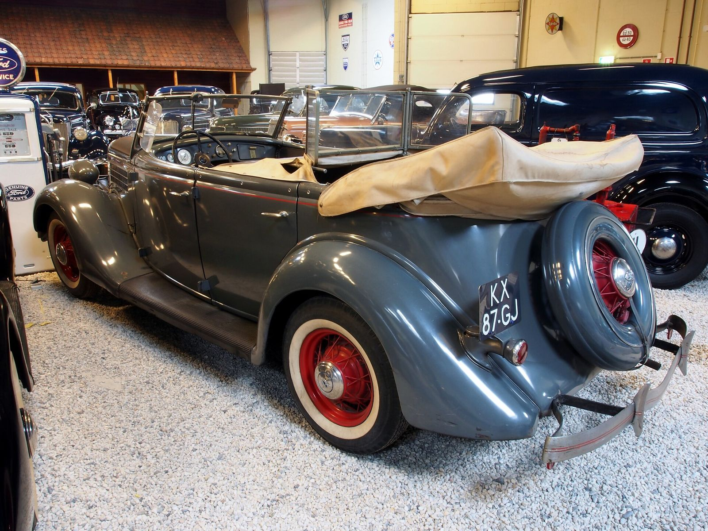

# The Plating Shop with the Rolling Billboards

*Southern California Plating Co. and Leonard K. DeBell*

!!! abstract "Article record"
    **Confidence:** Medium · **Source types:** secondary (census-based), oral (Doty via Ganahl) · **Last verified:** 2026-10-13 (Round 4) · **Open issues:** RJ #36 not read first-hand · [How we rate this](../reference/source-standards.md)

Leonard DeBell promoted his shop with customized delivery trucks: whitewalls, wheel discs, V-windshields and [DuVall](../people/george-duvall.md)-designed grilles and bumpers.[^cb][^kr]

## The owner and the shop

The man behind the trucks had a long paper trail. Leonard K. DeBell was born April 23, 1904, in Louisville, Colorado, to Italian-born parents (father Stefano Zarlengo), and died January 24, 1992, in Los Angeles. The 1930 census lists him as "salesman, nickel-plating" and the 1940 census as "proprietor, electro-plating."[^cb] The census implies the name change from Zarlengo but does not explain it.

The shop was at 4444 Sunset Blvd., later 3434 San Fernando Rd., Los Angeles.[^cb] Much of its work was building and plating grilles and accessories for midget racers.[^cb]

## The 1935 Ford phaeton delivery

One of the trucks was a 1935 Ford phaeton, and Coachbuilt gives detailed credits: a lift-up rear hatch by Chad Schultz of Joe Newell's body shop; a brass Cord-style grille by Frank Kurtis; a padded top by George Thomas (Ivar & Cahuenga); sea-foam green paint by Charles Remidi; a 1936 Cadillac front bumper, and Wood-Lites behind chrome openings.[^cb] Period photos ran in *Motor Life*, May 1955.[^cb]

## The parts business

The shop also made parts. **Pacific Metal Products** (also 4444 Sunset) took over the manufacturing division and sold DuVall's postwar rocker-arm OHV conversion for 1933–47 Willys fours, rated at 80 hp.[^cb]<a href="#q-1" title="Sources disagree: see Open questions">⚠</a>

Its front end on the 1931 Ford pickup has been credited with inspiring the 1933–34 Terraplane grille.[^cb]<a href="#q-2" title="Single source so far: see Open questions">◐</a>

## The car that vanished

The phaeton itself is gone. Julian Doty told Pat Ganahl he last saw the phaeton around 1963–64, dusty in a body shop DeBell owned on Melrose one block east of Vermont. He tried to buy it from DeBell's son Tony and failed. "The car has not been seen since."[^cb]

## Open questions & disputed details

*From the detective's notebook: where the sources disagree, where we have only one, and what we are still looking for. Each item links back to its place in the story.*

**Disputed.** Kustomrama says Doty bought the Jeep head patterns from So. Cal. Plating in 1946.[^kr] <a class="hr-q-back" href="#qr-1" title="Back to the story">↩</a>

**Single source so far.** The Terraplane-grille credit is repeated by both sources without a primary citation.[^cb] <a class="hr-q-back" href="#qr-2" title="Back to the story">↩</a>

**Not yet read:** Pat Ganahl's feature on this car, "The Mystery Wagon," *The Rodder's Journal* No. 36, has not been checked first-hand. The Doty quote comes through Coachbuilt. A copy of RJ #36 is a priority request (see [Research Trail](../research-trail.md)).

## Images

<figure markdown>
{ loading=lazy }
<figcaption markdown>A stock 1935 Ford 750 Phaeton at the Den Hartogh Ford Museum. It shows the body type of So. Cal. Plating's lost promotional phaeton. **It is not that car**, which had a '36 front end and a custom grille and is missing. Creator: Alf van Beem. Date: 2013-03-02 13:32:26. Source: [Wikimedia Commons](https://commons.wikimedia.org/wiki/File:1935_Ford_750_Phaeton_pic1.JPG). License: [CC0](https://creativecommons.org/publicdomain/zero/1.0/deed.en).</figcaption>
</figure>

## Visual references (external)

*These are copyrighted or rights-restricted images, so we link to them instead of copying them.*

- [Coachbuilt.com DuVall/DeBell page: period photos of the So. Cal. Plating trucks and phaeton](http://www.coachbuilt.com/des/d/duvall/duvall.htm)

[^cb]: Coachbuilt.com, "George DuVall (1913–1999)." http://www.coachbuilt.com/des/d/duvall/duvall.htm (accessed 2026-10-13)
[^kr]: Kustomrama, "George DuVall." https://kustomrama.com/wiki/George_DuVall (accessed 2026-10-13)
