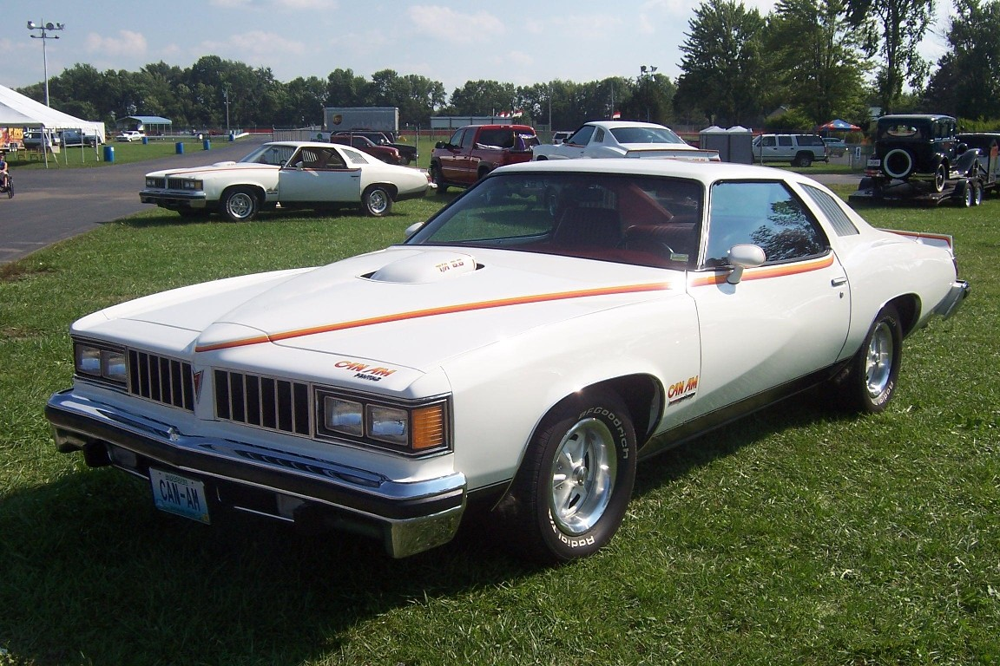

# Summit Racing: A Corvette, a Donut-Shop Basement and Two Little Ads

*How a Northeast Ohio drag-racing buddy discount became the World's Speed Shop*

!!! abstract "Article record"
    **Confidence:** Medium · **Source types:** trade press (RACER, 2016; Classic American, 2018), company jobs page, drag-racing museum Founders Award page (2026), Wikipedia (secondary) · **Last verified:** 2026-10-16 (Round 15) · **Open issues:** ⚠ first-store town and year; ⚠ date of the first catalog; ⚠ Wikipedia's "founded" city; the Akron *Beacon Journal*'s 2018 profile is paywalled (HTTP 402) and was not read; no local-paper coverage of the founder found yet · [How we rate this](../reference/source-standards.md)

!!! quote "In their own words"
    "When busheling corn, you always throw in two extra ears in case you miscounted."

    — Paul Sergi's father, as passed on by the Don Garlits Museum of Drag Racing's Founders Award write-up on Sergi (2026), about the farm lessons behind the company's customer service.[^garlits]

Summit Racing's first "store," Classic American says, was the basement of a donut shop in Stow, Ohio. "The coffee and pastries were nice, but the location didn't get a lot of traffic."[^ca]

It was 1968. A young engineer owned a 1967 Corvette roadster with the L71 427 and, per the company's own history, "made some connections to get hop-up parts at a discount," and "it wasn't long before his drag racing buddies found out and wanted the same deal."[^ca][^jobs] The Don Garlits Museum, which gave the founder, **Paul Sergi**, its Founders Award for the Class of 2025, fills in the farm boy behind it: a New Jersey family farm, car magazines at the local drugstore, college, and a new 1967 Corvette he still owns. When the 427 needed a special tool to adjust its valves, his closest speed shop "wasn't close enough to be convenient." He and its owner became friends, he began buying parts at distributor prices, and his racing buddies wanted in. The Corvette "became a delivery truck, and a spare bedroom became a warehouse."[^garlits]

RACER's version has the founder as "a drag racer who was frustrated by the lack of speed shops in the Northeast Ohio area."[^racer] The two accounts agree on the need and differ on the nuance: a shop too far away, or no shop at all.

## Two little ads

Advertising in the local newspaper came next, then a choice between his full-time job and the business. RACER says that by 1969 demand had grown enough for a first retail store in Akron, and that "three years later" Summit tested mail order "by placing small ads for Mickey Thompson ET wheels in *Hot Rod* and *Car Craft* magazines. Orders began rolling in from all over the country."[^racer] The wheels in those first ads were [Mickey Thompson](mickey-thompson.md)'s, from a company the Southern California drag racer had founded in 1963.

The catalog followed. RACER says Summit printed its own catalog and hired sales and customer-service representatives by 1976; Classic American counts "nearly 200 editions" of the "Big Book" since "the first one appeared in 1974," annual until 1987, when it went to six a year.[^racer][^ca] The 1987 move was to a four-building facility in Akron, and by 1992 it had a new three-story headquarters in Tallmadge. SummitRacing.com launched in 1997, a Sparks, Nevada, distribution center in 1998, and big retail stores in Tallmadge and McDonough, Georgia, followed.[^racer] The Garlits write-up says the company's first mail-order catalog was created as Sergi placed small ads in national magazines, and adds the **Handshake Guarantee**, the 24/7 order line and the website.[^garlits]<a href="#q-1" title="Sources disagree: see Open questions">⚠</a>

| Item | RACER (2016) | Classic American (2018) | Wikipedia |
|---|---|---|---|
| 1968 start | part-time venture, "Northeast Ohio" | first "store" in a donut-shop basement in **Stow**[^ca] | "started in 1968 in **Akron**" |
| 1969 | first retail store in **Akron**[^racer] | first true store, 1,500 sq ft and 20 feet wide, next to a Midas Muffler and a pizza shop in **Cuyahoga Falls**[^ca] | — |
| First catalog | own catalog by **1976**[^racer] | first Big Book **1974**[^ca] | — |

Wikipedia's text puts the start in Akron, while its infobox gives the founding place as Tallmadge, which is the headquarters town.[^wp] These are not necessarily contradictions: the store could have been on the Akron-Cuyahoga Falls line, and a "catalog" could mean a price sheet in 1974 and a printed book by 1976. We have not seen the early catalogs themselves.

## A Corvette that stayed

The 1967 Corvette was a company car long after it was a bargain hunter's delivery truck. The company says it served as "a faithful daily driver" and "performance test car" until it was put away for a rebuild "one day when there was time," and restored decades later by two long-time employees.[^jobs] Classic American says the restored L71 was punched out to 496 cubic inches with a COMP Cams hydraulic roller cam, Quick Fuel carburetors and Trick Flow heads, making about 590 horsepower.[^ca] That cam is the same COMP Cams whose [Memphis story](comp-cams-rhs.md) is next door in this department.

Summit also bought the naming rights to Norwalk Raceway Park in 2007, becoming Summit Racing Equipment Motorsports Park. The track hosted its first NHRA national event upon becoming sanctioned that same year.[^wp]

<figure markdown>
{ loading=lazy }
<figcaption markdown>Can-Am cars at Norwalk, Ohio, toward the end of the 2007 Pontiac Nationals (a 30th-anniversary Can-Am reunion), the track Summit later named. Creator: TropicDave. Date: 2007-12-23 19:38. Source: [Wikimedia Commons](https://commons.wikimedia.org/wiki/File:3_Can_Ams_at_Norwalk_30th_Anniv.JPG). License: [CC BY 3.0](https://creativecommons.org/licenses/by/3.0).</figcaption>
</figure>

## Connect the dots

- [Akron Fulton Airport strip](../drag-racing/akron-fulton-airport.md): the Akron runways where the Arfons brothers, Otie Smith and Arlen Vanke raced, a few years before Summit began in the same part of the state. The link is place, not documented contact.
- [Arlen Vanke](../people/arlen-vanke.md): an Akron racer who ordered a Pontiac Super Duty Catalina from a local dealer in 1961, the kind of customer Summit's early drag-racing buddies were.
- [The Ohio Gassers](../places/ohio-gassers.md): the same state's racers, including Columbus's Jeg Coughlin, listed in Hill's account with "JEGS"; a JEGS profile is on the Research Trail.
- [Mr. Gasket](mr-gasket.md): another Ohio parts business that began in a trunk and a basement, a few years earlier.
- [Mickey Thompson](mickey-thompson.md): the ET wheels of Summit's first mail-order ads.
- [COMP Cams and Racing Head Service](comp-cams-rhs.md): the cam brand in the restored Corvette.
- [Holley](holley.md): since 2015 the owner of the Mr. Gasket brand.

*See also:* [The Web of Influence](web-of-influence.md).

## Open questions & disputed details

*From the detective's notebook: where the sources disagree, where we have only one, and what we are still looking for. Each item links back to its place in the story.*

**Disputed.** **Where was the first store?** <a class="hr-q-back" href="#qr-1" title="Back to the story">↩</a>

## Images

Credited above and in [Image Credits](../reference/image-credits.md).

[^ca]: "Summit Racing Equipment: 50 Years of High Performance," Classic American, Sept 12, 2018. https://www.classic-american.com/summit-racing-equipment-50-years-of-high-performance/ (accessed 2026-10-16)
[^racer]: "IHRA: Summit Racing Equipment the definition of invested series partner," RACER, Aug 9, 2016. https://racer.com/2016/08/09/ihra-summit-racing-equipment-the-definition-of-invested-series-partner (accessed 2026-10-16). A 2017 RACER profile of the same company blocked our fetch.
[^garlits]: Xavier Vidot, "Paul Sergi," Don Garlits Museum of Drag Racing Hall of Fame (Class of 2025, Founders Award), Oct 5, 2026. https://garlits.com/hall-of-fame/paul-sergi/ (accessed 2026-10-16)
[^jobs]: "Life at SR: About the Company," Summit Racing careers page. https://jobs.summitracing.com/us/en/about-the-company (accessed 2026-10-16)
[^wp]: Wikipedia, "Summit Racing Equipment" (secondary). https://en.wikipedia.org/wiki/Summit_Racing_Equipment (accessed 2026-10-16)
