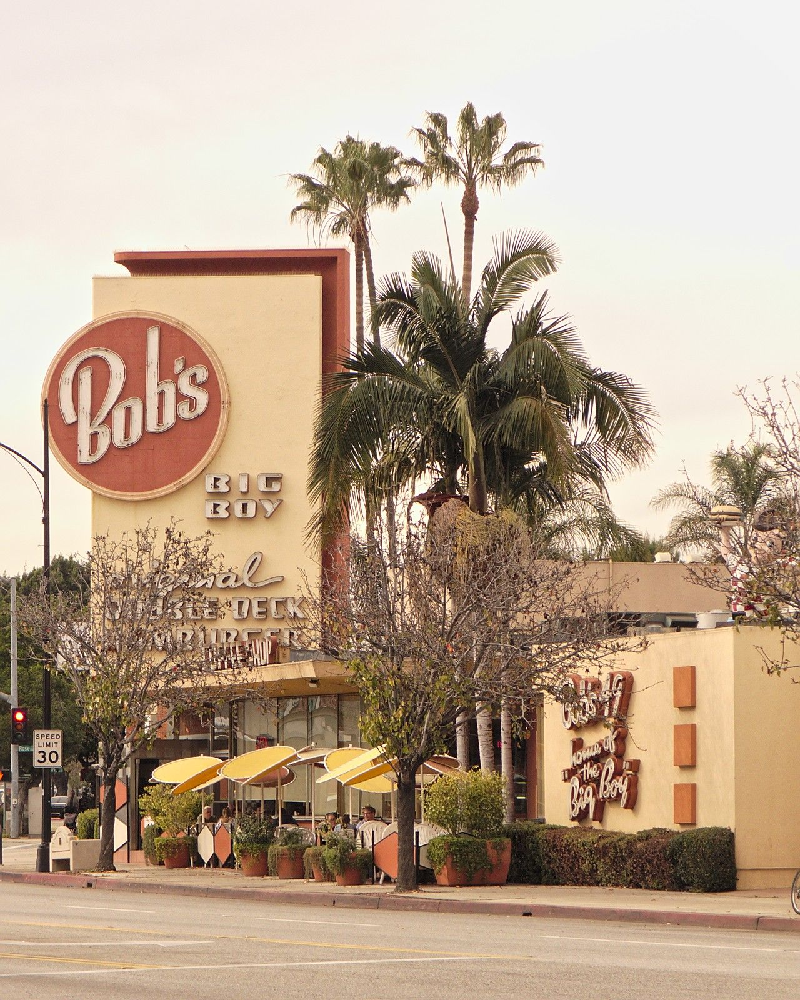

# Bob's Big Boy, Burbank & the "River Road" (1950s–60s)

!!! abstract "Article record"
    **Confidence:** Medium · **Source types:** Grassroots newspaper interviews (Burbank Leader/LA Times 2014; LA Times 2013), restaurant history page · **Last verified:** 2026-10-13 (Round 8) · **Open issues:** Told 55–60 years later · [How we rate this](../reference/source-standards.md)

**Location:** Bob's Big Boy, 4211 Riverside Dr, Burbank (Toluca Lake edge), and "the River Road," a lightly used road along the Los Angeles River. · **Peak:** 1950s to early 1960s. · **Revival:** a Friday-night classic car show at Bob's, still running.

## What happened
In the 1950s Burbank high schoolers met at the newly opened Bob's "to show off their jalopies," then settled challenges on the River Road. Some later raced in the river bed itself, which Life magazine photographed in 1957.[^bl]

## In their own words
> "At Bob's you'd choose somebody off and then head over to the River Road. … We'd race and get out of there in a hurry. … If somebody called the L.A. cops on us, we'd scoot back across the river to Burbank before they could catch us."
>
> — **Tommy Ivo**, 78, Burbank Leader (June 5, 2014).[^bl]

> "It wasn't a money deal. We didn't race for pink slips. It was a matter of pride. You'd race and go back to Bob's Big Boy."
>
> — **Tommy Ivo**, 2014.[^bl]

> "Police would come down to drink coffee and watch us. They figured at least we weren't on the streets. … He told us they were going to get coffee and doughnuts and come back in 20 minutes to raid us."
>
> — **Ted Sebern**, Road Knights club, retired Disney Imagineer, on racing in the river bottom, 2014.[^bl]

Sebern said he gave up racing after a Hoover High senior was killed in a '32 Ford "in the early '60s."[^bl]

## Ties
- **The Road Kings** (Burbank, founded 1952). The Leader says that in the 1960s "about 40 Road Kings were racing professionally," naming **Don Prudhomme**, Kenny Stafford, Tom Jandt, **Tony Nancy**, **Bob Muravez** and Ivo.[^bl] This is the clearest case in this section of a hangout that fed a generation of pro drag racers.
- The restaurant history page says Friday-night car shows and weekend carhop service were brought back during the restoration of the building.[^bob] An LA Times columnist (2013) quotes a regular: "I tell them I lived 'American Graffiti' right here."[^lat13]

## Images

<figure markdown>
{ loading=lazy }
<figcaption markdown>Bob's Big Boy, 4211 Riverside Drive, Burbank, Jan 2014. The uploader calls it the oldest remaining Bob's Big Boy. Creator: Junkyardsparkle. Date: 2014-01-21 12:55:33. Source: [Wikimedia Commons](https://commons.wikimedia.org/wiki/File:Bobs_big_boy_burbank_2014-01-21_1.jpg). License: [CC0](http://creativecommons.org/publicdomain/zero/1.0/deed.en).</figcaption>
</figure>

## Visual references (external)
*These images are copyrighted, so we link to them instead.*

- [Burbank Leader: Tommy Ivo with River Road photos](https://www.latimes.com/socal/burbank-leader/news/tn-blr-river-road-a-quick-route-to-memories-for-oldtime-burbank-drag-racers-20140605-story.html)

[^bl]: Burbank Leader (LA Times), "River Road a quick route to memories for old-time Burbank drag racers" (June 5, 2014). https://www.latimes.com/socal/burbank-leader/news/tn-blr-river-road-a-quick-route-to-memories-for-oldtime-burbank-drag-racers-20140605-story.html (accessed 2026-10-13)
[^bob]: Bob's Big Boy Burbank, "History." https://bobs.net/pages/history (accessed 2026-10-13)
[^lat13]: Chris Erskine, "Scoping classic cars at Bob's Big Boy in Burbank," LA Times (Aug 30, 2013). https://www.latimes.com/home/la-hm-erskine-20130831-column.html (accessed 2026-10-13)
