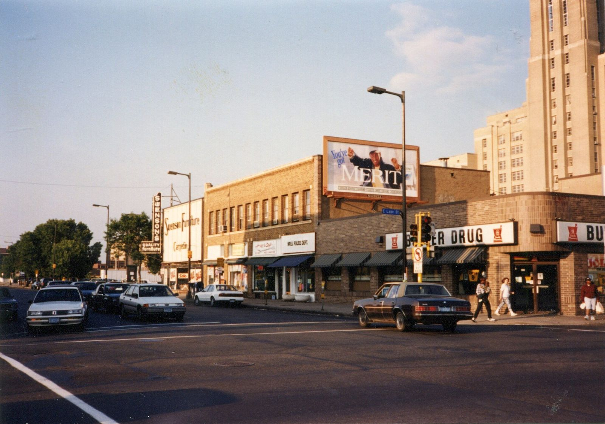

# Lake Street and University Avenue

*Cruising "the loop" in the Twin Cities, 1950s–1970s*

!!! abstract "Article record"
    **Confidence:** Medium · **Source types:** Grassroots timing association history (GSTA), H.A.M.B. thread posts by former cruisers · **Last verified:** 2026-10-13 (Round 8) · **Open issues:** Forum posters are anonymous · [How we rate this](../reference/source-standards.md)

**Location:** In Minneapolis, Lake Street from the **Flat Top** drive-in near the river to **Porky's** near Lake Calhoun, plus the Sun Drive-in on Central Ave. In St. Paul, **University Avenue** around Porky's.[^gsta] · **Peak:** 1950s to early 1970s. · **Later:** one poster wrote in 2009 that "they still cruise Uni."[^hamb]

## How cruising turned into racing

> "Unfortunately, this cruising activity often led to impromptu street races to see whose car was best, or fastest. The one-way streets that crossed Lake Street, Portland and Park, were the best because they were wide, with no oncoming traffic. Had to watch the cross streets carefully though."
>
> — **Gopher State Timing Association**, club history (undated; drawing on "The GSTA Story," 1957).[^gsta]

> "We cruised Lake Street a lot in the early 60's....never thought to take any pictures. I remember Porky's, the BigWheel, the Avalon theater, Sears, etc."
>
> — A **H.A.M.B. member** in the thread "Lake Street (Mpls, MN) in the 60s."[^hamb] *Anonymous forum recollection.*

> "They use to cruise Lake and Uni back then. It was called cruising the loop."
>
> — Another poster, same thread.[^hamb]

## Ties

**GSTA**, the Gopher State Timing Association: its own history ties street cruising to the clubs' effort to get racing off the streets, and its first car show, on September 16, 1956, was held in the Red Owl parking lot at Lake St. and 22nd Ave. So.[^gsta] It belongs to the same Upper Midwest network as the [MSRA and Back to the 50's](../regions/upper-midwest.md).

Porky's on University Avenue appears again in the MSRA's 1974 Back to the 50's cruise ([Upper Midwest](../regions/upper-midwest.md)).

## Images

<figure markdown>
{ loading=lazy }
<figcaption markdown>East Lake Street at Chicago Avenue, Minneapolis, about 1993. It shows the street, not the cruising era. Creator: Myotus. Date: 1993. Source: [Wikimedia Commons](https://commons.wikimedia.org/wiki/File:Butler_Drug_Store_800_E_Lake_Street_at_Chicago_Avenue,_Minneapolis,_Minnesota_Abt.1993.jpg). License: [CC BY-SA 4.0](https://creativecommons.org/licenses/by-sa/4.0).</figcaption>
</figure>

[^gsta]: Gopher State Timing Association, "GSTA History." https://www.gstarod-custom.com/gsta-history (accessed 2026-10-13)
[^hamb]: The H.A.M.B., "Lake Street (Mpls, MN) in the 60s." https://www.jalopyjournal.com/forum/threads/lake-street-mpls-mn-in-the-60s.341268/ (accessed 2026-10-13)
