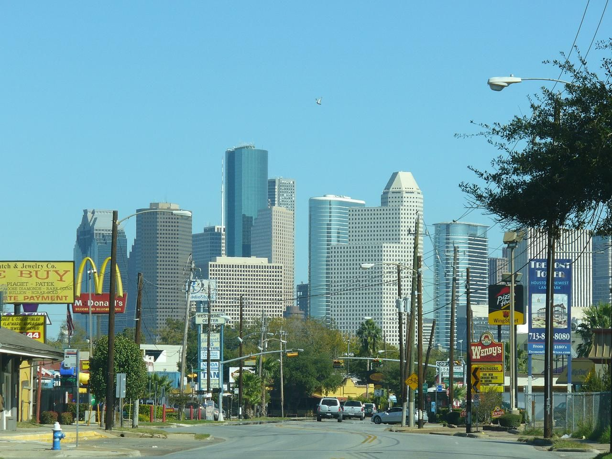

# Westheimer Road, Houston

*The teenage ritual of the late 1970s to 1986*

!!! abstract "Article record"
    **Confidence:** Medium · **Source types:** first-person newspaper column (John Nova Lomax, Houston Press, Aug 12, 2009) · **Last verified:** 2026-10-13 (Round 8) · **Open issues:** One source; the crackdown date is approximate ("about 1986") · [How we rate this](../reference/source-standards.md)

**Location:** Westheimer Rd. Cruisers drove east from west Houston through Montrose, turned around at Elgin and drove back out. · **Peak:** the 1980s, "Oil Bust Houston." · **Status:** a **regional repeat gathering**, with no documented builder or company links.

## In his words

> "For such a big city, '80s Houston was in some ways still a small town. Case in point: the teenage ritual of cruising Westheimer, in which the fourth largest city in America did its best to impersonate a one-Dairy Queen town, one where all you can do is drive down the strip and then turn back around."
>
> — **John Nova Lomax**, looking back on his years as a Strake Jesuit student, Houston Press (2009).[^hp]

Lomax describes suburban teenagers in "Blazers and Cutlasses" gawking at the Montrose street scene. He calls it "mostly harmless."[^hp]

## The end

> "In about 1986, the City decided enough was enough and cracked down on the pastime by setting up roadblocks and banning turning off of side-streets, and the whole phenomenon vanished in about a month."
>
> — **Lomax**, 2009.[^hp]

He says the scene then moved to the Richmond Strip, Shepherd Plaza, downtown, Midtown and Washington Avenue.[^hp]

## Images

<figure markdown>
{ loading=lazy }
<figcaption markdown>Downtown Houston seen from Westheimer Road in Neartown/Montrose, Nov 2006. Creator: iodine127. Date: 2006-11-19. Source: [Wikimedia Commons](https://commons.wikimedia.org/wiki/File:Houston_from_Westheimer.JPG). License: Public domain.</figcaption>
</figure>

[^hp]: John Nova Lomax, "Houston 101: Cruising Westheimer: The Favorite Teenage Pastime of Reagan-Era Houston," Houston Press (Aug 12, 2009). https://www.houstonpress.com/news/houston-101-cruising-westheimer-the-favorite-teenage-pastime-of-reagan-era-houston-6737202/ (accessed 2026-10-13)
