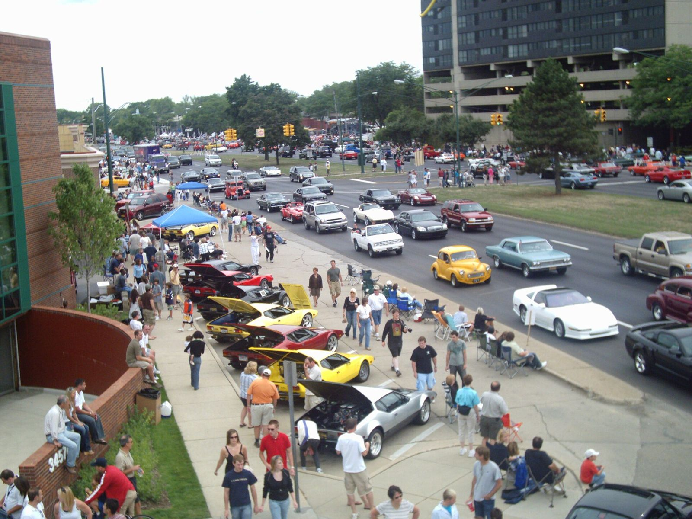
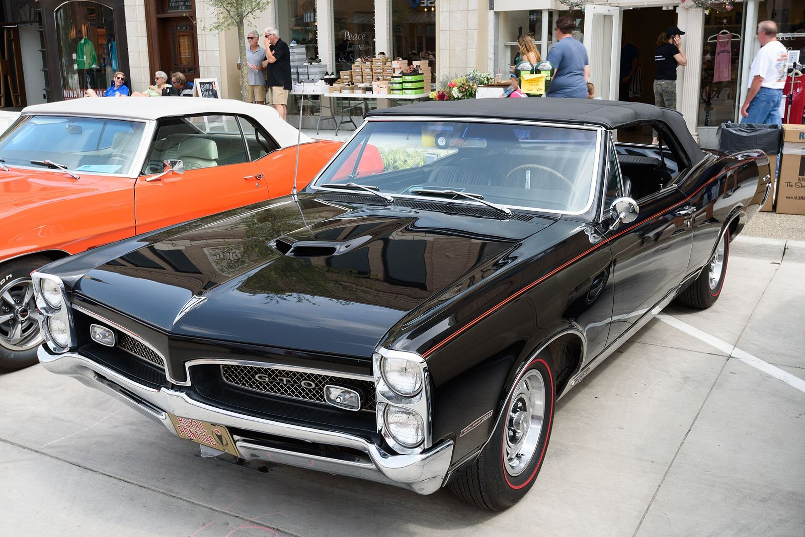

# Woodward Avenue, Detroit Suburbs (1950s–1970s)

!!! abstract "Article record"
    **Confidence:** High for setting; Medium for anecdotes · **Source types:** enthusiast press (Hagerty 2011, 2020; Hemmings 2018; Hot Rod 2014), newspaper (Oakland Press 2007) · **Last verified:** 2026-10-13 (Round 8) · **Open issues:** Factory-car stories are mostly from memory · [How we rate this](../reference/source-standards.md)

**Location:** Woodward Ave (M-1), north of Eight Mile Road, through Ferndale, Royal Oak, Birmingham and Bloomfield Hills, to Pontiac. · **Peak:** mid-1950s to about 1970. · **Revival:** the Woodward Dream Cruise, held every August since the 1990s.

## What happened
- **The loop.** Hagerty (2011) describes the loop as running "between Ferndale … and Pontiac." It started at Hedge's Wigwam and the Totem Pole near 10 Mile, where an intercom "Teletray" let you order from the car, and ended at **Ted's** drive-in at Square Lake Road (19 Mile). Hagerty says Ted's "was a favorite of General Motors' engineers" because it sat on the way to GM sites in Pontiac.[^hag] Along the way were Richards, Suzie-Q, the Bel-Aire, Big Town and Maverick's.[^hag][^hr]
- **Drive-in etiquette.** "You'd back in so you could keep an eye on the action − only parents and nerds pulled in grill first."[^hag]
- **Racing.** A writer for Hi-Performance Cars recalled for Hemmings (2018) that "we never street-raced south of Eight Mile Road … But north of Eight Mile … that's where the action was." He also said "little, if any money changed hands on Woodward" compared with the Connecting Highway in Queens.[^hem]

## Ties to people and companies
- **Royal Pontiac, Royal Oak (Ace Wilson).** Hemmings: "Pontiac definitely had more than one GTO set up for Woodward. They ran out of Royal Pontiac … and were often piloted by Jim Wangers himself," the Pontiac ad man who wanted to "keep in touch" with the street. Hemmings dates Wangers' Woodward-median GTO ad ("The Great One by Pontiac. You know the rest of the story.") to the December 1967 Motor Trend.[^hem]
- **Royal Bobcat** GTOs were tuned by Milt Schornack and others at Royal. The first Bobcat was a 1961 Catalina, and the program ended when Ace Wilson Sr. sold the dealership around 1970 (Hagerty 2020).[^hag2]
- **The "Silver Bullet" GTX.** The rumor was that it was a Mopar engineer's car. It belonged to **Jimmie Addison**, a gas station mechanic from Birmingham who got Hemi race parts through factory contacts (Hemmings).[^hem] ◐
- Clubs such as the **Ramchargers** and Drag-Ons came out of the same suburban scene (Hagerty).[^hag] See also [Detroit Dragway & Cordova](../regions/detroit-cordova.md).

## In their own words
> "Those were drag racing days. … We'd ride from The Totem Pole to Ted's and back again all day and night."
>
> — **Les Johnson**, 71, at the 2007 Dream Cruise, Oakland Press (Aug 19, 2007). *Told about 50 years later.*[^op]

> "You could drive up Woodward and start with two people in the car. By the time you got to Ted's Drive-In, there were six people in the car."
>
> — **Dick Krause**, same article.[^op]

> "The heavy hitters were at Dan's. We would stand around and wait all night for the big run to get set up. Usually, it never happened."
>
> — **Eric Schiffer**, Woodward street racer from 1967, Hagerty (2020).[^hag2]

## Policing
Johnson remembers **"Sheriff Irons"** in a big black Chrysler who would pull racers over and ask to look under their hoods ("I think it was," he hedges). Hagerty mentions "lot cops." Hot Rod (2014) says that by the late 1960s "laws were soon enacted that limited the cruising and long-term parking," which led to "demonstrations and a few arrests." It adds that rising muscle-car insurance ("more a month for insurance than their car payment") and then the OPEC oil crisis finished the era off. We have not identified the specific ordinances. ◐[^op][^hag][^hr]

## Images

<figure markdown>
{ loading=lazy }
<figcaption markdown>The 13th Woodward Dream Cruise, seen from a rooftop in Birmingham, Mich., Aug 2007. This is the revival, not the 1960s scene. Creator: Stephen K. Donnelly at en.wikipedia. Date: 2007-08-18. Source: [Wikimedia Commons](https://commons.wikimedia.org/wiki/File:2007_Dream_Cruise_photo.jpg). License: Public domain.</figcaption>
</figure>

<figure markdown>
{ loading=lazy }
<figcaption markdown>A 1967 Pontiac GTO Royal Bobcat convertible, a dealer-tuned package from Royal Pontiac of Royal Oak, photographed in Aug 2018 (Dream Cruise week, per the uploader's date). Creator: Mustang Joe. Date: Taken on 18 August 2018, 17:14. Source: [Wikimedia Commons](https://commons.wikimedia.org/wiki/File:1967_Pontiac_GTO_Royal_Bobcat_Convertible_(53777644236).jpg). License: [CC0](http://creativecommons.org/publicdomain/zero/1.0/deed.en).</figcaption>
</figure>

## Visual references (external)
*These images are copyrighted, so we link to them instead.*

- [Hagerty: "Cruising Woodward during the glory years" (period photos)](https://www.hagerty.com/media/archived/cruising-woodward-during-the-glory-years/)
- [Hot Rod: Woodward Avenue cruise history](https://www.hotrod.com/news/detroits-woodward-avenue-cruise-history)

[^hag]: Hagerty, "Cruising Woodward during the glory years" (July 27, 2011). https://www.hagerty.com/media/archived/cruising-woodward-during-the-glory-years/ (accessed 2026-10-13)
[^hag2]: Hagerty, "Back in the '60s, dealers bulked up factory muscle to create street-racing monsters" (Mar 25, 2020). https://www.hagerty.com/media/magazine-features/dealers-bulked-up-factory-muscle-to-create-street-racing-monsters/ (accessed 2026-10-13)
[^hem]: Hemmings Contributor, "Street Racing Woodward" (Sept 24, 2018). https://www.hemmings.com/stories/street-racing-woodward/ (accessed 2026-10-13)
[^hr]: Hot Rod, "Detroit's Woodward Avenue cruise history" (June 27, 2014). https://www.hotrod.com/news/detroits-woodward-avenue-cruise-history (accessed 2026-10-13)
[^op]: Oakland Press, "Cruisers gather, reminisce about Woodward's past" (Aug 19, 2007). https://www.theoaklandpress.com/2007/08/19/cruisers-gather-reminisce-about-woodwards-past/ (accessed 2026-10-13)
