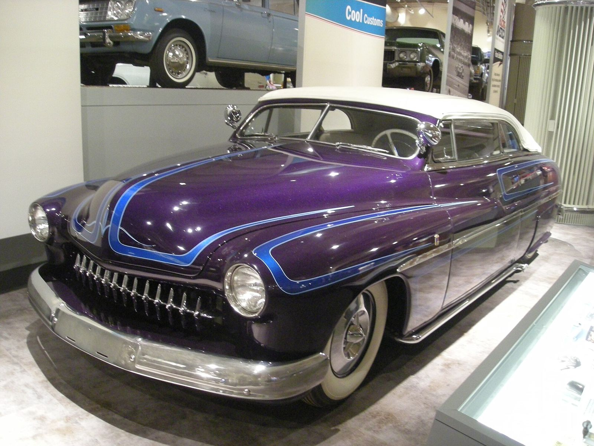
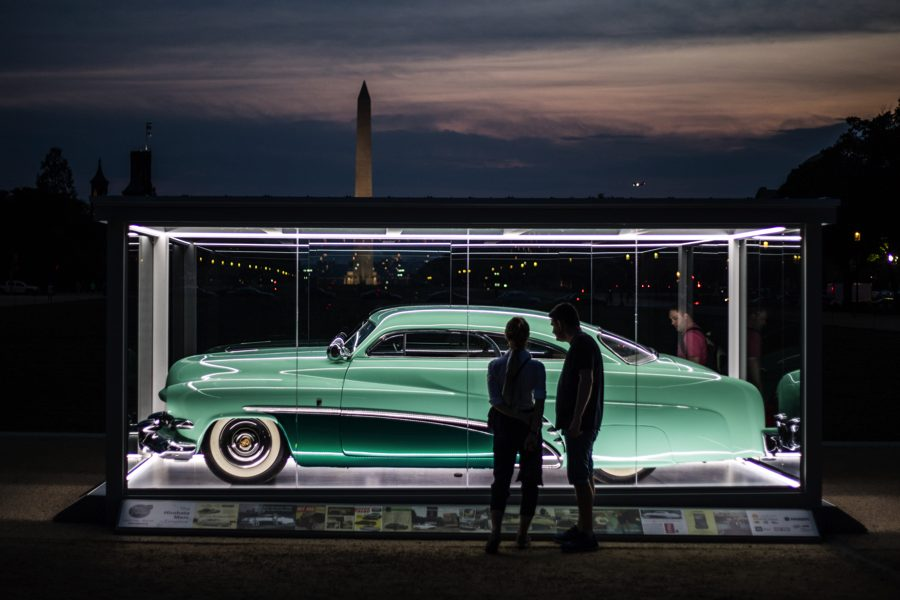

# Lead Sleds Come Back, by Way of Wichita

*KKOA and the revival, 1979–83*

!!! abstract "Article record"
    **Confidence:** Medium · **Source types:** Grassroots club history, period magazine (Hot Rod 1981, 1983) · **Last verified:** 2026-10-13 (Round 6) · **Open issues:** First-show count conflicts (300+ vs 400) · [How we rate this](../reference/source-standards.md)

!!! quote "In their own words"
    "It's like family at KKOA."

    — Jerry Titus, KKOA history page. [Full context in Voices](../voices/show-custom-voices.md)

The Kustom Kemps of America started with 14 charter members, whose low membership numbers were "drawn from a '52 Caddie hubcap."[^kk]

## Wichita, October 1, 1980

The KKOA's own history calls itself "a spin-off of the mystic '79 Merc/Deuce ReUnion." It began on **Oct 1, 1980**, in Wichita. Jerry Titus has led it from the start.[^kk]

It explains "kemp" as late-'50s teen slang for a car that gained national exposure through Edd "Kookie" Byrnes on *77 Sunset Strip* and through "the little 25-cent Rod and Custom magazines."[^kk]

## The first Lead Sled Spectacular (1981)

**⚠ Turnout:** "Four hundred customs, some old, some new, cruised in from all over the country" (Hot Rod, Dec 1981).[^hr81] "Over 300" (KKOA) and "300-plus" (Hot Rod, May 1983).[^kk][^hr83]

**Street Rodder** (editor Geoff Carter) and Tex Smith attended. The KKOA calls Street Rodder's national coverage "highly unusual those days for a street rodding mag."[^kk]

The 1981 Hot Rod piece framed the revival as a response to the energy crisis: "If we can't bring back 29-cent gas and 110 octane from the 50s, let's bring back the ultimate cruisemobile... built for comfort, not for speed." It singles out Eldon Titus of Wichita's '49 Buick, with a molded grille and '55 Chevy headlights in candy red.[^hr81]

In 1982 at the Des Moines fairgrounds, turnout roughly doubled. Hot Rod noted a **'62-or-earlier** cutoff and regretted that it kept later cars out. Its slogan: "If it don't go... dechrome it."[^hr83]

## Why it matters

The revival was born in **Kansas and Iowa**, not Southern California. It was nostalgia-driven and self-consciously low-buck ("easy, fun, and relatively inexpensive," Hot Rod 1983). It brought back the KKOA's founding generation of builders (Starbird, Barris, Bailon, Winfield, the Alexander Brothers) as guests of honor.[^kk][^hr83]

Compare the NSRA's [1948-and-older line](../street-rodding/nsra-early-nationals.md). Both groups drew a calendar boundary around what counts.

## Images

<figure markdown>
{ loading=lazy }
<figcaption markdown>A 1949 Mercury custom at the Henry Ford Museum (2012). The '49–'51 Mercury is the archetypal "lead sled." The builder and date are not identified in the file. Creator: Michael Barera. Date: 2012-08-24. Source: [Wikimedia Commons](https://commons.wikimedia.org/wiki/File:Henry_Ford_Museum_August_2012_85_(1949_Mercury_custom).jpg). License: [CC BY-SA 4.0](https://creativecommons.org/licenses/by-sa/4.0).</figcaption>
</figure>

<figure markdown>
{ loading=lazy }
<figcaption markdown>The Hirohata Merc (1951 Mercury, Barris), the template the 1980s revival looked back to. See [Hirohata Mercury](../cars/hirohata-mercury.md). Creator: Historic Vehicle Association (HVA). Date: 2017. Source: [Wikimedia Commons](https://commons.wikimedia.org/wiki/File:1951_Mercury_Sport_Coupe_Hirohata_Merc_(HAER_CA-2328).png). License: [CC BY-SA 4.0](https://creativecommons.org/licenses/by-sa/4.0).</figcaption>
</figure>

## Visual references (external)
*These images are copyrighted, so we link to them instead.*

- [Hot Rod, "Lead Sleds" (Dec 1981)](https://www.hotrod.com/features/lead-sleds-december-1981-982-1180-39-1)
- [H.A.M.B.: Jerry Titus audio interview thread](https://www.jalopyjournal.com/forum/threads/jerry-titus-talks-about-how-the-kkoa-began.1070767/)

[^kk]: Kustom Kemps of America, "History." https://www.kustomkempsofamerica.com/history.htm
[^hr81]: Hot Rod, "Lead Sleds," December 1981. https://www.hotrod.com/features/lead-sleds-december-1981-982-1180-39-1
[^hr83]: Hot Rod, "Tough Sledding," May 1983. https://www.hotrod.com/features/tough-sledding-may-1983-982-1178-84-1
