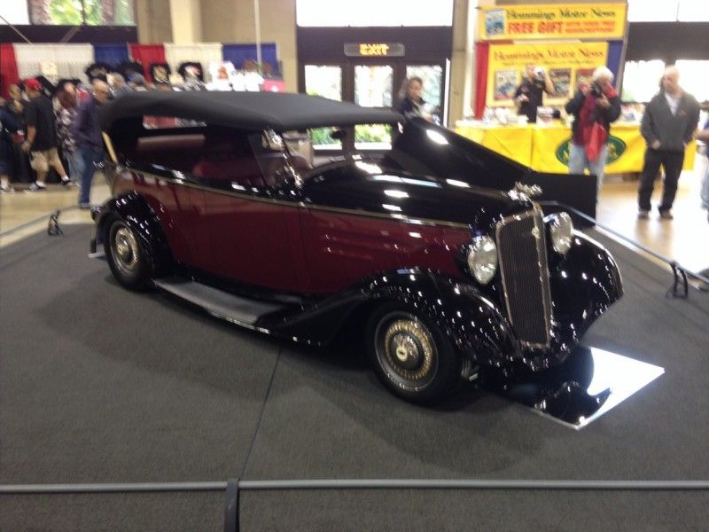

# Rope Barriers, Water Drums and the Show Circuit

*Oakland, Detroit, ISCA and Portland*

!!! abstract "Article record"
    **Confidence:** Medium · **Source types:** recollections (Mary Slonaker via Hot Rod), HOF bio, club histories, secondary · **Last verified:** 2026-10-13 (Round 6) · **Open issues:** Attendance figures conflict · [How we rate this](../reference/source-standards.md)

!!! quote "In their own words"
    "We didn't know rods from roller skates … but people liked them so much that Al decided the next year to hold a hot-rod-only car show."

    — Mary Slonaker, Hot Rod "Golden Oldie". [Full context in Voices](../voices/show-custom-voices.md)

Hot Rod describes the first National Roadster Show this way: rope barriers held up by water-filled 55-gallon drums, pigeons in the rafters, and about 100 cars.[^go]

## Oakland, 1950: "roadster," not "hot rod"

Promoter Al Slonaker first slipped some track roadsters and Barris customs into an "International Car Show" of new cars. Mary Slonaker recalled: "We didn't know rods from roller skates, but people liked them so much that Al decided the next year to hold a hot-rod-only car show." She added that "'hot rod' was still a no-no, so he substituted 'roadster'" (Hot Rod, "Golden Oldie").[^go]

The show ran **Jan 19–22, 1950**, at the Oakland Exposition Building.[^go] **⚠ Attendance:** 27,625 (Hot Rod) vs "more than 25,000" (Kustomrama).[^go][^k50]

**The first AMBR:** Bill Niekamp's lakes-bred '29 Ford roadster of Long Beach. Larry Neves (Oakland) and Fred Ige (West LA) were runners-up, and a roadster was built on the floor in 32 hours under Ben Hubbard.[^k50] "Grand" was added to the name in 1963.[^hr]

The AMBR list is dominated by T and A roadsters through the 1950s, then Richard Peters' **Ala Kart** won in 1958 and 1959 (Rod Shows).[^rs] In 1970 the AMBR winner, Andy Brizio, drove his '23 T to Peoria ([Peoria 1970](../eras/1970s-street-rod-nationals.md)).[^rc]

## Detroit Autorama, 1953, and the circuit

According to SEMA's Hall of Fame bio of Bob Larivee Sr., the first Autorama (1953, University of Detroit Field House) had only **45–50 vehicles**. It was a fundraiser for the New Baltimore strip, Motor City Dragway, which opened in spring 1957 with Larivee as its first manager ([Detroit & Cordova](../regions/detroit-cordova.md)).[^sema]

Promoter **Don Ridler** brought in musical acts: "Little Anthony & the Imperials, the Big Bopper and the Kalin Twins." The cars were now sharing the bill with pop music.[^sema]

In 1959 Larivee and his brother Marvin Jr. formed **Promotions Inc.** Their first shows were with Ontario clubs (the Piston Pushers of Hamilton and the Tecumseh Hot Rod association of Windsor), and Toronto in 1960 made a $10,000 profit.[^sema] In 1962 he went west to court Edelbrock, Weiand's Ed Cholakian, Roth and Wally Parks. In **1963** he created the **International Show Car Association (ISCA)** to standardize judging.[^sema] SEMA says Promotions Inc. was putting on 100 shows a year twenty years later.[^sema] Detroit's automakers used his shows for debuts, such as the Mustang.[^sema] ◐

The circuit was a Midwest–Canada invention that pulled California cars east, not the other way round.

## Portland Roadster Show (1956)

The Multnomah Hot Rod Council was founded in 1954 by Dee Wescott, "community members and elected officials." It produces the **Portland Roadster Show**, which it has owned and produced since 1956. MHRC calls it "the only [large show] that is ran entirely by volunteers."[^mhrc] See [Pacific Northwest](../regions/pacific-northwest.md).

## Images

<figure markdown>
{ loading=lazy }
<figcaption markdown>The 2014 AMBR-winning roadster at the Grand National Roadster Show (Pomona era). It shows how the award is staged today; the 1950 cars are linked below. Creator: Joetregembo. Date: 2015-01-29. Source: [Wikimedia Commons](https://commons.wikimedia.org/wiki/File:2014_AMBR_Award_Winner.jpg). License: [CC BY-SA 4.0](https://creativecommons.org/licenses/by-sa/4.0).</figcaption>
</figure>

<figure markdown>
{ loading=lazy }
<figcaption markdown>The 1985 Detroit Autorama, the show that began with 45–50 cars in 1953. Creator: Joetregembo. Date: 1985 (uploaded 2023-02-03). Source: [Wikimedia Commons](https://commons.wikimedia.org/wiki/File:1985_Detroit_Autorama.jpg). License: [CC BY-SA 4.0](https://creativecommons.org/licenses/by-sa/4.0).</figcaption>
</figure>

<figure markdown>
{ loading=lazy }
<figcaption markdown>Barris' Ala Kart, AMBR winner in 1958 and 1959, restored at the NHRA Museum. Creator: Wally Parks NHRA Motorsports Museum. Date: 2008-07-07. Source: [Wikimedia Commons](https://commons.wikimedia.org/wiki/File:Ala_Kart_(custom_car)_restored.jpg). License: [CC BY-SA 2.0](https://creativecommons.org/licenses/by-sa/2.0).</figcaption>
</figure>

## Visual references (external)
*These images are copyrighted, so we link to them instead.*

- [Kustomrama: 1950 National Roadster Show photos](https://kustomrama.com/wiki/National_Roadster_Show_1950)
- [Hot Rod: "Then and Now" GNRS history](https://www.hotrod.com/features/americas-beautiful-roadsterthen-now)

[^go]: Hot Rod, "Golden Oldie" (Mary Slonaker; Dain Gingerelli and Andy Southard Jr.). https://www.hotrod.com/features/golden-oldie-982-1789-117-1
[^k50]: Kustomrama, "National Roadster Show 1950." https://kustomrama.com/wiki/National_Roadster_Show_1950
[^hr]: Hot Rod, "Grand National Roadster Show History: Then and Now." https://www.hotrod.com/features/americas-beautiful-roadsterthen-now
[^rs]: Rod Shows, "America's Most Beautiful Roadster." https://rodshows.com/grand-national/americas-most-beautiful-roadster/
[^rc]: Dick Martin, "1st Street Rod Nationals," Rod & Custom (2007; Andy Brizio sidebar). https://www.hotrod.com/news/0710rc-1st-street-rod-nationals
[^sema]: SEMA Hall of Fame 2012, "Bob Larivee Sr." https://www.sema.org/hof/2012/bob-larivee-sr
[^mhrc]: Multnomah Hot Rod Council, "About Us." https://www.mhrc.org/about-us
