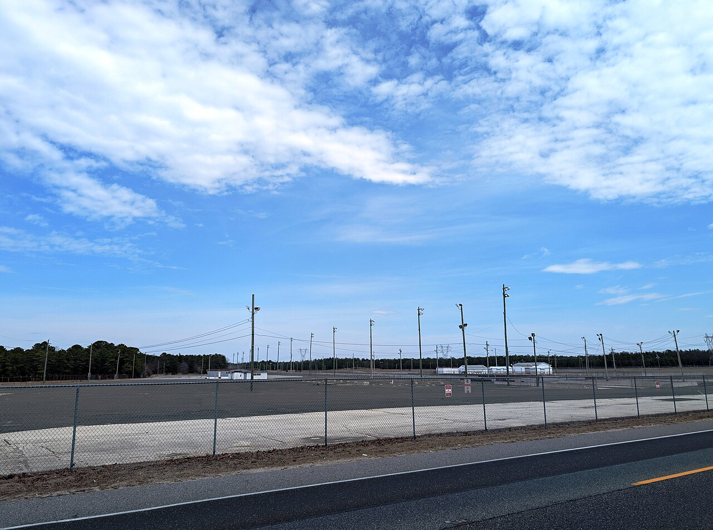

# Sunday Morning at McGuire, Sunday Night at Atco: South Jersey's Strips (1960–2023)

*A safety-first strip in the Pine Barrens, a jet car apologizing for 201 mph, a biker wedding 40 feet from the track, and an Air Force runway where a coffee can cooled the fuel and a Mr. Softee truck ran the driver meeting*

!!! abstract "Article record"
    **Confidence:** Medium (Atco's opening, owners, records and closing come from the *Inquirer*'s 2023 history, which quotes the paper's own archive, and from *Hemmings*; Strato Rods rests on racers' memories and forum posts that disagree on its years, plus two hall-of-fame biographies of its announcer, and is Low to Medium) · **Source types:** Grassroots racers' memories on *Drag Strip List*; H.A.M.B., Moparts and *NJ Pine Barrens* forum posts; *The Philadelphia Inquirer* (2023, quoting its 1961–75 reports and the *Daily News*); *Hemmings* (2023); EMPA and Garlits museum hall-of-fame biographies · **Last verified:** 2026-11-11 (Round 38) · **Open issues:** ⚠ "the first official drag strip in New Jersey"; ⚠ the years of Strato Rods · [How we rate this](../reference/source-standards.md)

!!! quote "In their own words"
    "Back then no one really had any money, but farmers like us found a way to race and have fun."

    — Chuck Dublick, on Strato Rods Dragway, *Drag Strip List*, undated.[^dslnj]

## Safety first, in the pines

Atco Dragway officially opened on Memorial Day Weekend 1960. Four Camden-area businessmen built it, Paul Jaffe, Paul B. Katz, Edwin Rosner and Lester M. Medvene, after studying drag strips around the country and copying the best features of each. They picked the site because it was well away from homes. "Our emphasis is on safety first and spectator comfort," Jaffe told the *Inquirer* in 1961.[^inq23] *Hemmings* adds that ground was broken on Jackson Road in 1959.[^hem23] The *Inquirer* called it "the first official drag strip in New Jersey."<a href="#q-1" title="Sources disagree: see Open questions">⚠</a>[^inq23]

The strip was smooth and it paid for speed. "Just the place for records to be set. It's real smooth," Don Garlits told the *Daily News* in 1961, eyeing a $1,000 prize for breaking the strip record: "they can start making out the check right now." He didn't collect it. Atco's first 200 belonged to Art Arfons of Akron, who ran 201.78 mph in his jet-powered *Cyclops* in May 1962. Arfons called the car "just the thing you need to run down to the corner for a loaf of bread," and after his record run he apologized: "I'm sorry I didn't hit 210 for you."[^inq23]

## Seven dollars to find out

Atco's regulars weren't the famous names, though. They were ordinary drivers from around Philadelphia. "Even if they just drive a little Valiant, they can race," Medvene said in 1973. A $7 pit ticket in 1975 let you take your own car down the track. Ed Hartnett, a 26-year-old electrical technician with Philadelphia Electric, had about $7,000 in his '69 Camaro: "It's over very quickly. The sensation I'm aware of is silence." John Conn, 26, of Magnolia wished there were more tracks: "Any time you race on the streets, it's hairy, you know."[^inq23] Ralph Bernstein's brother Skip drove down in 1961 in his '57 Plymouth, ran 14.8s, then ran out of gas and "pulled to the side like he was on a public street. Too funny!"[^dslnj]

In November 1971 two Warlocks motorcycle club members, Woody and Laurie, got married at Atco on the day of the national motorcycle championships. More than 200 Warlocks watched, and bikes went by at over 160 mph just 40 feet from the ceremony. The couple rode to the altar between two rows of choppers in a bucket-seated buggy. Later they married again before a justice of the peace, "Mostly for her parents' sakes."[^inq23]

## Strato Rods

Up in Burlington County, the Air Force let racers use an old runway. Matt Delio, stationed at Fort Dix across Texas Avenue, remembered McGuire's first runway as "McGuire Strato Rods": "An excellent place to run a street car, or low buck dragster, or homemade altered." Once a year it held a March of Dimes meet with a $1,000 top prize, $500 to the winner and $500 to the March of Dimes, "presented to the poster child, pretty neat!!"[^hamb11] You came in, one local wrote, through a gate by the Pointville graveyard.[^njpb]

Chuck Dublick raced an E/Gas '56 Chevy there in red primer, and nearly every part of it came from somewhere else. The hood scoop was a propane-tank regulator hood with the front cut out. "The cool can was an old coffee can with copper tubing in it." The tube grille was "old café curtain rods" that sometimes popped out and sparked all the way down the track. The seat came out of an old Austin "and wasn't much more than a lawn chair." The strip was "All concrete. No money, just trophies." Once, staged at about 5,000 rpm, he watched someone run out, grab the Christmas tree and wave both cars onto the grass, because a small plane needed to make an emergency landing. "I love grass-roots racing."[^dslnj]

Ed Beers came to watch in September 1980, when his cousin was in basic training at Dix. They heard cars and "snuck in the pits through the barbed wire fence. Secure military base, huh." What he remembered best was the driver meeting: "They towed an old Mr. Softee truck with a tractor out to the starting line and had their meeting and first round pairings done there."[^dslnj] Bob Drayton and George Adams raced a Day-Glo orange '55 Chevy at Strato Rods and Atco in 1965 and 1966; Frank Perkins brought a 1947 Austin with a Dodge slant six in the late 1960s.<a href="#q-2" title="Sources disagree: see Open questions">⚠</a>[^dslnj]

The two strips worked together. A Moparts poster wrote: "Used to run there every sunday morning. Load up, and race Atco that night," and he won at both on the same day twice.[^moparts] Bob Frey, an Air Force staff sergeant at McGuire, began announcing at Strato Rods, then got a tryout in Atco's tower and for the next 18 years (1966–1984) announced almost every race Atco held. He went on to be the voice of the IHRA and of NHRA television; he described himself as "a skinny, geeky, bald-headed guy with glasses."[^empa][^garlitsfrey] A Browns Mills man remembered that Walt Harris (a hall monitor at Pemberton High, another poster added) let him work Strato Rods for free admission. His crowd hung out at Highway Tire in Browns Mills, on "Nights that usually ended in a race on Mt Misery Rd."[^njpb]

## The end of the line

In 1988 Atco hosted the IHRA Summernationals, where Tommy Howes made what *Hemmings* calls the first full-bodied six-second pass.[^hem23] By August 2020, Insurance Auto Auctions, which had already bought and torn up Englishtown's strip, had applied to the Pinelands Commission to turn Atco's 180-acre site into a car auction lot, with owner Leonard Capone Jr. co-signing. Atco closed permanently on July 18, 2023, right after its 29th Pan American Nationals, with no reason given.[^inq23][^hem23] That left [Island Dragway](island-dragway-great-meadows.md), about 90 miles north, as the only drag strip in New Jersey.[^inq23]

<figure markdown>
{ loading=lazy }
<figcaption markdown>The former Atco Dragway in March 2025, almost two years after it closed. Creator: Mr. Matté. Date: 2025-03-29. Source: [Wikimedia Commons](https://commons.wikimedia.org/wiki/File:Former_Atco_Dragway_(1),_March_2025.jpg). License: [CC BY-SA 4.0](https://creativecommons.org/licenses/by-sa/4.0).</figcaption>
</figure>

*See also:* [Linden and the short strips](linden-njta-new-jersey-short-strips.md), where New Jersey raced before Atco; [Pennsauken, 1958](pennsauken-central-airport-1958.md), the Camden County airport strip that never was, a few miles from Atco; [Georgetown, Delaware](georgetown-speedway-delaware.md), whose young men "enjoyed the drag races at Atco"; [Don Garlits](../people/don-garlits.md).

## Open questions & disputed details

*From the detective's notebook: where the sources disagree, where we have only one, and what we are still looking for. Each item links back to its place in the story.*

**Disputed.** **Was Atco New Jersey's first official drag strip?** The *Inquirer* (2023) says so.[^inq23] But the NHRA's Safety Safari sanctioned a meet at Linden Airport in 1954, and a state sports history names paved strips at Woodbine and Manville in the early 1950s ([Linden](linden-njta-new-jersey-short-strips.md)). Atco may have been the state's first purpose-built quarter-mile, and that is probably what "official" means. Island Dragway also dates itself to 1960 ([Island Dragway](island-dragway-great-meadows.md)). <a class="hr-q-back" href="#qr-1" title="Back to the story">↩</a>

**Disputed.** **When did Strato Rods run?** Delio: "from 1966 to 1983."[^hamb11] A drag strip list quoted on Moparts: 1968 to 1982.[^moparts] *New Jersey Sports Heroes*: from 1968, "which operated for 15 years."[^njsh2] Yet Drayton raced there in 1965–66,[^dslnj] and Frey, in the Air Force from 1965 to 1969, was announcing there before he went to Atco in 1966.[^garlitsfrey] The likeliest answer is informal meets by 1965 and organized racing from around 1966–68 into the early 1980s. A McGuire base newspaper or the *Burlington County Times* would settle it. <a class="hr-q-back" href="#qr-2" title="Back to the story">↩</a>

### Next leads

The *Courier-Post* on Atco's 1960 opening (its 2023 retrospective was paywalled, 402); the McGuire base paper and *Burlington County Times*, 1965–83, for Strato Rods and the March of Dimes meets; Walt Harris; the 1968 Katz story only as context; Atco's 1961 strip-record prize.

## Sources

[^inq23]: Nick Vadala, "Atco Dragway closed suddenly, but it used to host drivers striving for 200 mph and at least one biker wedding," *The Philadelphia Inquirer*, July 19, 2023 (quotes *Inquirer* and *Daily News* reports of 1961, 1962, 1971, 1973, 1975 and 2020). https://www.inquirer.com/news/new-jersey/atco-dragway-closes-drag-racing-south-jersey-camden-county-20230719.html (accessed 2026-11-11)
[^hem23]: Tara Hurlin, "Atco Dragway Closes: A Chapter Ends in Drag Racing History," *Hemmings*, July 19, 2023. https://www.hemmings.com/stories/atco-dragway-closes-permanently/ (accessed 2026-11-11)
[^dslnj]: "New Jersey: Remembering . . ." (racers' memories posted with names, including Chuck Dublick, Ed Beers, Bob Drayton, Frank Perkins and Ralph H. Bernstein), *Drag Strip List* (read through a headless browser; the page is script-rendered). https://dragstriplist.com/nj (accessed 2026-11-11)
[^hamb11]: matt Delio, post of September 17, 2010, in "Lost Drag Strips," page 11, *The H.A.M.B.* https://www.jalopyjournal.com/forum/threads/lost-drag-strips.313182/page-11 (accessed 2026-11-11)
[^moparts]: kruger, post of December 24, 2009, in "Ghost Tracks, remember when, keep it going," *Moparts Forums*. https://board.moparts.org/ubbthreads/ubbthreads.php/topics/156920.html (accessed 2026-11-11)
[^njpb]: oji and bertsdirtytoys, posts of June 12 and November 24–25, 2009, in "Muscle," page 4, *NJ Pine Barrens Forums*. https://forums.njpinebarrens.com/threads/muscle.5289/page-4 (accessed 2026-11-11)
[^empa]: "Bob Frey," Hall of Fame, Eastern Motorsports Press Association, undated. https://empamedia.com/halloffameBob%20Frey.html (accessed 2026-11-11)
[^garlitsfrey]: "Bob Frey," International Drag Racing Hall of Fame, Don Garlits Museum of Drag Racing, undated. https://garlits.com/hall-of-fame/bob-frey/ (accessed 2026-11-11)
[^njsh2]: "Auto Racing History," *New Jersey Sports Heroes*, undated. https://www.njsportsheroes.com/auto.history.html (accessed 2026-11-11)
