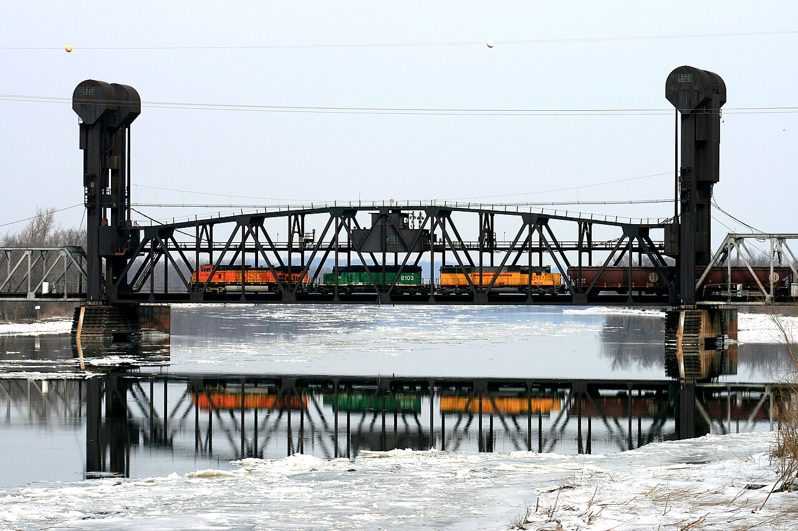

# Hog Butcher on Weekdays, Fun Capital on Sundays: the Beardstown Drag Strip (Beardstown, Ill., 1967–72)

!!! abstract "Article record"
    **Confidence:** Low · **Source types:** Grassroots daily newspaper (*Jacksonville Daily Journal*, Jacksonville, Ill.): a Beardstown correspondent's column, sports notes and display ads, 1967–72, read as scanned page OCR; one encyclopedia entry for background · **Last verified:** 2026-10-22 (Round 20) · **Open issues:** whether the 1967 "Seward Drag strip on the Arenzville road" and the 1970s "Beardstown Drag Strip" are the same place ◐; the founder, the exact site and the closing year are unknown; the Garlits match race was announced, and we have no report of the result ◐ · [How we rate this](../reference/source-standards.md)

!!! quote "In their own words"
    "Beardstown is getting back to reinforcing its reputation as Fun Capital on Sundays."

    — Beardstown column, *Jacksonville Daily Journal*, May 28, 1967.[^jdj670528]

Beardstown sits on the Illinois River in Cass County, a packing-house town with a lift bridge. In the spring of 1967 its newspaper correspondent noticed something new about Sundays.

## 2,000 on opening day (1967)

The town, the column said, had "apparently done everything possible to establish a reputation as 'hog butcher of Illinois' on weekdays." On weekends it was packed with bowlers for the annual KC tournament, "and for the past two weeks additional sports fans have been crowding in for drag races. The Seward Drag strip on the Arenzville road attracted 2,000 people on opening day, and apparently did just as well or better the following Sunday." Spectators paid $1.50 apiece. The strip "had cars parked for more than a mile along each side of the entrance — on both sides of the Arenzville blacktop."[^jdj670528]<a href="#q-1" title="Single source so far: see Open questions">◐</a>

<figure markdown>
{ loading=lazy }
<figcaption markdown>The Illinois River lift bridge at Beardstown, Illinois, in 2007. Context only; no photo of the strip has turned up. Photo: Rick from Baton Rouge, Feb. 12, 2007. Source: [Wikimedia Commons](https://commons.wikimedia.org/wiki/File:Illinois_River_Lift_Bridge,_Beardstown,_Illinois.jpg). License: [CC BY 2.0](https://creativecommons.org/licenses/by/2.0/).</figcaption>
</figure>

## The Michigan Madman comes to Cass County (1970)

The strip was still running three years later. By 1970 ads in the Jacksonville paper billed the **Beardstown Drag Strip** for an A.H.R.A. Super Stock Circuit date, with a car show, time trials from 9 a.m. to 1:30 p.m. and races at 2. Children under 12 got in free with an adult.[^jdj700501] That May, "E. J. Potter presented the feature attraction at Sunday's drag racing program at the Beardstown Drag Strip. Potter made three runs on his Chevy-powered" machine (the rest of the line is lost in the scan).[^jdj700520] Potter, the "Michigan Madman" from Ithaca, Mich., toured the strips for 13 years with motorcycles built around V8 engines.[^wikipotter]

## Ken Dobson's strip (1972)

Two years later it changed hands. In May 1972 the ads read "DRAG RACING EVERY SUNDAY … Beardstown DRAG STRIP New Owner & Operator" Ken Dobson, with "AHRA SANCTIONED DRAGS."[^jdj720527] Two weeks later the Jacksonville sports column told fans they had "a treat in store this weekend at the Beardstown Drag Strip, promoted by Ken Dobson of Jacksonville." There would be racing Friday and Saturday nights and Sunday afternoon, "with perhaps the top name in all of drag racing, 'Big Daddy' Don Gorlits [*sic*] pitted against Dobson in a special match race Friday evening."[^jdj720609]<a href="#q-2" title="Single source so far: see Open questions">◐</a>

A small river town drew a crowd of 2,000 to a country-road strip, and five years later had Garlits on the bill. Like [Malden, Mo.](semo-malden-drag-strip.md) in the same years, it ran under AHRA rather than NHRA sanction. Compare [Sedalia's unfinished strip](sedalia-big-sir.md) for a Midwestern town that never got that far. The 1967 page also ran a story on Beardstown's wartime Civilian Pilot Training program and a newly opened airport.<a href="#q-3" title="Single source so far: see Open questions">◐</a><a href="#q-4" title="Open question: see the bottom of the page">?</a>

## Open questions & disputed details

*From the detective's notebook: where the sources disagree, where we have only one, and what we are still looking for. Each item links back to its place in the story.*

**Single source so far.** *That's all the column says about the strip: no owner, no length, no clubs.*[^jdj670528] <a class="hr-q-back" href="#qr-1" title="Back to the story">↩</a>

**Single source so far.** *We have not found the result.*[^jdj720609] <a class="hr-q-back" href="#qr-2" title="Back to the story">↩</a>

**Open question.** **Was the strip on an airfield?** The same 1967 column that reported the strip also wrote about Beardstown's wartime pilot-training program and a new airport, but nothing ties the strip to either field.[^jdj670528] <a class="hr-q-back" href="#qr-3" title="Back to the story">↩</a>

### Next leads

The *Beardstown Illinoian-Star* and the Cass County Historical Society, for who built the Seward strip and where it was; Ken Dobson's own story; whether the Garlits match happened; when the strip closed. <a class="hr-q-back" href="#qr-4" title="Back to the story">↩</a>

## Sources

[^jdj670528]: Beardstown correspondent's column, *Jacksonville Daily Journal* (Jacksonville, Ill.), May 28, 1967. Page OCR (quotes corrected for OCR slips). https://archive.org/details/jacksonville-daily-journal-1967-05-28 (accessed 2026-10-22)
[^jdj700501]: Beardstown Drag Strip display ad, *Jacksonville Daily Journal*, May 1, 1970. Page OCR. https://archive.org/details/jacksonville-daily-journal-1970-05-01 (accessed 2026-10-22)
[^jdj700520]: Beardstown drag racing note, *Jacksonville Daily Journal*, May 20, 1970. Page OCR, partly lost. https://archive.org/details/jacksonville-daily-journal-1970-05-20 (accessed 2026-10-22)
[^wikipotter]: "E. J. Potter," Wikipedia, citing Paul Vitello, *New York Times*, May 12, 2012. https://en.wikipedia.org/wiki/E._J._Potter (accessed 2026-10-22)
[^jdj720527]: Beardstown Drag Strip display ad, *Jacksonville Daily Journal*, May 27, 1972. Page OCR (owner's first name garbled). https://archive.org/details/jacksonville-daily-journal-1972-05-27 (accessed 2026-10-22)
[^jdj720609]: Sports column, *Jacksonville Daily Journal*, June 9, 1972. Page OCR. https://archive.org/details/jacksonville-daily-journal-1972-06-09 (accessed 2026-10-22)
