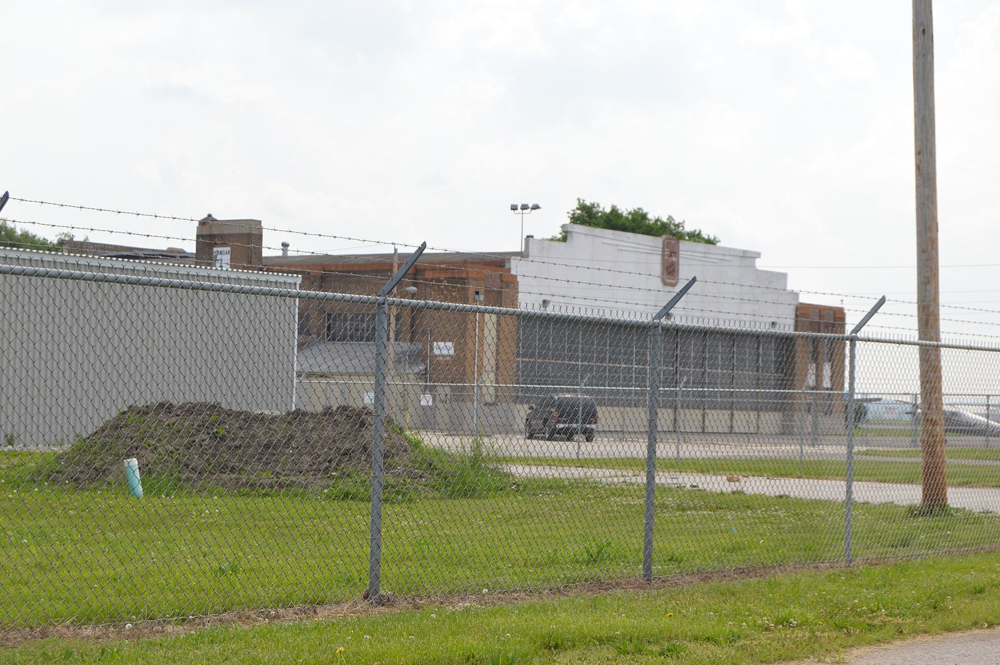

# Belleville's Gear Jammers and the St. Louis Strip Hunt (1952–1959)

!!! abstract "Article record"
    **Confidence:** Medium · **Source types:** Grassroots big-city daily's local pages (*St. Louis Post-Dispatch*: a feature, short news items, club ads and readers' letters, 1954–59, read as scanned page OCR); trade press (*Car Craft*, Dec 1958; *Hot Rod* 1959 index); Wikipedia for the airport's dates (tertiary) · **Last verified:** 2026-10-17 (Round 16) · **Open issues:** the strip's name changes from ad to ad (Parks Metropolitan Airport, "Walston (Parks) Airport," Walston Field "near Parks Airport") ⚠; the club member's surname is Mehrtens in the *Post-Dispatch* and Mertens in *Car Craft* ⚠; the Drag-ons' engine is described only as the paper printed it ◐; we have not found whether the Missouri side got its strip in the 1950s · [How we rate this](../reference/source-standards.md)

!!! quote "In their own words"
    "Applicants for membership in the Gear Jammers are screened by a committee."

    — **Wayne Mehrtens** of Belleville, Ill., a club member, to the *St. Louis Post-Dispatch*, June 11, 1956.[^pd1956]

On a Sunday in June 1956, about 2,000 people stood 75 yards back from an airfield strip on the Illinois side of the river and watched 104 cars race in pairs. Nobody cheered. The *Post-Dispatch* man noticed that: the spectators, mostly young, in T-shirts, blue jeans and shorts, "appeared to be quietly interested." Waiting cars were lined up "like planes on an aircraft carrier."[^pd1956]

The place was **Walston Field**, near Parks Airport in Cahokia, Illinois. The paper called it "the only place in the St. Louis metropolitan area where such racing is authorized." The hosts were the **Belleville Gear Jammers**.[^pd1956]

## The club with the half-fine rule

The *Post-Dispatch* laid out the club's history. The Gear Jammers were organized in June 1952 under the wing of the Junior Chamber of Commerce. They met at the Eagles Club in Belleville, had police endorsement, and belonged to the National Hot Rod Association. They had 40 members, aged 17 to 40, and had been running drag races for four years.[^pd1956]

Getting in took work. Wayne Mehrtens told the paper that a committee screened every applicant, tested his driving and his knowledge of the safety rules, and checked whether he had a police record. Once a member was in, a moving-violation arrest cost him twice: he paid the court, then paid the club treasury a sum equal to half his fine. A second arrest meant expulsion.[^pd1956]

The day's program was one of 13 that year, held on alternate Sundays. Cars were weighed in and safety-checked from 8:30 a.m., hub caps came off the stock models so they couldn't fly into the crowd, and trials started at 10. Two tow trucks and an ambulance stood by. There were four classes of stock and modified stock cars and one class of "hot" roadsters. About 79 of the entries were ordinary stock cars running ordinary fuel. Quarter-mile times ran from 15 to 18 seconds, and the fastest cars hit about 95 miles an hour. The worst thing that happened was a car that dropped its transmission at the end of a run.[^pd1956]

The same page carried an AP item from San Diego, where a hot rod with a broken axle had gone into the crowd at an authorized strip the day before, injuring 12 spectators.[^pd1956]

The money is worth a look. By the paper's figures the club paid $400 a Sunday for the strip and charged $1.50 per car and 50 cents per spectator. (The sentence giving its average gate is split across columns in the scan, but it appears to say about $1,300.) Proceeds bought scales, a judges' truck and an automatic timer, and that spring the club had given $550 to the National Heart Fund.[^pd1956]<a href="#q-1" title="Single source so far: see Open questions">◐</a>

Twelve clubs came that day, from around St. Louis and from as far as Mattoon and Canton, Illinois, and Springfield, Missouri. The ones the paper named were the Vagabonds, Cavaliers, Strokers, Auto Jammers, Dusters, Roadrunners and Axle Breakers.[^pd1956]<a href="#q-2" title="Open question: see the bottom of the page">?</a>

<figure markdown>
{ loading=lazy }
<figcaption markdown>One of the 1928 Curtiss-Wright hangars at today's St. Louis Downtown Airport in Cahokia, Ill., the field once called Parks Metropolitan Airport. Photographed in 2014; it shows the airport, not the strip. Creator: Nyttend. Date: 2014-05-26. Source: [Wikimedia Commons](https://commons.wikimedia.org/wiki/File:Curtiss-Wright_hangar_at_St_Louis_Downtown.jpg). License: Public domain (released by the photographer).</figcaption>
</figure>

## The Missouri side wanted one too

Across the river, the St. Louis clubs spent the decade asking for a strip of their own.

In February 1954 **Joseph R. Naber**, president of the **Midwest Hot Rod Club** of Brentwood, answered a letter-writer who doubted the new cars were safe. Detroit could add safety belts, he wrote, but 99 per cent of people wouldn't bother to use them, and it couldn't build in the best safety device of all: "The cautious and courteous driver."[^naber]

In August 1955 the paper reported that fifteen north St. Louis youths in the **Strokers Club** had gone eight months, since the club formed the previous December, without a single traffic arrest among them. Their president, **Edwin Styffe Jr.**, 17, said: "Some mixed-up adults don't realize that a true hot rodder is interested in speed racing on supervised tracks only." (The scan doubles the word "is.") The boys hoped a "drag strip" would open there. Styffe was spending his summer driving a delivery truck: "So far I haven't put any scratches on it or broken any eggs."[^strokers] A club called the Strokers raced at the Gear Jammers' meet the next June; the paper doesn't say whether it was the same club.[^pd1956]<a href="#q-3" title="Single source so far: see Open questions">◐</a>

By November 1958 the campaign was on bumper stickers. A letter signed S.J.G. quoted two of them: "St. Louis needs a drag strip." and "A drag strip will mean safer streets." The writer saw a threat in the second one: "If you don't let us have a drag strip you may get slaughtered by our speeding cars." The letter set the stickers beside a newspaper headline from the weekend before: "Three youths burned beyond recognition in climax to drag race."[^sjg]

The hot rodders had their own letter-writers. That October a physician who said he had served hot-rod organizations in three states as safety director objected to the paper calling a 90-mph crash on the Daniel Boone Expressway in Ladue "drag racing." He wrote that he had "yet to see a member of an organized hot-rod club who was not aware of his responsibilities." A drag race, he explained, is an acceleration contest from a standing start, held on a purpose-built strip.[^madness] *The signature is garbled in the scan, so we leave the writer unnamed.*

## The engine in the crate

The best St. Louis story of all appeared in March 1959. The **Drag-ons Hot Rod Club of Normandy** had "reluctantly put up for sale" a World War I Hispano Suiza airplane engine. It was still crated and unused, water-cooled, with 12 cylinders in a V. Club member **Gary Evans** said they had meant to convert it for a "dragster," but they had no garage to do the work. The club had got it two years before, "from a man who had two of them in his basement."[^dragons]<a href="#q-4" title="Single source so far: see Open questions">◐</a>

## The Gear Jammers go national

The Belleville club kept a higher profile than the clubs on the Missouri side. In March 1957 it put on a show of custom machines, classics, antiques and sports cars at Ainad Temple in East St. Louis.[^show1957] In its December 1958 issue, *Car Craft* covered what it called "the fourth annual National Drags" and reported that the Gear Jammers had given up running their own cars to work the event. **Wayne Mertens** (the magazine's spelling) accepted the *Car Craft* Sportsmanship Trophy for the club from NHRA field director Tex Smith. The magazine praised the members "who gave up running their cars in competition in order to become invaluable event personnel."[^cc1958]<a href="#q-5" title="Sources disagree: see Open questions">⚠</a> *Hot Rod*'s 1959 index lists the "Belleville Gear Jammers" as Club of the Month for January.[^hr1959]

## Open questions & disputed details

*From the detective's notebook: where the sources disagree, where we have only one, and what we are still looking for. Each item links back to its place in the story.*

**Single source so far:** The marked point in *The club with the half-fine rule* rests on one source so far. <a class="hr-q-back" href="#qr-1" title="Back to the story">↩</a>

### Where exactly? ⚠

The club's own ads can't agree on a name for the place. In September 1955 the Gear Jammers advertised drags "At Parks Metropolitan Air Port," on Upper Cahokia Road, with a rain date of October 2.[^ad1955] By April 1956 the ads promised NHRA-sanctioned racing every second and fourth Sunday until October 28 at a field "formerly Parks Airport."[^ad1956a] The May ad read "WALSTON (Parks) AIRPORT near Rt. 157 and 3."[^ad1956b] The June story said Walston Field, *near* Parks Airport, and its photo caption put it in Cahokia.[^pd1956] Today the airport is St. Louis Downtown Airport. Wikipedia says it was named Parks Metropolitan Airport in 1940, closed in 1959 and reopened in 1965.[^wiki] Whether Walston Field was part of the old airport or a strip next to it, we can't tell from these pages. <a class="hr-q-back" href="#qr-2" title="Back to the story">↩</a>

**Single source so far:** The marked point in *The Missouri side wanted one too* rests on one source so far. <a class="hr-q-back" href="#qr-3" title="Back to the story">↩</a>

**Single source so far.** *We give the paper's description, including its "1000 horsepower," as printed. We have not identified the engine.* <a class="hr-q-back" href="#qr-4" title="Back to the story">↩</a>

**Disputed.** *Mehrtens or Mertens: the newspaper and the magazine spell it differently.* <a class="hr-q-back" href="#qr-5" title="Back to the story">↩</a>

## Sources

[^pd1956]: Untitled feature (subheads "95 Miles-an-Hour Top," "Supported By Police," "Applicants Screened"), with photos, *St. Louis Post-Dispatch*, June 11, 1956; same page: AP, "12 Hurt as Drag Racing Car Runs Out of Control" (San Diego). Read as page OCR. https://archive.org/details/per_st-louis-post-dispatch_st-louis-post-dispatch_1956-06-11_78_161 (accessed 2026-10-17)
[^ad1955]: Gear Jammers drag-race advertisement, *St. Louis Post-Dispatch*, Sept. 18, 1955 (sports pages). https://archive.org/details/per_st-louis-post-dispatch_st-louis-post-dispatch_1955-09-18_77_257 (accessed 2026-10-17)
[^ad1956a]: Gear-Jammers NHRA drag-race advertisement, *St. Louis Post-Dispatch*, Apr. 21, 1956. https://archive.org/details/per_st-louis-post-dispatch_st-louis-post-dispatch_1956-04-21_78_111 (accessed 2026-10-17)
[^ad1956b]: "N.H.R.A. Drag Races Sponsored by Belleville Gear-Jammers" advertisement, *St. Louis Post-Dispatch*, May 27, 1956. https://archive.org/details/per_st-louis-post-dispatch_st-louis-post-dispatch_1956-05-27_78_147 (accessed 2026-10-17)
[^wiki]: "St. Louis Downtown Airport," Wikipedia (history section; tertiary, used only for the airport's names and dates). https://en.wikipedia.org/wiki/St._Louis_Downtown_Airport (accessed 2026-10-17)
[^naber]: Joseph R. Naber, "The Best Safety Device," letter, *St. Louis Post-Dispatch*, Feb. 1, 1954. https://archive.org/details/per_st-louis-post-dispatch_1954-02-01_76_31 (accessed 2026-10-17)
[^strokers]: "Hot-Rod Club Proud of Record of [No] Accidents" (the scan drops a word in the headline), *St. Louis Post-Dispatch*, Aug. 22, 1955. https://archive.org/details/per_st-louis-post-dispatch_st-louis-post-dispatch_1955-08-22_77_231 (accessed 2026-10-17)
[^sjg]: S.J.G., "What to Give Children," letter, *St. Louis Post-Dispatch*, Nov. 28, 1958. https://archive.org/details/per_st-louis-post-dispatch_st-louis-post-dispatch_1958-11-28_80_327 (accessed 2026-10-17)
[^madness]: "Madness, Not Dragging," letter, *St. Louis Post-Dispatch*, Oct. 4, 1958 (signature garbled in the scan). https://archive.org/details/per_st-louis-post-dispatch_st-louis-post-dispatch_1958-10-04_80_273 (accessed 2026-10-17)
[^dragons]: "Hot Rod Club Has World War I Engine for Sale," *St. Louis Post-Dispatch*, Mar. 2, 1959. https://archive.org/details/per_st-louis-post-dispatch_1959-03-02_81_60 (accessed 2026-10-17)
[^show1957]: "Belleville Gear Jammers to Conduct Auto Contests," *St. Louis Post-Dispatch*, Mar. 22, 1957, p. 7E (columns interleaved in the scan). https://archive.org/details/per_st-louis-post-dispatch_st-louis-post-dispatch_1957-03-22_79_80 (accessed 2026-10-17)
[^cc1958]: *Car Craft*, vol. 6, no. 8, December 1958 (National Drags coverage). https://archive.org/details/sim_car-craft_1958-12_6_8 (accessed 2026-10-17)
[^hr1959]: *Hot Rod* 1959 annual index, "Club of the Month." https://archive.org/details/sim_hot-rod_1959_12_index (accessed 2026-10-17)
