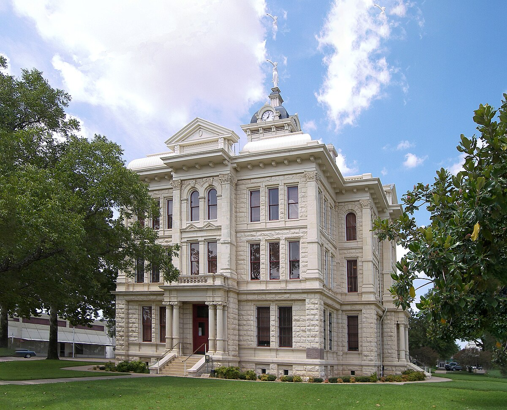

# A Car Fixed the Way a Person Likes It: the Cameron Accelerators and Krenek's Garage (Cameron, Tex., 1956–63)

!!! abstract "Article record"
    **Confidence:** Medium · **Source types:** Grassroots weekly newspaper (*The Cameron Herald*, Cameron, Tex.): club notices, a column written by a club member, a photo caption, an editorial and a year-in-review, 1956–63, read as scanned page OCR, with the 1963 strip story checked against the page image · **Last verified:** 2026-10-22 (Round 22-West) · **Open issues:** whether the strip on the Wohleb farm was ever built ◐; how the 1956, 1957 and 1963 clubs were related ? · [How we rate this](../reference/source-standards.md)

!!! quote "In their own words"
    "Do you want to know what a hot rod really is? It is a car fixed the way a person likes it."

    — "By An 'Accelerator'," a club member's column, *The Cameron Herald*, May 31, 1956.[^ch560531]

Cameron is the seat of Milam County, a farm town east of Temple in Central Texas. For seven years its weekly paper followed a teenage hot rod club that kept going quiet and starting up again, always at the same garage. Each time, the club wrote bylaws and asked the town to trust it, and each time it looked for somewhere to race.

<figure markdown>
{ loading=lazy }
<figcaption markdown>The Milam County Courthouse, Cameron, Texas. Context only; it does not show the club or its garage. Creator: Larry D. Moore. Date: 2008-08-22. Source: [Wikimedia Commons](https://commons.wikimedia.org/wiki/File:Milam_county_courthouse.jpg). License: [CC BY 4.0](https://creativecommons.org/licenses/by/4.0/).</figcaption>
</figure>

## The garage and the club (1956)

In May 1956 the *Herald*'s headline asked a question: "Cameron 'Accelerators' Getting Drag Strip(?)." The club met every Thursday night at Charlie L. Krenek's garage and had 21 members, with Gene Mitchan as president and Louis Krenek as vice president. "Krenek allows the teen-agers the run of his garage, tools and all," for demonstrations and for work on their hot rods and stock cars after each business meeting. Safety, the story said, was "one of the cardinal principals" of the club.[^ch560510]<a href="#q-1" title="Single source so far: see Open questions">◐</a>

Three weeks later a member answered the town in print, in a column signed "By An 'Accelerator.'" It began: "Some people think a hot rod is a car that has been chopped and dropped down a couple of inches with dual exhaust and a high powered engine to give it more speed." That was partly right, the writer said, but people who called a hot rod something "all souped up so it can go fast and kill people" should not jump to conclusions. His definition is quoted at the top of this page.[^ch560531]

## License numbers for the police (1957)

The club had faded by the next winter. In February 1957 Billy Slavik, "president of the Cameron Hot Rod Club," called young men to a meeting at **Krenek's Speed Shop** "for the reforming of the club." The members wanted to build one hot rod for races sponsored by the national association. Their aim was to develop racing engines "while at the same time not having to endanger others by holding drag races in streets," and to race only under the rules of the National Hot Rod Association.[^ch570207]

Two weeks later 19 youths were meeting weekly as the **Accelerators**, and the paper ran their case under the headline "Cameron Hotrod Enthusiasts Seek Understanding Of Adults." The bylaws required members to learn and obey traffic laws. Members reported for violations would be suspended for a time that depended on how serious the violation was. The city police and the Texas Highway Patrol would be given the license numbers of every member's car. The boys wanted to buy a club car and build it into "a vehicle capable of setting new speed records," and they needed a business or group to sponsor them so they could affiliate with the national association. Parents would be invited to meetings.[^ch570221]

The next week a photo showed two members with their trophies: Burke Barr, who had won his in Class A races, and J. T. "Toddy" Lawrence, who had taken one in Class C at a drag race in Temple. The caption called them "the only members" of the new club "that have been successful competitors in recognized drag races."[^ch570228] In March the club met with the Cameron Rotary Club. An editorial said the boys "impressed those men more with their intelligence than with talk of reckless driving."[^ch570321]

There was somewhere to race by 1960. The *Herald*'s review of that year recorded that Leon Ernest "won Top honors at Little River Drag Strip, winning F and E classes in his 49 Plymouth."[^ch610105]

## A strip on the Wohleb farm (1963)

In May 1963 the Accelerators met at "Charlie's Garage" and organized again. Chuck Krenek was elected president, Bobby Hughes vice president, Wally Short reporter, and Shirley Baker secretary-treasurer. The club's main aim, the paper said, was "to abolish 'hot rodding' and teach members to become safe drivers." Krenek said the club needed the support of adults as well as teenagers in enforcing its safety rules.[^ch630509]

A week later the club had land. The headline read "Drag Strip Is Planned Here: Accelerators Start Building Plans On S. J. Wohleb Farm." The farm was "just off the Temple Highway and about two miles outside of the city limits." Wohleb had two sons in the club, and he told the members they could have the land for a strip "as long as they wanted the land." He explained why: "The boys have tried for a long time to get a strip around here and have never been able to get the land." The plan was about half a mile of road, with a quarter mile for dragging, and stands if they could manage them. The photo showed the club's president at work: "DRAGGING MOTOR - Chuck Krenek, president of the Accelerators."[^ch630516]<a href="#q-2" title="Single source so far: see Open questions">◐</a>

The same club name lasted seven years, and the meetings stayed at Krenek's garage. A Krenek was an officer in 1956 and the president in 1963. For another Texas club of the same years, see [Canyon's Orchids, Plugs and Celtics](canyon-orchids-celtics-amarillo.md). For a Missouri club with similar bylaws, see [the Sedalia Drag-Ons](sedalia-drag-ons.md).<a href="#q-3" title="Open question: see the bottom of the page">?</a>

## Open questions & disputed details

*From the detective's notebook: where the sources disagree, where we have only one, and what we are still looking for. Each item links back to its place in the story.*

**Single source so far.** *The 1956 headline's "Drag Strip(?)" is never explained in the OCR text we could read. We do not know how Louis Krenek and Chuck Krenek were related to Charlie L. Krenek, or whether "Krenek's Speed Shop" (1957) and "Charlie's Garage" (1963) were the same business.* <a class="hr-q-back" href="#qr-1" title="Back to the story">↩</a>

**Single source so far.** *We found no later story saying the Wohleb farm strip was built or used. The 1960 "Little River Drag Strip" is named once, with no location.* <a class="hr-q-back" href="#qr-2" title="Back to the story">↩</a>

### Next leads

*Cameron Herald* issues from summer 1963 for the Wohleb strip; the *Temple Daily Telegram* for the Temple drag races of 1957 and the Little River strip; Milam County deed records; the Krenek family. <a class="hr-q-back" href="#qr-3" title="Back to the story">↩</a>

## Sources

[^ch560531]: "By An 'Accelerator'," *The Cameron Herald* (Cameron, Tex.), May 31, 1956. Page OCR. https://archive.org/details/cameron-herald-1956-05-31 (accessed 2026-10-22)
[^ch560510]: "Cameron 'Accelerators' Getting Drag Strip(?)," *The Cameron Herald*, May 10, 1956. Page OCR (quotes corrected for OCR slips; "principals" as printed). https://archive.org/details/cameron-herald-1956-05-10 (accessed 2026-10-22)
[^ch570207]: "Hot Rod Club To Be Formed," *The Cameron Herald*, Feb. 7, 1957. Page OCR. https://archive.org/details/cameron-herald-1957-02-07 (accessed 2026-10-22)
[^ch570221]: "Cameron Hotrod Enthusiasts Seek Understanding Of Adults," *The Cameron Herald*, Feb. 21, 1957. Page OCR. https://archive.org/details/cameron-herald-1957-02-21 (accessed 2026-10-22)
[^ch570228]: "Cameron Hot-Rod Drag Race Winners," photo caption, *The Cameron Herald*, Feb. 28, 1957. Page OCR (Lawrence's surname garbled; spelled as in the Feb. 21 member list). https://archive.org/details/cameron-herald-1957-02-28 (accessed 2026-10-22)
[^ch570321]: Editorial, *The Cameron Herald*, Mar. 21, 1957. Page OCR. https://archive.org/details/cameron-herald-1957-03-21 (accessed 2026-10-22)
[^ch610105]: Year-in-review, *The Cameron Herald*, Jan. 5, 1961. Page OCR. https://archive.org/details/cameron-herald-1961-01-05 (accessed 2026-10-22)
[^ch630509]: Accelerators organizational meeting, *The Cameron Herald*, May 9, 1963. Page OCR. https://archive.org/details/cameron-herald-1963-05-09 (accessed 2026-10-22)
[^ch630516]: "Drag Strip Is Planned Here: Accelerators Start Building Plans On S. J. Wohleb Farm," *The Cameron Herald*, May 16, 1963, p. 6. Checked against the page image. https://archive.org/details/cameron-herald-1963-05-16 (accessed 2026-10-22)
