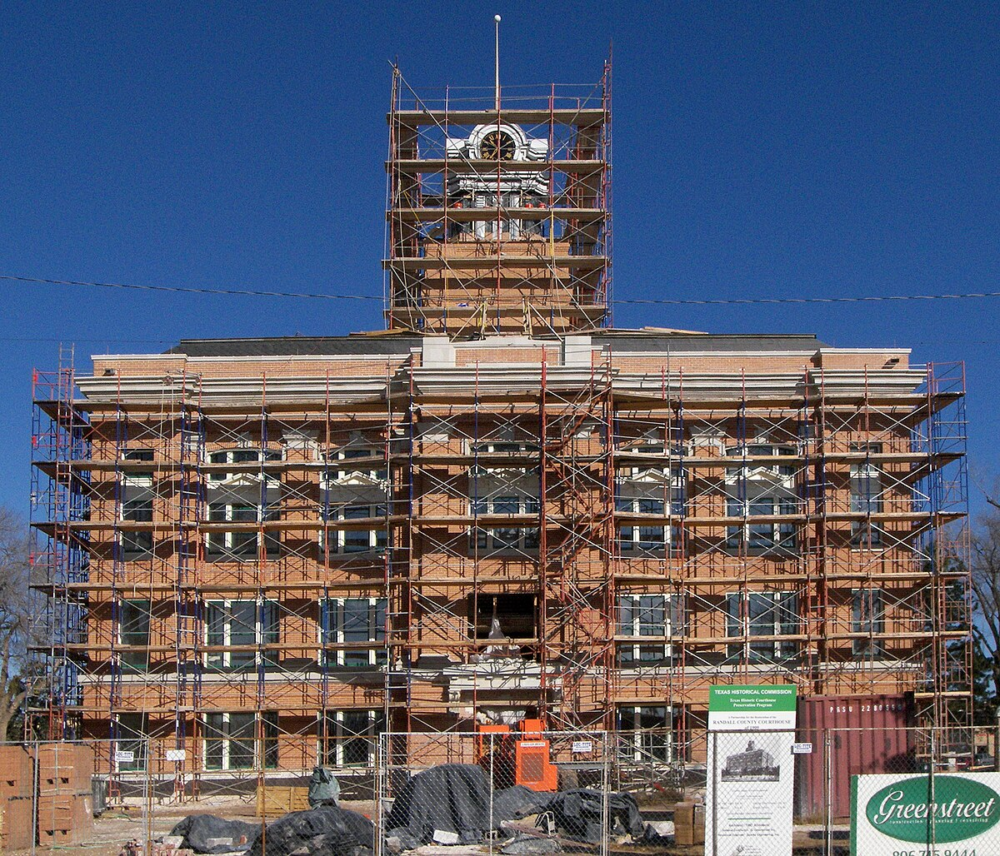

# Orchids, Plugs and Celtics: Canyon's Car Clubs and the Amarillo Drag Strip (Canyon, Tex., 1956–66)

!!! abstract "Article record"
    **Confidence:** Medium · **Source types:** Grassroots weekly newspaper (*The Canyon News*, Canyon, Tex.): club notices, a women's club report, a club display ad, a society column and a sheriff's report, 1956–66, read as scanned page OCR, with the 1966 story checked against the page image · **Last verified:** 2026-10-22 (Round 22-West) · **Open issues:** whether the three clubs were one club renamed ◐; whether "Amarillo Dragway" (1960) and the "Amarillo Drag Strip" (1962, 1966) are the same strip ◐ · [How we rate this](../reference/source-standards.md)

!!! quote "In their own words"
    "Most violations are drinking in a dry county, illegal hours, and minors in possesion."

    — Randall County Sheriff L. S. "Slim" Johnston on the crowds at the Amarillo Drag Strip, *The Canyon News*, June 2, 1966.[^cn660602]

Canyon is the seat of Randall County, a small Panhandle college town just south of Amarillo. Its weekly paper never ran a drag race report from Canyon itself. What it did record, over ten years, is three teenage car clubs trying to convince the town they were safe drivers, and the strip up the road where their cars ran.

<figure markdown>
{ loading=lazy }
<figcaption markdown>The Randall County Courthouse, Canyon, Texas, in 2009. Context only; it does not show the clubs or the strip. Creator: Larry D. Moore. Date: 2009-12-02. Source: [Wikimedia Commons](https://commons.wikimedia.org/wiki/File:Randall_county_courthouse_2009.jpg). License: [CC BY 4.0](https://creativecommons.org/licenses/by/4.0/).</figcaption>
</figure>

## The Orchids (1956)

In May 1956 the paper ran "Boys Organize For Safe Driving." The first official meeting of "the Canyon timing association" had elected Carl Hollabaugh president, Boz Zachry vice president, Ted Fowler secretary, Slats Wheeler treasurer and Ray Mills business manager. The name they chose was "The Orchids." Police Chief George Roden came and offered full support: "The aims of the club are to promote safe driving, setting an example for all drivers, and to try to improve relations between so-called hot rodders and the citizens of Canyon." He added that the members felt "modifying stock cars is a wholesome activity for teen-agers with idle time." The boys planned a car wash at the city barn, a dragster "to enter in the drags in Amarillo," and a summer trip through New Mexico, Colorado, Wyoming, Idaho, Washington, California and Mexico.[^cn560523]

In November the chief of police was Ralph Pray (in May the paper had named George Roden as chief). Pray told a meeting on juvenile problems about the new "hot rod" club, which "should take the members off the streets." Most of its members, he said, were "above the juvenile age."[^cn561121]

## The Plugs at the book club (1957)

A year later Canyon had a club called **The Plugs**, and three of its members were on a panel at the Junior Woman's Book Club. The topic was "Do Hot Rod Clubs Make Better Drivers of Teen-Agers." Bob Zachery, Johnny Knittel and Ted Fowler spoke with Texas Highway Patrolman Cecil McNeill, and Mrs. Truett Hull moderated. Then everyone in the room, members and guests, took a written driver's examination from the state examiner. The club's safety essay prizes, $5 checks, went to Beth Fowler in the junior high division and to Ted Fowler in the high school division.[^cn571113]<a href="#q-1" title="Single source so far: see Open questions">◐</a>

## The Celtics and the safety check (1960–62)

The strip was close enough for a family Sunday. In August 1960 the society column reported that a Canyon family "went to the drag races at the Amarillo Dragway Sunday afternoon," where their son-in-law, Robert Blakley, was competing in two classes.[^cn600818]

In July 1962 the **Celtic Car Club** of Canyon reported that it had grown "from a small group of 11 members" to "almost 25 members in four months time." It was open to boys 16 and older and "was started to promote safety on the Texas highways." It had won two trophies at Amarillo, the latest for entering 18 cars in the drag strip races. Its officers were Charlie Wagner, Mike McAtee, Ben Burkett and Morris Steen. The members were working for an NHRA club charter.[^cn620726]

The next week a display ad for the club ran with the line "THIS AD SPONSORED BY AARON COTTLE." It listed four club objectives, from "To Promote Interest In Hot Rod Activities" to "To Promote Safety In Automobile Maintance And Operation." In capitals in the middle it gave one rule: "EVERY MEMBER'S CAR SHALL BE GIVEN A SAFETY CHECK EVERY THREE MONTHS." It closed with "MAKE PLANS TO ATTEND THE DRAG RACES AT THE AMARILLO DRAG STRIP. SUPPORT THE LOCAL CLUB."[^cn620802]

## Seventy arrests in a dry county (1966)

The strip itself made the front page in 1966, in a sheriff's story. "Deputies Patrol Drag Strip Area" reported that the strip's racing season, which opened the last Sunday in April, had increased the number of deputies needed to patrol the northeast part of the county. The strip lay "one mile east of Washington Street in Amarillo and one-half mile south of the Claude cutoff." Racing was held on the fourth Sunday of each month. In April, "of the approximately 10,000 persons attracted to the Amarillo Drag Strip, 70 were arrested and fined," for moving violations or alcohol in a dry county. Twenty were stopped by the Department of Public Safety for traffic violations and fifty by the sheriff's office for illegal possession of alcohol or drinking by minors. The fines came to more than $1,100. Over Memorial Day weekend the count dropped to 26, with $675 in liquor-law fines. Sheriff Johnston had deputized two Amarillo motorcycle patrolmen to help, and he complained that people were "also throwing bottles and cans in yards along the Claude" cutoff.[^cn660602]

In 1962 the Celtics' ad asked readers to support the local club at the strip. Four years later the same strip was keeping the sheriff's deputies busy on race Sundays. The paper does not say whether any club members were among those arrested. For another Texas club of the same years that wanted a strip of its own, see [Cameron's Accelerators](cameron-accelerators.md). For the state's first sanctioned strip, see [Texas: Three Stopwatches at Caddo Mills](../places/texas.md).<a href="#q-2" title="Open question: see the bottom of the page">?</a>

## Open questions & disputed details

*From the detective's notebook: where the sources disagree, where we have only one, and what we are still looking for. Each item links back to its place in the story.*

**Single source so far.** *Ted Fowler was an officer of the Orchids in 1956 and a member of the Plugs in 1957, which suggests one club under two names; the paper never says so. Whether the 1962 Celtics continued either club is unknown.*[^cn571113] <a class="hr-q-back" href="#qr-1" title="Back to the story">↩</a>

### Next leads

The *Amarillo Globe-Times* and *Amarillo Daily News* for who built and ran the Amarillo strip (1960 "Amarillo Dragway," 1962 and 1966 "Amarillo Drag Strip"), its NHRA status and its closing; whether the Celtics got their NHRA charter; the Orchids' dragster. <a class="hr-q-back" href="#qr-2" title="Back to the story">↩</a>

## Sources

[^cn660602]: "Deputies Patrol Drag Strip Area," *The Canyon News* (Canyon, Tex.), June 2, 1966, p. 1. Checked against the page image. https://archive.org/details/canyon-news-1966-06-02 (accessed 2026-10-22)
[^cn560523]: "Boys Organize For Safe Driving," *The Canyon News*, May 23, 1956. Page OCR. https://archive.org/details/canyon-news-1956-05-23 (accessed 2026-10-22)
[^cn561121]: Juvenile problems meeting report, *The Canyon News*, Nov. 21, 1956. Page OCR. https://archive.org/details/canyon-news-1956-11-21 (accessed 2026-10-22)
[^cn571113]: "Panel Discusses Driving Safety," *The Canyon News*, Nov. 13, 1957. Page OCR. https://archive.org/details/canyon-news-1957-11-13 (accessed 2026-10-22)
[^cn600818]: Society column, *The Canyon News*, Aug. 18, 1960. Page OCR. https://archive.org/details/canyon-news-1960-08-18 (accessed 2026-10-22)
[^cn620726]: "Canyon Car Club Open For Youths," *The Canyon News*, July 26, 1962. Page OCR. https://archive.org/details/canyon-news-1962-07-26 (accessed 2026-10-22)
[^cn620802]: Celtics of Canyon Car Club display ad, *The Canyon News*, Aug. 2, 1962, sec. 2, p. 9. Page OCR. https://archive.org/details/canyon-news-1962-08-02 (accessed 2026-10-22)
