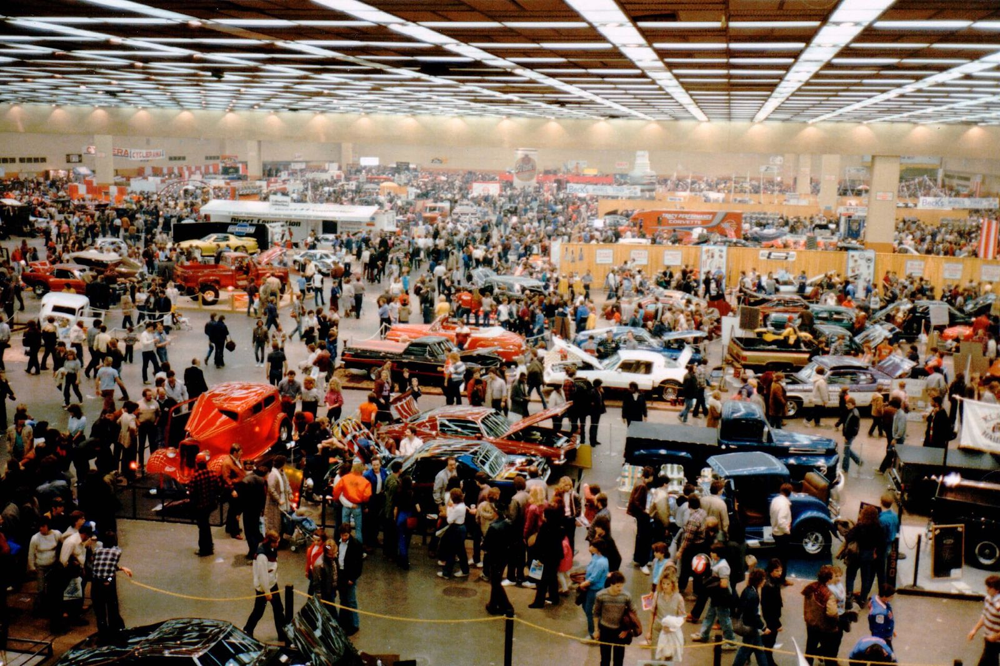
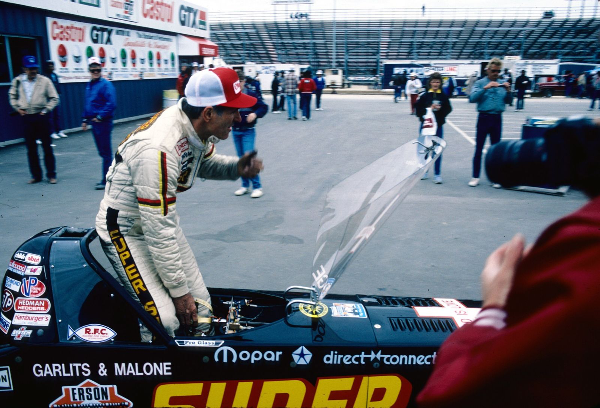

# The Upset at Cordova

*Heartland strips: Detroit Dragway and the World Series of Drag Racing*

!!! abstract "Article record"
    **Confidence:** Medium · **Source types:** Grassroots obituary/tribute, local press, secondary · **Last verified:** 2026-10-13 (Round 4) · **Open issues:** Cordova opening and Detroit closing conflicts · [How we rate this](../reference/source-standards.md)

## 1957: the Garlits upset

In **1957 (Aug 21–25)**, an unknown Don Garlits ran only 133 mph until Emery Cook showed him how to build a hand-operated fuel pressure pump. Garlits then beat Cook & Bedwell in the semis, 9.92/150 against 10.12/160. "Even Garlits admits [it] earned him a 'name.'" Detroit's [Setto Postoian](../people/setto-postoian.md) beat Garlits in the final of both the 1957 and 1958 ATAA World Series (BangShift).[^bs]<a href="#q-4" title="Sources disagree: see Open questions">⚠</a>

BangShift puts the meet in context. Because NHRA's Nationals were gas-only in 1957–58, BangShift argues that the AHRA meet at Great Bend and the ATAA World Series were the only true national gatherings of fuel cars before 1959.[^bs]

## The World Series of Drag Racing

The event itself was older than Cordova. According to Competition Plus, Bob Bartel and his partner Lamona held the first World Series in **October 1954** on a taxiway at George Field, Lawrenceville, Illinois. Competition Plus calls it "one year before the NHRA... had a similar race." It drew entrants from as far as California and New York. It moved from the taxiway to a full runway in 1955.[^cp]<a href="#q-1" title="Sources disagree: see Open questions">⚠</a>

Then it came to Cordova. Bartel's Quad City Drag Strip opened Labor Day weekend 1956. A late-1956 government mandate pushed racing off airports. The World Series moved to Cordova the weekend before Labor Day 1957, the "first of sixty consecutive" there.[^cp]<a href="#q-2" title="Sources disagree: see Open questions">⚠</a>

## Detroit's strips

Detroit had two strips of its own. The first was **Motor City Dragway (1957)**. The Michigan Hot Rod Association used profits from its Detroit Autorama, founded in 1953, to buy land near New Baltimore. Hagerty calls it "the nation's first member-owned strip," with a sign reading "Built, owned, and operated by the youth of Detroit."[^hag] Schartman first drove the flip-top Comet there in December 1965 ([Eddie Schartman](../people/eddie-schartman.md)).

The second, **Detroit Dragway (1959–1997/98)**, was opened by promoter Gil Kohn at Sibley and Dix in Brownstown Township.[^hag][^dd] It hosted the NHRA Nationals in 1959 (783 entries and about 30,000 spectators, per Hagerty) and 1960.[^hag][^nh] Its radio spot "Sunday! Sunday! Sunday!" made it famous. Kohn: "I've run into people in Times Square... who've heard those commercials" (Detroit News, via RememberMichigan, which also hosts 1964–73 radio spots).[^rm]<a href="#q-3" title="Sources disagree: see Open questions">⚠</a>

There is also period evidence for the World Series' early years. Chilton's *Motor Age* (June 1955, sponsor-written) calls the October 1954 Lawrenceville meet the "first annual" World Series, says it drew about 350 hot rodders and 10,000 spectators, and says the second annual was set for "August 17 through 21," with the Motor City Modifiers of Detroit expected to bring 30 to 40 cars. See [Half Day, Illinois](half-day-ataa-maremont.md).[^r12ma]

## Open questions & disputed details

*From the detective's notebook: where the sources disagree, where we have only one, and what we are still looking for. Each item links back to its place in the story.*

**Disputed.** Other accounts give **1956** (Bartel's 2009 newspaper interview, as summarized in 2017) or **1953** (IRG). See [Bob Bartel](../people/bob-bartel.md#when-was-the-first-world-series) for the full biography and the date conflict. <a class="hr-q-back" href="#qr-1" title="Back to the story">↩</a>

**Disputed.** **Opening-year conflict:** the Clinton Herald says Cordova was "built in 1955."[^ch] Competition Plus gives an opening in Labor Day 1956.[^cp] A forum poster's recollection that the race moved there in 1955 is unsourced.[^svt] <a class="hr-q-back" href="#qr-2" title="Back to the story">↩</a>

**Disputed.** **Closing:** "end of 1997" (Detroit Dragway heritage site) vs "1998" (News-Herald, 2011).[^dd][^nh] <a class="hr-q-back" href="#qr-3" title="Back to the story">↩</a>

**Disputed.** **Which two years did Postoian win?** BangShift, the Michigan Motor Sports Hall of Fame and a 1964 Dixon, Ill., newspaper preview all say 1957 and 1958.[^bs] But a June 1958 preview in the same paper called him the winner of "the last two years," which read literally means 1956 and 1957. The sources and the details are on [Setto Postoian](../people/setto-postoian.md#q-4). <a class="hr-q-back" href="#qr-4" title="Back to the story">↩</a>

## Images

<figure markdown>
{ loading=lazy }
<figcaption markdown>The 1985 Detroit Autorama. The show began in 1953, and its profits built Motor City Dragway. Creator: Joetregembo. Date: 2023-02-03. Source: [Wikimedia Commons](https://commons.wikimedia.org/wiki/File:1985_Detroit_Autorama.jpg). License: [CC BY-SA 4.0](https://creativecommons.org/licenses/by-sa/4.0).</figcaption>
</figure>

<figure markdown>
{ loading=lazy }
<figcaption markdown>Don Garlits at Texas Motorplex, April 1987, thirty years after his Cordova breakthrough. Creator: twm1340. Date: 2007-11-16 08:59:48. Source: [Wikimedia Commons](https://commons.wikimedia.org/wiki/File:DonGarlitsApril1987.jpg). License: [CC BY-SA 2.0](https://creativecommons.org/licenses/by-sa/2.0).</figcaption>
</figure>

## Visual references (external)

*These are copyrighted or rights-restricted images, so we link to them instead of copying them.*

- [RememberMichigan: Detroit Dragway radio spots, 1964–73 (audio)](https://www.remembermichigan.com/dragway.aspx?id=1335&type=6)

[^cp]: Competition Plus, "Quad Cities Drag Racing Legend Bob Bartel Passes." https://competitionplus.com/quad-cities-drag-racing-legend-bob-bartel-passes/
[^ch]: Clinton Herald, "Cordova Dragway Park carries on a popular pastime." https://www.clintonherald.com/archives/cordova-dragway-park-carries-on-a-popular-pastime/article_bbc6f1b7-2b04-5f8c-8f35-d53d319b7ca5.html
[^svt]: SVTPerformance forum, "Quad Cities Drag Racing photos from the 50's," 2010. https://www.svtperformance.com/threads/quad-cities-drag-racing-photos-from-the-50s.737744/
[^bs]: BangShift, "Everything You Know About The Nitro Ban Is Wrong." https://bangshift.com/bangshift1320/everything-you-know-about-the-nitro-ban-is-wrong-the-real-history-of-the-infamous-nhra-nitro-ban/
[^hag]: Hagerty, "Detroit's lost dragstrips." https://www.hagerty.com/media/archived/detroit-drag-strips/
[^dd]: DetroitDragway.com, "History of Detroit Dragway." https://detroitdragway.com/history-of-detroit-dragway/
[^nh]: The News-Herald, "Second Dragway reunion is May 21," May 5, 2011. https://www.thenewsherald.com/2011/05/05/motorsports-second-dragway-reunion-is-may-21/
[^rm]: RememberMichigan / WaterWinterWonderland, "Detroit Dragway." https://www.remembermichigan.com/dragway.aspx?id=1335&type=6
[^r12ma]: M. Robert Wolfson (Maremont Automotive Products, Inc.), "The World Series Comes Early" and "For 1955 Hot Rodders," Chilton's *Motor Age*, June 1955 (scanned OCR; sponsor-written). https://archive.org/details/sim_motor-age_1955-06_74_7 (accessed 2026-10-15)
