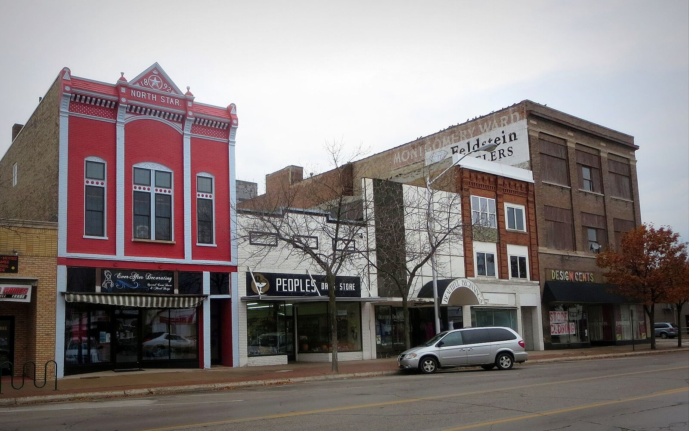

# The Cop and the Auto Shop: Escanaba's Drag-n's, 1954–55

!!! abstract "Article record"
    **Confidence:** Medium · **Source types:** Grassroots local daily newspaper (*Escanaba Daily Press*, seven club items, a school safety conference and a police-ticket column, Jan–Jun 1955, read as scanned OCR), wire feature carried by the same paper (Jul 1954) · **Last verified:** 2026-10-20 (Round 18) · **Open issues:** OCR is rough and a few names and one address are uncertain (flagged); no report of the club's drag strip, auto show or race results was found in the January–June 1955 issues on the archive (July onward is not on the archive, and four earlier issues would not download); the Mexican Road Race claim is unverified ◐ · [How we rate this](../reference/source-standards.md)

!!! quote "In their own words"
    "An organized hot rod club is not a group of thrill drivers menacing the streets and highways as most of the people in this area believe."

    — **Escanaba Daily Press** staff feature, "Escanaba Hot Rod Club Stresses Safe Driving To Its Membership," Apr 23, 1955. *OCR text, spacing normalized.*[^apr23]

A Michigan policeman spent a year driving to another town every weekend to run with its car club. Then he came home and started his own, above an auto shop.

That is the short version of **Kemp Sabourin** and **Bill Miller**, the two men behind the **Drag-n's Auto Club** of Escanaba, a small city whose daily paper billed itself as serving the "Upper Peninsula's Leading Trade Area."[^apr23] The *Escanaba Daily Press* gave them a feature and six shorter notices between January and June 1955. Their small, earnest story has none of the usual hot rod landmarks. There is no dry lake and no famous shop. There is a police officer, an auto shop with a clubroom upstairs, a strict rulebook and, by the paper's account, a town that mostly believed the worst of hot rodders.

## The weekend commute

The April 23, 1955 feature says Sabourin, "a member of the city police force," and Miller "decided to organize a local hot rod club after spending a year of traveling to Kingsford every week end" to take part in the activities of a Kingsford car club. The scan reads "Kingsford Shailenger's Auto Club," and we cannot be sure of that spelling (OCR). It adds that Sault Ste. Marie and the Copper Country also had hot rod clubs.[^apr23]<a href="#q-1" title="Single source so far: see Open questions">◐</a>

## The shop on Washington Avenue

The feature places the club's home at **1418 Washington Avenue**. The auto shop "belongs to Kemp and Bill," and the clubroom sits above it. Members could use the shop "at anytime" to build and repair their cars.[^apr23] (The January item's scan reads the street as "Wallington Ave.," which looks like an OCR slip. A May notice prints "Washington Ave." too.[^may21])

The feature dates the founding to **December 1954** and says eight of the town's "driving enthusiasts" organized it. Besides Sabourin and Miller, the charter members it lists are Earl Anderson, Wayne Berthaume, Bill Kolich, Jerry Larson, John Lasnoski Jr. and John Moore. Thirteen more had joined by April.[^apr23] The treasurer's name is garbled in the scan, so we leave it out.

On **January 5, 1955** the paper reported that organization "has been completed and officers named on a provisional basis": Sabourin as president and Miller as vice president for six months, until an election. The club met "each Monday evening at 7:30," had 24 members, and wanted a quarter-mile strip for the summer.[^jan5] By April 16 it had "over 25."[^apr16]

## The rules

The Drag-n's looked a lot like the safety clubs the city planners described in 1955 (see [What the City Planners Wrote](planners-report-1955.md)). The paper lists the rules, and they start with the cars themselves. Members got aluminum plates with "a black background and a hot rod and the name Drag-n's and Escanaba." The plates were meant to tell other drivers which hot rods belonged to the club and which belonged to other drivers. Members said this would "help abate undue criticism."[^apr23] A member's plate stayed on only if his car met standards for lights, brakes, front end, rear end, exhaust and wiring.[^apr23]

Discipline was strict. "A moving violation ticket automatically suspends a member from the club for 30 days." Missing meetings without an excuse was a second ground for suspension. In January the officers said a member who broke the safe-driving policy "is expelled."[^apr23][^jan5]

Membership cost a $2.50 fee and weekly dues of 35 cents. The treasury could be spent only on items that benefited the whole club, by majority vote. Members needed a driver's license, and a current member had to bring them in.[^apr23]

The police took part as well. A January item says Escanaba police officers "attended a recent meeting to speak on driving safety and safe automobiles."[^jan5] In April the club invited a police representative, service clubs and business people to an open meeting to explain its by-laws and its drag strip plan.[^apr16]

The club also said it was not for teenagers only. "Any person of good character," including "persons of an older age group," could apply.[^apr23]

## The cars

The cars came slowly, and the feature is blunt about money. "The cars that are being built by the club members are being built correctly," Sabourin said, "but the work is slow because of the high expense involved." It describes a '49 Oldsmobile engine and Hydra-Matic in a '33 Plymouth frame, and a '39 Ford engine in a '32 Chevrolet frame. Sabourin and Miller were building a dragster, a car "with no body," which they said was "begun right from the rails."[^apr23]

Of the dragster the paper quotes them: "Putting a motor in a car is one of the easiest steps, but hooking up the many parts of the car proves a bit more difficult."[^apr23]

The piece adds that a home-built hot rod "captured fifth place last year in the Mexican Road Race." It gives no name or car, and nothing else in this wiki supports it. We repeat it as the paper's claim only.<a href="#q-2" title="Single source so far: see Open questions">◐</a>[^apr23]

## The strip that never shows up

The Drag-n's wanted a drag strip, and the paper says where. It was "a quarter mile level straight stretch of road" near a radio site whose name is garbled in the scan ("Danfordth," OCR). The road would have to be black-topped "for greatest safety measures." The paper claims many club cars would top 100 mph "in a quarter mile, a distance of three blocks."[^apr23] The club also planned an **auto show** for "the first of June," where any vehicle from a sedan to a motorcycle would be safety-checked and scored for appearance, lights, brakes, steering, exhaust, wiring and papers.[^apr23]

The one event we can document is smaller. A notice on **May 21, 1955** says the club would sponsor "a road race to test speed judgment" on Sunday, May 22, starting at noon from the clubhouse. Only members could enter, "although the public is invited to attend," and prizes would be awarded.[^may21] That is a judgment test, not a timed drag run, which fits the club's safety message. We found no report of the result.<a href="#q-3" title="Open question: see the bottom of the page">?</a>

## More from the paper's small print { #more-from-the-papers-small-print-added-round-18 }

Four more mentions turn up in the January–June issues. None is a headline, but together they show a club the paper kept on its calendar.

The first came from the schools. On **January 14, 1955**, nine days after the club's organization notice, the paper reported on the second annual regional Teen Age Safety Conference at Escanaba Senior High School, with "more than 100" students from area high schools. Among the resolutions the delegates adopted: "that an attempt be made to channel the abilities and interests of boys, who are mechanically inclined, into hot-rod clubs or other constructive programs," and that "the community be informed as to the real purpose of hot-rod clubs and other driver education programs."[^jan14] The Drag-n's rulebook, with its plates and 30-day suspensions, reads like an answer to that second resolution. The paper does not connect the two, and neither do we.<a href="#q-4" title="Single source so far: see Open questions">◐</a>

The rest are meeting notices. On April 13 the paper announced a "special meeting" for Thursday evening at the club room on Washington Avenue, and its April 18 sports column listed the Drag-n's among the evening's meetings.[^apr13][^apr18] April 18, 1955 was a Monday, which fits the Monday-night schedule the January item gave. On **June 20, 1955**, a "Briefly Told" item said "a special meeting of the Drag-n's Auto Club will be held at 7:30 tonight" at 1418 Washington Avenue, adding that "the public is invited to attend and all members are requested to be present."[^jun20] It is the last club item we can read, and it shows the club still meeting a month after the May 22 road race. It does not say why the meeting was special.<a href="#q-5" title="Single source so far: see Open questions">◐</a>

One ticket from those weeks stands out. On June 10, 1955 the police-ticket column listed a Green Bay motorist for "speeding and 'drag racing' on Ludington St." The item says nothing about the Drag-n's, and nothing in the paper ties them to it.[^jun10] We mention it because it is the only traffic ticket for "drag racing" that turned up in our search of these issues, and it fell in the same weeks the club was preaching safe driving. Full story: [Belleville's Gear Jammers and the St. Louis Strip Hunt (1952–1959)](belleville-gear-jammers.md#the-club-with-the-half-fine-rule).

<figure markdown>
{ loading=lazy }
<figcaption markdown>The 1200 block of Ludington Street, Escanaba's main street, in 2014. A Green Bay motorist was ticketed in June 1955 for "drag racing" on Ludington St.; the item gives no block, so this photo shows the street, not the spot. Creator: Yooperann. Date: 2014-10-23. Source: [Wikimedia Commons](https://commons.wikimedia.org/wiki/File:1200_Block_Ludington_Street,_Escanaba,_MI.JPG). License: [CC BY-SA 3.0](https://creativecommons.org/licenses/by-sa/3.0).</figcaption>
</figure>

## Where this fits

The paper had already run the safety pitch. In July 1954 the same paper ran a feature headed "Hot Rodders Playing It Safe" about the Chicago-area Automobile Timing Association of America, with the line that the group came into being in 1953. See [Half Day, Illinois](half-day-ataa-maremont.md). Other clubs were working the same way: [Decatur, Indiana](indiana-small-town-clubs.md) formed its own chapter in 1956 with a police blessing. [Kansas City](kansas-city-timing-association.md) was building a 32-club timing association in 1955, the year the Drag-n's got their plates.

## Open questions & disputed details

*From the detective's notebook: where the sources disagree, where we have only one, and what we are still looking for. Each item links back to its place in the story.*

**Single source so far.** The April 16 notice says Escanaba's club was formed "along the lines of similar clubs in Iron Mountain and other cities."[^apr16] <a class="hr-q-back" href="#qr-1" title="Back to the story">↩</a>

**Single source so far:** We repeat it as the paper's claim only. <a class="hr-q-back" href="#qr-2" title="Back to the story">↩</a>

**Open question.** **What we could not find.** We searched every readable *Escanaba Daily Press* issue on the archive from January through June 1955 for the strip, the auto show and the race results and found nothing. The archive's run of this paper for 1955 stops at June 30: the July through September issues we tried do not exist there. Four issues in between (Jan. 1, Feb. 12, Feb. 21 and May 30) returned server errors on every try, so we could not search them. The OCR also misses words. Treat the strip and the auto show as plans, not events. ◐ <a class="hr-q-back" href="#qr-3" title="Back to the story">↩</a>

**Single source so far:** The paper does not connect the two, and neither do we. <a class="hr-q-back" href="#qr-4" title="Back to the story">↩</a>

**Single source so far:** It does not say why the meeting was special. <a class="hr-q-back" href="#qr-5" title="Back to the story">↩</a>

## Sources and notes

Scans of the *Escanaba Daily Press* are on the Internet Archive from the NewspaperArchive collection. The OCR splits words, interleaves columns and drops letters, so every quotation here is normalized for spacing only and kept as short as possible. We link the scans as external references; we do not reproduce the pages.

[^apr23]: "Escanaba Hot Rod Club Stresses Safe Driving To Its Membership," *Escanaba Daily Press*, Apr 23, 1955 (OCR of the scanned issue). https://archive.org/details/escanaba-daily-press-1955-04-23 (accessed 2026-10-15)
[^apr16]: "Hot Rod Club To Hold Meeting Monday Night," *Escanaba Daily Press*, Apr 16, 1955 (OCR). https://archive.org/details/escanaba-daily-press-1955-04-16 (accessed 2026-10-15)
[^jan5]: Item on the organization of the Escanaba Drag-n's Auto Club, *Escanaba Daily Press*, Jan 5, 1955 (OCR). https://archive.org/details/escanaba-daily-press-1955-01-05 (accessed 2026-10-15)
[^may21]: "Drag-n's Auto Club Will Sponsor Race," *Escanaba Daily Press*, May 21, 1955 (OCR). https://archive.org/details/escanaba-daily-press-1955-05-21 (accessed 2026-10-15)
[^jan14]: "Teen-Agers Discuss Problems Of Safety," *Escanaba Daily Press*, Jan 14, 1955, p. 2 (OCR). https://archive.org/details/escanaba-daily-press-1955-01-14 (accessed 2026-10-18)
[^apr13]: "Hot Rod Club" notice, *Escanaba Daily Press*, Apr 13, 1955 (OCR). https://archive.org/details/escanaba-daily-press-1955-04-13 (accessed 2026-10-18)
[^apr18]: Sports column mentioning the Drag-n's meeting, *Escanaba Daily Press*, Apr 18, 1955 (OCR). https://archive.org/details/escanaba-daily-press-1955-04-18 (accessed 2026-10-18)
[^jun10]: "Motorists Ticketed" item, *Escanaba Daily Press*, Jun 10, 1955 (OCR). https://archive.org/details/escanaba-daily-press-1955-06-10 (accessed 2026-10-18)
[^jun20]: "Drag-n's Auto Club" item in "Briefly Told," *Escanaba Daily Press*, Jun 20, 1955 (OCR). https://archive.org/details/escanaba-daily-press-1955-06-20 (accessed 2026-10-18)
