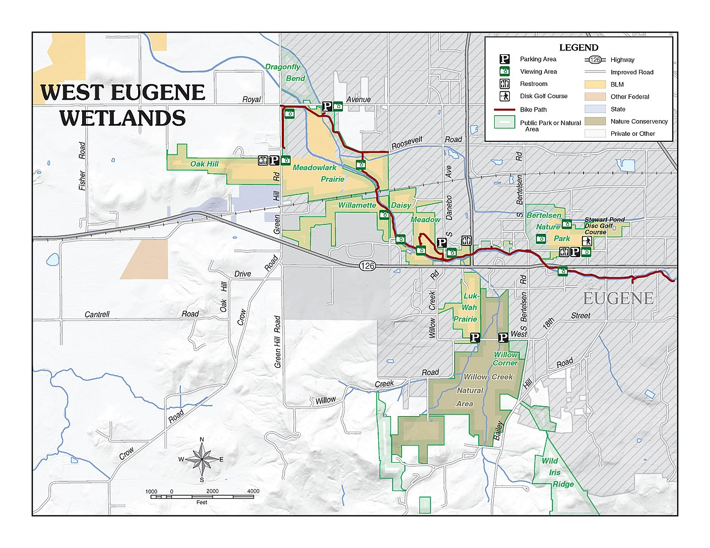

# "Cash Back, Cash Back": Eugene's Road Kings, Balboa Park and Medford's White City Strip (1950–1979)

*A police chief's club so teenagers would race off the street, and a 1973 funny-car night that ended with cash back and a raceway T-shirt turned inside out*

!!! abstract "Article record"
    **Confidence:** Medium (the 1950, 1955, 1958, 1962 and 1968 details come from the *Register-Guard*, the *Mail Tribune* and the *Oregon Daily Emerald* themselves, read page by page; Balboa's 1973 night rests on the track manager's own memoir and a teenager's memory, and its first and last years, and its length, are disputed) · **Source types:** Grassroots *Eugene Register-Guard* (1950, 1955), *Medford Mail Tribune* (1958, 1962) and *Oregon Daily Emerald* (1968) through Historic Oregon Newspapers; racers' memories on *Drag Strip List*; "Rocky's Road" on a class-reunion website; a wetlands group's trail history · **Last verified:** 2026-11-11 (Round 38) · **Open issues:** ⚠ the Road Kings' first meet; ⚠ Balboa's first year; ⚠ Balboa's last year; ⚠ an eighth-mile or a quarter; ? the Slo Poks' founding; ◐ why the police stopped the 1973 show · [How we rate this](../reference/source-standards.md)

!!! quote "In their own words"
    "You have exactly 10 minutes to complete this event. The neighbors near here have been complaining and this event is done!"

    — A plain-clothes Eugene police officer at Balboa Drag Strip, 1973, as Rocky, who brought the timing equipment, remembered it, "Rocky's Road."[^rocky3]

## The chief's club

Eugene's Road Kings were organized by the former police chief so teenagers could race somewhere other than the streets. Their first full-fledged hot-rod meet was at Mahlon Sweet Airport in 1950. In 1973 the crowd at Balboa chanted "cash back, cash back," and Rocky turned his raceway T-shirt inside out.

In 1955 the *Register-Guard* said Eugene's **Road Kings** "were originally organized by Eugene's former police chief, Keith Jones, to give teenagers a chance to race somewhere other than on the streets and highways."[^erg55] On August 30, 1950, the paper announced: "Eugene's 'Road Kings' will sponsor their first full-fledged hot-rod meet Sunday at Mahlon Sweet Airport, starting at 10 a.m."<a href="#q-1" title="Sources disagree: see Open questions">⚠</a>[^erg50] Bo Knabb of Portland won top eliminator at Mahlon that year in a '32 three-window with a four-carburetor flathead. Randy Rhoades found the remains of the coupe in the late 1990s. Knabb told him he had bought a 331 Chrysler engine for it, "but sold the car in 1952 and put the engine in his ski boat."[^dslor] The meets drew from far away: Albert Drake and his father drove 120 miles from Oswego to watch.[^drake]

By September 1955 it had been "about three years," Road Kings president Robert Scott said, since Eugene's last local drag race. That month the Eugene Active Club sponsored an all-Sunday NWTA meet at Mahlon Sweet, with up to 100 racers and the proceeds going to its charities. Admission was 50 cents and children under 12 got in free. The racing was on one of the taxi strips, and "Spectators will watch from their cars." The Antique Car Club put on a show between rounds.[^erg55]

## Camp White

Southern Oregon raced at the old Camp White, north of Medford. The *Mail Tribune* of September 5, 1958 previewed the Southern Oregon Timing Association's "second annual Northwest Gas Championship" at the **Camp White** strip. The headliner was Jay Cheatham of Sunnyvale, who had just lost the national title at Oklahoma City "only by inches." The strip record, 134.24 mph, set the year before, belonged to the "Glass Slipper" of Sacramento, but its owners "have been unable to get a new crankshaft for their engine." About $2,000 in savings bonds was up for grabs. The top eliminator got a $50 bond and a 34-inch trophy, and there were special prizes for the racer who came farthest and for "hard luck." Saturday's top cars went on display in the First National bank lot at Sixth and Front, and the Medford Lions ran the concession stand.[^mmt58] By 1962 the season ran seven weekends, including a Worlds Fair meet, the Sixth Annual Northwest Gas & Fuel championship and an annual charity meet, with about 150 entrants expected for the May 13 opener.[^mmt62]

Gary Pruitt started hitchhiking from Grants Pass to the White City strip around 1956, when he was 12 or 13, and saw the Glass Slipper "several times." In 1958 his club, the **Rakes** of Grants Pass, met with SOTA about a new purpose-built strip in Josephine County. They had support from the Highway Patrol, the sheriff, the police, the mayor and a landowner willing to donate the ground. "I don't recall what happened Everything fell apart in 1960."[^dslor] In September 1959 the Slo Poks of Vancouver, Washington, came south for the Oregon Centennial Gas Championship at Camp White and won the trophy for most members of any club there. When the Slo Poks were organized is still open.<a href="#q-4" title="Open question: see the bottom of the page">?</a> Their Dave Skeans set a track record of 103.32 mph in his Chevy-powered '37 Ford.[^dslor] On the coast, Randy Rhoades took the only trophy he ever won at the Port Orford strip in 1963. Earlier, at Woodburn, a buddy who had flat-towed Rhoades's '56 Chevy there "beat my time with the tow car."[^dslor]

## Balboa Park

Eugene got its own strip on West 11th, on the old Thunderbird Air Park. Whether the first year was 1967 or 1968 is still open.<a href="#q-2" title="Sources disagree: see Open questions">⚠</a>[^wren] On April 28, 1968, a Sunday, a "U of O STUDENTS" ad in the *Oregon Daily Emerald* offered "AA/Fuel Match-Racing At Its BEST!," Ron Salsbury of Corvallis against Bob Cochran's new Eugene dragster, more than 250 cars, $2 admission and "SUDS ON TAP" at "BALBOA PARK DRAG STRIP WEST 11th AND DANEBO AVENUE."[^ode68] Richard Gray started there in high school, at Wednesday-night grudge racing. The first funny car he ever saw up close was Ed McCulloch's, fired off next to him in the lanes: "Flames went through under my car and I was deaf and at times I couldn't see or hardly breath. Absolutely loved it." Spectators, he added, parked against the fence past the bleachers and "sat on the hood with your girlfriend."[^dslor]

Rocky remembered Balboa as a small eighth-mile. Whether it was an eighth-mile or a quarter is still open.<a href="#q-6" title="Sources disagree: see the bottom of the page">⚠</a> Weekly eight-car funny car shows on Friday nights through the summer: Kenney Goodell, Springer and Price, Twig Ziegler, Nitro Nick Harmon. Its starting line got its traction from "a splash of VHT."[^rocky1] In 1973 Bill Doner rented it for the Friday before his first-ever 64-funny-car show in Seattle, so that the touring stars would have one more payday. Former Seattle concessionaire Rod Ormsby would run the food, and Doner promised to be done by 10 p.m.[^rocky1] Ten days of radio ads ended with the tagline "16 funny cars on the line, guaranteed or your money back," Doug Morris remembered.[^dslor] McCulloch, the Hawaiian, Pisano, the Blue Max, Jungle Jim and Danny Ongais in the Vel's Parnelli Jones car came, about 16 in all. Three or four thousand people, maybe more, squeezed onto the old wooden grandstands, "often call 'circus blues,'" with cars parked along the highway as far as the eye could see.[^rocky2]

Then, just before the final and well before the curfew, a plain-clothes officer walked up to the starting line and gave them ten minutes. Why the police stopped the show is one account.<a href="#q-5" title="Single source so far: see Open questions">◐</a> Doner asked for two more cars and was told it was jail if he didn't stop. Security disappeared. The crowd poured onto the strip, threw rocks through the tower windows, tried to set the tower on fire and chanted "cash back, cash back." Rocky, who ran the timing gear, turned his raceway T-shirt inside out to look as little a part of the event as he could.[^rocky3] "It was the talk of my junior high school the following day," Morris wrote.[^dslor]

Balboa went on as a bracket track. Its later names included Norpack and West Pacific Dragway, and one retired Eugene police car, a blue-and-white Dodge driven by a woman, won the points one year.[^dslor] Don Washington said the lease was not renewed after 1976. The wetlands history has the strip until 1979.<a href="#q-3" title="Sources disagree: see Open questions">⚠</a> Rob Ross, whose father owned The Keg Tavern, remembered the land "being part of a Wet Lands" with spotted frogs.[^dslor] He was right: it is now the Tsanchiifin Walk in the West Eugene Wetlands, formerly the Balboa Trail and renamed for a Kalapuyan band, and remnants of the runway, taxiways and fill are still there, now wetland and upland habitat.[^wren]

<figure markdown>
{ loading=lazy }
<figcaption markdown>West Eugene Wetlands map (context only); the old Balboa strip land lies near West 11th Avenue and Danebo Avenue. Creator: Bureau of Land Management Oregon and Washington. Date: 2016-11-18. Source: [Wikimedia Commons](https://commons.wikimedia.org/wiki/File:West_Eugene_Wetlands_(30946701742).jpg). License: Public domain.</figcaption>
</figure>

The Road Kings were a police chief's club, and the first full-fledged meet was at the airport in 1950. In 1973 the crowd chanted "cash back, cash back," and Rocky turned his raceway T-shirt inside out.

*See also:* [Scappoose, Aurora and the CTA](scappoose-aurora-columbia-timing-association.md), the Portland clubs to the north; [The Pacific Northwest](../places/pacific-northwest.md), for Woodburn; [Red Bluff](red-bluff-schafer-oil-special.md), Northern California's strips over the Siskiyous; [Western Washington's airport strips](western-washington-airport-strips.md).

## Open questions & disputed details

*From the detective's notebook: where the sources disagree, where we have only one, and what we are still looking for. Each item links back to its place in the story.*

**Disputed.** **When was the Road Kings' first meet?** The *Register-Guard* of August 30, 1950 called the Sunday meet, September 3, their "first full-fledged hot-rod meet."[^erg50] *Drag Strip List*'s research says the club scheduled at least four races at the airport in 1950 and that Robert Bugsbee "won the first race on Aug. 20."[^dslor] An August 20 trial and a September 3 "full-fledged" meet could both be right. <a class="hr-q-back" href="#qr-1" title="Back to the story">↩</a>

**Disputed.** **Did Balboa open in 1967 or 1968?** The wetlands history gives "a drag strip (Balboa Drag Strip) from 1968 until 1979."[^wren] Richard Gray: "I started in 1967."[^dslor] A racing blog posted a full-page Balboa Park ad that its file name dates to the *Register-Guard* of August 18, 1967.[^bfp] <a class="hr-q-back" href="#qr-2" title="Back to the story">↩</a>

**Disputed.** **When did Balboa close?** Washington: "The last year of operation was 1976. The track lease was not renewed." The wetlands history: until 1979.[^dslor][^wren] <a class="hr-q-back" href="#qr-3" title="Back to the story">↩</a>

**Open question.** **When were the Slo Poks organized?** The *Drag Strip List* editor's note says 1951, "the second car club to be organized in Vancouver"; the caption on Bill Cordell's plaque says 1952. Both are on the same page, and we have not seen the club's own records.[^dslor] <a class="hr-q-back" href="#qr-4" title="Back to the story">↩</a>

**Single source so far.** **Why did the police stop the 1973 show?** Only Rocky's account gives the officer's words and the neighbors' complaints; Morris confirms that the authorities shut it down before all the cars had run.[^rocky3][^dslor] The *Register-Guard* for that weekend is the next place to look. <a class="hr-q-back" href="#qr-5" title="Back to the story">↩</a>

**Disputed.** **Was Balboa an eighth-mile or a quarter?** Rocky calls it "That small eighth mile track," and the 1973 rental "the small eighth race track."[^rocky1][^rocky2] Walt Ballard, under a heading dated 1973–76, wrote of "a 11.23 and an 11.24 on the 1/8th-mile strip."[^dslor] Bruce Patten raced a '67 Chevelle there in the summer of 1972 and wrote, "It was a 1/4 mile strip that year," with a best of "13.65 at 109."[^dslor] His "that year" may be a different season from the funny-car night Rocky describes. The August 18, 1967 ad, as posted, does not print a distance, though the blog captions it an "eighth-mile drag strip," and the April 26, 1968 *Emerald* ad gives none either.[^bfp][^ode68] <a class="hr-q-back" href="#qr-6" title="Back to the story">↩</a>

### Next leads

The *Register-Guard*, August–October 1950 (Road Kings results), August 1967 (Balboa's opening) and the 1973 funny car night; the *Mail Tribune*, 1957 (the first Northwest Gas Championship) and 1960 (the Josephine County strip); the *Grants Pass Daily Courier*, 1958–60; the *Port Orford News*, 1963.

## Sources

[^erg50]: "Hot-Rod Race Set Sunday," *Eugene Register-Guard*, August 30, 1950, p. 15, via Historic Oregon Newspapers (page OCR). https://oregonnews.uoregon.edu/lccn/sn85042472/1950-08-30/ed-1/seq-15/ocr/ (accessed 2026-11-11)
[^erg55]: "Active Club Sponsoring All-Sunday Drag Races," *Eugene Register-Guard*, September 22, 1955, p. 27, via Historic Oregon Newspapers (page OCR). https://oregonnews.uoregon.edu/lccn/sn85042472/1955-09-22/ed-1/seq-27/ocr/ (accessed 2026-11-11)
[^mmt58]: "Competition Starts Saturday Afternoon In Northwest Gas Championship Drags," *Medford Mail Tribune*, September 5, 1958, p. 11, via Historic Oregon Newspapers (page OCR). https://oregonnews.uoregon.edu/lccn/sn97071090/1958-09-05/ed-1/seq-11/ocr/ (accessed 2026-11-11)
[^mmt62]: "Drag Strip Will Open On May 13," *Medford Mail Tribune*, May 7, 1962, p. 13, via Historic Oregon Newspapers (page OCR). https://oregonnews.uoregon.edu/lccn/sn97071090/1962-05-07/ed-1/seq-13/ocr/ (accessed 2026-11-11)
[^ode68]: Balboa Park Drag Strip advertisement, *Oregon Daily Emerald* (Eugene), April 26, 1968, p. 12, via Historic Oregon Newspapers (page OCR). https://oregonnews.uoregon.edu/lccn/2004260239/1968-04-26/ed-1/seq-12/ocr/ (accessed 2026-11-11)
[^dslor]: "Oregon: Remembering . . ." (racers' memories posted with names, including Randy Rhoades, Gary Pruitt, Bill Cordell, Richard Gray, Doug Morris, Bruce Patten, Rob Ross, Don Washington and Walt Ballard, with editor's research notes), *Drag Strip List* (read through a headless browser; the page is script-rendered). https://dragstriplist.com/or (accessed 2026-11-11)
[^drake]: Albert Drake, "The First Drags," excerpted from *Reflections in a Spinner Hubcap*, *Flat Out Press* (blog), April 2021. https://flatoutpress.blogspot.com/2021/04/the-first-drags.html (accessed 2026-11-11)
[^rocky1]: Rocky, "Eugene Drags: A Happening," Rocky's Road, jefferson61.com (class-reunion website), undated. https://www.jefferson61.com/t1.htm (accessed 2026-11-11)
[^rocky2]: Rocky, "Eugene Drags: Pt. 2," Rocky's Road, jefferson61.com (class-reunion website), undated. https://www.jefferson61.com/t2.htm (accessed 2026-11-11)
[^rocky3]: Rocky, "Police have arrived. Now what?," Rocky's Road, jefferson61.com (class-reunion website), undated. https://www.jefferson61.com/Police-have-arrived.-Now-what.htm (accessed 2026-11-11)
[^wren]: "Tsanchiifin Trail," *WREN: Engage, Educate, Empower!* (Willamette Resources and Educational Network blog), March 7, 2008. http://wewwild.blogspot.com/2008/03/tsanchiifin-trail.html (accessed 2026-11-11)
[^bfp]: befastpast, "another 1967 ad from Oregon," *racin' thru the raindrops* (blog), October 29, 2014. http://befastpast.blogspot.com/2014/10/another-1967-ad-from-oregon.html (accessed 2026-11-11)
