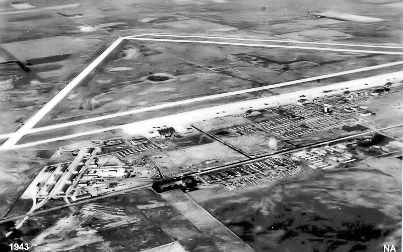
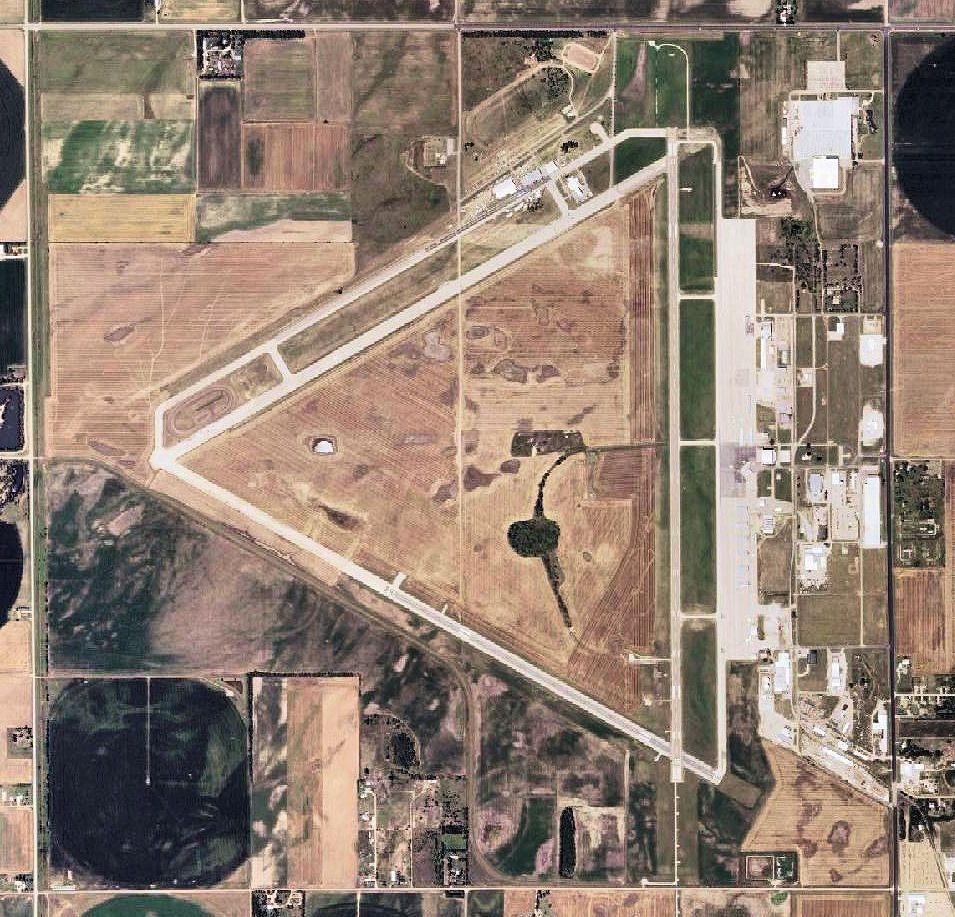

# Great Bend, Kansas: A Club, a Chamber of Commerce and the First Nationals (1953–1955)

!!! abstract "Article record"
    **Confidence:** Medium-High · **Source types:** Grassroots club-run track's own history page (SRCA Dragstrip), local newspaper (Great Bend Tribune, 2011), NHRA retrospective (2021) · **Last verified:** 2026-10-15 (Round 11) · **Open issues:** ⚠ a top-speed figure differs by one digit between sources; the Tribune's 'birthplace of drag racing' is local pride, not a documented fact; Kansas Historical Site status is the club's own claim · [How we rate this](../reference/source-standards.md)

!!! quote "In their own words"
    "It was because of all of the accidents that were happening on the highways and the streets during this time with the kids. … Everybody was hot-rodding. They decided to take the air strip and turn it into a drag strip and that's really how it all started."

    — **Hank Denning**, president of the Sunflower Rod and Custom Association, Great Bend Tribune (2011), recounting why the club went to the city. He is retelling club history, not his own memory.[^gbt]

NHRA calls the 1955 National Championship Drags at Great Bend "its first national event." The story of how a Kansas town got it is a **local-initiative** story: a club of "motorheads," a city that owned a surplus bomber field, and a Chamber of Commerce letter.[^nhra][^srca][^gbt]

## The timeline, from the club's own page

- **1946:** the City of Great Bend acquired the B-29 Army Air Force base after the military declared it surplus.
- **May 12, 1953:** the first race on the old field.
- **January 19, 1954:** the Sunflower Rod and Custom Association (SRCA) was formed. It joined NHRA in April 1955.
- **1955:** "The Great Bend Chamber of Commerce on behalf of SRCA wrote a letter to Wally Parks requesting that Great Bend, KS be the site for the FIRST National Event. NHRA said YES."
- **1956–59:** the new AHRA held its nationals there on the 8,000-foot track; in 1960 AHRA's president moved them to Kansas City.
- **1993–94:** the club reorganized under its original name, and says the track was recognized as a Kansas Historical Site in 1994.[^srca]

## The 1955 meet

NHRA's retrospective (2021) says Hot Rod's August 1955 issue announced Great Bend as the site, using an 8,000-foot runway at the municipal airport, Sept. 29 to Oct. 2, with a $5 entry fee and 30 classes.[^nhra] Key details:

**Rain.** "The worst rainstorm in 30 years" hit on the third day and washed out Sunday's finals. The championship was finished on Nov. 19–20 at the Southwest Regional in Perryville, near Phoenix, where Calvin Rice, a 25-year-old from Santa Ana, became NHRA's first national champion.[^nhra]

**Inspections.** NHRA's tech team disqualified several winners, mostly in Stock classes. In one class "the first three finishers were found to be running 'out of class.'"[^nhra]

**Ties to our other pages.** NHRA lists Howard Johansen as "C" Gas Coupe class winner (see [Howard Johansen](../people/howard-johansen.md)) and Raymond Godman as "A" Modified Roadster winner (see [Ray Godman](../voices/ray-godman.md)).[^nhra]

### ⚠ Discrepancies

*From the detective's notebook: one likely typo and two meanings of "first."*

**Fastest speed.** The SRCA page says Art Chrisman ran **146.16** mph; NHRA's retrospective says his second run "netted a speed of 145.16 mph." Both say Lloyd Scott later reached 151 mph.[^srca][^nhra] One is likely a typo.

**"First."** The Tribune says "the first NHRA drag race" and "birthplace of drag racing." NHRA's own retrospective says "first national event," and a separate NHRA feature credits Pomona with "the first NHRA-sanctioned event" in April 1953 (see [Pomona's Choppers](pomona-choppers-fontana.md)). These are different claims.[^gbt][^nhra][^pom]

## What kept it going

The Tribune calls it a "National Hot Rod Association member city-leased track" and says it was one of four tracks chosen for Hot Rod Drag Week in 2011. The club says it reorganized in 1993 "to help in maintaining the track," and that the track was resurfaced in 2000 with a Kansas DOT grant.[^gbt][^srca] The club, not a promoter, still runs it.

<figure markdown>
{ loading=lazy }
<figcaption markdown>Great Bend Army Airfield in 1943, the bomber field that became the city's airport and, in the early 1950s, the drag strip. Creator: United States Army Air Forces. Date: 1943. Source: [Wikimedia Commons](https://commons.wikimedia.org/wiki/File:Great_Bend_Army_Airfield_KS_1943.jpg). License: Public domain.</figcaption>
</figure>

<figure markdown>
{ loading=lazy }
<figcaption markdown>USGS orthophoto of Great Bend Municipal Airport (the former Army airfield), 2006. We have not identified the drag strip in this image. Creator: United States Geological Survey (USGS). Date: 2006. Source: [Wikimedia Commons](https://commons.wikimedia.org/wiki/File:Great_Bend_Municipal_Airport_KS_2006_USGS.jpg). License: Public domain.</figcaption>
</figure>

[^srca]: SRCA Dragstrip, "About Us." https://www.srcadragstrip.com/about-us (accessed 2026-10-15)
[^gbt]: "1955: Back to where it all began," Great Bend Tribune (2011, Hot Rod Drag Week preview). https://www.gbtribune.com/sports/local_sports/1955-back-to-where-it-all-began/ (accessed 2026-10-15)
[^nhra]: Phil Burgess, "Reliving NHRA's first race: the 1955 National Championship Drags in Great Bend," NHRA, Oct 27, 2021. https://www.nhra.com/news/2021/reliving-nhra-s-first-race-1955-national-championship-drags-great-bend (accessed 2026-10-15)
[^pom]: Phil Burgess, "Pomona: SoCal drag racing's lifelong love," NHRA, Feb 1, 2012. https://www.nhra.com/news/2012/pomona-socal-drag-racing-s-lifelong-love (accessed 2026-10-15)
