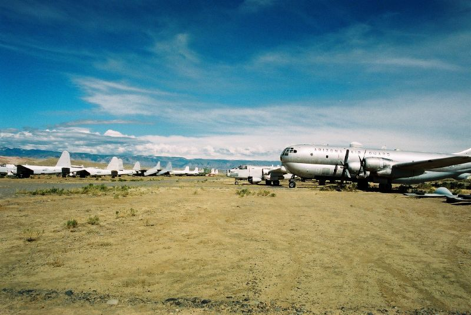

# "Tonto" at 4,700 Feet and Cheyenne's Oldest Teenager: Greybull and Cheyenne, Wyoming (1955–2026)

*A Pontiac dealer's family timing his new Super Duty with a stopwatch on a country road, a timing tower on skids, a plaid top for a Deuce, and a hamburger with a racer's name on it*

!!! abstract "Article record"
    **Confidence:** Low (Greybull's early drags rest on three men's memories that agree on the Collingwoods and the airport but not on every name; Cheyenne's strip is known from a manager's son's memory and a hall-of-fame biography, not from its own records; the obituaries and the recent Greybull and Powell coverage are solid) · **Source types:** Grassroots racers' memories on *Drag Strip List*; Doug Grieve's memoir in *Hemmings* (2019); the *Greybull Standard* (2018, 2023) and *Powell Tribune* (2026); Duane Pindell's obituary (2009); the Don Sands Hot Rod Reunion site; *The Jalopy Journal* (2024); *Hot Rod* (1970); Colorado Motorsports Hall of Fame · **Last verified:** 2026-11-12 (Round 39) · **Open issues:** ? Cheyenne Dragway's site and years; ◐ why Greybull's drags ended; ◐ Roland Leong at Greybull; ? which Collingwood was "Cubby" · [How we rate this](../reference/source-standards.md)

!!! quote "In their own words"
    "We recorded two passes right at 13 seconds and a 108 by the speedometer. Not bad for 4700' elevation."

    — Frankie Fisher, on the Collingwoods' new Super Duty Catalina, Greybull, 1963, *Drag Strip List*.[^dslwy]

## Pontiac heaven

In the Big Horn Basin in the early 1960s, the racing family was the Pontiac dealer's. Doug Grieve, who grew up in Livingston, Montana, put it simply: "Everybody drove Pontiacs around that area at the time—it was Pontiac heaven." He remembered "Cubby Collingwood" as the Pontiac dealer in Greybull, who later raced a "Swiss Cheese" Catalina called the *Tonto VI*, sold it, "but it still exists."<a href="#q-4" title="Open question: see the bottom of the page">?</a>[^hem19]

Frankie Fisher was 14 in 1963 and lived in Greybull, where he and his brother were friends with two of the Collingwood boys. The family's '62 racer was a red Catalina, *Tonto III*, a 421 tri-power automatic in C/Stock Automatic. The day the Super Duty car arrived at the dealership, Allen Jr. told him his father was going out to "a marked-off 1/4 mile in the country" to make a couple of passes. By the time the boys got there the car had 8-inch Racemasters and uncorked collectors. Allen Jr. and Fisher stood at the finish line with a stopwatch while Allen Jr.'s brother Zeb flagged the start with a hand-held flag. Fisher later saw the car run 12.50s at the strip, and in 1968, back in Greybull for a visit, he ran into Allen Jr. driving *Tonto III* and they "cruised around town in it with open headers."[^dslwy]

## A tower on skids

The strip was the county airport, which held races "a couple times a month." Fisher was at the first race on the Greybull airstrip in '63: "They had a timing tower on skids which was pushed up against the track and races were hand-flagged and stop watch timed. In '64 they got a 'tree' and clocks."[^dslwy] Warren Armstrong, who ran a '54 Chevy Del Ray in M/Stock and lost to a '64 Dodge slant-six, wrote that Big Horn Dragway was managed by Allen Collingwood of Collingwood Motors, whose '63 Super Duty Catalina was *Tonto VI*. He remembered the airport's aviation business, Avery Aviation, and "a boneyard of many WWII aircraft." He went to the races until May 1968, when he was home on leave before his first tour in Vietnam, and he remembered Roland Leong competing there that month.<a href="#q-3" title="Single source so far: see Open questions">◐</a> When Avery sold to Hawkins and Powers Air Service, he wrote, the new owners "ended drag racing after the purchase."<a href="#q-2" title="Single source so far: see Open questions">◐</a>[^dslwy]

<figure markdown>
{ loading=lazy }
<figcaption markdown>Retired firefighting aircraft, mostly converted C-97s, at the South Big Horn County Airport, Greybull, in 2004, the field where the Big Horn Dragway raced in the 1960s and club drags returned in the 2010s. *Context only: this is not a photograph of the strip.* Photo: Andrij Bulba, 2004, via Wikimedia Commons, [CC BY 2.0](https://creativecommons.org/licenses/by/2.0/). See [Image credits](../reference/image-credits.md).</figcaption>
</figure>

The airplanes stayed, and so, eventually, did the drag racing. In June 2018 the *Greybull Standard* reported 74 cars and about 500 spectators at Sunday drags on the airport, flagged by organizer Mike Howe, with "the old airplanes and the colorful hills" as "a perfect backdrop."[^gs18] In 2023 the Cloud Peak Drags club found the county's newly resurfaced crosswind runway "slicker than heck." "What they did might have been good for airplanes, but it wasn't good for drag racing," Kip McIntosh said.[^gs23] The racers moved to Powell's airport and formed Battle on the Bench. "After the Greybull races got shut down, all of us who do this kind of stuff didn't really have an outlet to go out and do it anymore," its president, Randy Walker, told the *Powell Tribune* in 2026.[^pt26]

## Cheyenne: a club, a tech man and a teenager

Cheyenne had a roadster club by the mid-1950s. Its head, Al Monk, drove a green Deuce highboy, the "Range Rod," on the street and the strip, with bobbed rear fenders, cycle fenders in front and heavy double-decker nerf bars; *Hot Rod* ran it in May 1958, and Monk had a matching plaid top he would "break out from time to time."[^jj24]

The capital's strip was run for a time by Duane Pindell. His son Craig spent "a lot of my early summers" there with him; when his father became NHRA Division 5 tech director, Al Farrens took over as strip manager.<a href="#q-1" title="Open question: see the bottom of the page">?</a>[^dslwy] His obituary in the *Wyoming Tribune Eagle* says nothing of racing: born in Ogallala, Nebraska, in 1931, he finished Cheyenne High in 1950, served in Korea, belonged to the plumbers and pipefitters' local for nearly 60 years and retired as chief of maintenance for the Laramie County schools.[^wte09] Keith Blow raced there and at Scottsbluff, Nebraska, in 1967–69, first a '57 Pontiac in D/Gas and then a '60 Olds in O/Stock Automatic, and won his class many times: "I wish I had those trophies now."[^dslwy] Wayne Etter won an NHRA Stock Eliminator meet at Cheyenne in a stocker against the gas, comp and gas dragster winners: "There was no money, just a watch and trophy," and he still has the watch.[^cmhof] Two Cheyenne men, Bernard Conaway and John Woodhouse, ran a BB/Altered '23 T roadster that set both class records in 1965.[^hr70] Denver's Speed Specialist team towed its fuel dragster up for the Cheyenne meets too ([Denver's cruise](../places/denver-16th-street-colfax-scotchman.md)).

And Cheyenne had Don Sands. Born in 1941, he graduated from Cheyenne High in 1959. In high school he worked at McDonald's, where "he styled his own hamburger that he called the 'Sands' Burger. As late as 1981, you could still order a 'Sands' Burger." Oldsmobile was his brand; his cars included a '49 Olds fastback, an injected 455 Olds-powered Ford Pinto and a Super Gas Chevette. "He was known as Cheyenne's oldest teenager; most every kid with a car knew Don." He died at home on November 21, 2017, "losing his final drag race to cancer." His friends, led by Jim Haefele, held a get-together for him at Uncle Charlie's in north Cheyenne in 2019, raised $2,200 for cancer research and kept it going as the Don Sands Hot Rod Reunion, which has "no judging and no awards."[^dsr] His obituary ends: "Later, Dude."[^dsr]

*See also:* [Casper, Bar Nunn and Douglas](casper-bar-nunn-wyoming-strips.md), the rest of Wyoming's strips; [the Denver Timing Association](denver-timing-association-bandimere.md); [Denver's 16th Street, Colfax and the Scotchman](../places/denver-16th-street-colfax-scotchman.md); [Roland Leong](../people/roland-leong.md).

## Open questions & disputed details

*From the detective's notebook: where the sources disagree, where we have only one, and what we are still looking for. Each item links back to its place in the story.*

**Open question.** **Where was Cheyenne Dragway, and when did it run?** Our sources place racing there from at least 1964 (Etter's win) to 1969 (Blow), and the Pindells' years suggest earlier, but none gives its location, opening or closing.[^cmhof][^dslwy] <a class="hr-q-back" href="#qr-1" title="Back to the story">↩</a>

**Single source so far.** **Why did Greybull's drags end?** Only Armstrong says the new airport operator ended them after buying Avery Aviation. An airport history gives 1969 for Hawkins and Powers' arrival, which would fit, but it does not mention the drags.[^dslwy][^notac] <a class="hr-q-back" href="#qr-2" title="Back to the story">↩</a>

**Single source so far.** **Did Roland Leong race at Greybull in May 1968?** Only Armstrong's memory; no Leong source we have read mentions it.[^dslwy] <a class="hr-q-back" href="#qr-3" title="Back to the story">↩</a>

**Open question.** **Who was "Cubby" Collingwood?** Grieve's "Cubby" and Armstrong's Allen Collingwood are both the Greybull Pontiac dealer who owned *Tonto VI*, so they are probably the same man, but neither source says so.[^hem19][^dslwy] <a class="hr-q-back" href="#qr-4" title="Back to the story">↩</a>

### Next leads

The *Greybull Standard*, 1963–69 (its archive answers only by single page, and the state's Wyoming Newspapers site sat behind a bot check); the *Wyoming State Tribune* and *Wyoming Eagle*, 1955–70 (the Roadster Club, the strip's site and years); Collingwood Motors and the Collingwood family; Al Farrens; *Drag News*, May 1968 (Leong's tour).

## Sources

[^dslwy]: "Wyoming: Remembering . . ." (racers' memories posted with names, including Frankie Fisher, Warren Armstrong, Craig Pindell and Keith Blow), *Drag Strip List* (read through a headless browser; the page is script-rendered). https://dragstriplist.com/wy (accessed 2026-11-12)
[^hem19]: Doug Grieve, as told in "From Strip to Salt," *Hemmings* (Muscle Car Scrapbook), byline Terry McGean, March 26, 2019 (updated March 25, 2024). https://www.hemmings.com/stories/from-strip-to-salt/ (accessed 2026-11-12)
[^gs18]: "Drag Racing" (photos by Lisa Kunkel), *Greybull Standard*, June 14, 2018, p. 8 (OCR text of the archive page). https://gyb.stparchive.com/Archive/GYB/GYB06142018p08.php (accessed 2026-11-12)
[^gs23]: Nathan Oster, "Slick track impacts August drag races," *Greybull Standard*, August 17, 2023. https://greybullstandard.com/content/slick-track-impacts-august-drag-races (accessed 2026-11-12)
[^pt26]: Logan Stayton, "Homegrown racing at Battle on the Bench," *Powell Tribune*, November 6, 2026. https://www.powelltribune.com/stories/homegrown-racing-at-battle-on-the-bench,178780 (accessed 2026-11-12)
[^notac]: "South Big Horn County Airport (KGEY)," *NOTAC* (airport history; reviewed September 21, 2026). https://notac.aero/airports/KGEY/ (accessed 2026-11-12)
[^jj24]: Joey Ukrop, "Range Rod: Revisited," *The Jalopy Journal*, August 23, 2024 (quoting his 2015 feature). https://www.jalopyjournal.com/?p=59113 (accessed 2026-11-12)
[^wte09]: "Duane Pindell" (paid obituary), *Wyoming Tribune Eagle* (wyomingnews.com), May 5, 2009. https://www.wyomingnews.com/milestones/duane-pindell/article_065ddb69-b494-5788-8782-ee8562e99ed0.html (accessed 2026-11-12)
[^cmhof]: "Wayne Etter," Colorado Motorsports Hall of Fame (2014 inductee). https://coloradomotorsportshalloffame.com/wayne-etter/ (accessed 2026-11-12)
[^hr70]: "Cheyenne War Party," *Hot Rod*, April 1970 (online January 1, 2023). https://www.hotrod.com/features/cheyenne-war-party-april-1970-982-714-125-1 (accessed 2026-11-12)
[^dsr]: "Don Sands - Cheyenne's Oldest Teenager" (obituary text and the 2019 memorial), *Don Sands Hot Rod Reunion*, Cheyenne. https://donsandshotrodreunion.com/about-don-sands.html and https://donsandshotrodreunion.com/ (accessed 2026-11-12)
