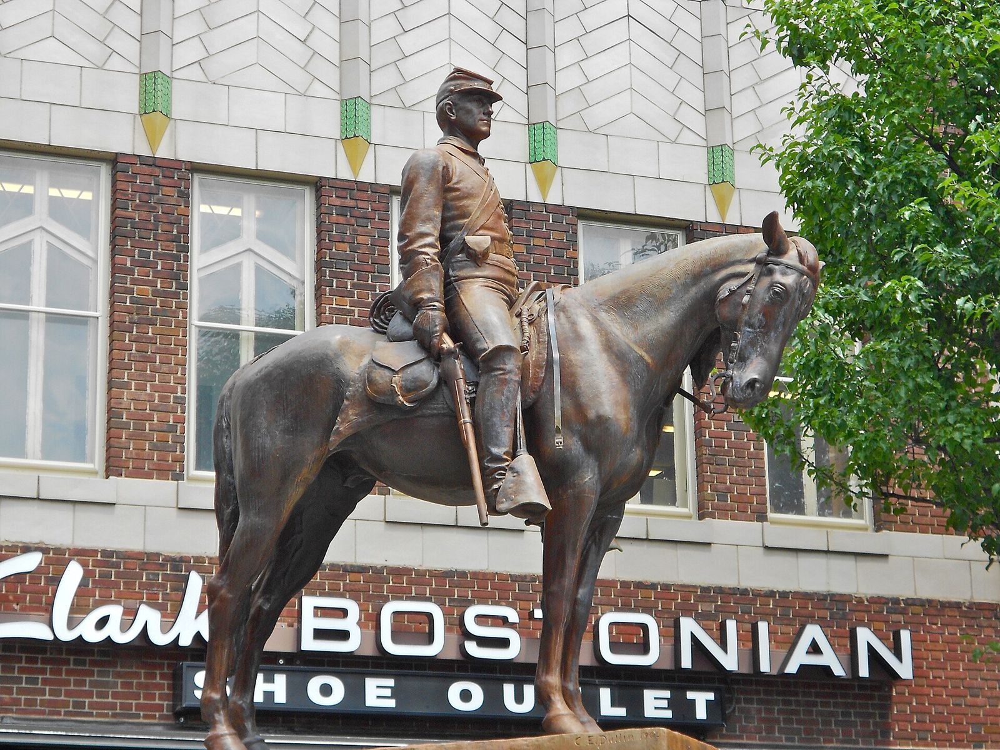

# Petitions, Jackets and a No-Ticket Rule: Hot Rod Clubs Around Gettysburg and Hanover (1956–59)

!!! abstract "Article record"
    **Confidence:** Low-Medium · **Source types:** Grassroots small-town daily newspaper (*Gettysburg Times*, Gettysburg, Pa.): village correspondents' columns, club notices and a classified ad, 1956–59, read as scanned page OCR · **Last verified:** 2026-10-21 (Round 19) · **Open issues:** the Fly-Wheels have two different presidents and two different descriptions in March 1959 ⚠; the March 6 sentence naming a sponsoring "National ... Hanover Hot Rod Club" is garbled ◐; "Flaming Carbs" is our reading of the OCR's "Flaming Carte" ◐; we have not read the Hanover *Evening Sun*, which should have much more · [How we rate this](../reference/source-standards.md)

!!! quote "In their own words"
    "The purpose of the club is to help fellow travelers in distress along the highway. In order to obtain or keep membership with the club, members must not be arrested for any traffic violation."

    — The Fly-Wheels of Adams County, *Gettysburg Times*, March 6, 1959.[^gt590306]

Gettysburg's paper is mostly about the battlefield, the farms and the churches. But in the late 1950s its small columns from the surrounding towns show something else going on: a hot rod club in Hanover asking a whole neighborhood for permission to meet, a Hanover man touring the Lions clubs to explain how such clubs worked, and teenagers in Gettysburg and across the Maryland line picking jacket colors and promising to stay out of traffic court.

## Hanover asks the neighbors (1956)
In May 1956 the Littlestown column reported that the **Hanover Hot Kustom Klub** had decided to petition the people living near **Lincoln Speedway** in Berwick Township, Adams County, "asking that they do not oppose" the speedway's use as a Sunday afternoon meeting place for the club. The owner had already said yes, "with the provision that members first petition the residents."[^gt560510] Lincoln Speedway was a stock-car track on the Hanover side of the county. The request was a polite one: Sunday afternoons in a churchgoing county, at a track that was already noisy the rest of the week.

## The Hanover experience, on tour (1958)
In April 1958 the Lions Club at York Springs, at the other end of Adams County, had a guest. "Jimmy Price, Hanover" spoke "on the advantages of a well supervised hot rod club in a community and gave the experiences of Hanover and some other communities and explained how they are operated."[^gt580418] We do not know what Hanover's experiences were. That a service club wanted to hear about them suggests Hanover's clubs were seen as something worth copying.

That September, just south of the state line, three Frederick County, Maryland, youths were fined on charges of driving faster than "reasonable and proper" as state police "began a crack down on drag racing in the county."[^gt580922]

<figure markdown>
{ loading=lazy }
<figcaption markdown>"Sentry," the 1904 Civil War statue in Center Square, Hanover, Pa. (photo 2013). The Hanover clubs met a few miles away, in Adams County. Creator: Smallbones. Date: 2013-06-25. Source: [Wikimedia Commons](https://commons.wikimedia.org/wiki/File:Sentry_1904_Hanover_York_County_PA.JPG). License: [CC0](http://creativecommons.org/publicdomain/zero/1.0/deed.en).</figcaption>
</figure>

## Turquoise jackets in Taneytown (February 1959)
Across the line in Taneytown, Maryland, a "recently organized hot rod club" chose turquoise and blue as its colors. Members planned to buy turquoise jackets with black trim, "featuring the club insignia, three carburetors with flames."[^gt590227] ◐ *The OCR gives the club's name as the "Taneytown Flaming Carte"; with carburetors on the jacket, "Flaming Carbs" is almost certainly right, and the headline reads "CARBS CHOOSE COLORS."*

## The Fly-Wheels (March 1959)
Two weeks later the paper introduced the **Fly-Wheels of Adams County**, "a newly organized club," which planned a paper and scrap drive to raise money. President **William Moorehead** said the members met weekly at his grandparents' motel on Lincolnway West and hoped to rent a garage in Gettysburg as a permanent clubhouse. The club existed "to help fellow travelers in distress along the highway," and a member who was arrested for any traffic violation was out.[^gt590306] ◐ *A garbled line says the club was "under the auspices of the National ... Hanover Hot Rod Club"; the words in between are lost.*

On March 25 the paper announced the organization of "the 'Fly Wheels,' a Gettysburg 'hot-rod' Club," giving the president of the "three-week old group" as **Francis L. Althoff Jr.** of Hanover Street. This club planned "to race its vehicles at the airport at Thomasville," and its first event was a car wash at the Hunt Avenue service station, where members would pick up the cars, wash them and bring them back.[^gt590325] The next day the club ran a classified ad: "FLY-WHEELS GETTYSBURG HOT ROD CLUB Will Wash Cars at Hunt Avenue, Inc., Saturday, March 28," for $1.50 a car with pickup and delivery, and with the profits going to the club (the last words of the ad are garbled in the scan).[^gt590326]

⚠ *Two presidents in three weeks.* It could be a change of officers, two reports about different people, or two groups using the same name. One version is about roadside good deeds and a clean record; the other is about racing at an airport. Both were probably true of most clubs in 1959.

*From the detective's notebook:* this is the small-town East in miniature. There is no strip yet, only a borrowed stock-car track, a country airfield and a car wash, and every step needed someone's permission: the neighbors, the Lions, the police. Compare the [Ridge Runners of Stroudsburg](stroudsburg-ridge-runners.md), the [Kingston Igniters](kingston-igniters.md) and the [Indiana small-town clubs](indiana-small-town-clubs.md).

## Next leads
The Hanover *Evening Sun*, 1955–60, for the Hot Kustom Klub, Jimmy Price and the Hanover Hot Rod Club; the Thomasville airport and whether drags were run there; the *Carroll County Times* for the Taneytown club; any surviving Fly-Wheels jacket or plaque.

## Sources

[^gt560510]: "Ask Speedway For Sunday Use," Littlestown column, *Gettysburg Times* (Gettysburg, Pa.), May 10, 1956. Page OCR (quotes corrected for obvious OCR slips). https://archive.org/details/gettysburg-times-1956-05-10 (accessed 2026-10-21)
[^gt580418]: York Springs column ("About Hot Rod Club"), *Gettysburg Times*, Apr. 18, 1958. Page OCR. https://archive.org/details/gettysburg-times-1958-04-18 (accessed 2026-10-21)
[^gt580922]: "Frederick County," area news roundup, *Gettysburg Times*, Sept. 22, 1958. Page OCR. https://archive.org/details/gettysburg-times-1958-09-22 (accessed 2026-10-21)
[^gt590227]: "Carbs Choose Colors," *Gettysburg Times*, Feb. 27, 1959. Page OCR. https://archive.org/details/gettysburg-times-1959-02-27 (accessed 2026-10-21)
[^gt590306]: "'Fly-Wheels' Plan Paper, Scrap Drive," *Gettysburg Times*, Mar. 6, 1959. Page OCR, columns interleaved (quotes corrected for obvious OCR slips). https://archive.org/details/gettysburg-times-1959-03-06 (accessed 2026-10-21)
[^gt590325]: "Hot-Rod Club Is Organized Here," *Gettysburg Times*, Mar. 25, 1959, p. 2. Page OCR. https://archive.org/details/gettysburg-times-1959-03-25 (accessed 2026-10-21)
[^gt590326]: Fly-Wheels car wash advertisement, *Gettysburg Times*, Mar. 26, 1959. Page OCR. https://archive.org/details/gettysburg-times-1959-03-26 (accessed 2026-10-21)
