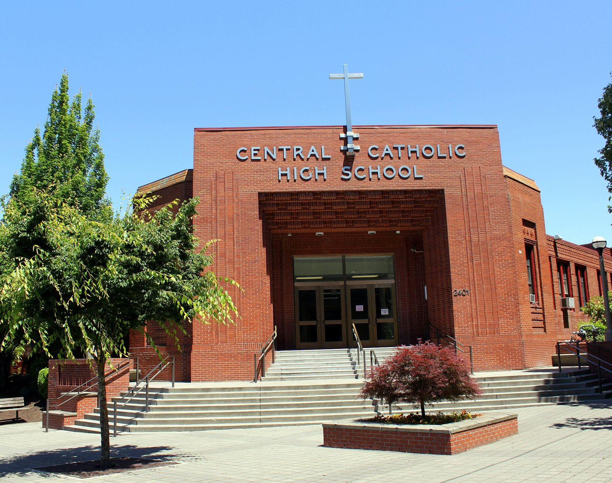

# Hot Rod Club, Third Row: The High School Car Clubs (1953–1967)

!!! abstract "Article record"
    **Confidence:** Medium · **Source types:** Grassroots high school yearbooks and a school newspaper bound into one (Pensacola, Fla.; Sherman, Tex.; Chillicothe and Circleville, Ohio; Portland, Tillamook and Imbler, Ore.; Shawnee Mission, Kan.; Fort Collins, Colo.; Greensboro, N.C.; 1955–1967), read as scanned OCR on the Internet Archive; a small-town daily's senior profiles, club notes and fair column (*Circleville Herald*, Ohio, 1964–65 and a 1974 look-back); one school-administration textbook (1955), seen only as a search snippet · **Last verified:** 2026-10-17 (Round 16) · **Open issues:** we opened only the yearbooks cited here, so "how many schools" is not counted ◐; club write-ups are the students' and advisers' own, with no outside check; the textbook's list is seen out of context ◐; Circleville's Devastators were a town youth club with school members, not a school club, as far as the paper shows · [How we rate this](../reference/source-standards.md)

!!! quote "In their own words"
    "In many cars they should have checked the nut that holds the wheel."

    — **Unsigned editorial**, "Something Overlooked," in the school paper of Central Catholic High School, Portland, Oregon, after the hot rod club's car inspections (pages in the scan of the 1957 yearbook).[^cc]

Flip through a 1950s yearbook and, somewhere between the Glee Club and the Future Business Leaders, you may find it: **Hot Rod Club**. Sometimes it's only a line under a senior's photo. Sometimes it's a group shot of thirty boys. Once in a while the students wrote down what they thought they were doing, and those pages are some of the most honest hot rod history there is, because nobody was writing them for history.

## The line under the photo

The earliest date we have found comes from Sherman, Texas. In the 1956 yearbook, seniors' activity lists put "Hot Rod Club" beside the Scrabble, Bridge and Horseshoes and Washers clubs, with year marks running back to '53.[^sher]<a href="#q-1" title="Single source so far: see Open questions">◐</a> In Pensacola, Florida, the 1955 yearbook gave the HOT ROD CLUB its own roster, about thirty names long, and seniors listed it among their activities next to Allied Youth and the Monitor staff.[^pens] In Tillamook, Oregon, in 1958, the senior class president listed football, wrestling, DeMolay and the **Coasters Hot Rod Club**, and the line chosen for his photo was "Let me tell you [a]bout that car."[^till] In Imbler, Oregon, two 1958 seniors listed Future Farmers of America, boxing and "Hot Rod Club 2."[^imb] In Shawnee Mission, Kansas, a 1958 senior's list began "Hot Rod Club Pres. 1."[^sm] Fort Collins, Colorado, seniors listed "Hot Rod Club 4" in 1957.[^fc]

Then there's Chillicothe, Ohio, where the 1955 class will had Hal Watts handing down "his most honored and cherished position as President of the 'Model A' Hot Rod Club" to "Lightning Louie" Ahlen, along with what the will called the "next to the fastest car in our fair city."[^chil]

Search the Internet Archive's yearbook scans for the phrase and the hits keep coming, from Massachusetts and Maine to Texas, Oklahoma, Wisconsin and Michigan. We opened only the yearbooks cited on this page, so we won't put a number on it.[^search]<a href="#q-2" title="Single source so far: see Open questions">◐</a>

## The Ram Rods of 24th and Stark

The fullest picture comes from **Central Catholic High School** in Portland, Oregon, where pages of the school paper ended up in the scan of the 1957 yearbook. A columnist, Tom Joyce, opened his car column like a period feature: "Once again the squeal of rubber and the roar of exhaust are heard in the vicinity of 24th and Stark."[^cc]

The club was the **Ram Rods**, and the column gave them "a pat on the back" for being on the job again to promote safety. Its "Car of the Month" for October was John Hardiman's Olds-powered Merc: a '53 Olds with four-barrel carburetion and dual exhausts, Lincoln gears, a decked body and "coal black paint." Officer Jay Sadler, the column promised, would answer readers' traffic-safety questions.[^cc]

A separate item explained that the hot rod club, with a student president, John Joyce, and the Rev. T. B. McLoughlin as faculty moderator (initials as the scan reads them), was again sponsoring the **Safe-Teen** program, and a photo caption said "The Ram Rod Club is sponsoring Central's current safe-driving campaign." The program inspected cars, and most passed; Safe-Teen stickers showed up on cars all around the school.[^cc]

Then the paper's own editorial took the air out of it. Passing the inspection, it said, had made some drivers think they could pass anything. Watching the cars leave at the end of the day, a person might conclude that "tires are black so as to leave more distinguishable rubber strips upon the pavement." Its last line is the quote at the top of this page.[^cc]

<figure markdown>
{ loading=lazy }
<figcaption markdown>Central Catholic High School, Portland, Oregon, in 2009. Its 1950s hot rod club, the Ram Rods, ran the Safe-Teen car inspections; context only. Creator: Tedder. Date: 2009-06-28. Source: [Wikimedia Commons](https://commons.wikimedia.org/wiki/File:Central_Catholic_High_School_-_Portland_Oregon.jpg). License: [CC BY 3.0](https://creativecommons.org/licenses/by/3.0).</figcaption>
</figure>

## What the advisers wrote

By the early 1960s the purpose statement had settled into a formula. At **Southeast Guilford High School** in Greensboro, North Carolina, in the school's first yearbook (1963), the Hot Rod Club "was organized under the leadership of Mr. James Russell." Its purpose "was to promote safe driving habits among the students and to give students a better understanding of the maintenance of their vehicle." The club ran a Christmas clothing drive, earned money with a car-inspection service, and hoped "to buy a car for their club project."[^seg]

The idea had reached the textbooks, too. A 1955 book on secondary-school administration by Roland C. Faunce includes, in a numbered list, "Hot-rod club (to promote safe driving)," right between comfortable library chairs and a visitor's locker room. We could see only that search snippet, not what the list was for.[^faunce]<a href="#q-3" title="Single source so far: see Open questions">◐</a>

## Circleville, Ohio, 1964–1967

Sometimes the school club and the town club overlap, and a small-town paper shows both sides. In March 1964, the *Circleville Herald* later recalled, "A Hot Rod Club was organized by local youths interested in automobile safety, maintenance and operation." It had two adult advisers, **Norton Barnes**, the Pickaway County juvenile probation officer, and **Forrest Easterday Jr.**[^cir1974]

Within two months it showed up under seniors' photos. In the *Herald*'s graduation-day profiles that May, one Circleville senior listed football, baseball and the "Devastators Hot Rod Club," gave his hobby as cars, and planned to work, enlist and later attend business college. Another, bound for Texas A&M, listed the English Merit Society, the band, the Science Club, the mock political convention and "Hot Rod Club."[^cir1964]

That August the **Devastators** had their own exhibit under the grandstand at the fair, with hot rods from the Circleville, Lancaster and Columbus areas. The paper's fair column called it a "must" for drag strip buffs.[^fair1964] In February 1965 the club, its name misspelled "Devastors" in the paper, elected six officers, from president down to master-at-arms and publicity chairman. Barnes and "Junior" Easterday stayed on as advisers.[^cir1965]

Three years later, the line under the photo turns up again just outside town. In the 1967 yearbook of **Logan Elm High School**, Circleville, several seniors listed the Hot Rod Club, one of them for three years running, next to 4-H, the Grange and the Farm Bureau Youth Organization.[^le1967]

The school clubs show up in the same years as the town clubs the police and planners were sponsoring (see [What the City Planners Wrote](planners-report-1955.md), [The Cop and the Auto Shop](escanaba-dragns.md) and [Hoosier Road Runners](indiana-small-town-clubs.md)), and they use the same safety language. What the yearbooks add is the other side: a kid's car of the month, a will that passes down a Model A presidency, and an editorial that noticed the inspection checked the cars and not the drivers. For the novel that made a high school timing association its plot in 1953, see [*Street Rod* in the Small-Town Paper](../media/street-rod-newspaper-serial.md).

**Visual references (external):** the yearbook pages themselves, linked in the footnotes (Internet Archive scans of copyrighted yearbooks; linked, not copied).

## Open questions & disputed details

*From the detective's notebook: where the sources disagree, where we have only one, and what we are still looking for. Each item links back to its place in the story.*

**Single source so far.** *Years as the scan reads them.* <a class="hr-q-back" href="#qr-1" title="Back to the story">↩</a>

**Single source so far:** We opened only the yearbooks cited on this page, so we won't put a number on it. <a class="hr-q-back" href="#qr-2" title="Back to the story">↩</a>

**Single source so far:** We could see only that search snippet, not what the list was for. <a class="hr-q-back" href="#qr-3" title="Back to the story">↩</a>

[^cc]: Central Catholic High School (Portland, Ore.) 1957 yearbook scan, including pages of the school paper: Tom Joyce's car column, "Ram Rods: Theme of Club Safe Driving," a club photo caption, and the editorial "Something Overlooked." https://archive.org/details/classmates-yearbook-34055-1957-central-catholic-high-school (accessed 2026-10-16)
[^pens]: Pensacola High School (Pensacola, Fla.) 1955 yearbook. https://archive.org/details/classmates-yearbook-36688-1955-pensacola-high-school (accessed 2026-10-16)
[^till]: Tillamook High School (Tillamook, Ore.) 1958 yearbook, senior entry of the class president (OCR reads "sbout"). https://archive.org/details/classmates-yearbook-27056-1958-tillamook-high-school (accessed 2026-10-16)
[^imb]: Imbler High School (Imbler, Ore.) 1958 yearbook, senior entries. https://archive.org/details/classmates-yearbook-20622-1958-imbler-high-school (accessed 2026-10-16)
[^sm]: Shawnee Mission High School (Shawnee Mission, Kan.) 1958 yearbook, senior entry. https://archive.org/details/classmates-yearbook-51132-1958-shawnee-mission-high-school (accessed 2026-10-16)
[^fc]: Fort Collins High School (Fort Collins, Colo.) 1957 yearbook, senior entries. https://archive.org/details/classmates-yearbook-24605-1957-ft-collins-high-school (accessed 2026-10-16)
[^chil]: Chillicothe High School (Chillicothe, Ohio) 1955 yearbook, class will. https://archive.org/details/classmates-yearbook-59831-1955-chillicothe-high-school (accessed 2026-10-16)
[^search]: Internet Archive full-text search for "hot rod club" limited by year, 1950–1961 (results include yearbooks from Natick and Brockton, Mass.; Fryeburg Academy, Maine; Katy and Alamo Heights, Tex.; Velma-Alma, Okla.; West Bend, Wis.; Ypsilanti, Mich.; and others). https://archive.org/search?query=%22hot+rod+club%22&sin=TXT (accessed 2026-10-16)
[^seg]: Southeast Guilford High School (Greensboro, N.C.) 1963 yearbook, Hot Rod Club page. https://archive.org/details/classmates-yearbook-32257-1963-southeast-guilford-high-school (accessed 2026-10-16)
[^faunce]: Roland C. Faunce, *Secondary School Administration* (1955), seen as an Internet Archive full-text search snippet; the book itself is lending-restricted. https://archive.org/details/secondaryschoola00faun (accessed 2026-10-16)
[^sher]: Sherman High School (Sherman, Tex.) 1956 yearbook, senior entries. https://archive.org/details/classmates-yearbook-59691-1956-sherman-high-school (accessed 2026-10-17)
[^cir1974]: "Editions of the Past: March 1964, 10 Years Ago," *Circleville Herald* (Circleville, Ohio), Mar. 2, 1974. https://archive.org/details/circleville-herald-1974-03-02 (accessed 2026-10-17)
[^cir1964]: Senior profiles, *Circleville Herald*, May 22, 1964 (graduation edition). https://archive.org/details/circleville-herald-1964-05-22 (accessed 2026-10-17)
[^fair1964]: Fair-week column, *Circleville Herald*, Aug. 5, 1964. https://archive.org/details/circleville-herald-1964-08-05 (accessed 2026-10-17)
[^cir1965]: "Hot Rod Club Elects Officers," *Circleville Herald*, Feb. 13, 1965. https://archive.org/details/circleville-herald-1965-02-13 (accessed 2026-10-17)
[^le1967]: Logan Elm High School (Circleville, Ohio) 1967 yearbook, senior entries. https://archive.org/details/classmates-yearbook-23753-1967-logan-elm-high-school (accessed 2026-10-17)
