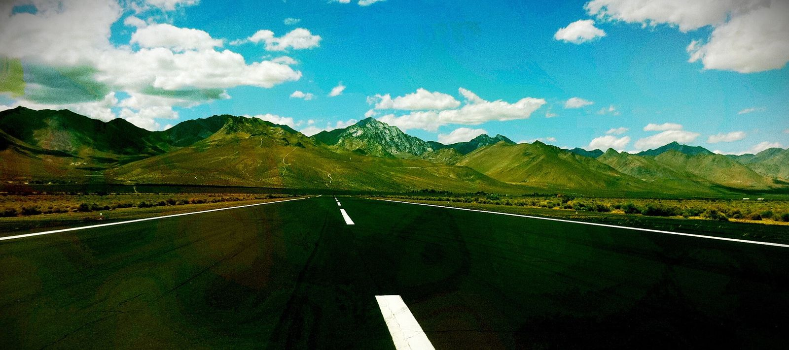

# Inyokern: The Sheriff's Strip and the Dust Devils (1954–2005)

!!! abstract "Article record"
    **Confidence:** Medium · **Source types:** Grassroots metro-newspaper feature built on local interviews (LA Times, 2005), local-newspaper obituary (San Bernardino Sun, 2012), historical-society news release (Ridgecrest, 2025), NHRA memorial feature (2012), columnist's blog (Pat Ganahl, 2022) · **Last verified:** 2026-10-15 (Round 11) · **Open issues:** ⚠ date of the last race; the strip's opening date (Oct 24, 1954) is a bracketed note in Ganahl's blog, not from a primary record · [How we rate this](../reference/source-standards.md)

!!! quote "In their own words"
    "How ironic … that we got started by the sheriff in one branch of government and now we get killed by feds in another."

    — **Dennis Garrett**, Dust Devils Car Club president, LA Times, Oct 10, 2005.[^lat]

A sheriff started it, and a federal agency ended it. In between, a quarter-mile at a nearly empty desert airport in Kern County ran for about **51 years**, kept up by a volunteer car club. The LA Times says it began when Sheriff "Mac" McKernan, facing young people racing hot rods on rural roads "during the first Eisenhower administration," helped them form a nonprofit and "arranged for them to drag race legally and safely on a taxiway" of the Inyokern Airport.[^lat] Ganahl's blog gives the opening as Oct. 24, 1954.[^pg]

## How a club ran a strip

The LA Times feature shows how a club kept a strip alive for half a century.[^lat] The racers paid the airport about **$1,000 per racing day** (the airport manager's figure) and gave other funds, such as entry fees, to local charities including the Boy Scouts. To meet insurance requirements, volunteers erected two guardrails "begged from other tracks" nearly 20 years earlier.

The club also worked the town. Members spoke to Ridgecrest shop classes and invited students to "high school days" on the taxiway; the club's public address system was loaned to local clubs and parades. They bought modern timing equipment with volunteer fundraising, sold sponsorships on hubcaps, and rented the timing gear to other tracks.[^lat]

What they kept was old-fashioned. Pat Ganahl, who visited in 2003, wrote: "But if you want a '50s drag race experience today, go to Inyokern. It's a time warp." He described a bare track with one small bleacher, no timing stand, two outhouses and an old Cadillac ambulance.[^pg]

## The shutdown

Then came the inspection. The LA Times says the FAA threatened the county-owned airport's certification and federal funding if "non-aviation activity such as drag racing continues," after a routine inspection of the airport, a move that "puzzled and saddened locals." Club president Garrett: "We're just regular working folks in an isolated place."[^lat]<a href="#q-1" title="Open question: see the bottom of the page">?</a>

> "So many things don't work in our society. … Yet here's something positive that does, and some guy wants to crush it. I don't understand."
>
> — **Steve Parsons**, local champion, LA Times (2005).[^lat]

## The man at the microphone

The strip also launched a career. **Bernie Partridge** joined the Dust Devils Auto Club of Ridgecrest in 1951, was elected president in 1953, and managed the Inyokern Dragstrip from 1954 through 1962, says his San Bernardino Sun obituary. He became NHRA's chief announcer in 1958 and Southwest Division director in December 1962, and retired in 1989. The obituary adds that he "gave legendary racer Don Garlits his 'Big Daddy' nickname while announcing at the 1962 U.S. Nationals."<a href="#q-2" title="Single source so far: see Open questions">◐</a>

At his 2012 memorial, NHRA's report quotes David Leighton, who worked with his father Gus and Partridge, "Dust Devils Auto Club alumni all," setting up impromptu airport tracks: "We opened and closed more racetracks than Steve Evans did."[^nhra]

The town still tells the story. In April 2025 the Historical Society of the Upper Mojave Desert announced a talk on Mark Pahuta's two-hour film *The Hot Rod Years*, built from interviews with twenty local hot rodders. The release says "racing on Trona Hill and cruising China Lake Boulevard between A&W, and Foster's Freeze was the stuff of local racing legend." It calls the Inyokern strip "the longest continuously running drag strip in the country" and lists interviewees including Don Waldron, J.D. Williams, Tex Whitson, Bob Cram, Billie Raglin and Dave Leighton.[^hs] We have not seen the film.

<figure markdown>
{ loading=lazy }
<figcaption markdown>The runway at Inyokern Airport, 2011. The drag strip was on a taxiway at this airport, not the runway shown. Creator: Pintsmasher. Date: 12 September 2011 (original upload date). Source: [Wikimedia Commons](https://commons.wikimedia.org/wiki/File:Inyokern_Airport_-_panoramio.jpg). License: [CC BY 3.0](https://creativecommons.org/licenses/by/3.0).</figcaption>
</figure>

## Open questions & disputed details

*From the detective's notebook: where the sources disagree, where we have only one, and what we are still looking for. Each item links back to its place in the story.*

### ⚠ When was the last race?

*Three sources, three answers.*

- **April 9, 2005.** Ganahl's 2022 post says that day's "First Annual Standard 1320 Invitational Drag Race" was the last. He writes that "nobody knew it was Inyokern's last drag race," and that the FAA decision came days later.[^pg]
- **October 2005 or later.** The LA Times piece of Oct 10, 2005 says racing would be allowed through "the next meet, a major regional race for young drivers set for Friday and Saturday," which would be Oct 14–15.[^lat]
- The Dust Devils held their final awards banquet on Feb 4, 2006, according to a drag-racing news blog.[^dl]

Ganahl assumed the LA Times story came "just after this last meet," so he may have dated the closure too early. We have not found the FAA order or a club record to settle it. The 2005 event's name, "Standard 1320," also appears in our [Doris Herbert article](../people/doris-herbert.md) (the 1960 record list). We found no source that connects the two. <a class="hr-q-back" href="#qr-1" title="Back to the story">↩</a>

**Single source so far.** We found that nickname claim only there.[^sb] <a class="hr-q-back" href="#qr-2" title="Back to the story">↩</a>

[^lat]: Andrew H. Malcolm, "Finish Line Comes Early," Los Angeles Times, Oct 10, 2005. https://www.latimes.com/archives/la-xpm-2005-oct-10-me-dragstrip10-story.html (accessed 2026-10-15)
[^pg]: Pat Ganahl, "Last Drag at Inyokern," Pat Ganahl's Rod and Custom, Feb 7, 2022. https://patganahl.com/2022/02/07/last-drag-at-inyokern/ (accessed 2026-10-15)
[^dl]: Bill Pratt, "Dust Devils Celebrate 51 Years of Racing with a Final Banquet," Drag Racing News Daily (blog), Feb 7, 2006. https://draglist.blogspot.com/2006/02/dust-devils-celebrate-51-years-of.html (accessed 2026-10-15)
[^sb]: "MOTOR RACING: Services for two racing legends this weekend," San Bernardino Sun, April 18, 2012. https://www.sbsun.com/sports/20120418/motor-racing-services-for-two-racing-legends-this-weekend/ (accessed 2026-10-15)
[^nhra]: Phil Burgess, "Remembering 'the Bird,'" NHRA, 2012. https://www.nhra.com/news/2012/remembering-bird (accessed 2026-10-15)
[^hs]: "HSUMD April meeting: drag racing in old Ridgecrest," news release, Ridgecrest Daily Independent (ridgecrestca.com), Apr 11, 2025. https://www.ridgecrestca.com/news/hsumd-april-meeting-drag-racing-in-old-ridgecrest/article_7bc2f56d-951b-4f93-8b58-eba04720b1bd.html (accessed 2026-10-15)
