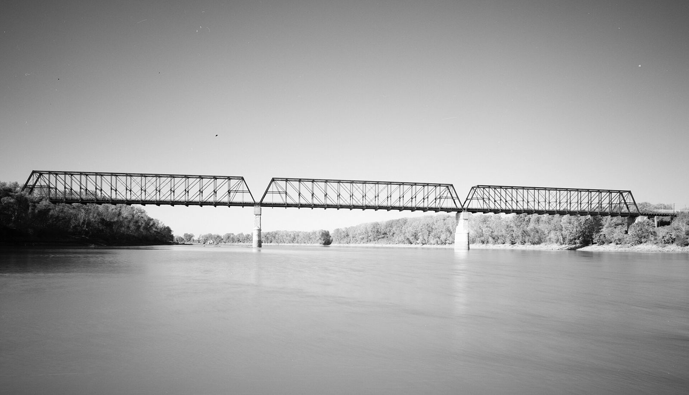

# The Detective Whose Son Was a Dragster: Kansas City, 1955–66

!!! abstract "Article record"
    **Confidence:** Medium · **Source types:** Grassroots police chief-of-detectives' first-person account in a National Safety Council magazine (*Public Safety*, May 1956), municipal-planning report (ASPO, May 1955), a *Kansas City Star* feature sent out by the AP (1959) and small-town *Sedalia Democrat* items (1957, 1966, 1969) and a 1956 California daily quoting Kansas City figures, read as scanned OCR · **Last verified:** 2026-10-21 (Round 19) · **Open issues:** opening day July 15 (AP, 1959) or July 17 (Pond) ⚠; length 3,850 ft (Pond) or 4,850 ft (AP) ⚠; the site "near the Chouteau Bridge" comes from one 1969 small-town story ◐; we have still not read the *Kansas City Star* or *Times* of July 1955; Pond's "no street racing since opening" is self-reported ◐; the "75 to 100 disturbance calls" figure quoted in California in 1956 has no Kansas City source yet ◐ · [How we rate this](../reference/source-standards.md)

!!! quote "In their own words"
    "Give the hot rodder a 'break' and there's nothing wrong with him. He can even be turned into an active participant in the cause of traffic safety."

    — **Major Eugene M. Pond**, Chief of Detectives, Kansas City, Mo., Police Department, *Public Safety*, May 1956.[^pond]

The photo caption in the magazine says it all in ten words: "Kansas City police, unable to coerce Hot Rodders, joined them."[^pond]

The man who made that happen was not a juvenile officer or a traffic cop. **Major Eugene M. Pond** was the department's chief of detectives, and he had a personal reason. "My son was a teen-age dragster," he wrote, "so I had both a personal and professional interest in providing a drag strip facility where these young hot rodders could compete without endangering lives on city streets and country roads."[^pond] A caption names the boy as Gene, 16, and says he had recently won a drag race trophy.[^pond]

## The meeting

Pond's account of how it began is short and businesslike.[^pond] First he called a meeting of the "Greater Kansas City law enforcement administrators": police chiefs, sheriffs and the heads of the Missouri and Kansas highway patrols. He presented a plan for a drag strip with "rigid rules and regulations." Then he met the hot rodders themselves. "They went for it in a big way," he wrote, and the result was **32 clubs** from communities around the metro area.

Civic clubs, the YMCA and driver-training instructors supplied adult advisers. Pond stresses that the clubs "run their organizations" but accept the advice. The clubs sent two members each to a new body, the **Kansas City Timing Association**, incorporated in Missouri as a non-profit and later affiliated with the National Hot Rod Association. It adopted NHRA's code of ethics and rules.

This matches the May 1955 planners' survey, which had the Kansas City Timing Association working with the police and trying to lease a site in the Northeast Industrial District.[^aspo] See [What the City Planners Wrote](planners-report-1955.md).

## The month the hot rodders checked everyone else's cars

Before there was a strip, Pond got the clubs to volunteer for the **National Vehicle Safety Check Program**. His figures for May 1955, as printed:[^pond]

| Item | Pond's figure |
|---|---|
| Check days | 19 days between May 2 and May 28 (rain cancelled the rest) |
| Busiest day | "as many as 400 cars" |
| Vehicles checked | 3,947 |
| In perfect condition | 660, "about 17 per cent" |
| Rated mechanically unsafe | 158 |

The hot rodders checked brakes, lights, steering, tires, exhaust, glass, wipers, mirrors and horns. Girlfriends and the wives of married members recorded the results on tally cards. The program ran with the Kansas City Safety Council, the Kansas City Timing Association and the Motor Car Dealers Association.[^pond]

Pond leans on small stories. He relays a column by **Landon Laird** ("About Town," *The Kansas City Star*), which we have not read, about **Don Penson**, a teenage member of the Barons Club. Penson changed a tire for a woman driver and refused her $5. He said it was against his club's rules and handed her a card reading "You have been assisted by the Barons of Kansas City."[^pond] Pond says another woman wrote the paper that two youths changed her blowout in Johnson County, Kansas, and left a card signed Barry Baxter of the same club.[^pond]<a href="#q-1" title="Single source so far: see Open questions">◐</a>

## The strip

Pond's own article gives the track and the money.[^pond] The site was a plot in the northeast industrial district, and the facility cost **$72,000**. A contractor agreed to build it "standing one-half of the cost and without profit." Because it looked self-supporting, "no donations were accepted."

Then came opening day. "On July 17, 1955, more than 200 hot rodders and 18,000 paid spectators turned out for the opening of our drag race course." The first season ran ten meets, and "the profit reached $21,800," paid against the debt. The association gave $500 to the United Fund campaign.

The strip itself was asphalt, 3,850 feet long and "wide enough for two cars." Pond planned to widen it and add bleachers. Its safety record, by his count: "More than 10,000 races on the strip without an accident of serious nature." The association had more than 1,300 members in 24 clubs, down from the original 32 as some clubs folded and their members moved to others.

"The organization of the clubs into the Timing Association has brought all of us into a new relationship with the police," said **Ray Erickson** of the Crank Twisters. "We now have a place where we can compete under safety rules, inspection, and good sportsmanship."[^pond]

Pond also describes a club discipline system: "A traffic violator is severely dealt with by his club with additional fines being levied and participation in club activities limited by suspension."[^pond] That is the same idea as the Escanaba club's 30-day suspension (see [The Cop and the Auto Shop](escanaba-dragns.md)).<a href="#q-2" title="Open question: see the bottom of the page">?</a>

## Second witnesses: a Sedalia club, the AP and the Chouteau Bridge

The best checks on Pond came from the *Sedalia Democrat*, which covered Kansas City's strip because its own hot rodders kept driving there.

In **June 1957**, members of Sedalia's Drag-On Car Club "saw safety in action" one Sunday at "the Kansas City Drag Strip," and "Many of the local boys participated." The paper described the strip as "65 feet wide and a half mile long," with the cars started "from zero to the one-fourth mile mark."[^sd57] Pond had called it 3,850 feet and "wide enough for two cars." A half mile is 2,640 feet, so the visitors' figure is a rough one. See [The Sedalia Drag-Ons](sedalia-drag-ons.md).

In **April 1959** came the AP feature, a story by **Ed Shook** of *The Kansas City Star*, sent out by the Associated Press and printed in Sedalia under the headline "Hot-Rod Racing Is Legal; Encouraged in Kansas City," fills in Pond's blanks.[^ap59] The Kansas City Southern Lines offered "a plot of land for $2 a year." A $70,000 loan, to be repaid out of the strip's profits, came from a patron group, and a contractor agreed to contribute half the cost of grading and paving. The strip "was finished two months sooner than planned." It was a strip of asphalt 4,850 feet long "in a lonely section of the city," near the Missouri River.<a href="#q-3" title="Sources disagree: see Open questions">⚠</a> Pond's figure was 3,850 feet. One of them is probably a misprint, and the scan can't tell us which.

The AP's opening day differs too: "On July 15, the day the strip opened, a crowd of 18,000 persons watched as some 200 racers competed in the first trophy meet."<a href="#q-4" title="Sources disagree: see Open questions">⚠</a> Pond wrote July 17, 1955; the crowd and racer counts match his. A 66-year-old motorcyclist ran 93.25 mph in his class.

By 1959 the association had 500 members and 31 registered clubs, including the **Draggin Diplomats** and the **Gear Jammers** (a Kansas City club, not [Belleville's](belleville-gear-jammers.md)). Trophy meets ran on the first and third Sundays until October; the off Sundays were for "grudge" races. The strip was open seven days a week, and 60 to 100 cars raced on an average summer night. That year "Kansas City's only all-girl hot-rod club," seven wives or sweethearts of members of other clubs, ran the concession stand, and they did some racing too.

The association also had a new boss. The president was **Lee Dorrell**, a Kansas City policeman. Pond had become chief of police at Wichita. Dorrell called the untamed show-offs "squirrels." "A true hot-rodder takes an interest in his car, keeps it looking nice and mechanically perfect," he said.

In **1966** it was still running. A Kansas City dispatch in the *Sedalia Democrat* placed "The Kansas City Timing Association drag strip" at "Chateau Trafficway and Front Street" (the paper's spelling of Chouteau). By then it was sanctioned by the **American Hot Rod Association**, not NHRA, and it hosted the Missouri State Stock Car Championships, with St. Louisan Jim Kerby's 1965 Chevelle against the 1965 Hemi Plymouth of Biggers and Loo of Kansas City.[^sd66]

In **1969** the organizer looked back. When Lee Dorrell turned up as an officer of a new strip at Sedalia, the *Democrat* wrote that he "was one of the planners and organizers of the first drag strip built in Missouri in 1955. That strip was built in Kansas City near the Chouteau Bridge and named the Kansas City Timing Association (KCTA)."[^sd69]<a href="#q-5" title="Single source so far: see Open questions">◐</a> By then the big Kansas City meets had moved to a newer track, **Kansas City International Raceway** at 8201 Noland Road, where Mickey Thompson's Mach 1 Mustang held the low E.T. of 7.37 seconds in August 1969.[^kcir] See [Mickey Thompson](../companies/mickey-thompson.md).

The story had traveled even earlier. Kansas City's results were already being quoted far away within a year. On June 26, 1956, Mill Valley attorney Peter Behr asked the Marin County, California, supervisors to build a strip, and the paper reported that "He quoted figures from Kansas City where police recorded from 75 to 100 'disturbance calls' per month prior to the strip opening, and afterwards 'went 10 months before they had another single call.'"[^ij56]<a href="#q-6" title="Single source so far: see Open questions">◐</a> See [Hey! Anybody Got a Drag Strip?](marin-cotati-strips.md).<a href="#q-7" title="Open question: see the bottom of the page">?</a>

<figure markdown>
{ loading=lazy }
<figcaption markdown>The old Chouteau Bridge over the Missouri River at Chouteau Trafficway, photographed in 1990 for the Historic American Engineering Record (HAER MO-93-12). In 1969 the *Sedalia Democrat* placed the 1955 strip "near the Chouteau Bridge"; this photo does not show the strip. Creator: Trey Cambern, photographer. Date: 1990. Source: [Wikimedia Commons](https://commons.wikimedia.org/wiki/File:Francois_Chouteau_Bridge,_Spanning_Missouri_River_at_Chouteau_Traffic_Way,_Kansas_City,_Jackson_County,_MO_(cropped).jpg). License: Public domain.</figcaption>
</figure>

*See also:* [A Strip in a Ravine](kk-sports-arena-kaukauna.md), and ["Go Out to Scribner"](nebraska-go-out-to-scribner.md), where Lincoln's clubs named Kansas City as the nearest sanctioned strip in 1958.

## Open questions & disputed details

*From the detective's notebook: where the sources disagree, where we have only one, and what we are still looking for. Each item links back to its place in the story.*

**Single source so far.** *Both items are Pond's retelling of newspaper pieces.*[^pond] <a class="hr-q-back" href="#qr-1" title="Back to the story">↩</a>

### What to doubt

- **One voice, until Round 17.** Everything above is Pond writing about his own project, in a magazine of the National Safety Council. In Round 17 we found second witnesses for the strip itself (below), but still none for the 32 clubs or the safety-check totals. ◐
- **"No more hot rodding on the streets."** Pond says that "from the day our drag strip opened for operation, there was no more hot rodding on the streets or country roads of our area." That is a strong claim for a metro area, and it is his own statement, not a police statistic.
- **The magazine turned.** *Public Safety* was the National Safety Council's own journal. A March 1957 wire survey reported that the council had "a few weeks ago" come out in "direct opposition to drag racing, supervised or otherwise." See [March 1957: America Argues About Drag Strips](march-1957-drag-strip-survey.md).
- **Missing facts.** Pond never names the strip. The answer turned up in a small-town paper down the road in Sedalia (next section). <a class="hr-q-back" href="#qr-2" title="Back to the story">↩</a>

**Disputed.** **How long was the strip?** Pond's 1956 account gives 3,850 feet;[^pond] the 1959 AP feature gives 4,850 feet.[^ap59] One figure may be a typo. <a class="hr-q-back" href="#qr-3" title="Back to the story">↩</a>

**Disputed.** **Opening day.** Pond dates it July 17, 1955, with "more than 200 hot rodders and 18,000 paid spectators";[^pond] the 1959 AP feature says July 15, with 18,000 people and "some 200 racers."[^ap59] <a class="hr-q-back" href="#qr-4" title="Back to the story">↩</a>

**Single source so far.** "First in Missouri" is the paper's claim, not something we have checked. See [The Big S.I.R.](sedalia-big-sir.md). <a class="hr-q-back" href="#qr-5" title="Back to the story">↩</a>

**Single source so far.** *These are Behr's figures as reported; they are not in Pond's article, and we have not found their original source. Pond's own claim was stronger and less exact ("no more hot rodding on the streets").*[^ij56] <a class="hr-q-back" href="#qr-6" title="Back to the story">↩</a>

### Next leads

The *Kansas City Star* and *Times* for July 1955, to settle July 15 or 17; Landon Laird's column; Kansas City Safety Council records for the May 1955 check campaign; when the strip closed, and when the association switched from NHRA to AHRA; and the Dragettes' own names. <a class="hr-q-back" href="#qr-7" title="Back to the story">↩</a>

[^pond]: Major Eugene M. Pond, "Give the Hot Rodders a Break," *Public Safety* (National Safety Council) 48, no. 5 (May 1956). Scanned periodical, OCR text. https://archive.org/details/sim_traffic-safety_1956-05_48_5 (accessed 2026-10-15)
[^aspo]: American Society of Planning Officials, Information Report No. 74, "Hot Rods, Car Clubs and Drag Strips" (May 1955). https://www.planning.org/pas/reports/report74.htm (accessed 2026-10-15)
[^sd57]: "Drag-On Clubbers Visit KC Drag Strip," *Sedalia Democrat* (Sedalia, Mo.), June 19, 1957. Page OCR. https://archive.org/details/sedalia-democrat-1957-06-19 (accessed 2026-10-18)
[^ap59]: Ed Shook, *The Kansas City Star*, via Associated Press, "Hot-Rod Racing Is Legal; Encouraged in Kansas City," *Sedalia Democrat*, April 23, 1959. Page OCR; columns interleaved, so quotes are limited to clean passages. https://archive.org/details/sedalia-democrat-1959-04-23 (accessed 2026-10-18)
[^sd66]: "Kansas City, Mo. (Special)," Missouri State Stock Car Championships item, *Sedalia Democrat*, April 24, 1966. Page OCR. https://archive.org/details/sedalia-democrat-1966-04-24 (accessed 2026-10-18)
[^sd69]: "Ground is Broken for the 'Big S.I.R.'," *Sedalia Democrat*, July 23, 1969. Page OCR. https://archive.org/details/sedalia-democrat-1969-07-23 (accessed 2026-10-18)
[^ij56]: "Hot Rodders Drag Strip Proposed; Hearing Set," *Daily Independent-Journal* (San Rafael, Calif.), June 26, 1956. Page OCR. https://archive.org/details/san-rafael-daily-independent-journal-1956-06-26 (accessed 2026-10-21)
[^kcir]: "Thompson vs. Don Biggers At K.C.I.R.," *Sedalia Democrat*, Aug. 13, 1969. Page OCR. https://archive.org/details/sedalia-democrat-1969-08-13 (accessed 2026-10-18)
