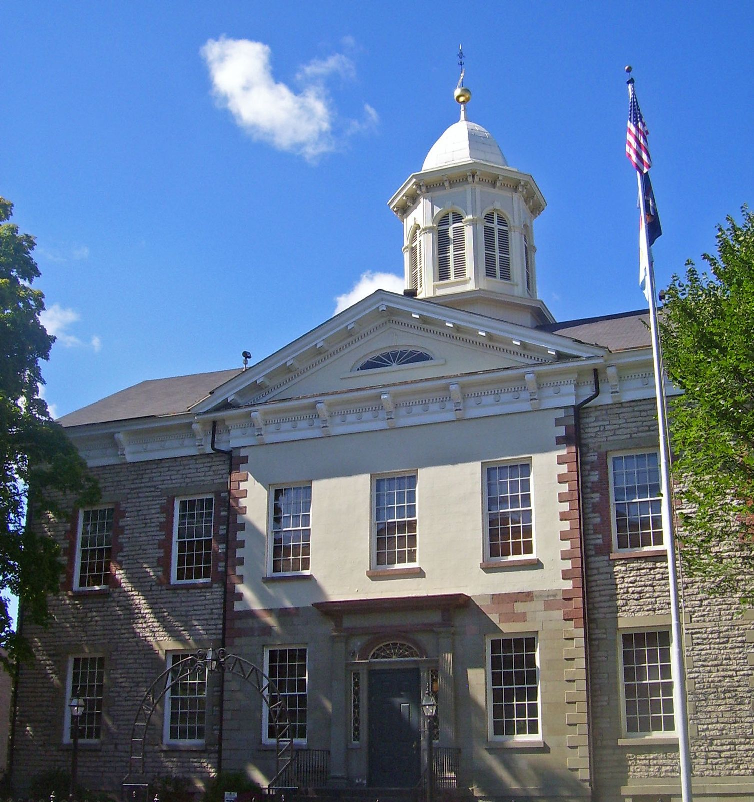

# The Kingston Igniters: Four Years Looking for a Drag Strip (1955–59)

!!! abstract "Article record"
    **Confidence:** Medium · **Source types:** Grassroots small-town daily newspaper (*Kingston Daily Freeman*, Kingston, N.Y.): about twenty short club items, a district attorney's talk, a photo caption and a safe-driving campaign notice, 1955–59, read as scanned page OCR · **Last verified:** 2026-10-18 (Round 17) · **Open issues:** the club never found a strip in the items we read; why it became a motor club in 1959 is not explained; the advisory board member appears as both "Carl Cline" and "Carl Kline" ◐ · [How we rate this](../reference/source-standards.md)

!!! quote "In their own words"
    "The Igniters Club has volunteered to do this and I think it's a very fine gesture."

    — **George Mustaparta**, director of Kingston's Safe Driving Day, *Kingston Daily Freeman*, Nov. 12, 1955.[^kf551112]

The Igniters of Kingston, New York, in the Hudson Valley, wanted one thing: a straight, flat, legal place to run. They spent four years looking. Along the way they handed out thousands of safety tags, shined up a 1931 Ford for the home show and helped Poughkeepsie start its own club. Then they quietly turned into something else.

## Thirty young men at a service station

In August 1955 the *Freeman* reported that "About 30 young men" had come to the organizational meeting of the "Igniters," "a new organization designed to attract hot-rodders and young men interested in automobiles." The second meeting was at Don's Service garage, 52 Hasbrouck Avenue. A committee would look for "a mile-long 'drag strip' or track on which the motor-minded young people may drive under club regulations." The paper said local officials backed the club, including State Senator **Arthur H. Wicks**, and that it hoped to grow into a countywide "Ulster County Igniters."[^kf550816]

The first officers were **William Locke** (president), **Amos MacCreery** (vice president), **Peter Steketee** (treasurer), **William Ziros** (inspector) and **Joseph Cornelski** (secretary). On the advisory board were **Don Eaton**, **Gus Lovy**, **Leroy "Pappy" Wells** and **Carl Cline**.[^kf550816]

By the third meeting a committee of Anthony De Paola, Louis Roberti, Connie Venditti and John Resso had three possible strip sites to report, but no action was taken. A delegation visited Senator Wicks, who approved of the club's aims.[^kf550820]

## The DA drops by

District Attorney **Howard C. St. John** spoke to the club late that August. He told the members that the community looked to them as an example of safe driving and that any traffic violation by a member would be "a reflection on the organization." He also said the club "should have a track, such as they now seek, on which to drive."[^kf550826]

That night the club had 35 members, had applied to join the National Hot Rod Association, and planned to look at land owned by William Schryver at Stone Ridge as "a possible site for a 'drag strip.'" The club was already policing itself. A hearing on two members was continued: one was under a 60-day suspension of driving privileges, and the other was on probation.[^kf550826]

<figure markdown>
{ loading=lazy }
<figcaption markdown>The Ulster County Courthouse in Kingston, where the Igniters were meeting by 1958–59 (photo 2008). Creator: Daniel Case. Date: 2008-09-19. Source: [Wikimedia Commons](https://commons.wikimedia.org/wiki/File:Ulster_County_courthouse,_Kingston,_NY_cropped.jpg). License: [CC BY-SA 3.0](https://creativecommons.org/licenses/by-sa/3.0).</figcaption>
</figure>

## Good deeds, on the record

- **September 1955:** after a one-car crash on Route 28 knocked down and set fire to the gasoline pumps at Art's Esso station, a Mr. Granquist thanked the Igniters for helping clear the wreckage: "the boys did a good job and I'm grateful to them."[^kf550923] The club now met weekly at the Kingston Recreation Center, 97 Broadway, and had about 40 members.[^kf550915]
- **November 1955:** for Safe Driving Day on Dec. 1, the club volunteered to pay for and hand out **4,000 lapel tags**.[^kf551112]
- **March 1956:** Deputy Sheriff Carl Cline, "founder of the organization," announced safe-driving trophies for members with perfect driving records, with a campaign starting April 1. LeRoy Wells of the White Star Transfer Co. would present the trophies.[^kf560312]

## A 1931 Ford at the home show

At the Kingston Lions Industrial Exposition and Home Show at the state armory in March 1956, the Igniters showed what a hot rod club actually did. A *Freeman* photo shows Amos McCreery Jr., Robert Powell, LeRoy Wells and Gus Lovy, now president, beside "a completely rebuilt car": a **1931 Ford roadster with a 1948 engine and dual carburetion**. The caption called the project part of a club safety campaign "to acquaint club members with the operation of a car and to realize its power."[^kf560321]

## Still looking

By May 1956 the headline said it all: "'Drag Strip' Is Still Sought by Igniters Club." For the layman, the paper explained, a drag strip was a flat straightaway at least a quarter of a mile long for timed runs from a standing start. So far, according to County Jailer Carl Cline, one of the club's founding "sparks," they had had no success. The White Star Transfer Co. had donated trophies for six-month, one-year and five-year perfect driving records. And Lovy said the idea was spreading: the Poughkeepsie Police Athletic League had talked with local hot rod leaders about starting a club there.[^kf560517] In June, Lovy reported that Igniters had gone to Poughkeepsie to help organize a safety campaign for the young drivers there.[^kf560606]

## From hot rod club to motor club

In November 1958 **Richard Cooney** was elected president at a meeting in the supervisors' room of the Ulster County Courthouse. He stressed safe driving and paying dues on time, and the advisers told the members to look for a meeting place "which they could call their own."[^kf581125]

Two months later the board met at Wells's home and changed the operation of the club "from a hot rod to a motor club." The name stayed. Members got new club plates (purple, with aluminum lettering), and the first road rally, a 17-mile run around the county from Hasbrouck Avenue near the Strand to Dietz Stadium, went to **Kenneth Lamphere** with co-pilot George Bilyou.[^kf590114][^kf590130] By November 1959 the Igniters were running a newspaper collection drive.[^kf591107]

The papers never say why the change happened. The timing suggests a club that had waited four years for a strip that never came and found something else to do with its cars. That is our reading, not the *Freeman*'s. Sedalia's Drag-Ons and Stroudsburg's Ridge Runners hunted for strips at the same time. See [The Sedalia Drag-Ons](sedalia-drag-ons.md) and [The Ridge Runners of Stroudsburg](stroudsburg-ridge-runners.md).

**Related:** [Escanaba's Drag-n's](escanaba-dragns.md), [Belleville's Gear Jammers](belleville-gear-jammers.md) and the 1955 [planners' survey](planners-report-1955.md).<a href="#q-1" title="Open question: see the bottom of the page">?</a>

## Open questions & disputed details

*From the detective's notebook: where the sources disagree, where we have only one, and what we are still looking for. Each item links back to its place in the story.*

### Next leads

The Poughkeepsie PAL club of 1956; whether the Stone Ridge site or any Ulster County strip was ever built; the 1959 road rallies; Igniters plates in collectors' hands. <a class="hr-q-back" href="#qr-1" title="Back to the story">↩</a>

## Sources

[^kf550816]: "New York Motor Society Meets," *Kingston Daily Freeman* (Kingston, N.Y.), Aug. 16, 1955. Page OCR. https://archive.org/details/kingston-daily-freeman-1955-08-16 (accessed 2026-10-18)
[^kf550820]: "Igniters Group Seek Track Site," *Kingston Daily Freeman*, Aug. 20, 1955. Page OCR. https://archive.org/details/kingston-daily-freeman-1955-08-20 (accessed 2026-10-18)
[^kf550826]: "DA Tells They Should Set Driver Example," *Kingston Daily Freeman*, Aug. 26, 1955. Page OCR. https://archive.org/details/kingston-daily-freeman-1955-08-26 (accessed 2026-10-18)
[^kf550915]: "Igniters Meet Today," *Kingston Daily Freeman*, Sept. 15, 1955. Page OCR. https://archive.org/details/kingston-daily-freeman-1955-09-15 (accessed 2026-10-18)
[^kf550923]: Route 28 accident item, *Kingston Daily Freeman*, Sept. 23, 1955. Page OCR. https://archive.org/details/kingston-daily-freeman-1955-09-23 (accessed 2026-10-18)
[^kf551112]: "Igniters to Take Part in Safe Driving Day Here," *Kingston Daily Freeman*, Nov. 12, 1955. Page OCR. https://archive.org/details/kingston-daily-freeman-1955-11-12 (accessed 2026-10-18)
[^kf560312]: "Igniters Will Award Trophies For Safe Driving," *Kingston Daily Freeman*, March 12, 1956. Page OCR. https://archive.org/details/kingston-daily-freeman-1956-03-12 (accessed 2026-10-18)
[^kf560321]: "Igniters Show Rebuilt Car" photo caption, *Kingston Daily Freeman*, March 21, 1956. Page OCR. https://archive.org/details/kingston-daily-freeman-1956-03-21 (accessed 2026-10-18)
[^kf560517]: "'Drag Strip' Is Still Sought by Igniters Club," *Kingston Daily Freeman*, May 17, 1956. Page OCR, columns interleaved. https://archive.org/details/kingston-daily-freeman-1956-05-17 (accessed 2026-10-18)
[^kf560606]: "Igniters Will Hold Meeting Tonight," *Kingston Daily Freeman*, June 6, 1956. Page OCR. https://archive.org/details/kingston-daily-freeman-1956-06-06 (accessed 2026-10-18)
[^kf581125]: "Igniters Elect Cooney New Head," *Kingston Daily Freeman*, Nov. 25, 1958. Page OCR. https://archive.org/details/kingston-daily-freeman-1958-11-25 (accessed 2026-10-18)
[^kf590114]: "Change Operation Of Igniters Group To Motor Club," *Kingston Daily Freeman*, Jan. 14, 1959. Page OCR. https://archive.org/details/kingston-daily-freeman-1959-01-14 (accessed 2026-10-18)
[^kf590130]: "Kingston Igniters Club Will Issue New Plates," *Kingston Daily Freeman*, Jan. 30, 1959. Page OCR. https://archive.org/details/kingston-daily-freeman-1959-01-30 (accessed 2026-10-18)
[^kf591107]: "Igniters Slate Paper Collection," *Kingston Daily Freeman*, Nov. 7, 1959. Page OCR. https://archive.org/details/kingston-daily-freeman-1959-11-07 (accessed 2026-10-18)
