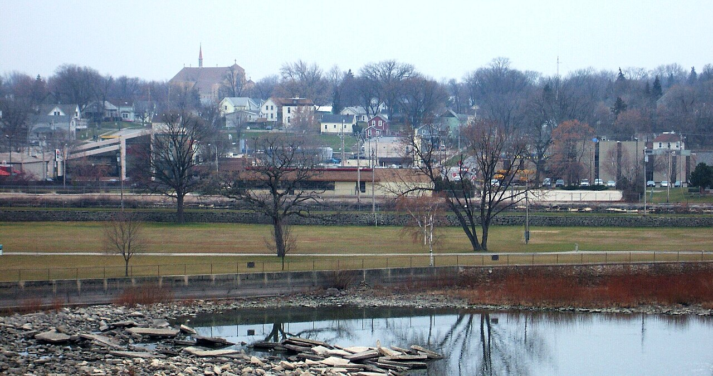

# A Strip in a Ravine: the Fox Valley's Drag Strip Hunt and the KK Sports Arena (Appleton–Kaukauna, Wis., 1960–68)

!!! abstract "Article record"
    **Confidence:** Medium · **Source types:** Grassroots daily newspaper (*Appleton Post-Crescent*, Appleton, Wis.): readers' letters, county-board and plan-commission reports, sports notes, display ads, a fatal-accident report and a 1968 feature, read as scanned page OCR · **Last verified:** 2026-10-22 (Round 20) · **Open issues:** the 1964 claim that the strip would be only the state's "second" ◐; the 1968 president's name and his Union Grove role are garbled in the scan ◐; the first drag meet at KK (1964 promotion day or 1966 "opening") ◐; whether the 1965 rezoning request was the same land ◐ · [How we rate this](../reference/source-standards.md)

!!! quote "In their own words"
    "And why can't the cities around here build a public drag strip, in conjunction with the police department, so that the driver can test himself and his car?"

    — D. R. Seeger, letter to the *Appleton Post-Crescent*, Dec. 22, 1960.[^pc601222]

Wisconsin's Fox River valley, the paper-mill towns of Appleton, Kaukauna, Kimberly, Little Chute, Neenah and Menasha, spent four years asking for a drag strip. The letters came from a driver, a car club and a county supervisor. The answer came from a farmer's ravine south of Kaukauna, where two men were building a stock car track.

## The asking (1960–64)

The first letter we found wasn't a hot rodder's plea. In December 1960 D. R. Seeger wrote in about "highway slaughter" on U.S. 41. He wanted public lectures, a minimum speed law and a place where an ordinary driver could test his brakes on wet pavement, throw his car into a skid "and see what happens." That place, he suggested, could be a public drag strip run with the police.[^pc601222]

In November 1962 the **Road Deacons Rod and Custom Club** made the hot rodders' case under the headline "Drag Racers Present Their Case for Track." They explained what a drag strip was, down to the pit area and the return road, and argued that "drag racing, on a drag strip, is one of the most supervised and safest forms of racing today." A strip, they said, was "the major goal of every member of each car club in the Fox Valley area."[^pc621127] (For the clubs themselves, see [The Road Deacons and the Gas-Ketts](fox-valley-road-deacons-gas-ketts.md).)

In May 1964 a freshman Outagamie County supervisor, Norman Beyer, asked the county traffic committee whether the old county airport, about to be abandoned, could become a youth center, with its concrete runway as a drag strip and its hangar for other activities. The other committeemen said the airport property "is too valuable to be used in such a manner"; one suggested putting a strip "in the middle of the Center Valley swamp." The county's traffic police sided with Beyer. Sgt. George Else said young drivers were already racing a back road near Mackville, with two S-curves, and that its surface was "all torn up."[^pc640504]

## KK Sports Arena (1964)

That same month the paper announced a new speedway "one-half mile east of Little Chicago on County Trunk KK," run by partners **Clarence DeLeeuw** and **Clyde Schumacher**. It was being built "in a ravine," a natural amphitheater with bleachers set into the hillside for 4,000 people. There would be a quarter-mile stock car track and a half-mile track for modifieds, sports cars, motorcycles and horse racing. "A drag strip is also in the plans for which a club is now being organized. When completed, the drag strip will be the second in the state The only other one is in Union Grove."[^pc640529]<a href="#q-1" title="Single source so far: see Open questions">◐</a>

Building it turned up a surprise. In June 1964 the paper photographed charred wood and clay "thought to be materials dating back to the Ice Age," found when owner-operator Clarence DeLeeuw had a hill cut away; he planned to have a geology professor look at them (the professor's college is lost in the scan).[^pc640620] That September an arena ad promised a "Big 'DRAG STRIP' PROMOTION DAY" for Sunday, September 27.[^pc640919]<a href="#q-2" title="Single source so far: see Open questions">◐</a>

<figure markdown>
{ loading=lazy }
<figcaption markdown>The south side of downtown Kaukauna, Wisconsin, in 2006. Context only: the KK arena was two miles south of town, on County Trunk KK near Highway 55. Photo: Tjrudebeck at English Wikipedia, Nov. 2006. Source: [Wikimedia Commons](https://commons.wikimedia.org/wiki/File:Kaukaunasouthsidedowntown.jpg). License: [CC BY-SA 3.0](https://creativecommons.org/licenses/by-sa/3.0/).</figcaption>
</figure>

## Drag races every Sunday (1966)

On June 4, 1966, an ad announced "DRAG STRIP OPENING - TOMORROW - Sunday, June 5th," gates at 9 a.m. and racing at 1 p.m., at the arena at "Highway 55 & County Trunk KK."[^pc660604]<a href="#q-3" title="Single source so far: see Open questions">◐</a> By midsummer the arena's ads were a map: a figure-8 track, a half-mile dirt oval, and a "Quarter mile black top drag strip" with its own return road. Stock cars ran Saturday night, drags on Sunday, and professional motorcycles on the Fourth of July. Adults paid $1.25.[^pc660701] "Stock Car Racing (With Figure 8) Every Sat. Drag Races Every Sunday!"[^pc660612] (The 1965 plan commission had heard, but not acted on, a request from property owners on County Trunk KK to develop their land "as a drag strip, toboggan and ski slide area.")[^pc650325]<a href="#q-4" title="Single source so far: see Open questions">◐</a>

On Sunday, August 7, 1966, Thomas J. Broas, 28, of Black Creek, a father of three, "became the first race track fatality in Outagamie County history when he was killed Sunday afternoon after his small dragster shot off the north end of the KK Sports Arena drag strip, clipped off a utility pole and rolled over several times." He had failed to qualify earlier and was turning around to take his place when the accident happened; the headline said the accelerator may have stuck.[^pc660808]

## $600,000 later (1968)

By April 1968, when the arena was paving a banked half-mile oval, the paper said the building program "started back in 1964" was worth "approximately $600,000." What had been "200 acres of grass, hills, and woodlands owned by a farmer" now held a quarter-mile and figure-8 track, the half-mile, and "a quarter-mile drag strip," whose bleachers held about 8,500, with hillside room for many more. A photo from the scorers' booth showed two women running the strip's "new 'Chrondek' timing equipment."[^pc680421]<a href="#q-5" title="Single source so far: see Open questions">◐</a>

The Fox Valley's strip came the way many Midwestern strips did. The clubs asked for a county strip on public land. The county said no. Then a private oval builder added a drag strip, and four years later it had Chrondek timers. Compare [Kansas City](kansas-city-timing-association.md), where the clubs did get a public site, and [Malden](semo-malden-drag-strip.md), where a town owned an empty air base.<a href="#q-6" title="Open question: see the bottom of the page">?</a>

## Open questions & disputed details

*From the detective's notebook: where the sources disagree, where we have only one, and what we are still looking for. Each item links back to its place in the story.*

**Single source so far.** *That was the paper's claim. Great Lakes Dragaway at Union Grove was holding its eighth annual national meet that very week, per a story on the same page.* <a class="hr-q-back" href="#qr-1" title="Back to the story">↩</a>

**Single source so far.** *We have not found a report of that day.* <a class="hr-q-back" href="#qr-2" title="Back to the story">↩</a>

**Single source so far.** *The name of the sponsoring association is lost in the scan; it ends "...Association."* <a class="hr-q-back" href="#qr-3" title="Back to the story">↩</a>

**Single source so far.** *The report doesn't say whose land it was.* <a class="hr-q-back" href="#qr-4" title="Back to the story">↩</a>

**Single source so far.** *The same story names the arena's president, a 46-year-old Kaukauna man who was also president of events at Great Lakes Dragaway in Union Grove, but the columns are interleaved and his name reads only as "Joe Van Daalwyk." We have not confirmed it.* <a class="hr-q-back" href="#qr-5" title="Back to the story">↩</a>

### Next leads

The arena's 1966 sponsoring association; the 1964 promotion day; the president's name and his Union Grove link; when the strip closed; the Ghost Rods and other clubs that raced there. <a class="hr-q-back" href="#qr-6" title="Back to the story">↩</a>

## Sources

[^pc601222]: D. R. Seeger, letter to the editor, *Appleton Post-Crescent* (Appleton, Wis.), Dec. 22, 1960. Page OCR (quote corrected for OCR slips). https://archive.org/details/appleton-post-crescent-1960-12-22 (accessed 2026-10-22)
[^pc621127]: Road Deacons Rod and Custom Club, "Drag Racers Present Their Case for Track," letter, *Appleton Post-Crescent*, Nov. 27, 1962. Page OCR. https://archive.org/details/appleton-post-crescent-1962-11-27 (accessed 2026-10-22)
[^pc640504]: "Outagamie County Supervisor Suggests Auto Drag Strip," *Appleton Post-Crescent*, May 4, 1964. Page OCR, columns interleaved. https://archive.org/details/appleton-post-crescent-1964-05-04 (accessed 2026-10-22)
[^pc640529]: "Saturday Stock Car Races Scheduled at KK Sports Arena," *Appleton Post-Crescent*, May 29, 1964. Page OCR, columns interleaved. https://archive.org/details/appleton-post-crescent-1964-05-29 (accessed 2026-10-22)
[^pc640620]: Photo caption, "These Pieces of Wood and a mound of clay...," *Appleton Post-Crescent*, June 20, 1964. Page OCR. https://archive.org/details/appleton-post-crescent-1964-06-20 (accessed 2026-10-22)
[^pc640919]: KK Sports Arena display ad, *Appleton Post-Crescent*, Sept. 19, 1964. Page OCR. https://archive.org/details/appleton-post-crescent-1964-09-19 (accessed 2026-10-22)
[^pc650325]: Appleton plan commission report, *Appleton Post-Crescent*, Mar. 25, 1965. Page OCR. https://archive.org/details/appleton-post-crescent-1965-03-25 (accessed 2026-10-22)
[^pc660604]: Arena drag strip opening ad, *Appleton Post-Crescent*, June 4, 1966. Page OCR, partly garbled. https://archive.org/details/appleton-post-crescent-1966-06-04 (accessed 2026-10-22)
[^pc660612]: Sports Arena display ad, *Appleton Post-Crescent*, June 12, 1966. Page OCR. https://archive.org/details/appleton-post-crescent-1966-06-12 (accessed 2026-10-22)
[^pc660701]: "Holiday Hi-Lites," Sports Arena display ad with site map, *Appleton Post-Crescent*, July 1, 1966. Page OCR. https://archive.org/details/appleton-post-crescent-1966-07-01 (accessed 2026-10-22)
[^pc660808]: "Drag Race Driver Killed in Accident," *Appleton Post-Crescent*, Aug. 8, 1966. Page OCR. https://archive.org/details/appleton-post-crescent-1966-08-08 (accessed 2026-10-22)
[^pc680421]: Ron Witt, "Building of Paved Half-Mile Track Another Milestone in Development of KK Arena," *Sunday Post-Crescent*, Apr. 21, 1968, p. B6. Page OCR, columns interleaved. https://archive.org/details/appleton-post-crescent-1968-04-21 (accessed 2026-10-22)
