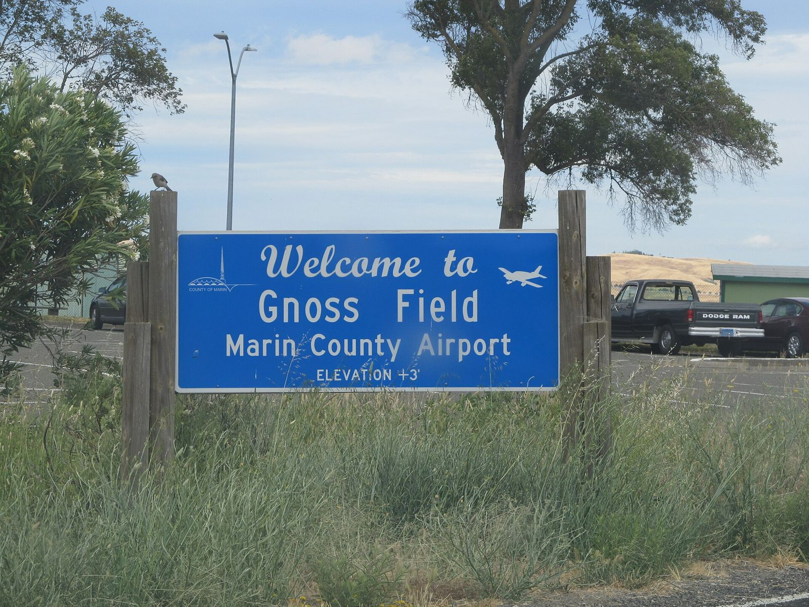

# "Hey! Anybody Got a Drag Strip?" Marin County and the Cotati Strip (1955–64)

!!! abstract "Article record"
    **Confidence:** Medium · **Source types:** Grassroots small-city daily newspaper (*Daily Independent-Journal*, San Rafael, Calif.): front-page reports, a car columnist's notes, an editorial, a Saturday picture page and readers' letters, 1955–64, read as scanned page OCR; one racing weekly (*MotoRacing*, Oct 1956); Peter Behr's State Archives oral history (1988–89) and Wikipedia for his later career · **Last verified:** 2026-10-21 (Round 19) · **Open issues:** how the Navy's April 1956 refusal turned into an October opening at Cotati is not explained in what we read ◐; the cost of Behr's plan ($25,000, $35,000 or "$20,000") ⚠; whether Marin ever got a strip of its own (none found through 1964) ◐; Thomas Beyer or Beyers (both spellings in one story) · [How we rate this](../reference/source-standards.md)

!!! quote "In their own words"
    "To them the drag strip is the single most satisfying and desirable recreational facility. It is what they want most."

    — **Peter Behr**, Mill Valley attorney, to the Marin County Board of Supervisors, as reported in the *Daily Independent-Journal*, July 13, 1956.[^ij560713]

In the summer of 1956 the hot rodders of Marin County, just north of the Golden Gate, had home-garage dragsters, six clubs and a lawyer who would later be a state senator. What they did not have was anywhere to run. The nearest paved strip was at Lodi. Then one opened at an old Navy field up the highway at Cotati, ran for ten weeks, and was shut by the same police chief who had driven the first car through the traps.

## A clambake of car clubs (1955)

The paper's car columnist, Ken Molino, reported a "big clambake" in October 1955 with all Marin auto clubs represented. The subject was "a drag strip in Marin or the Bay Area," with room for a road course later. It was the second such meeting, and an adviser was former county supervisor **Bill Wright**, who flew his own plane and had a bird's-eye view of possible sites. Molino noted that local peace officers were "showing some interest," and he drew the lesson for rodders and sports-car drivers alike: "The various types of car clubs CAN work together and will have to if this thing is going to work out."[^ij551014]

## Cotati: yes, no, yes

In February 1956 Molino wrote that "it's just a matter of time now before the Cotati Drag Strip is in operation." The Santa Rosa city council had acted, pushed by that city's hot rod organization and its Junior Chamber of Commerce. The strip would be run by the **Redwood Empire Timing Association** (RETA) under an agency named by Santa Rosa, to National Hot Rod Association standards, on a site "boasting two runways, each 5,000 feet in length." The Jaycees' man, **Bill Rush**, said Santa Rosa's leaders had shown "that their thinking is clear and progressive."[^ij560203]

Ten weeks later the headline read "Cotati Drag Strip Project Is Blocked." RETA president **Ray Alpeter** said Navy officials "cannot release the proposed site (an abandoned auxiliary airfield near Cotati) for anything but aircraft purposes." It was "a grave disappointment" to the 39 clubs in RETA.[^ij560412]

## The lawyer and the supervisors (June–July 1956)

On June 26, 1956, Mill Valley attorney **Peter Behr** asked the Marin County supervisors to put "$25,000 or more" into a drag strip: paved, 3,000 feet long and 60 wide, with a pit, parking and a small control tower, to be run by an incorporated "timing association" of adults. He quoted Kansas City, where police had logged 75 to 100 "disturbance calls" a month before their strip opened and then "went 10 months before they had another single call." Profits, he said, usually paid off a strip in two years, and in Marin perhaps one.[^ij560626] (Kansas City's own account of those years is in [The Detective Whose Son Was a Dragster](kansas-city-timing-association.md).)

At the hearing on July 12 about 20 young people, "both boys and girls," sat in the audience. Behr said a strip "will predictably reduce accidents on our highways faster, and at less cost, than any other known safety measure," that there were 487 strips in 32 states, and that the cost "might go as high or higher than $35,000." **Mario Aquilino**, one of the youths, said Marin had six hot rod clubs with 188 members, all tied to RETA. Deputy District Attorney **Leland Jordan** said the county could legally build and run a strip but saw "some question" about handing it to an association. Every supervisor agreed it "sounded like a good idea but that it needed further investigation," and the board sent it to the county administrator, planning director Mary Summers and Jordan to work out with a small committee of hot rodders.[^ij560713]

The paper's editorial was warm and careful. It pointed out that Marin's 180 or so club members drove to Lodi and San Jose to race, and "sometimes they drive clear to Salinas" because they thought San Jose's partly paved strip dangerous, and it concluded: "We'd like to see Marin have a drag strip if, in fact, it will be used and useful to a sizeable proportion of the county's youth."[^ij560716] A San Rafael reader, Albert F. Hammill, wrote that young people who could make a pile of parts run better than a passenger car "are above average and should be encouraged," and added: "There are hundreds of juvenile offenders to one delinquent."[^ij560702]

A week later the hot rodders' committee picked seven possible sites in the **Novato–Black Point** area: flat land on both sides of the Black Point cutoff east of Highway 101, and north of Novato near the Novato airport. The site committee was **John France**, president of the Marin Coupe and Roadster Club; **Harvey Simpkins** of Novato, a highway engineer; and Aquilino, now described as a drag race official.[^ij560719]

<figure markdown>
{ loading=lazy }
<figcaption markdown>Gnoss Field, the county airport at Novato (photo 2014). Wikipedia says the Wright family opened an airport just west of the present site after World War II, and the county bought it in 1968.[^wikignoss] The 1956 and 1960 strip sites were proposed "in the vicinity of Novato airport"; this photo shows the place today, not a strip. Creator: Mx. Granger. Date: 2014-06-25. Source: [Wikimedia Commons](https://commons.wikimedia.org/wiki/File:Marin_County_Airport_sign.JPG). License: [CC0](http://creativecommons.org/publicdomain/zero/1.0/deed.en).</figcaption>
</figure>

## Garage dragsters (August 1956)

The Saturday magazine gave the hunt a full picture spread under the line "Hey! Anybody Got A Drag Strip?" Molino's photos showed **Bob Sletten**, 22, of San Anselmo, three months into a dragster with only the differential finished and a tractor seat ready; **Eddie Mullen**, 23, souping up a 1932 Ford with a Mercury engine and a four-carburetor manifold set up for nitromethane, who said of finding parts, "you hunt small towns, farm yards and junk yards"; and John France filing the seams of a 100-pound fiberglass body for a 1940 Ford chassis with a 1955 Chrysler engine. The text said students at Marin's six high schools had told their principals a strip was their "No. 1 desire," but there was no place "in Marin—or the nine Bay Area counties—to try them out."[^ij560818]

## Ten weeks at Cotati (October–December 1956)

Then the Cotati strip opened after all. A racing weekly reported a crowd of more than 2,000 at the grand opening of "Northern California's newest drag strip at the former Cotati Naval Airfield," called the **Santa Rosa Drag Strip**, run by RETA ("some 35 member clubs") under the supervision of the City of Santa Rosa, with more than 300 cars at the opening two-day meet. The first car through the traps was a Santa Rosa police car driven by Chief **Melvin Flohr**. "The time wasn't made public."[^moto561019]<a href="#q-1" title="Single source so far: see Open questions">◐</a>

On Dec. 20, 1956, the *Independent-Journal* reported that the strip had been closed "until next summer" on Chief Flohr's orders after a fatal crash the previous Sunday. **Joseph V. Mahoney**, 26, a San Jose State College student, had been traveling 129 mph. The strip's director, **Dick Berndt**, blamed the chief's action on "unfavorable publicity."[^ij561220]

The strip came back. By December 1959 the paper was previewing the end of Cotati's 1959 season, with a Petaluma club's record-breaking roadster expected.[^ij591203] In March 1964 Cotati hosted the California State Drag Championships, with **Don Garlits** of Tampa, Connie Kalitta and others in the fuel class, at a strip "off Highway 101, between Petaluma and Santa Rosa near the Russian River turnoff."[^ij640328]

## Marin keeps asking (1957–60)

Marin kept trying for its own strip. In **May 1957** labor offered a plan: Thomas W. Beyer of Machinists Lodge 238 (the paper also spells him Beyers) asked the Marin Central Labor Council to join management in a donated-labor project: a five-eighths-mile oval plus a drag strip, at about $75,000 "exclusive of land," with "a committee of the younger generation" given real parts to play.[^ij570516]

Two years later the clubs met in a courtroom. In **June 1959** seven Marin car clubs met in the Superior Court room of Judge N. Charles Brusatori, with the sheriff and a San Rafael police captain invited, to push for a strip in North Marin. Eli Foure of the Marin Coupe and Roadster Club chaired. They had formed the **Marin County Timing Assn.** to run it and had hopes of acreage near Novato owned by the Dons Club of San Francisco. The clubs: the Marin Coupe and Roadster Club, Eliminators, Sleepers, Strip Pacers, Rumblers, Road Runners and the Twisters of Novato.[^ij590601]

A carnival tried next. In **July 1959** Novato's American Legion post was to get a share of a carnival's profits "toward construction of a public drag strip and recreational area north of Novato," until a district attorney's investigator shut three wheels of fortune as gambling.[^ij590731]

By **1960** the clubs had grown, and land was on offer. By June 1960 the timing association had "between 250 and 300" members in eight clubs (the paper then lists nine names, adding the Lancers, the Gentleman and the new Quick Changers of Fairfax) and was holding its first car show.[^ij600604] In July its adviser, **Leland E. "Lee" Baum**, asked the county recreation commission for a site, ideally a mile and a half long, and said club members would do the work.[^ij600707] Days later he announced that Mervin Goodman of a San Francisco real estate firm had offered 20 acres by the Smith Brothers ranch, southeast of St. Vincent's School for Boys, on condition it be used only for drag racing, sports cars, karts and quarter-midgets. Marin's enthusiasts (the paper called them "sports car" fans) would get a strip "without the cost of a penny of taxpayers' money," he said, with work to start in August.[^ij600711]

## The clubs at a funeral

In August 1960 Kenneth and Barbara Foutch of Tiburon wrote to the paper. Their son Bill, a Road Runners of Marin member, had been killed in a car crash at Placerville on July 2. The Road Runners, the Sleepers, the Eliminators and the other timing-association clubs had driven to Placerville to help, held a benefit dance at Bermuda Palms, and sold $1 chances on Bill's just-finished 1953 Ford so the family would not have to. "We can't begin to praise these young men enough," they wrote.[^ij600809]

## The drag strip as a campaign issue (1961)

In 1961 Behr ran in a recall election against Supervisor Blair. On a KTIM radio program about the recall, Blair's side brought up the drag strip. **John R. Ehlen** of Sausalito, who had been on the program for Blair, wrote to correct the paper's account: it was Blair's other spokesman, Albert Bianchi, who had said Behr urged the supervisors to buy land "for 'hot rod' addicts" and spend $20,000 on it, "by way of demonstrating the immaturity" of Behr. He finished with a jab: Blair's supporters "are prepared to concede that the votes of all political 'hot rodders' will be cast in favor of Mr. Blair's opponent."[^ij611124]<a href="#q-2" title="Sources disagree: see Open questions">⚠</a>

Behr won. "It was the first recall that has ever been won at the supervisorial level," he told an interviewer in 1988.[^behroh] He served on the board in the 1960s and in the state senate from 1971 to 1978, and he is remembered mainly as a conservationist.[^wikibehr] His long oral history does not mention the drag strip at all (we searched the text for "drag" and "hot rod").[^behroh]

## Still asking (1963)

In May 1963 a San Rafael High School student running for "Youth in Government" mayor, **Bruce Wold**, said students had suggested a drag strip in San Rafael "or on some abandoned air strip in the county," and that a candidate's duty was "to please constituents."[^ij630503] In the papers we read through 1964, Marin's racers were still going up the highway to Cotati.<a href="#q-3" title="Single source so far: see Open questions">◐</a>

Marin is the mirror image of Kansas City. There, the police chief built the strip with the clubs. Here, a lawyer, a labor man, a carnival, a real-estate offer and a student candidate all tried, and the county never quite said yes. The strip the Marin kids got was across the county line, at an airfield the Navy first refused to let go. Compare [Sedalia's eleven-year chase](sedalia-big-sir.md), [Kingston's four years](kingston-igniters.md), the [Pocono hunt](pocono-strips.md), [Palm Springs' timing association](palm-springs-timing-association.md) and [Redding's borrowed runway](red-bluff-schafer-oil-special.md).<a href="#q-4" title="Open question: see the bottom of the page">?</a>

## Open questions & disputed details

*From the detective's notebook: where the sources disagree, where we have only one, and what we are still looking for. Each item links back to its place in the story.*

**Single source so far.** *Our reading of the papers does not show how the Navy's April refusal was overcome.* <a class="hr-q-back" href="#qr-1" title="Back to the story">↩</a>

**Disputed.** *The $20,000 figure, and the 1961 paper's version that Behr had "voted" for it as a Mill Valley councilman,[^ij611124] do not match the 1956 reports, where he made the request as an attorney and named $25,000 or more, then up to $35,000.*[^ij560626] <a class="hr-q-back" href="#qr-2" title="Back to the story">↩</a>

**Single source so far.** *We found no Marin strip; a later issue may prove us wrong.* <a class="hr-q-back" href="#qr-3" title="Back to the story">↩</a>

### Next leads

The Santa Rosa *Press Democrat* for how the Cotati lease got past the Navy, and for Mahoney's crash; RETA's member clubs; the fate of the 1960 Smith Brothers ranch offer; whether Bill Wright, the flying former supervisor, was one of the Wrights who ran the Novato airport (unconfirmed); the Marin Coupe and Roadster Club's own papers. <a class="hr-q-back" href="#qr-4" title="Back to the story">↩</a>

## Sources

[^ij551014]: Ken Molino, "Marin Sports Cars: New MG-A To Be Unveiled Tonight; Continue Plans For Drag Strip," *Daily Independent-Journal* (San Rafael, Calif.), Oct. 14, 1955. Page OCR. https://archive.org/details/san-rafael-daily-independent-journal-1955-10-14 (accessed 2026-10-21)
[^ij560203]: Ken Molino, "Marin Auto Sports: Drag Strip Near Realization; Santa Rosa City Council Hailed," *Daily Independent-Journal*, Feb. 3, 1956. Page OCR. https://archive.org/details/san-rafael-daily-independent-journal-1956-02-03 (accessed 2026-10-21)
[^ij560412]: "Cotati Drag Strip Project Is Blocked," *Daily Independent-Journal*, Apr. 12, 1956. Page OCR. https://archive.org/details/san-rafael-daily-independent-journal-1956-04-12 (accessed 2026-10-21)
[^ij560626]: "Hot Rodders Drag Strip Proposed; Hearing Set," *Daily Independent-Journal*, June 26, 1956. Page OCR. https://archive.org/details/san-rafael-daily-independent-journal-1956-06-26 (accessed 2026-10-21)
[^ij560702]: Albert F. Hammill, "Drag Strip Deserves Aid," letter, *Daily Independent-Journal*, July 2, 1956. Page OCR (spacing corrected). https://archive.org/details/san-rafael-daily-independent-journal-1956-07-02 (accessed 2026-10-21)
[^ij560713]: "Drag Strip Wins First Approval Of Supervisors," *Daily Independent-Journal*, July 13, 1956, pp. 1 and 4. Page OCR. https://archive.org/details/san-rafael-daily-independent-journal-1956-07-13 (accessed 2026-10-21)
[^ij560716]: "Proposed Drag Strip Needs Study But Could Be Good," editorial, *Daily Independent-Journal*, July 16, 1956. Page OCR. https://archive.org/details/san-rafael-daily-independent-journal-1956-07-16 (accessed 2026-10-21)
[^ij560719]: "Seven Sites Favored For Marin Drag Strip," *Daily Independent-Journal*, July 19, 1956. Page OCR. https://archive.org/details/san-rafael-daily-independent-journal-1956-07-19 (accessed 2026-10-21)
[^ij560818]: "Hey! Anybody Got A Drag Strip?" and "A Drag Strip For All Aim Of Hot Rodders," photos by Ken Molino, *Daily Independent-Journal* (Marin Magazine), Aug. 18, 1956, pp. M8–M9. Page OCR. https://archive.org/details/san-rafael-daily-independent-journal-1956-08-18 (accessed 2026-10-21)
[^moto561019]: "Drag Strip at Santa Rosa in Big Opening," *MotoRacing*, Oct. 19, 1956. Page OCR. https://archive.org/details/motoracing_1956-10-19 (accessed 2026-10-21)
[^ij561220]: "Fatal Mishap Closes Cotati Drag Strip," *Daily Independent-Journal*, Dec. 20, 1956. Page OCR, columns interleaved. https://archive.org/details/san-rafael-daily-independent-journal-1956-12-20 (accessed 2026-10-21)
[^ij591203]: "San Rafael Dragster May Try For Record At Cotati," *Daily Independent-Journal*, Dec. 3, 1959. Page OCR. https://archive.org/details/san-rafael-daily-independent-journal-1959-12-03 (accessed 2026-10-21)
[^ij640328]: "Dragsters Race At Cotati Strip," *Daily Independent-Journal*, Mar. 28, 1964. Page OCR. https://archive.org/details/san-rafael-daily-independent-journal-1964-03-28 (accessed 2026-10-21)
[^ij570516]: "Labor-Management Action To Create Drag Strip Urged," *Daily Independent-Journal*, May 16, 1957. Page OCR. https://archive.org/details/san-rafael-daily-independent-journal-1957-05-16 (accessed 2026-10-21)
[^ij590601]: "7 Car Clubs Ask Drag Strip In North Marin," *Daily Independent-Journal*, June 1, 1959. Page OCR. https://archive.org/details/san-rafael-daily-independent-journal-1959-06-01 (accessed 2026-10-21)
[^ij590731]: "Game Closing At Carnival Protested," *Daily Independent-Journal*, July 31, 1959. Page OCR. https://archive.org/details/san-rafael-daily-independent-journal-1959-07-31 (accessed 2026-10-21)
[^ij600604]: "Cars Are Their Big Interest," *Daily Independent-Journal*, June 4, 1960. Page OCR. https://archive.org/details/san-rafael-daily-independent-journal-1960-06-04 (accessed 2026-10-21)
[^ij600707]: "Recreation Commission May Seek 'Drag Strip'," *Daily Independent-Journal*, July 7, 1960. Page OCR (the name first reads "Bium," then "Baum"). https://archive.org/details/san-rafael-daily-independent-journal-1960-07-07 (accessed 2026-10-21)
[^ij600711]: Drag strip land offer (headline not legible in the scan), *Daily Independent-Journal*, July 11, 1960. Page OCR. https://archive.org/details/san-rafael-daily-independent-journal-1960-07-11 (accessed 2026-10-21)
[^ij600809]: Kenneth L. and Barbara Foutch, "Grieving Parents," letter, *Daily Independent-Journal*, Aug. 9, 1960. Page OCR. https://archive.org/details/san-rafael-daily-independent-journal-1960-08-09 (accessed 2026-10-21)
[^ij611124]: John R. Ehlen, "Inaccuracies In Recall Story," letter, *Daily Independent-Journal*, Nov. 24, 1961. Page OCR. https://archive.org/details/san-rafael-daily-independent-journal-1961-11-24 (accessed 2026-10-21)
[^ij630503]: "Young Mayor Candidates Give Views," *Daily Independent-Journal*, May 3, 1963. Page OCR. https://archive.org/details/san-rafael-daily-independent-journal-1963-05-03 (accessed 2026-10-21)
[^behroh]: Peter H. Behr, oral history interview by Ann Lage, Nov. 1988–Jan. 1989, Regional Oral History Office, UC Berkeley, for the California State Archives State Government Oral History Program. https://archives.cdn.sos.ca.gov/oral-history/pdf/behr.pdf (accessed 2026-10-21)
[^wikibehr]: "Peter Behr," Wikipedia (career dates; the oral history gives his supervisor years differently). https://en.wikipedia.org/wiki/Peter_Behr (accessed 2026-10-21)
[^wikignoss]: "Gnoss Field," Wikipedia. https://en.wikipedia.org/wiki/Gnoss_Field (accessed 2026-10-21)
