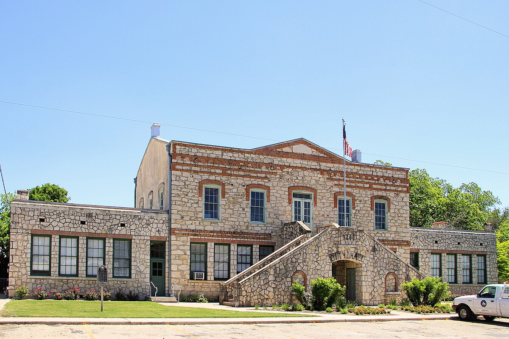

# March of Dimes at the Castroville Airfield: The Alamo Timing Association and Medina County's Drags (Castroville, Hondo and Devine, Tex., 1956–57)

!!! abstract "Article record"
    **Confidence:** Medium · **Source types:** Grassroots County weekly (*Hondo Anvil Herald*, Hondo, Tex.), 1956–57 and 1971: club notices, race results, a profile of an air cadet and a local column, read as OCR from the paper's scans on the Internet Archive · **Last verified:** 2026-10-22 (Round 23-West) · **Open issues:** Rutledge's 139.85 at Laredo is reported once ◐; when Castroville's monthly drags began and ended ?; whether Devine got its strip ? · [How we rate this](../reference/source-standards.md)

!!! quote "In their own words"
    "To place before the public the true meaning of hot roding, not reckless driving as usually thought of, but safe and sane driving."

    — By-laws of the Devine Hot Rod Club, *Hondo Anvil Herald*, Sept. 7, 1956.[^hah560907]

In the 1950s Medina County had what a drag racer most wanted: airfields. Hondo had an air base where cadets took primary pilot training, and Castroville had a municipal airfield.[^hah560706] The county weekly, the *Hondo Anvil Herald*, covered how the races came there, from a club's request in 1956 to a mother's worries in 1957.

## A strip for Devine (1956)

The paper's first hot-rodder was not local. In July 1956 it profiled Aviation Cadet Jimmie D. Burkett of Boise, Idaho, who had arrived at Hondo Air Base for primary pilot training. In Idaho he had "served as vice-president of a hot rod club," belonged to the Boise Valley Timing Association, built a 1927 Model T street roadster and a coupe, and acted "as flag man at drag races for the Board of Control of the Timing Association" before a season in midget races.[^hah560706]

In late August the Devine correspondent, Don Lawrence, reported that "the Devine Chamber of Commerce has been handed a proposal for a hot rod strip." The paper's headline set out the bargain: "Eliminate Public Dragging / Drag Strip Now Being Studied." The hope was that a strip would help young boys see that "one place is best" for dragging.[^hah560831] A week later the paper reported that Devine enthusiasts had organized a Hot Rod Club with 11 charter members. David Williams was president, Douglas Holden vice-president, Cotton Wilborn secretary-treasurer and Dale Fell reporter. The by-laws promised to promote safety, build interest in "auto and speed mechanics," set up competitive events and "help fellow motorists at any time." The only requirement for membership was a driver's license.[^hah560907]<a href="#q-1" title="Open question: see the bottom of the page">?</a>

That October, Hondo racers were invited to New Braunfels for the Jaycees' first drags at the Clear Springs Air Strip, south of town toward Seguin. The races ran under NHRA sanction on an asphalt strip a mile long, which the paper noted "exceeds the half mile" required, with electric timing clocks and trophies in all 27 automotive and motorcycle classes. Meets were to be held on the third Sunday of each month.[^hah561019]

## Castroville (1957)

The big day came on a Sunday in February 1957. The **Alamo Timing Association**, working with Air Force and Castroville city officials, held March of Dimes charity drag races at the Castroville Municipal Airfield. They drew about 200 car entries and 30 motorcycles before an estimated crowd of 2,500. Bobby Joe Rutledge of San Antonio took top eliminator at 123.11. In the final he met Gilbert Goodlett of Corpus Christi, who drove a "Chevy V-8 powered 32' Ford Cpe." It was close in second gear, "but the mighty Ardun driven by Rutledge stormed away in high to win." The paper called the car an "Ardun-Merc" and added that it had turned 139.85 at Laredo.<a href="#q-2" title="Single source so far: see Open questions">◐</a> Goodlett got top gas time at 102.44, and R. E. Sparks of Victoria was top motorcycle eliminator at 104.18. Harold Lozano reported the net proceeds for the association.[^hah570215]

That spring the Legislature passed two bills "affecting the hot rod crowd," as the paper put it. One made girls under 18 and boys under 17 responsible for their own traffic violations, and the other moved the decision on licenses for drivers under 16 from county judges to the Department of Public Safety.[^hah570524] In August the paper reported that Texas Aviation Industries was adding to Hondo Air Base a bowling alley, a driving range and, "for hot rod fans, a new automobile hobby shop" in the old National Guard motor pool.[^hah570802]

By fall the Castroville drags were regular. On Oct. 27 Jerry Koch of Hondo won a trophy in D-Gas at 90.36 mph in a '56 Chevrolet.[^hah571108] A week later a columnist visited his mother, Mrs. Elyne Koch. She had at least a dozen of his trophies at home, and he had given about as many more to girlfriends. She admitted she worried about his racing but insisted it was just another sport, like football. Jerry worked for a brake company in San Antonio and raced around the area. The column told readers they could see the drags at the Castroville Airport on the fourth Sunday of each month, with the next on Nov. 24. The October races had drawn 800 onlookers, with racers from as far away as Austin, though most came from San Antonio.[^hah571115]

{ loading=lazy }

*Castroville's city hall, the former first Medina County courthouse, in 2013. Photo: Larry D. Moore, [CC BY 4.0](https://creativecommons.org/licenses/by/4.0/), via Wikimedia Commons.*

The paper's last word came 14 years later. In March 1971 the Sports Car Club of America asked Hondo for a one-time race at the old air field, and two councilmen pointed out that "the council has refused local people permission to hold drag races at the air field."[^hah710311] In the 1950s the county's airfields had hosted drag racing. By 1971 the town was turning down requests for it. For other small-town Texas clubs of the period, see [Cameron's Accelerators](cameron-accelerators.md) and [Canyon's Orchids, Plugs and Celtics](canyon-orchids-celtics-amarillo.md).<a href="#q-3" title="Open question: see the bottom of the page">?</a>

## Open questions & disputed details

*From the detective's notebook: where the sources disagree, where we have only one, and what we are still looking for. Each item links back to its place in the story.*

**Open question.** **Did Devine ever get its strip?** The Chamber was "handed a proposal" in August 1956, and the club organized the next week, but we have found no later item saying a strip was built at Devine. The Castroville airfield meets may have filled the need instead.[^hah560831][^hah560907] <a class="hr-q-back" href="#qr-1" title="Back to the story">↩</a>

**Single source so far.** **Did Rutledge's Ardun-Merc really turn 139.85 at Laredo?** The figure appears only as a one-line aside in the Castroville report, without a date or meet, and it is 16 mph faster than his winning speed at Castroville. A Laredo program or San Antonio paper would settle it.[^hah570215] <a class="hr-q-back" href="#qr-2" title="Back to the story">↩</a>

### Next leads

A forum thread says the association ran a Kerrville race as early as Aug. 23, 1953 (see [What the City Planners Wrote](planners-report-1955.md)); the *San Antonio Light* and *Express* for the Alamo Timing Association's founding, officers and the end of the Castroville meets; Laredo's strip in 1956–57; Clear Springs results after October 1956; whether the Hondo hobby shop led to a base club, as at other air bases. <a class="hr-q-back" href="#qr-3" title="Back to the story">↩</a>

## Sources

[^hah560706]: Shirley Fowler and Barbara Braden, "Meet Your Neighbors: Three Cadets Study At Hondo," *Hondo Anvil Herald* (Hondo, Tex.), July 6, 1956. OCR via Internet Archive. https://archive.org/details/hondo-anvil-herald-1956-07-06 (accessed 2026-10-22)
[^hah560831]: Don Lawrence, "Eliminate Public Dragging / Drag Strip Now Being Studied," *Hondo Anvil Herald*, Aug. 31, 1956. OCR via Internet Archive. https://archive.org/details/hondo-anvil-herald-1956-08-31 (accessed 2026-10-22)
[^hah560907]: "Hot Rod Clubbers Organize," *Hondo Anvil Herald*, Sept. 7, 1956. OCR via Internet Archive. https://archive.org/details/hondo-anvil-herald-1956-09-07 (accessed 2026-10-22)
[^hah561019]: "Racers Invited To Show," *Hondo Anvil Herald*, Oct. 19, 1956. OCR via Internet Archive. https://archive.org/details/hondo-anvil-herald-1956-10-19 (accessed 2026-10-22)
[^hah570215]: "Victoria Man Takes Honors At Races," *Hondo Anvil Herald*, Feb. 15, 1957. OCR via Internet Archive. https://archive.org/details/hondo-anvil-herald-1957-02-15 (accessed 2026-10-22)
[^hah570524]: Legislative roundup ("Teen-Age Drivers"), *Hondo Anvil Herald*, May 24, 1957. OCR via Internet Archive. https://archive.org/details/hondo-anvil-herald-1957-05-24 (accessed 2026-10-22)
[^hah570802]: Hondo Air Base facilities report, *Hondo Anvil Herald*, Aug. 2, 1957. OCR via Internet Archive. https://archive.org/details/hondo-anvil-herald-1957-08-02 (accessed 2026-10-22)
[^hah571108]: "Race Winner," *Hondo Anvil Herald*, Nov. 8, 1957. OCR via Internet Archive. https://archive.org/details/hondo-anvil-herald-1957-11-08 (accessed 2026-10-22)
[^hah571115]: Local column, *Hondo Anvil Herald*, Nov. 15, 1957. OCR via Internet Archive. https://archive.org/details/hondo-anvil-herald-1957-11-15 (accessed 2026-10-22)
[^hah710311]: Hondo city council report on the proposed SCCA race, *Hondo Anvil Herald*, Mar. 11, 1971. OCR via Internet Archive. https://archive.org/details/hondo-anvil-herald-1971-03-11 (accessed 2026-10-22)
