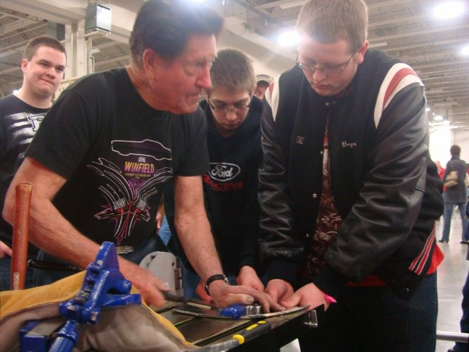
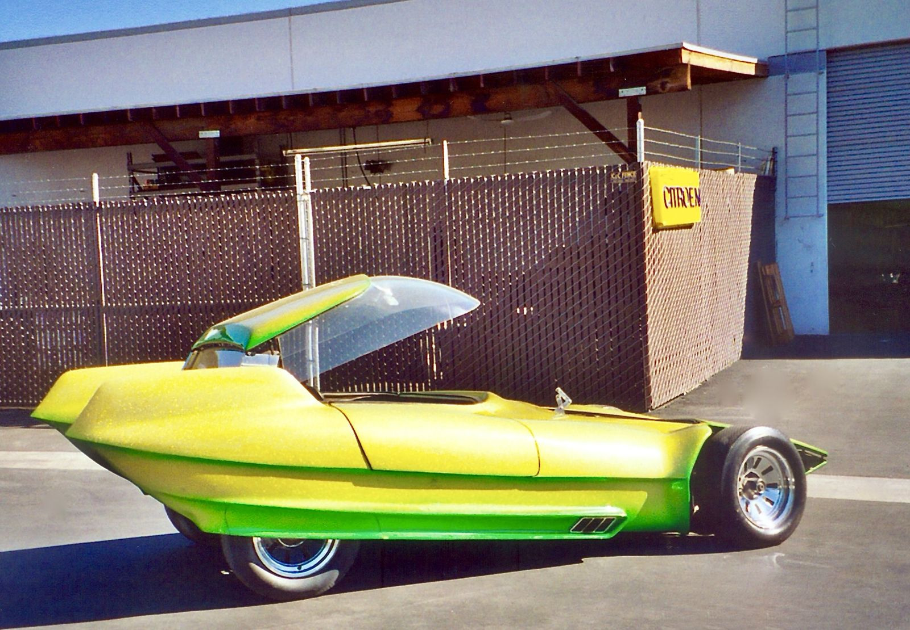

# Modesto's Century Toppers: A Club, a Chicken Coop and the Highway Patrol (1946–50)

!!! abstract "Article record"
    **Confidence:** Medium · **Source types:** Grassroots local-history magazine/site interviews and a remembrance (Modestoview, Chris Murphy), enthusiast wiki summarizing Modesto Bee and Tracy Press clippings (Kustomrama) · **Last verified:** 2026-10-15 (Round 11) · **Open issues:** ⚠ founding year (1946 vs late 1947); the 1949–50 newspaper items are known only through Kustomrama's summaries, not the original clippings · [How we rate this](../reference/source-standards.md)

!!! quote "In their own words"
    "We put the Century Toppers together in late '47"

    — **Gene Winfield**, interviewed by Chris Murphy for Modestoview (undated, about the Modesto Cruise Route opening).[^int]

The Century Toppers were Modesto's first hot rod club, named for cars that could top 100 mph. They matter here because the same garage where they met launched one of the country's best-known customizers, and because their 1949 paper trail shows a small-town club working **with** the California Highway Patrol rather than against it.[^mv]<a href="#q-1" title="Open question: see the bottom of the page">?</a>

## The coop, the jackets and the lakes

**The shop.** Winfield began customizing in his mother's converted chicken coop on Figaro Street, and the club met at his "Windy's Custom Shop," per Modestoview and Kustomrama. Later he moved to 451 Tully Road, across from Modesto Junior College.[^int][^kr]

**Membership.** Orvel Reichert said you did not need a hot rod, custom or car to join. The white jackets had Kelly-green trim and a top-hat logo, and members sometimes wore "a cheap black top hat" while driving.[^kr]

**The lakes.** "Several members" ran dry-lakes events through the Valley Timing Association. Winfield says he built fast cars "and go to El Mirage and then Bonneville in '51."[^kr][^int]

## In their own words: racing and cruising

> "We did some out racing out on Paradise road and later we had a county road out by Empire. We would go out at night and do all kinds of racing, and we marked off a ¼ mile and a full mile track."
>
> — **Gene Winfield**, Modestoview interview.[^int]

> "At first it was only 10th back and forth, and then later they opened it up and made 10th one way and 11th back and it was a loop."
>
> — **Gene Winfield**, on cruising 10th Street, same interview. This is the loop described on our [Modesto cruising page](../places/modesto.md).[^int]

## The paper trail (via Kustomrama)

Kustomrama summarizes newspaper items; we have not seen the original pages.<a href="#q-2" title="Single source so far: see Open questions">◐</a>

- **March 1949, Tracy Press:** Winfield, as club president, wrote a letter after accusations at a Tracy City Council meeting about racing at the Jerusalem Airport on March 6. Kustomrama says he wrote that club members were not involved and that the incident was a misunderstanding involving non-members.[^kr]
- **April 30, 1949, Modesto Bee:** the club and the Highway Patrol hosted a traffic-safety evening with films at Modesto Junior College.[^kr]
- **October 18, 1949, Modesto Bee:** a safety session with Highway Patrolman Ezra Earhart and Captain Don Halterman. Stockton and Sacramento clubs attended, and Earhart announced plans to help the club incorporate.[^kr]
- **April 20, 1950, Modesto Bee:** the club's incorporation was announced, with a stated mission of promoting sportsmanship and safety.[^kr]

This matches the pattern in [What the City Planners Wrote (1955)](planners-report-1955.md), which says the CHP worked with clubs from 1948 until a 1953 order ended it.

## The first show

The Century Toppers held their first car show December 10–11, 1949 at the Griswold & Wight Ford dealership, with Orvel "Speed" Reichert in charge. Kustomrama adds that Winfield remembers **Al Slonaker**, the man behind the Oakland Roadster Show, visiting to choose cars for his first show.[^kr] See [the show circuit](../media/show-circuit.md) for the Oakland side of that story.<a href="#q-3" title="Single source so far: see Open questions">◐</a> single source.

<figure markdown>
{ loading=lazy }
<figcaption markdown>Gene Winfield demonstrating metalwork to students at the Milwaukee World of Wheels show, 2013. Modestoview says he learned to hammer-weld in Japan during his Army service. Creator: Joetregembo. Date: 2015-02-06. Source: [Wikimedia Commons](https://commons.wikimedia.org/wiki/File:Gene-Winfield-Milwaukee-2013-JTTWebServices..jpg). License: [CC BY-SA 4.0](https://creativecommons.org/licenses/by-sa/4.0).</figcaption>
</figure>

<figure markdown>
{ loading=lazy }
<figcaption markdown>Winfield's *Reactor* (Citroën DS chassis, Corvair turbo engine), seen at a 2020 show in Valencia, California. Modestoview says it visited Modesto in recent years. It is later than the club years. Creator: PLawrence99cx. Date: 2020-08-27 19:45:39. Source: [Wikimedia Commons](https://commons.wikimedia.org/wiki/File:Reactor_by_Gene_Winfield.jpg). License: [CC BY-SA 4.0](https://creativecommons.org/licenses/by-sa/4.0).</figcaption>
</figure>

## Open questions & disputed details

*From the detective's notebook: where the sources disagree, where we have only one, and what we are still looking for. Each item links back to its place in the story.*

### ⚠ When was it founded?

*Three sources, three starting lines.*

- **Late 1947:** Gene Winfield says "We put the Century Toppers together in late '47," and names Dick Petz, his brother Frank Winfield, Bob Petz, Ray Rossin and Tommy McGee as early members, with Evelyn Horn, who lived next door to his mother, as secretary "for the entire time."[^int]
- **1947:** Modestoview's "The Birth of Cruising" also says 1947.[^mv]
- **1946:** Kustomrama says the club was "formed in Modesto, California in 1946" when Charlie Bell "got together with some friends," and that Winfield was voted first president because most members "were bringing their cars to Gene Winfield for custom work."[^kr]

We favor late 1947 because it comes from the founder himself, but the 1946 account names a different founder and may describe an earlier informal group. We have not seen a contemporary document. <a class="hr-q-back" href="#qr-1" title="Back to the story">↩</a>

**Single source so far:** Kustomrama summarizes newspaper items; we have not seen the original pages. <a class="hr-q-back" href="#qr-2" title="Back to the story">↩</a>

**Single source so far:** See [the show circuit](../media/show-circuit.md) for the Oakland side of that story. single source. <a class="hr-q-back" href="#qr-3" title="Back to the story">↩</a>

[^int]: Chris Murphy, "InterView: Gene Winfield," Modestoview. https://www.modestoview.com/gene-winfield-interview/ (accessed 2026-10-15)
[^mv]: Chris Murphy, "BigView – Late 1940s Modesto – The Birth of Cruising," Modestoview. https://www.modestoview.com/bigview-late-1940s-modesto-the-birth-of-cruising/ (accessed 2026-10-15)
[^kr]: Kustomrama, "Modesto Century Toppers." https://www.kustomrama.com/wiki/Modesto_Century_Toppers (accessed 2026-10-15)
