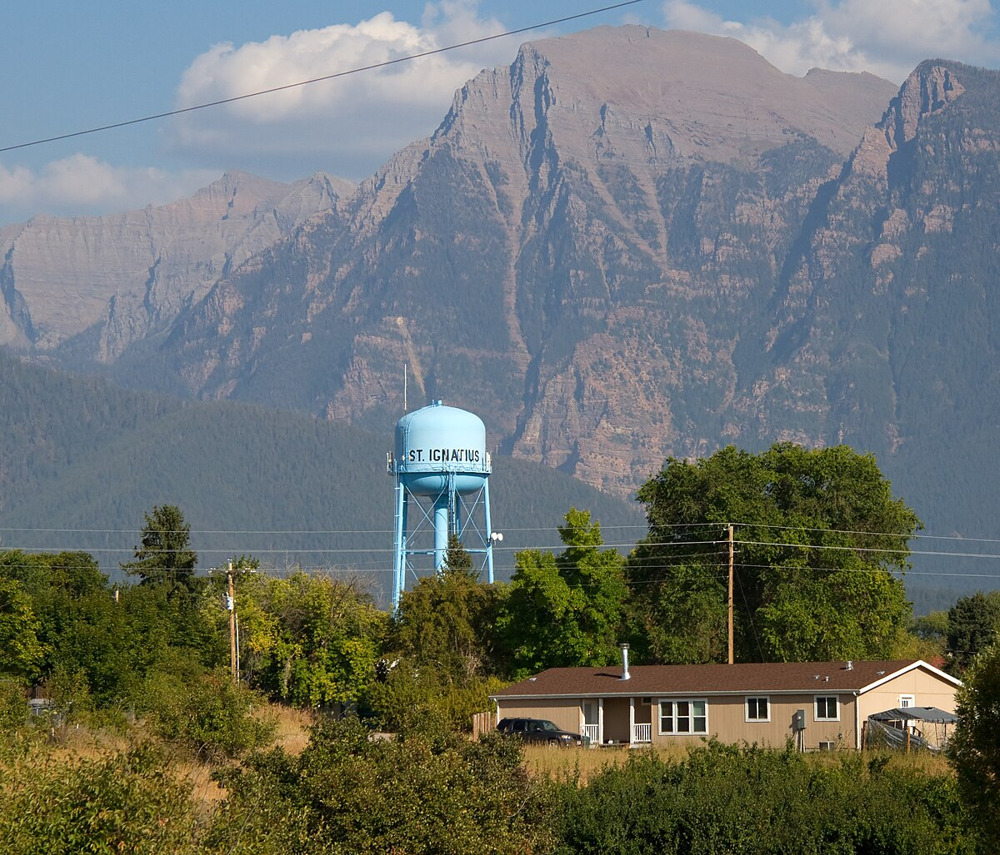

# "Angels Behind the Wheel": Montana's Hoodoos, Road Runners and Royal Coachmen (Poplar, Arlee and Ronan, Mont., 1955–62)

!!! abstract "Article record"
    **Confidence:** Medium · **Source types:** Grassroots Montana weeklies (*Poplar Standard*, *Sidney Herald*, *Hardin Tribune-Herald*, *St. Ignatius Post*), 1955–62: club statements, a club's letter to the editor, a reprinted editorial and a local racing item, read as page OCR from Chronicling America (Library of Congress) · **Last verified:** 2026-10-22 (Round 23-West) · **Open issues:** the Morin trophy count and times come from one paragraph ◐; the Lewistown meet is known only from a reprinted editorial ◐; where Montana's own strips were ? · [How we rate this](../reference/source-standards.md)

!!! quote "In their own words"
    "We are not gang of tough guys, and don't pretend to be."

    — The Hoodoos Hot Rod Club of Poplar, Mont., in the *Poplar Standard*, Dec. 30, 1955.[^ps551230]

Montana's small weeklies did not cover drag racing much in the 1950s. What they did print, again and again, was hot rod clubs explaining themselves. From Poplar, whose weekly called itself "Voice of The Oil City," to Sidney, Hardin, Arlee, Ronan and St. Ignatius, young men wrote down their rules and sent them to the paper.[^ps551230] Read in order, the stories run like this: first the clubs ask to be trusted, then the town argues, and finally one club president is winning trophies in his family car.

## The skull and the calling card (1955–59)

In December 1955 the front page of the *Poplar Standard* told readers not to be alarmed if a young man in a black leather jacket with a skull and crossbones on it stopped at their stalled car. "The emblem is that of the Poplar Hoodoos Hot Rod club, and the wearer is there to help you." The emblem had caused misunderstandings, the club said, but its meaning was a question: "Are you a careful driver, or will you end up like this?" Each member carried a card to hand to the motorists he helped: "U were assisted by a member of the Hoodoo's Hot Rod Club, Poplar, Montana." The Hoodoos belonged to the National Hot Rod Association, and their rules were strict. A member fined for a traffic violation paid the same fine again to the club and was suspended for 30 days or more, and drinking and driving meant immediate suspension. A new member served 60 days on probation, every member had to pass a first-aid test, and every member's car carried a first-aid kit and a fire extinguisher. President Gene Bauer said people were "too quick to judge," and gave the club motto as "Angels behind the wheel."[^ps551230] The double fine was a rule other clubs used too; see [the Drag-Ons of Sedalia](sedalia-drag-ons.md).

The next spring, in Hardin, Roger Shaw's youth council column raised the "controversial" subject of a drag strip, which he described as "not a race track but rather a straight, flat strip about three blocks long." He argued that a strip would keep fast driving off the streets and pointed to Billings, where "the hot rod clubs cooperate with the authorities."[^ht560405] At the end of May the council's tally of sign-ups for its summer program showed five people asking for a drag strip.[^ht560531] A week later the column summarized the council's poll of Hardin High School: of 315 questionnaires returned, 72 students listed a drag strip among the summer activities they wanted.[^ht560607] Two years later, in Sidney, a group of boys aged 14 to 18 organized the Throttle Pushers, about eight members who wanted their club "under the supervision of adults" and fined any member who broke a traffic law.[^sh581112]

The strips that did exist could bring trouble with them. In May 1959 the *Glasgow Courier* wrote that Lewistown was "recovering from a wild melee" after "camp followers of the worst kind" came to town for "an authorized drag race program." The editorial said the meet itself was "well run and orderly," and it quoted a spokesman for the local Road-Stur Club: "There was no way we could handle the rough element." The *Poplar Standard* reprinted the editorial a week later.[^ps590522]<a href="#q-1" title="Single source so far: see Open questions">◐</a>

## Arlee and Ronan (1960–62)

In February 1960 the secretary, Francis "Frenchy" Budland, and the president, LeRoy Morin, of the **Road Runners Rod and Kustom club** at Arlee sent the *St. Ignatius Post* a statement because "a good deal of misunderstanding exists as to the objectives of a Hot Rod club." Its rules would have suited the Hoodoos. Members who broke the law were fined or expelled, there was no alcohol at club events, and every member's car had a safety check every three months. Rule two read: "Any racing of any kind is limited to sanctioned and insured Drag Strips." The club promised to help stalled motorists and support safety and charity drives, and it gave NHRA's size as "over 90,000 members" in "over 900 chartered clubs."[^sip600218]

The next winter it was the turn of the **Royal Coachmen Car Club** of Ronan. The club held a dance at the Ronan parish hall on Dec. 23, 1961.[^sip611214] A month later its president, Ronald McCrea, wrote to the *Post* asking the public for "a chance to prove ourselves." The Coachmen ranged in age from 16 to 24 and were a charter member of NHRA, and the club said it worked "hand in hand with law enforcement agencies." It had been "criticized many times because of the actions of someone who didn't belong to the club." So the letter printed every member's name and asked readers to report any of them seen breaking the law. The list included women. Lonna Stevens was vice president and Judy Compton secretary, and Bud Hughes was named as sponsor.[^sip620125] The same paper had printed a sterner view the summer before, a column asking young readers whether they would pay "homage to the hot rod artist who ought to be in jail and soon will be, or dead."[^sip610803]

## The family car (1962)

By the summer of 1962 the Road Runners' president was racing as far away as Deer Park, Washington. On July 26 the *Post*'s Arlee correspondent reported that Mr. and Mrs. LeRoy Morin and their two children, ages 6 and 4, were going to Deer Park again that weekend, where Morin would race "for a $100 purse." At the last Deer Park meet he had won his 20th trophy since April 1, and his wife had won her sixth in the "Powder Puff Woman's race." She drove her husband's car, a C/Gas entry described as "an older type body with a newer engine." The Morin racer was also the family car: they drove it to the races, it had covered 89,000 miles, and only the Morins drove it. Morin had first raced in 1958 at Butte, where he won "in 16.2 second at 85 miles per hour." His latest win was 14.26 seconds at 100 mph. Six more meets were planned that year, at Deer Park, Butte, Bozeman and Conrad. Morin said the association's safety standards would "disqualify about 50 per cent of the cars on the highway."[^sip620726]<a href="#q-2" title="Single source so far: see Open questions">◐</a>

{ loading=lazy }

*St. Ignatius, home of the weekly that printed the Arlee and Ronan clubs' statements. Photo: Tony Hisgett, 2012, [CC BY 2.0](https://creativecommons.org/licenses/by/2.0/), via Wikimedia Commons.*

Clubs elsewhere in this wiki wrote the same kind of statements: the [Orchids and Celtics of Canyon, Texas](canyon-orchids-celtics-amarillo.md) and the [Twin Falls club](../places/twin-falls-main-avenue.md) that formed to get off Main Avenue. In Montana the clubs first explained a skull emblem, then printed their members' names, and by 1962 one club's president was driving the family car to Deer Park and winning.<a href="#q-3" title="Open question: see the bottom of the page">?</a>

*See also:* another far-northern strip hunt in the same years, [Palmer, Alaska, and Polar Dragway](palmer-alaska-polar-dragway.md).

## Open questions & disputed details

*From the detective's notebook: where the sources disagree, where we have only one, and what we are still looking for. Each item links back to its place in the story.*

**Single source so far.** **What happened at Lewistown in 1959?** We know the meet only from the *Glasgow Courier* editorial as reprinted in Poplar. It names the Road-Stur Club but gives no date, place, sanction or arrest count for the "melee."[^ps590522] <a class="hr-q-back" href="#qr-1" title="Back to the story">↩</a>

**Single source so far.** **Are the Morin numbers right?** The trophy count, the 89,000 miles and both times come from one correspondent's paragraph, which also mentions a *Missoulian* feature on the family that we have not found. The paper prints the boy's name as "Thomothy."[^sip620726] <a class="hr-q-back" href="#qr-2" title="Back to the story">↩</a>

### Next leads

The *Missoulian* feature on the Morins (summer 1962); where Montana's 1958–62 strips were at Butte, Bozeman and Conrad, and who ran them; the Lewistown meet in the *Lewistown Daily News* (May 1959); whether the Hoodoos, Throttle Pushers or Royal Coachmen lasted past their first year. Chronicling America's Montana weeklies stop at 1963. <a class="hr-q-back" href="#qr-3" title="Back to the story">↩</a>

## Sources

[^ps551230]: "Hoodoos Hot Rod Club Defends Name," *Poplar Standard* (Poplar, Mont.), Dec. 30, 1955, p. 1. Page OCR via Chronicling America, Library of Congress. https://www.loc.gov/resource/sn86075284/1955-12-30/ed-1/?sp=1 (accessed 2026-10-22)
[^ht560405]: Roger Shaw, "Youth Council Corner," *Hardin Tribune-Herald* (Hardin, Mont.), Apr. 5, 1956, p. 11. Page OCR via Chronicling America. https://www.loc.gov/resource/sn86075229/1956-04-05/ed-1/?sp=11 (accessed 2026-10-22)
[^ht560607]: Roger Shaw, "Youth Council Corner" (poll summary), *Hardin Tribune-Herald*, June 7, 1956, p. 4. Page OCR via Chronicling America. https://www.loc.gov/resource/sn86075229/1956-06-07/ed-1/?sp=4 (accessed 2026-10-22)
[^ht560531]: Summer recreation sign-ups, *Hardin Tribune-Herald*, May 31, 1956, p. 4. Page OCR via Chronicling America. https://www.loc.gov/resource/sn86075229/1956-05-31/ed-1/?sp=4 (accessed 2026-10-22)
[^sh581112]: "Sidney Boys Organize 'Throttle Pushers' Club," *Sidney Herald* (Sidney, Mont.), Nov. 12, 1958, p. 7. Page OCR via Chronicling America. https://www.loc.gov/resource/sn83004278/1958-11-12/ed-1/?sp=7 (accessed 2026-10-22)
[^ps590522]: "Only One Way to Handle 'Punks'," reprinted from the *Glasgow Courier* of May 14, 1959, *Poplar Standard*, May 22, 1959, p. 6. Page OCR via Chronicling America. https://www.loc.gov/resource/sn86075284/1959-05-22/ed-1/?sp=6 (accessed 2026-10-22)
[^sip600218]: "Aims of 'Hot Rod' Clubs Explained by Local Club Officials," *St. Ignatius Post* (St. Ignatius, Mont.), Feb. 18, 1960, p. 3. Page OCR via Chronicling America. https://www.loc.gov/resource/sn84036106/1960-02-18/ed-1/?sp=3 (accessed 2026-10-22)
[^sip611214]: Royal Coachmen dance notice, *St. Ignatius Post*, Dec. 14, 1961, p. 2. Page OCR via Chronicling America. https://www.loc.gov/resource/sn84036106/1961-12-14/ed-1/?sp=2 (accessed 2026-10-22)
[^sip620125]: Ronald McCrea, "Hot Rod Club Seeks Support of Public," letter, *St. Ignatius Post*, Jan. 25, 1962, p. 3. Page OCR via Chronicling America. https://www.loc.gov/resource/sn84036106/1962-01-25/ed-1/?sp=3 (accessed 2026-10-22)
[^sip610803]: Column addressed to teenage readers, *St. Ignatius Post*, Aug. 3, 1961, p. 3. Page OCR via Chronicling America. https://www.loc.gov/resource/sn84036106/1961-08-03/ed-1/?sp=3 (accessed 2026-10-22)
[^sip620726]: "Morins Seek More Trophies," Arlee news, *St. Ignatius Post*, July 26, 1962, p. 8. Page OCR checked against the page image, via Chronicling America. https://www.loc.gov/resource/sn84036106/1962-07-26/ed-1/?sp=8 (accessed 2026-10-22)
