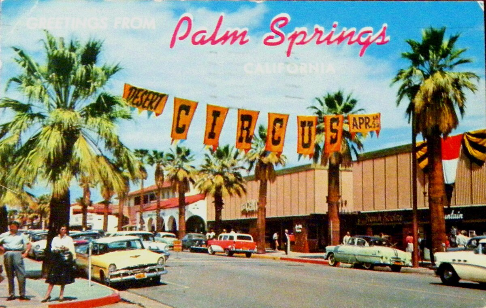

# Not a Police Dragnet: the Palm Springs Stockers and the Timing Association That Waited for a Strip (Palm Springs, Calif., 1951–59)

!!! abstract "Article record"
    **Confidence:** Medium · **Source types:** Grassroots twice-weekly town newspaper (*The Desert Sun*, Palm Springs, Calif.): club and police news, 1951–59, read as scanned page OCR; one NHRA obituary for a name · **Last verified:** 2026-10-22 (Round 22-West) · **Open issues:** whether the association ever got land or held a meet ◐; the October 1953 story spells the Pomona sergeant two ways · [How we rate this](../reference/source-standards.md)

!!! quote "In their own words"
    "First the boys must prove their interest by aiding with the organization of the group, then with securing the needed land, and finally with construction— before the actual operation of the drag strip starts."

    — Officer T. M. Aitken and Detective Ted Greene, *The Desert Sun*, Nov. 2, 1953.[^ds531102]

Palm Springs was a winter resort of film stars and golf tournaments, and in the early 1950s it had something less glamorous: teenagers with cars, and nowhere to run them. The town paper followed the story for most of a decade. It runs from a club's timed road rally to a police-sponsored association that was promised help from the National Hot Rod Association and then waited for a strip.

## A safety run with a hot rod on the trophy (1951)

The first hot rod group in these pages was the **Palm Springs Stockers**. In May 1951 the club announced a "Reliability Safety Run," worked out at secretary Doug Doyle's home with city police, school officials, county probation officers and the state police. The 105-mile course left the Palm Springs airport, climbed through Idyllwild, came down to Banning and returned. The organizers expected 100 to 150 entrants and said the run was "expected to draw nationwide attention from stock car and hot rod fans." The fastest driver would not win; the winner would be the one "closest to the time which a state patrol car determines is the maximum safe driving speed."[^ds510511]

It was won by Chuck Hoffmeier, an employee of Desert Forge, in a 1941 Packard convertible. His time was 2:53.43 (hours, minutes and seconds) against the judges' 2:53.45, "just two seconds off." His prize was a two-foot Stockers trophy "with a hot rod perched on top," plus a carburetor manifold donated, like the other prizes, by a Southern California auto concern. Frances Doyle was second in a 1951 Mercury.[^ds510525]

<figure markdown>
{ loading=lazy }
<figcaption markdown>"Greetings from Palm Springs": Palm Canyon Drive on a 1950s postcard. Context only; it does not show the Stockers or the timing association. Publisher: Postcards of the Desert. Date: circa 1950s. Source: [Wikimedia Commons](https://commons.wikimedia.org/wiki/File:Greetings_from_Palm_Springs_-_Palm_Canyon_Drive_postcard_(1950s).jpg). License: Public domain.</figcaption>
</figure>

## Two policemen from Pomona (October 1953)

Two years later the Stockers met with the Palm Springs police and two guests from Pomona: "Chief Ralph E. Parker and Sgt. E. Cooncs of the Pomona police department" (the scan's spelling, which becomes "Sgt. Coones" a paragraph later). Parker's department had stopped fighting its own hot rodders and helped the Choppers club to a legal strip, a story Parker told the FBI's bulletin in December 1951[^nhracoons] (see [Pomona's Choppers & the Fontana Strip](pomona-choppers-fontana.md)). In Palm Springs the two "described the organization in Pomona, and gave advice on forming a similar group here." Police Chief John S. Davis named Detective Ted Greene and Patrolman T. M. Aitken as liaison officers. The paper added a condition: "Actual construction of the strip will not start until the association is in operation."[^ds531012]

Two weeks later Chief Davis posted sample questions for his new Junior Police Reserve exam. One was a true-or-false: "The Drag Strip Association is chiefly concerned with setting up a police dragnet."[^ds531026] (The answer was false.)

## Thirty-five youths and an NHRA promise (November 1953)

The association drew on the whole pass. Sixty youths came to a preliminary meeting, and the group was described as "composed of youths from the Village, Indio, Banning and Beaumont." Greene and Aitken told them it would not all be fun, in the words quoted at the top of this page.[^ds531102] The organizational meeting was moved to Saturday, November 14, to avoid another youth event,[^ds531105] and Chief Davis told a civic meeting that the youngsters' support and enthusiasm would soon bring the strip inside the city, "under competent supervision."[^ds531109]

At that meeting 35 youths from Palm Springs, Banning, Beaumont, Cherry Valley, Indio and Coachella chose a name: the **Palm Springs Timing Association**. The Youth Coordinating Council sponsored it. Lloyd Walden, Jerry McKinney and Aitken, as advisor, were named to finish a charter for a non-profit organization. The guest was the second Pomona man again, this time in full: "Sgt. Bud Coons of the Pomona police department, representing the National Hot Rod association, told the local association that the national organization will supply a complete crew of experienced men to assist with the staging of the first meet here."[^ds531119] NHRA's own history names him as Eldo J. "Bud" Coons, the Pomona police sergeant whom NHRA hired as executive manager by 1954 and who led that year's Drag Safari.[^nhracoons]

## Waiting (1954–59)

The program then went to the service clubs. In January 1954 the Kiwanis and the Soroptimists met together to see a 35mm film, "The Cool Hot Rod," "shown in connection with the drag strip program."[^ds540111] The streets had not gone quiet: that Easter's vacation report counted "six youths cited for drag racing on city streets."[^ds540419] In June 1955 the paper noted that a longtime visitor, Walt Woestman, who had been coming to Palm Springs since 1924, "has been active in trying to promote a drag strip for them in Palm Springs."[^ds550609]<a href="#q-1" title="Single source so far: see Open questions">◐</a>

By 1957 another club had the Youth Center: a photo page showed the Emperors Car Club's dance there, with club president Dave Hartnett and secretary Jim Harris.[^ds570525] In December 1959 an editorial praised a "switch in emphasis among our youth from unauthorized drag racing to officially supervised Safe Driving Contests."[^ds591212] It did not mention the strip.

A small town borrowing a bigger town's police model is a pattern elsewhere in the wiki. Compare [Inyokern's sheriff's strip](inyokern-dust-devils.md), which got built, and [Marin County's eight-year hunt](marin-cotati-strips.md), which mostly did not. Palm Springs had the police, the name, the charter and an NHRA promise, but in these pages it never had a strip.<a href="#q-2" title="Open question: see the bottom of the page">?</a>

## Open questions & disputed details

*From the detective's notebook: where the sources disagree, where we have only one, and what we are still looking for. Each item links back to its place in the story.*

**Single source so far.** *We have only this one mention of Woestman's drag strip effort, and no report that the timing association ever secured land, held the NHRA-crewed first meet, or raced at another strip under its own name.* <a class="hr-q-back" href="#qr-1" title="Back to the story">↩</a>

### Next leads

Later *Desert Sun* issues (1954–56) for a first meet; Riverside County supervisors' minutes for any strip lease; NHRA's 1954 Drag Safari route for a desert stop; whether the Stockers of 1951 and the Stocker Club of 1953 were the same club. <a class="hr-q-back" href="#qr-2" title="Back to the story">↩</a>

## Sources

[^ds510511]: "Stockers and Police Join in Safety Event," *The Desert Sun* (Palm Springs, Calif.), May 11, 1951. Page OCR. https://archive.org/details/palm-springs-desert-sun-1951-05-11 (accessed 2026-10-22)
[^ds510525]: "Hoffmeier Only Two Seconds Off in Reliability Run," *The Desert Sun*, May 25, 1951. Page OCR. https://archive.org/details/palm-springs-desert-sun-1951-05-25 (accessed 2026-10-22)
[^ds531012]: "Drag Strip Ass'n Organization for City Under Study," *The Desert Sun*, Oct. 12, 1953. Page OCR (the sergeant's name is spelled "Cooncs" and "Coones"). https://archive.org/details/palm-springs-desert-sun-1953-10-12 (accessed 2026-10-22)
[^ds531026]: Junior Police Reserve examination notice, *The Desert Sun*, Oct. 26, 1953. Page OCR. https://archive.org/details/palm-springs-desert-sun-1953-10-26 (accessed 2026-10-22)
[^ds531102]: "Drag Strip Association to be Organized Next Saturday," *The Desert Sun*, Nov. 2, 1953. Page OCR. https://archive.org/details/palm-springs-desert-sun-1953-11-02 (accessed 2026-10-22)
[^ds531105]: "Drag Strip Ass'n Meeting Nov. 14," *The Desert Sun*, Nov. 5, 1953. Page OCR. https://archive.org/details/palm-springs-desert-sun-1953-11-05 (accessed 2026-10-22)
[^ds531109]: Youth Coordinating Council report, *The Desert Sun*, Nov. 9, 1953. Page OCR. https://archive.org/details/palm-springs-desert-sun-1953-11-09 (accessed 2026-10-22)
[^ds531119]: "Racing Strip Association Formed at Meeting Here," *The Desert Sun*, Nov. 19, 1953. Page OCR. https://archive.org/details/palm-springs-desert-sun-1953-11-19 (accessed 2026-10-22)
[^nhracoons]: "Remembering Bud Coons and 'Surfer Hank'," NHRA.com, 2015. https://www.nhra.com/news/2015/remembering-bud-coons-and-surfer-hank (accessed 2026-10-22)
[^ds540111]: "Soroptimists to Meet with Kiwanians," *The Desert Sun*, Jan. 11, 1954. Page OCR. https://archive.org/details/palm-springs-desert-sun-1954-01-11 (accessed 2026-10-22)
[^ds540419]: Easter vacation police report, *The Desert Sun*, Apr. 19, 1954. Page OCR. https://archive.org/details/palm-springs-desert-sun-1954-04-19 (accessed 2026-10-22)
[^ds550609]: Note on Walt Woestman, *The Desert Sun*, June 9, 1955. Page OCR. https://archive.org/details/palm-springs-desert-sun-1955-06-09 (accessed 2026-10-22)
[^ds570525]: Emperors Car Club dance photo caption, *The Desert Sun*, May 25, 1957. Page OCR. https://archive.org/details/palm-springs-desert-sun-1957-05-25 (accessed 2026-10-22)
[^ds591212]: Editorial on safe driving contests, *The Desert Sun*, Dec. 12, 1959. Page OCR. https://archive.org/details/palm-springs-desert-sun-1959-12-12 (accessed 2026-10-22)
