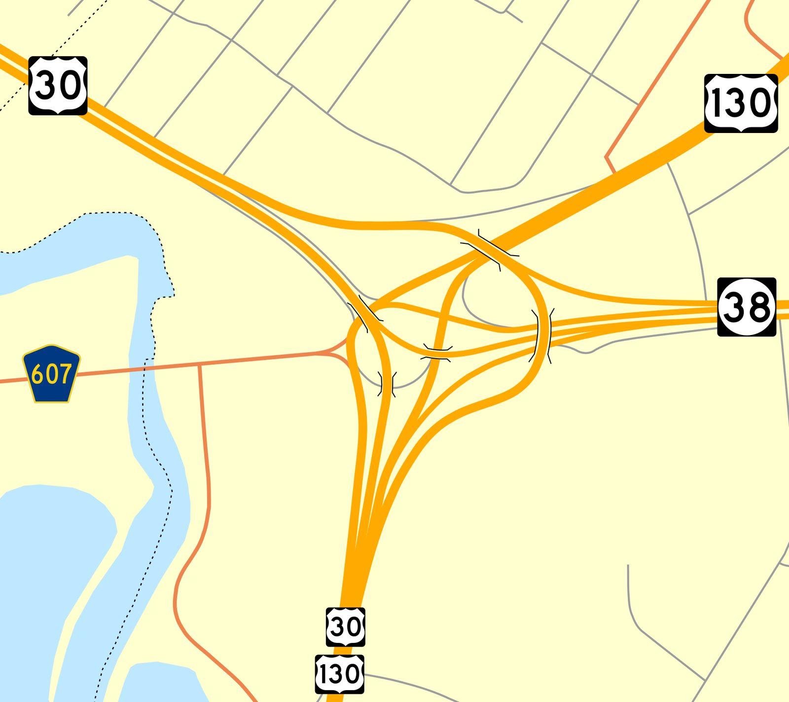

# Tear Gas on the Runways: Pennsauken's Central Airport, May 1958

!!! abstract "Article record"
    **Confidence:** Low · **Source types:** two Associated Press stories as printed in small-town Pennsylvania dailies (*Gettysburg Times* and the Stroudsburg *Daily Record*, May 29, 1958), read as scanned page OCR; Wikipedia for the airport and Airport Circle · **Last verified:** 2026-10-21 (Round 19) · **Open issues:** both accounts come from one wire service ◐; the number of cars (1,000 in one story; the other's OCR could read 1,000 or 1,600) ◐; we have not read the Camden *Courier-Post* or Philadelphia papers, which would have had their own reporters there · [How we rate this](../reference/source-standards.md)

!!! quote "In their own words"
    "We'll be back."

    — a young racer leaving Central Airport, as reported by the Associated Press, May 1958.[^dr580529]

Every town that fought its street racers in the 1950s had a story like this, but Pennsauken's was the biggest. On a Tuesday night in May 1958, on the abandoned runways of Camden's old airport, a police chief faced what he said were a thousand cars and two thousand teenagers. He used fire hoses and tear gas. The next day the township brought in bulldozers and tore up the runways.

## An empty airport by the first traffic circle

Camden Central Airport, in Pennsauken Township just outside Camden, New Jersey, operated from 1929 to 1957. The traffic circle next to it, **Airport Circle**, opened in 1927 and is described as the first traffic rotary in the United States. The world's first drive-in movie theater opened beside it in 1933.[^wikicircle] So the runways that drew the racers sat at one of the oldest crossroads of American car culture.

<figure markdown>
{ loading=lazy }
<figcaption markdown>Airport Circle in Pennsauken today, where US 30, US 130 and Route 38 meet. It is named for Camden Central Airport, whose terminal stood beside the circle to the southeast. Creator: Mr. Matté. Date: 2013-03-09. Source: [Wikimedia Commons](https://commons.wikimedia.org/wiki/File:Airport_Circle_NJ_map.svg) (rendered from SVG). License: [CC BY-SA 3.0](https://creativecommons.org/licenses/by-sa/3.0).</figcaption>
</figure>

## Tuesday night and Wednesday morning (May 27–28, 1958)

By 1958 the airport was closed, and the racers had found it. Township police chief **Russell Walton** said drag racers had been using the field "in the last week or so," and he was tipped off that they would turn out in force. He sent two officers, who found 100 cars racing on the landing strips. For every car they chased, they said, at least three more came onto the field. Walton came out and "declared a state of emergency." By then, he said, "a thousand cars and twice that many teen agers" were racing up and down the runways.

It did not go quietly. Some of the boys threw stones, and some police cars were hit. The rest moved on when told to, but only to the next runway. Firemen turned hoses on the racers, which moved a few. "Walton then used tear gas. That worked." Two young men were held on $105 bail on disorderly conduct charges, and two teenagers were released to their parents. Walton said the racing "was well organized," with cars from Pennsylvania, Delaware and Maryland as well as New Jersey.[^gt580529]

The next day "bulldozers and road graders ripped up three long asphalt runways at the old Central Airport," the AP reported, along with the pavement around the abandoned hangars. Pennsauken Township directed the job. A representative of the New York development company that owned the field said trespassers would be prosecuted. As the last racers had been driven off the night before, one of them shouted, "We'll be back." The AP's answer: "They can't now."[^dr580529]

## Why it ran in Gettysburg and Stroudsburg

The story traveled. Both stories we read were printed in small Pennsylvania papers far from Camden. To their readers this was not distant news: the cars came from four states, including Pennsylvania, and their own towns were arguing about hot rods too. On the same Stroudsburg page as the bulldozer story, the [Ridge Runners](stroudsburg-ridge-runners.md) were planning a summer of sanctioned drag races. In Adams County, the [Hanover and Gettysburg clubs](hanover-adams-county-clubs.md) of 1956–59 kept asking neighbors, service clubs and police for permission.

Pennsauken is the other side of the old-airfield story. At [Cotati](marin-cotati-strips.md), [Malden](semo-malden-drag-strip.md) and [Akron](akron-fulton-airport.md), a city or a civic club took over an empty runway and made it a strip with rules. In Pennsauken the owner was a developer, no one organized a strip, and the racers ran it themselves until the township ripped up the pavement. Compare the 1957 arguments in [Opinions Differ on Hot Rods](new-york-towns-panel-1957.md) and [Recreation magazine's pro and con](recreation-1957-pro-and-con.md).<a href="#q-1" title="Open question: see the bottom of the page">?</a>

## Open questions & disputed details

*From the detective's notebook: where the sources disagree, where we have only one, and what we are still looking for. Each item links back to its place in the story.*

### Next leads

The Camden *Courier-Post* and Philadelphia *Inquirer* for May 28–30, 1958, including the Monday hearing; whether South Jersey clubs then pushed for a strip (Atco Dragway, a few miles away, is a lead we have not checked); later memories of the night in local history groups. <a class="hr-q-back" href="#qr-1" title="Back to the story">↩</a>

## Sources

[^gt580529]: "Police Break Up Rally With Water And Gas," Associated Press, Camden, N.J., in the *Gettysburg Times* (Gettysburg, Pa.), May 29, 1958. Page OCR. https://archive.org/details/gettysburg-times-1958-05-29 (accessed 2026-10-21)
[^dr580529]: "Bulldozers Rip Runways To Halt Teen-Age Drag Races," Associated Press, Camden, N.J., in the *Daily Record* (Stroudsburg, Pa.), May 29, 1958, p. 8. Page OCR. https://archive.org/details/stroudsburg-daily-record-1958-05-29 (accessed 2026-10-21)
[^wikicircle]: "Airport Circle (Pennsauken, New Jersey)," Wikipedia (citing Kane et al., *Famous First Facts*, and other sources). https://en.wikipedia.org/wiki/Airport_Circle_(Pennsauken) (accessed 2026-10-21)
