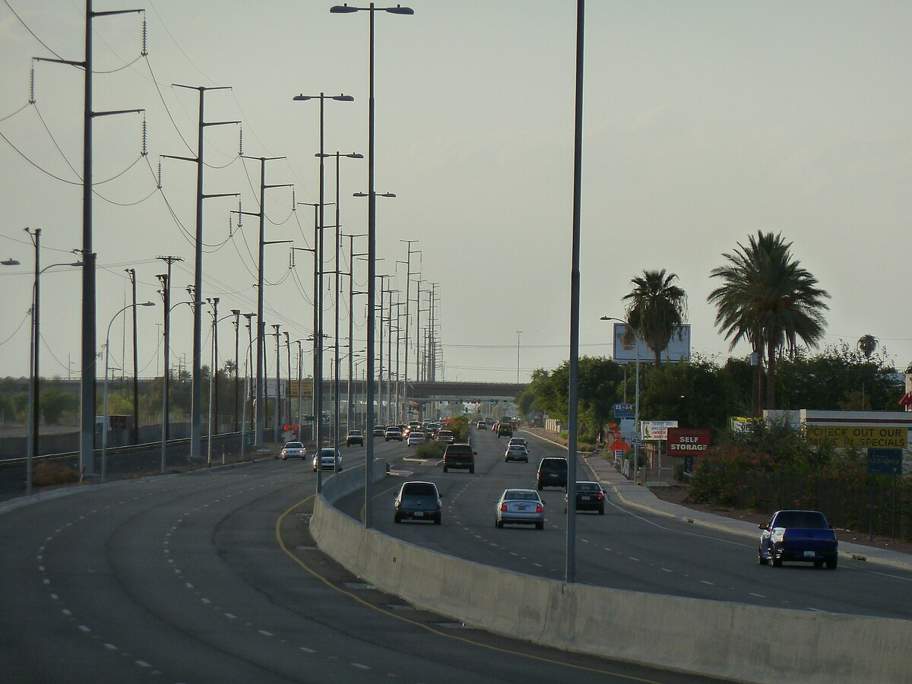

# The KARBS and the Strip on Litchfield Road: Drag Racing on Phoenix's West Side (Goodyear, Perryville and Glendale, Ariz., 1953–63)

!!! abstract "Article record"
    **Confidence:** Medium · **Source types:** Grassroots West Valley weekly (*Westside Weekly* / *Westside Enterprise*, Tolleson and Goodyear, Ariz.), 1953–63, plus the *Arizona Sun* (Phoenix, 1954) and *Navajo Times* (Window Rock, 1963): club news, ads, meet previews and front-page briefs, read as page OCR from Chronicling America (Library of Congress) · **Last verified:** 2026-10-22 (Round 23-West) · **Open issues:** the Green Monster booking and its owner ◐; whether the Perryville strip and the Litchfield Road strip were the same operation ?; the KARBS' Larry Towle and the record-holder Larry Towle are probably one man ◐; Towle's "world record" is the paper's claim ◐ · [How we rate this](../reference/source-standards.md)

!!! quote "In their own words"
    "Do Perryville Drag Race Drivers ask us to drain other brands of gasoline from their tanks & replace them with UNION GAS?"

    — Advertisement for Vern Session & Sons Union Oil Service Station, *Westside Weekly* (Goodyear, Ariz.), June 16, 1955.[^ww550616]

West of Phoenix in the 1950s, the Westside towns had a weekly paper, published at Tolleson and later at Goodyear. Over ten years it printed the whole run of a local drag scene. First came an air base club and a teenage club building a car, then a filling station that sponsored them, then a strip that closed and reopened, and finally a promoter who gave out champagne. One name, Larry Towle, keeps turning up.

## The KARBS' coupe (1953–55)

The first club in the paper was at Luke Air Force Base. In March 1953 Luke's new Automobile Club reported 66 members at its first meeting. It bought $530 worth of tools, among them a Van Norman boring bar and a Sunnen pin bushing reamer, and it set up a work area on the base parking lot. The club ran as a co-op, buying parts and tools at wholesale and pooling its members' mechanical skills, and it "has considered conducting drag races and time trials."[^we530312] In Phoenix the next year, the Junior Chamber of Commerce set up a five-man advisory board for hot rod clubs. It started with the Headers, 40 boys aged 16 to 21 who met at the Phoenix Boys' Club on Thursday nights and were building "drag roadsters for racing on various supervised drag strips."[^as540827]

In May 1955 the *Westside Weekly* reported that the **KARBS**, "a Westside teenage automobile club," were building a racer expected to "make over 100 mph in a fourth of a mile." The car was a '39 Ford coupe with a '48 Mercury engine bored .125 over and stroked, a full race cam, a 12-pound flywheel, an electric fuel pump, three carburetors, Harman-Collins ignition, a Mallory coil and a Lincoln low-gear transmission. Session and Sons Union 76 Service Station of Avondale supplied all the gas and oil, and the club was looking for more sponsors and for money for a trip to Bonneville. The boys working on it included Gary Session and Larry Towle, and an adult sponsor, Roger Huebner, worked "closely with the boys."[^ww550519] The next month the Session family's Union station advertised that "Perryville Drag Race Drivers" asked to have other brands drained from their tanks.[^ww550616]

That November the Perryville strip held the national meet. On Nov. 24, 1955, the *Enterprise* reported that a Scout troop had gone to "the National Drag races being held on the Perryville Strip," and that the junior police had skipped their meeting because of the races.[^we551124c][^we551124d] The KARBS had "tough luck." Their car had head gasket trouble, then the wiring caught fire, and by the time it was rewired two drags had already run in its class. "As a result, the local boys ran third, and stayed third for the state, it was reported by Larry Towle."[^we551124a] These were the same November 1955 finals that NHRA had moved to Arizona after rain [washed out Great Bend](great-bend-srca.md).<a href="#q-1" title="Open question: see the bottom of the page">?</a>

## Litchfield Road (1959–61)

By 1959 the paper said drag racing in the Valley had to be "revived." In August George Huskey reopened the **Arizona Timing Association** strip on Litchfield Road, half a mile south of Grand Avenue. It now had a steel guard rail along the track and a chain-link fence in front of a 1,000-seat spectator area, with time trials at 5 p.m. and the first race at 8:30. Goodyear's police chief, Marvin Clemens, and "Auxiliary Police Captain Larry Towle" ran the concession stand.[^we590827] A Larry Towle of Buckeye set a record "on the Phoenix Drag strip," as the paper called it, on Aug. 28, 1959. The paper reported the next July that verification "came through this July" and headlined it "Larry Towle Breaks World Record In Drags." The mark was 120.43, and two weeks later he was elected to the 150 Mile Per Hour Club. The paper said he planned to run at Bonneville that August and identified him as the son of Wayne Towle of Goodyear.[^we600714]<a href="#q-2" title="Single source so far: see Open questions">◐</a> The same front page, a week later, reported a 15-year-old killed as a passenger in a street drag race at Van Buren and Cotton Lane.[^we600721]

The strip was now the **Phoenix Drag Strip**, and its promoter was **Mel Larson**. In August 1960 he gave class winners sport shirts with the strip's emblem and the words "Class Champion" instead of trophies; the paper said he was the first in Arizona to award prizes other than trophies. At the previous meet the top eliminator had won "a silver ice bucket and a bottle of champagne" and a $25 savings bond.[^we600811] In December the paper said cars had turned 177 mph there. On Dec. 4 Don Fuller lost traction at 115 mph, went through the steel guard rail, tore down a wooden control tower, hit an official's car and stopped against the back of the ambulance. The car was destroyed, but "the roll bars, his safety belt, shoulder harness, and helmet stayed intact," and Fuller spent little more than a day in the hospital.[^we601215] The last meet of 1960 ended in an upset: veterans Dean Turk, Joe Dillon, Lyle Fisher and Fred Dobney "fell by the wayside" while Jim Simpson took top eliminator in his Chevrolet-powered dragster.[^we610105]

In June 1961 the *Enterprise* described a Saturday night at the strip, "northwest of Glendale." Nearly 150 cars raced on the quarter-mile asphalt strip, from creations "costing nearly $10,000" that had reached 176.12 mph to family cars that might never top 70, sorted into more than 50 classes. Anyone could race: "pay a $1 entry fee plus 50 cents for a pit tag covering him with insurance," pass the safety test and show a driver's license.[^we610629] That summer Larson booked the jet-powered **Green Monster**, driven by Nook Bakewell for an owner the paper names as Walt Arfons. Its first appearance, set for July 22, was "stormed out" and run the next night, and the crowd was too big for the postponed date to handle, so Larson brought it back on Aug. 5.[^we610803]<a href="#q-3" title="Single source so far: see Open questions">◐</a>

## New tracks (1963)

In 1963 the West Valley got bigger plans. In July Richard Hogue of Scottsdale announced Phoenix International Raceway, a $500,000 complex on 320 acres beside Estrella Park, with a mile oval, a drag strip, a road course and "Saturday night drag meets."[^we630711] In August it named as drag racing director Bill Costianes, 25, who had worked at the Arizona Raceway for three years and planned a strip 70 feet wide with a paved "fire-up" lane and Chrondek dual-lane timers.[^we630808] In September Tony Briggs of Scottsdale, the raceway's newly named general manager, said weekly and championship drag races would "fill out the year" in 1964.[^we630919] The same month the *Navajo Times* reported that the Beeline Corporation, headed by C. Tim Rogers of Scottsdale, had broken ground on a $100,000 dragway on the Salt River Indian Reservation, "the first drag strip to be built on an Indian Reservation," with dual-lane timers and push lanes for dragsters.[^nt630829]

{ loading=lazy }

*Grand Avenue, Glendale, in 2011. The Phoenix Drag Strip stood farther out the same road, at Litchfield Road. Photo: Chris English, [CC BY-SA 3.0](https://creativecommons.org/licenses/by-sa/3.0/), via Wikimedia Commons.*

The *Enterprise* recorded each stage as it happened, from the KARBS' coupe and its Union 76 sponsor to Larson's prize shirts. The jet's owner, named in the paper as Walt Arfons, may tie this desert strip to the Arfons family of [Akron's airport strip](akron-fulton-airport.md), and the KARBS were one more case of the [teen and school clubs](high-school-hot-rod-clubs.md) that newspapers kept writing about.<a href="#q-4" title="Open question: see the bottom of the page">?</a>

## Open questions & disputed details

*From the detective's notebook: where the sources disagree, where we have only one, and what we are still looking for. Each item links back to its place in the story.*

**Open question.** **Were Perryville and Litchfield Road one strip or two?** The 1955 paper puts the national meet on "the Perryville Strip," while the 1959 strip is on Litchfield Road south of Grand Avenue, and the paper calls it "the Arizona Timing Association strip." We have not found who ran the Perryville meet or when the Litchfield Road strip first opened. Reading "revived" in 1959 as meaning a gap is our inference.[^we551124c][^we590827] <a class="hr-q-back" href="#qr-1" title="Back to the story">↩</a>

**Single source so far.** **Is the record-holder the KARBS' Larry Towle, and what was the record?** The 1955 KARBS member, the 1959 auxiliary police captain and the 1960 record-holder from Buckeye, son of a Goodyear man, are probably one person, but no item says so. The paper does not say what class the 120.43 was set in or who certified it, The 1960 item dates the record to Aug. 28, 1959; the 1959 paper dates the reopening to "Saturday, August 14."[^we600714][^we590827] In 1959 Aug. 14 was a Friday, and Aug. 28 was also a Friday, so either the strip also ran on Friday nights or both dates are a day off; the sources do not say which. The text also says he was one of the few in the state "who have raced three successive 150 miles in one day."[^we600714][^we590827] <a class="hr-q-back" href="#qr-2" title="Back to the story">↩</a>

**Single source so far.** **Who owned the Green Monster that came to Phoenix?** The paper names the owner as Walt Arfons (the Chronicling America OCR reads "Arsons"; the page image reads "Arfons"). This item is our only source for the booking and for its owner.[^we610803] Elsewhere on this site the Green Monster name belongs to the Arfons brothers' six-wheeled car of 1954 and to Art Arfons's land-speed car of 1964–65 (see [Akron's airport strip](akron-fulton-airport.md)); we have no source on how the 1961 jet relates to those cars. <a class="hr-q-back" href="#qr-3" title="Back to the story">↩</a>

### Next leads

The *Arizona Republic* and *Phoenix Gazette* for the Perryville strip's opening, its operator and the 1955 meet; when Mel Larson took over the Litchfield Road strip and when it closed; the "Arizona Raceway" where Costianes worked; Beeline Dragway's opening night; what became of the KARBS' Bonneville trip. <a class="hr-q-back" href="#qr-4" title="Back to the story">↩</a>

## Sources

[^we530312]: "Auto Club Plans Maintenance Area, Purchase of Equipment," *Westside Enterprise* (Tolleson, Ariz.), Mar. 12, 1953, p. 3. Page OCR via Chronicling America, Library of Congress. https://www.loc.gov/resource/sn94050655/1953-03-12/ed-1/?sp=3 (accessed 2026-10-22)
[^as540827]: "Board Helps Hot Rodders," *Arizona Sun* (Phoenix), Aug. 27, 1954, p. 1. Page OCR via Chronicling America. https://www.loc.gov/resource/sn84021917/1954-08-27/ed-1/?sp=1 (accessed 2026-10-22)
[^ww550519]: "KARBS Build Special Racing Car," *Westside Weekly* (Goodyear, Ariz.), May 19, 1955, p. 1. Page OCR via Chronicling America. https://www.loc.gov/resource/sn94050656/1955-05-19/ed-1/?sp=1 (accessed 2026-10-22)
[^ww550616]: Vern Session & Sons Union Oil Service Station advertisement, *Westside Weekly*, June 16, 1955, p. 4. Page OCR via Chronicling America. https://www.loc.gov/resource/sn94050656/1955-06-16/ed-1/?sp=4 (accessed 2026-10-22)
[^we551124a]: "Karbs Place Third In Drags," *Westside Enterprise* (Goodyear, Ariz.), Nov. 24, 1955, p. 1. Page OCR via Chronicling America. https://www.loc.gov/resource/sn94050657/1955-11-24/ed-1/?sp=1 (accessed 2026-10-22)
[^we551124c]: Scout troop news, *Westside Enterprise*, Nov. 24, 1955, p. 3. Page OCR via Chronicling America. https://www.loc.gov/resource/sn94050657/1955-11-24/ed-1/?sp=3 (accessed 2026-10-22)
[^we551124d]: "Westside Junior Police News," *Westside Enterprise*, Nov. 24, 1955, p. 4. Page OCR via Chronicling America. https://www.loc.gov/resource/sn94050657/1955-11-24/ed-1/?sp=4 (accessed 2026-10-22)
[^we590827]: "Drag Races Resumes," *Westside Enterprise*, Aug. 27, 1959, p. 3. Page OCR via Chronicling America. https://www.loc.gov/resource/sn94050657/1959-08-27/ed-1/?sp=3 (accessed 2026-10-22)
[^we600714]: "Larry Towle Breaks World Record In Drags," *Westside Enterprise*, July 14, 1960, p. 1. Page OCR checked against the page image, via Chronicling America. https://www.loc.gov/resource/sn94050657/1960-07-14/ed-1/?sp=1 (accessed 2026-10-22)
[^we600721]: "Services Held For Accident Victim," *Westside Enterprise*, July 21, 1960, p. 1. Page OCR via Chronicling America. https://www.loc.gov/resource/sn94050657/1960-07-21/ed-1/?sp=1 (accessed 2026-10-22)
[^we600811]: "Phoenix Drag-Strip Active Again," *Westside Enterprise*, Aug. 11, 1960, p. 1. Page OCR via Chronicling America. https://www.loc.gov/resource/sn94050657/1960-08-11/ed-1/?sp=1 (accessed 2026-10-22)
[^we601215]: "Phoenix Drag Strip To Hold Meet Dec. 18," *Westside Enterprise*, Dec. 15, 1960, p. 1. Page OCR via Chronicling America. https://www.loc.gov/resource/sn94050657/1960-12-15/ed-1/?sp=1 (accessed 2026-10-22)
[^we610105]: "Drag Races Scheduled Jan. 8 at Phoenix Strip," *Westside Enterprise*, Jan. 5, 1961, p. 1. Page OCR via Chronicling America. https://www.loc.gov/resource/sn94050657/1961-01-05/ed-1/?sp=1 (accessed 2026-10-22)
[^we610629]: "Speedsters, Family Cars Compete In Drag Races," *Westside Enterprise*, June 29, 1961, p. 12. Page OCR via Chronicling America. https://www.loc.gov/resource/sn94050657/1961-06-29/ed-1/?sp=12 (accessed 2026-10-22)
[^we610803]: "'Green Monster' To Return To Area Drag Strip Aug. 5," *Westside Enterprise*, Aug. 3, 1961, p. 7. Page OCR via Chronicling America, checked against the page image (the OCR reads "Arsons"; the print reads "Arfons"). https://www.loc.gov/resource/sn94050657/1961-08-03/ed-1/?sp=7 (accessed 2026-10-22)
[^we630711]: "Raceway For Autos Due Here," *Westside Enterprise*, July 11, 1963, sec. I, p. 1. Page OCR via Chronicling America. https://www.loc.gov/resource/sn94050657/1963-07-11/ed-1/?sp=1 (accessed 2026-10-22)
[^we630808]: "Drag Race Director Appointed," *Westside Enterprise*, Aug. 8, 1963, p. 1. Page OCR via Chronicling America. https://www.loc.gov/resource/sn94050657/1963-08-08/ed-1/?sp=1 (accessed 2026-10-22)
[^we630919]: Phoenix International Raceway progress report, *Westside Enterprise*, Sept. 19, 1963, p. 1. Page OCR via Chronicling America. https://www.loc.gov/resource/sn94050657/1963-09-19/ed-1/?sp=1 (accessed 2026-10-22)
[^nt630829]: "For Hot Rodders and Fans," *Navajo Times* (Window Rock, Ariz.), Aug. 29, 1963, p. 2. Page OCR via Chronicling America. https://www.loc.gov/resource/sn85047513/1963-08-29/ed-1/?sp=2 (accessed 2026-10-22)
