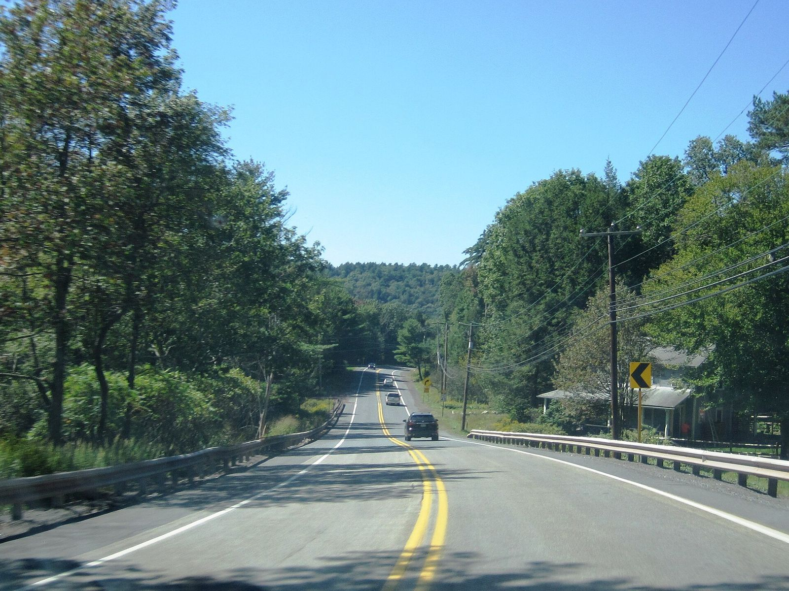

# Where Could a Pocono Hot Rodder Race? A Flood Levee, Wind Gap, Bear Creek and the Airport That Wasn't (1958–68)

!!! abstract "Article record"
    **Confidence:** Medium · **Source types:** Grassroots small-town daily newspaper (*The Daily Record*, later *The Pocono Record*, Stroudsburg, Pa.): a club letter (1958), a borough council report (1962), a club member's wife's letter to the editor (1964), sports briefs, results and display ads (1964–68), all read as scanned page OCR; two *Car Craft* items (1959, 1961) for context · **Last verified:** 2026-10-20 (Round 18) · **Open issues:** Mountain View's opening year is inferred from a 1964 "fifth season" line ◐; the Pocono Drag Lodge's opening year is not found ◐; the 1964 letter writer's first name is garbled in the scan; no source says whether the Mount Pocono Airport Authority answered · [How we rate this](../reference/source-standards.md)

!!! quote "In their own words"
    "As a parent I know we must tell our children what they should not do; but that's not enough unless we [tell] them something they can do."

    — **A Mount Pocono mother** whose husband belonged to the Ridge Runners, letter to the editor, *The Daily Record*, June 5, 1964 (OCR; the bracketed word is garbled in the scan).[^dr640605]

In May 1958 the [Ridge Runners of Stroudsburg](stroudsburg-ridge-runners.md) told their local paper they would buy land for a drag strip if someone would sell it to them.[^dr580524] They never got their own. This page follows the question every Monroe County hot rodder had to answer for the next ten years: if not on the highway, then where?

## 1962: the flood levee

The kids found their own answer first. In August 1962, East Stroudsburg's councilmen inspected the new $1,500,000 Stroudsburg–East Stroudsburg flood control project. They talked about the control gates, the grass on the levees, and chains and locks for the maintenance gates. The locks, the *Daily Record* reported, "would also stop cars from using the 19-foot wide area as a drag strip. Tire marks in many places showed cars have been using the strip and councilmen said they had reports of drivers racing there."[^dr620815]

It was a two-town drag strip that nobody built on purpose, and the council's answer was a padlock.

## 1964: Wind Gap, Allentown and a mother's proposal

The nearest real strip we can find in the paper was at Wind Gap. On April 4, 1964, a sports brief announced that "the Mountain View drag strip in Wind Gap" would open its fifth season of racing on Sunday, with pits at 10 a.m., time trials at noon and eliminations at 2 p.m.[^dr640404]<a href="#q-1" title="Single source so far: see Open questions">◐</a>

*Car Craft*'s national strip calendar for July 1961 lists only two Pennsylvania strips, Vargo's Dragway in Bucks County and the U.S. 30 Drag-O-Way near York. Wind Gap isn't on it.[^cc6107] Those calendars printed what strips sent in, so the absence proves nothing, but it does show how small a strip like Mountain View was.

There was racing to the south, too. The Stroudsburg paper carried ads for Friday-night drag races at the **Allentown Fairgrounds**: "OPENING NIGHT DRAG RACES FRIDAY, APRIL 17," with spectator admission at $1.00.[^dr640416]

Closer to home, someone had a better idea. On June 5, 1964, under the headline "Drag Races Suggested At Pocono Airport," the *Daily Record* printed a letter from a Mount Pocono woman (the signature reads "Mrs. ... Heller," with the first name garbled in the scan). "My husband is a member of the Ridge Runners Auto Club Inc. of Monroe County," she wrote. The club had "received its charter from Harrisburg" and belonged to the National Hot Rod Association.[^dr640605] She and her husband had "become very concerned about the teenagers who drag (race) on the side roads and even on the highways."[^dr640605] (Quotes from this letter correct obvious OCR slips, such as "Chib" for "Club" and "11" for "it.")

She quoted the club's constitution and bylaws at length (see [the Ridge Runners page](stroudsburg-ridge-runners.md#1964-incorporated-and-still-asking) for the rules). Then she made her pitch. The **Mount Pocono Airport Authority**, she understood, needed money. "I feel that it would be very helpful to this local club and its eighteen members if the Mount Pocono Airport Authority would consider allowing the use of their airstrip for drag racing." The club was non-profit, so "they would turn over the proceeds from such a race (or races) to the authority."[^dr640605]

Anyone who wanted to see how a drag race was run, she added, could go to **Island Dragway** at Great Meadows, N.J., or the **Pocono Drag Lodge** at Bear Creek, Pa.[^dr640605] Island Dragway, on Route 46, was in *Car Craft*'s 1961 calendar for "Every Sunday, weather permitting."[^cc6107]

We have found no reply from the airport authority, and no drag race at the Mount Pocono airport.<a href="#q-2" title="Single source so far: see Open questions">◐</a>

## 1968: the Drag Lodge and the big track

By 1968 the Pocono Drag Lodge on Route 115 at Bear Creek was advertising in the Stroudsburg paper, by then called *The Pocono Record*, almost every week. Its "1968 SEASON'S OPENER" on Sunday, May 19, matched the funny cars **Limefire** and **Jungle Jim**, with $50 to the top eliminator, "Plus 200 Cars Drag Racing."[^pr680518]

The paper's Monday briefs named the local winners. On Sunday, June 23, Harry Smith of Saylorsburg was "among the 62 class winners."[^pr680624] On Sunday, Aug. 4, Rich Everitt of Stroudsburg was one of 56, with others from Saylorsburg, Bangor, Moscow, Jim Thorpe and Palmerton; "A total of 220 drivers took part in the races."[^pr680806] That is the shape of a working local strip: a few professional funny cars to sell tickets, and a couple of hundred weekend racers from the surrounding towns running for class wins.

On Saturday, Aug. 31, the paper previewed the Drag Lodge's **third annual Funny Car, Super Stock and Gas Spectacular**, to be the facility's biggest and last event of the season. It promised dozens of funny cars, super stockers and gassers, named funny cars including Lime Fire, Phantom Charger, Rebel Barracuda, Tickle Me Pink Charger and Jolly Green Javelin, and said the event drew more than 10,000 fans and paid more than $3,500 in prizes, with funny cars getting $100 a round. The regular field would be limited to 500 vehicles.[^pr680831] A "third annual" spectacular in 1968 means the first was held in 1966.

<figure markdown>
{ loading=lazy }
<figcaption markdown>Pennsylvania Route 115 northbound in Bear Creek Village, 2023. The Pocono Drag Lodge's ads gave its address as Route 115, Bear Creek; this photo shows the road, not the strip site. Creator: Mr. Matté. Date: 2023-09-16. Source: [Wikimedia Commons](https://commons.wikimedia.org/wiki/File:PA_115_nb_in_Bear_Creek_Village_(1),_Sept._2023.jpg). License: [CC BY-SA 4.0](https://creativecommons.org/licenses/by-sa/4.0).</figcaption>
</figure>

That October the *Pocono Record* announced the opening race of the **Pocono International Speedway**, four miles south of Blakeslee on Route 115, with a $13,600 purse for a 200-lap super-modified race. The story described a 1,000-acre, multi-million-dollar complex with five tracks in one, including a 2½-mile championship oval and a road course, and it listed a drag strip among them.[^pr681011] (The scan garbles the strip's length.)

Ten years after the Ridge Runners offered to buy a patch of land, the Poconos were getting a racing plant on a scale the club's 1958 letter never imagined.

## The club that put Pennsylvania on a stage

One more trace. In December 1959 *Car Craft* covered the NHRA's first National Champion Custom Car Show in Detroit, held with that year's Labor Day Nationals. Among the displays was a booth "built by Northeastern Pennsylvania Timing Association," with three club members' cars, including Mike Coffee's street rod, plus live models, club trophies and a stereo hi-fi system.[^cc5912] The Ridge Runners had voted to join that association in 1958 (see [the Ridge Runners page](stroudsburg-ridge-runners.md)). The item does not say whether any Monroe County car was in the booth.

*See also:* [The Ridge Runners of Stroudsburg](stroudsburg-ridge-runners.md); [The Clockers of Cumberland, Md.](cumberland-clockers.md), a club that raced at York; [The Kingston Igniters](kingston-igniters.md), another club with no strip; the airfield strips at [Akron](akron-fulton-airport.md) and [Ames](ames-drag-strip-nightcrawlers.md); [Hurst-Campbell](../companies/hurst-campbell.md), the speed-parts company of the Philadelphia suburbs.<a href="#q-3" title="Open question: see the bottom of the page">?</a>

## Open questions & disputed details

*From the detective's notebook: where the sources disagree, where we have only one, and what we are still looking for. Each item links back to its place in the story.*

**Single source so far.** A fifth season in 1964 points to a first one in 1960, but we have not found an opening notice.[^dr640404] <a class="hr-q-back" href="#qr-1" title="Back to the story">↩</a>

**Single source so far.** **Did the airport ever answer?** Mrs. Heller's 1964 letter proposed races at the Pocono airport.[^dr640605] We found no reply from the airport authority and no drag race there. Lead: the *Daily Record* for summer 1964. <a class="hr-q-back" href="#qr-2" title="Back to the story">↩</a>

### Next leads

The Wind Gap borough and *Easton Express* for Mountain View's owners and opening day; the Pocono Drag Lodge's first season and owners (Luzerne County papers); the Mount Pocono Airport Authority's minutes for 1964; whether Pocono's drag strip opened; the NEPTA's member clubs. <a class="hr-q-back" href="#qr-3" title="Back to the story">↩</a>

**Did the speedway's drag strip run?** The October 1968 story listed a drag strip among Pocono International Speedway's tracks, but we have not found whether it was ever built or run.[^pr681011]

## Sources

[^dr580524]: Ridge Runners Hot Rod Club, letter to the editor, and editorial "Concerning Drag Strips," *The Daily Record* (Stroudsburg, Pa.), May 24, 1958. Page OCR. https://archive.org/details/stroudsburg-daily-record-1958-05-24 (accessed 2026-10-18)
[^dr620815]: Report of the East Stroudsburg council's inspection of the flood control project, *The Daily Record*, Aug. 15, 1962. Page OCR. https://archive.org/details/stroudsburg-daily-record-1962-08-15 (accessed 2026-10-20)
[^dr640404]: "Open Drag Strip," *The Daily Record*, April 4, 1964. Page OCR. https://archive.org/details/stroudsburg-daily-record-1964-04-04 (accessed 2026-10-20)
[^dr640416]: Display ad, "Opening Night Drag Races," Allentown Fairgrounds, *The Daily Record*, April 16, 1964. Page OCR. https://archive.org/details/stroudsburg-daily-record-1964-04-16 (accessed 2026-10-20)
[^dr640605]: Mrs. ... Heller (first name garbled in the scan), Mount Pocono, letter to the editor, "Drag Races Suggested At Pocono Airport," *The Daily Record*, June 5, 1964, p. 4. Page OCR. https://archive.org/details/stroudsburg-daily-record-1964-06-05 (accessed 2026-10-20)
[^pr680518]: Pocono Drag Lodge display ad, "1968 Season's Opener," *The Pocono Record* (Stroudsburg, Pa.), May 18, 1968. Page OCR. https://archive.org/details/stroudsburg-pocono-record-1968-05-18 (accessed 2026-10-20)
[^pr680624]: "Smith winner at Bear Creek," *The Pocono Record*, June 24, 1968. Page OCR. https://archive.org/details/stroudsburg-pocono-record-1968-06-24 (accessed 2026-10-20)
[^pr680806]: "Everitt winner at Pocono Drag," *The Pocono Record*, Aug. 6, 1968. Page OCR. https://archive.org/details/stroudsburg-pocono-record-1968-08-06 (accessed 2026-10-20)
[^pr680831]: "Third spectacular at Pocono Drag Lodge," *The Pocono Record*, Aug. 31, 1968. Page OCR. https://archive.org/details/stroudsburg-pocono-record-1968-08-31 (accessed 2026-10-20)
[^pr681011]: Pocono International Speedway opening-race story, *The Pocono Record*, Oct. 11, 1968. Page OCR. https://archive.org/details/stroudsburg-pocono-record-1968-10-11 (accessed 2026-10-20)
[^cc5912]: "1st Annual National Champion Custom Car Show," *Car Craft*, Dec. 1959 (Internet Archive scan), OCR. https://archive.org/details/sim_car-craft_1959-12_7_8 (accessed 2026-10-20)
[^cc6107]: National drag strip calendar, *Car Craft*, July 1961 (Internet Archive scan), OCR. https://archive.org/details/sim_car-craft_1961-07_9_3 (accessed 2026-10-20)
