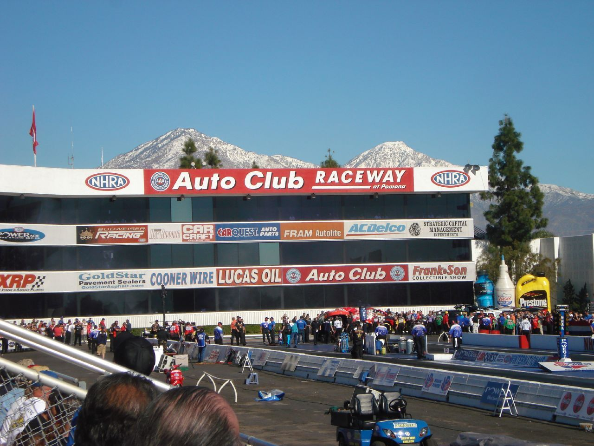

# Pomona's Choppers & the Fontana Strip: "If You Can't Control Them, Join Them"

!!! abstract "Article record"
    **Confidence:** Medium-High · **Source types:** Grassroots municipal police chief's first-person account (FBI Law Enforcement Bulletin, Dec 1951), planning-officials report (ASPO, 1955), NHRA feature (2012), local-court blog item (1947) · **Last verified:** 2026-10-15 (Round 11) · **Open issues:** the chief is describing his own program, so the account is promotional; the officer's name and the strip's later move to the fairgrounds are only partly documented · [How we rate this](../reference/source-standards.md)

!!! quote "In their own words"
    "Every effort to control them failed, and it became apparent that the old adage, 'If you can't control them—join them' was the only approach not tried."

    — **Ralph E. Parker**, Chief of Police, Pomona, Calif., FBI Law Enforcement Bulletin, December 1951.[^leb]

In 1951 the chief of a Southern California city police department wrote up, for the FBI's monthly bulletin to other police, how his department had stopped fighting its hot rodders and started working with them. It is one of the clearest first-hand records of how a **local police force** helped create an early legal drag strip.

## The problem, as the police radio heard it

Parker opens with the dispatcher's call: "KMA 384—to motors—20, 21, 22, 23, and 24 . . . Vicinity of Holt and White Avenues—Hot Rods Racing and Creating Disturbance." He calls this "typical of the nightly broadcast," and says that in some cases traffic court judges rode along with officers from several Los Angeles-area cities "to make mass arrests." The state legislature had also made it unlawful to take part in, or be present at, illegal races, which he says "had negative results" for control.[^leb]

A 1947 item from a blog that posts daily 1947 news shows the older approach in a neighboring city. In Compton, police blockaded a street on July 8 and caught 20 boys racing. Justice Harry R. Simon fined nine of them $2 to $5 and warned, "If we catch you racing your hot rods in Compton again … I am going to throw you all in jail."[^c47]<a href="#q-1" title="Single source so far: see Open questions">◐</a>

## What the police tried instead

**1949:** young owners formed clubs with names such as "Spooks," "Choppers" and "Cam Twirlers."[^leb]

**A police liaison.** Traffic Officer **E. J. Coons**, "a racing enthusiast himself," met the clubs and explained the complaints. The department then donated its **Officers Club rooms** one evening a week as a meeting place, and he showed safety films and gave talks.[^leb]

**A point system.** Poker runs, secret-destination runs and time runs earned points: five for winning a run, one for taking part. A moving-violation citation cost **10 points**, and under the honor system each member reported his own citations at the next meeting. A donated "Perpetual Activity Trophy" went to the semiannual winner. Parker says membership "tripled" and citations and complaints fell.[^leb]

## The strip, and the red tape

After about 15 months the club wanted "a runway trial strip." The first sites were rejected for safety, and the club finally **leased an air strip at Fontana Airport**. Then came the red tape:[^leb]

1. San Bernardino County had an ordinance against racing. It took two meetings with the supervisors, with letters from police chiefs and highway patrol officials, to get it amended.
2. The regional Civil Aeronautics Administration office also had to approve.
3. Insurers refused until "a Pomona insurance broker" wrote **$100,000/300,000 public liability and $50,000 property damage** coverage.

The "Choppers" Club "dug in" on **April 1, 1951**, with the program's operating body appearing in the bulletin as the **Fontana Racing Association**. Admission was 25 cents, and the best crowd so far was eleven hundred. Parker's closing line: "The hot rodder is no longer a problem in Pomona—he is part of a program."[^leb]

## Later: the fairgrounds

A 1955 planning-officials report says Pomona's city built an asphalt strip in the Los Angeles County fairgrounds parking lot and the club agreed to repay the city's investment of more than $5,000 from dues and admissions.[^aspo] NHRA's Phil Burgess (2012) writes that the Choppers, incorporated as the **Pomona Valley Timing Association**, raced on that fairgrounds strip, and credits Chief Parker and officer "Bud Coons" with paving the way for the first NHRA-sanctioned event at Pomona in **April 1953**. A street sign installed in 1979 names the track's road Parker Avenue.[^nhra]<a href="#q-2" title="Sources disagree: see Open questions">⚠</a>

## Why it matters

It ties a **police department** directly to the strip that later became NHRA's Pomona Raceway and the Winternationals home. See also [Santa Ana Drags](../eras/1950s-santa-ana-drags.md) for the county-airport deal that preceded it.

Compare the other local programs in [What the City Planners Wrote (1955)](planners-report-1955.md) and the sheriff-backed strip at [Inyokern](inyokern-dust-devils.md).

<figure markdown>
{ loading=lazy }
<figcaption markdown>The Pomona strip in February 2008, at what is now Auto Club Raceway at Pomona on the Fairplex grounds. It is the successor site to the fairgrounds strip the Choppers raced on; it is not the Fontana airport strip. Creator: mbtrama. Date: 2008-02-09 12:42:45. Source: [Wikimedia Commons](https://commons.wikimedia.org/wiki/File:Pomona_Drag_Strip.jpg). License: [CC BY 2.0](https://creativecommons.org/licenses/by/2.0).</figcaption>
</figure>

## Open questions & disputed details

*From the detective's notebook: where the sources disagree, where we have only one, and what we are still looking for. Each item links back to its place in the story.*

**Single source so far.** *The blog does not name the newspaper it summarizes.* <a class="hr-q-back" href="#qr-1" title="Back to the story">↩</a>

**Disputed.** We found no source for exactly when the club moved from Fontana to the fairgrounds, and none that confirms that "E. J. Coons" and "Bud Coons" are the same officer. They probably are. <a class="hr-q-back" href="#qr-2" title="Back to the story">↩</a>

## Visual references (external)

*Period photos are not clearly free of copyright, so we link to them instead.*

- [FBI Law Enforcement Bulletin, December 1951 (PDF)](https://leb.fbi.gov/file-repository/archives/december-1951.pdf). Parker's article starts on bulletin page 2 and includes a photo, "Two hot rods being flagged to a start for a drag race," and a track diagram.

[^leb]: Ralph E. Parker, "Pomona Police Join Forces With 'Hot Rodders,'" FBI Law Enforcement Bulletin, Dec 1951, pp. 2–5 and 11. https://leb.fbi.gov/file-repository/archives/december-1951.pdf (accessed 2026-10-15)
[^aspo]: American Society of Planning Officials, Information Report No. 74, "Hot Rods, Car Clubs and Drag Strips" (May 1955). https://www.planning.org/pas/reports/report74.htm (accessed 2026-10-15)
[^nhra]: Phil Burgess, "Pomona: SoCal drag racing's lifelong love," NHRA, Feb 1, 2012. https://www.nhra.com/news/2012/pomona-socal-drag-racing-s-lifelong-love (accessed 2026-10-15)
[^c47]: "Hot Rod Boys Spend Afternoon in Court," 1947project (blog), posted July 15, 2005, for July 15, 1947. http://1947project.blogspot.com/2005/07/hot-rod-boys-spend-afternoon-in-court.html (accessed 2026-10-15)
