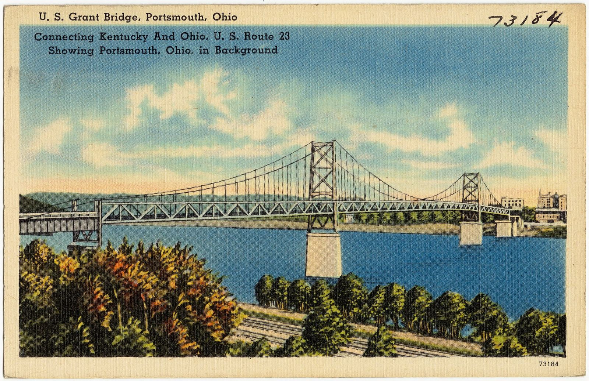

# Portsmouth, Ohio, 1956: The Phones Went Dead and the Hot Rod Club Carried the Messages

!!! abstract "Article record"
    **Confidence:** Medium · **Source types:** an Associated Press dispatch of Sept. 19, 1956, as printed in small-town dailies (*Circleville Herald* and *Washington C.H. Record-Herald*, Ohio; *Hope Star*, Ark.); a national magazine feature written after the strike by an Ohio State journalism teacher (*Saturday Evening Post*, June 8, 1957), all read as scanned OCR · **Last verified:** 2026-10-17 (Round 16) · **Open issues:** neither source names a single club member; the AP places the courier offer in the September shutdown and the *Post* in the 61-day blackout that began Oct. 15 ⚠ (both may be true); we have not read the *Portsmouth Times* itself · [How we rate this](../reference/source-standards.md)

!!! quote "In their own words"
    "Greater Portsmouth has been without telephone service for five days. Who's doing what about it?"

    — **Front-page editorial**, *Portsmouth Times*, on the fifth day of the blackout, as quoted by Evan Hill in the *Saturday Evening Post*, June 8, 1957.[^sep]

Most hot rod club stories from the 1950s are about winning over a town. This one is about a town that needed its hot rodders.

## A city with no dial tone

In the summer of 1956, workers at the Ohio Consolidated Telephone Company in Portsmouth, an Ohio River city of about 40,000, were on strike, and the strike turned violent. By Evan Hill's count in the *Saturday Evening Post*, there had been sixty-seven cable cuts by September 3, and some lines had been slashed three times.[^sep]

On the night of September 18, after five supervisors repairing cables near Sciotoville were attacked, the company closed its Portsmouth and Sciotoville exchanges. The AP reported the next day that the city had no telephone service at all, local or long distance. Police Chief Hugh Rudity declared an emergency and called in every officer and auxiliary. Telegrams were the only way to reach anyone outside town. And: "A local 'hot rod' club organized its members to act as couriers for hospitals in the area."[^ap]

## Sixty-one days

That was only a rehearsal. Twice, Hill wrote, the main exchange was evacuated and the whole region was silent for three days. By October 15 vandals had slashed 290 cables, and that night a mob stormed the telephone building. The main switch was pulled "for sixty-one days."[^sep]

Hill's list of what Portsmouth improvised reads like a civil-defense drill run by volunteers. Twenty-three auxiliary police were deputized to patrol all night in their own cars. Four old police call boxes downtown were wired open. The Yellow Cab Company put its 21 radio cabs at the disposal of the police, some as cruisers and some parked at key spots to relay messages. Detroit Steel took a radio out of a yard locomotive and lent it to the city. The two radio stations, WNXT and WPAY, went on the air around the clock to broadcast emergency calls, and funeral homes parked their ambulances at the police station. In all of Portsmouth, he wrote, only three telephones worked.[^sep]

Two clubs offered to run messages: the Portsmouth Motorcycle Club and the "Kustom Kouriers Kar Club—formerly the Hot Rod Club."[^sep] (The scan garbles the verb, but the sense is that they volunteered to rush messages.)<a href="#q-1" title="Open question: see the bottom of the page">?</a>

<figure markdown>
{ loading=lazy }
<figcaption markdown>The U.S. Grant Bridge over the Ohio River, with Portsmouth in the background, on a linen postcard from about 1930–45, before the events on this page. Creator: Portsmouth News Agency, publisher; Tichnor Bros., printer (Boston Public Library, Tichnor Brothers collection #73184). Date: c. 1930–1945. Source: [Wikimedia Commons](https://commons.wikimedia.org/wiki/File:U.S._Grant_Bridge,_Portsmouth,_Ohio._Connecting_Kentucky_and_Ohio,_U.S._Route_23_showing_Portsmouth,_Ohio,_in_background_(73184).jpg). License: Public domain.</figcaption>
</figure>

## Open questions & disputed details

*From the detective's notebook: where the sources disagree, where we have only one, and what we are still looking for. Each item links back to its place in the story.*

### Which blackout? ⚠

The AP put the couriers in the September shutdown; Hill listed them among the volunteers of the long blackout that began October 15. The two accounts don't have to conflict. A club that had done the job in September would be a natural one to call on again in October. But no source says that, and neither one names a single member.

The name matters too. By the time Hill wrote in 1957, the club had stopped calling itself "the Hot Rod Club" and become the **Kustom Kouriers**.[^sep] Whether the courier work gave it the name, the *Post* doesn't say.

Hill wasn't a passing big-city reporter. The *Post*'s contributor note says he taught journalism at Ohio State, urged his students to go research the strike, and went himself when none volunteered.[^sep]

**Related:** clubs that set out to prove themselves to their towns, such as [Belleville's Gear Jammers](belleville-gear-jammers.md), [Escanaba's Drag-n's](escanaba-dragns.md) and [Kansas City](kansas-city-timing-association.md), and the [Ohio Gassers](../places/ohio-gassers.md). <a class="hr-q-back" href="#qr-1" title="Back to the story">↩</a>

## Sources

[^ap]: Associated Press, Portsmouth, Ohio, Sept. 19, 1956, as printed in the *Circleville Herald* (Circleville, Ohio), Sept. 19, 1956 https://archive.org/details/circleville-herald-1956-09-19 , and as "Ohio City Without Telephone Service," *Hope Star* (Hope, Ark.), Sept. 21, 1956 https://archive.org/details/hope-star-1956-09-21 ; also in the *Washington C.H. Record-Herald*, Sept. 19, 1956 https://archive.org/details/washington-court-house-record-herald-1956-09-19 . Read as page OCR (accessed 2026-10-17).
[^sep]: Evan Hill, "City of Silence," *The Saturday Evening Post*, vol. 229, no. 49, June 8, 1957, pp. 32–33 and continuation, plus the contributor note "Always Mind a Professor," read as scanned OCR. https://archive.org/details/saturday-evening-post-the-1955-1997 (file "Saturday Evening Post, The v229n49 (1957-06-08)") (accessed 2026-10-17)
