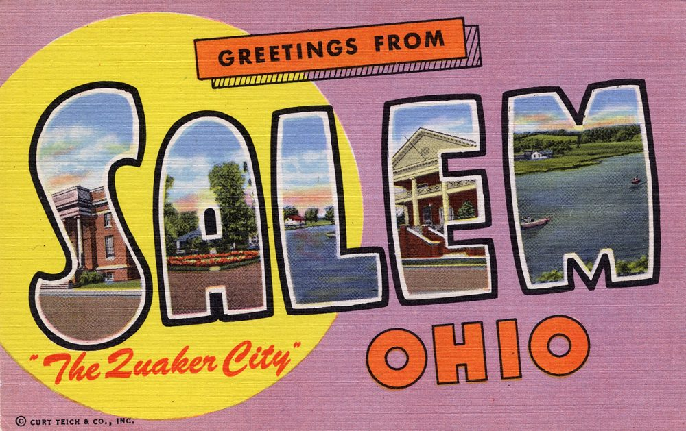

# Headlights on a Pole: Quaker City Drag Strip, Salem, Ohio (1957–77)

!!! abstract "Article record"
    **Confidence:** Medium-High · **Source types:** Grassroots small-town daily newspaper (*The Salem News*, Salem, Ohio): local items, sports notes, club and bowling notices and ads, 1958–77, read as scanned page OCR; *Yesteryears*, the *Salem News*'s weekly local-history journal (Mar. 2, 1992), interviewing Dick and Vivian Mossey; a 2016 *Salem News* story; the track's own "About" page · **Last verified:** 2026-10-22 (Round 20) · **Open issues:** opening year 1957 (owners, track, a 1964 "eighth straight year") vs a 1977 "20th year" that points to 1958 ⚠; the claim that E.T. bracket racing began here rests on the owners' memories ◐; who "Mrs. Nell Mossey," owner of the barn, was ◐; Norm Fox's purchase, 2010 or 2011 ⚠ · [How we rate this](../reference/source-standards.md)

!!! quote "In their own words"
    "They were local racers when we opened."

    — Vivian Mossey, remembering 1957, in *Yesteryears* (*The Salem News*), Mar. 2, 1992.[^yest]

Salem calls itself the Quaker City, after the Friends who founded it. In the late 1950s a young man named Dick Mossey came home from the service, got tired of hauling his car to Akron every weekend, and laid out a drag strip on farmland three miles north of town. A silo became the timing tower. Ten car headlights wired to a pole lit the night races. And in 1958 a pilot from Michigan landed his airplane on it.

<figure markdown>
{ loading=lazy }
<figcaption markdown>"Greetings from Salem, Ohio, 'The Quaker City'," a large-letter postcard (Curt Teich for the Mahoning Valley Distributing Agency, 1953 per the uploader). Context only: the strip took the town's nickname. Scan: Steve Shook. Source: [Wikimedia Commons](https://commons.wikimedia.org/wiki/File:Greetings_from_Salem,_Ohio,_%22The_Quaker_City%22_-_Large_Letter_Postcard_(5945510841).jpg). License: [CC BY 2.0](https://creativecommons.org/licenses/by/2.0).</figcaption>
</figure>

## Tired of driving to Akron

Dick Mossey first saw organized drag racing while stationed on the West Coast; he told *Yesteryears* he went to races "right around Pomona." Back home in Salem he "hopped up his rig and drove it to the Rubber Bowl in Akron to drag race," and after he had his fill of that drive he opened his own strip. "It just looked like such a good deal," he said.[^yest] A 2016 *Salem News* story puts it the same way: he "got tired of making the drive to Akron to race," and he and Vivian opened the track in 1957.[^sn2016] The Akron strip he was driving to was the runway at Fulton Airport, now marked by a state historical marker (see [Akron Fulton Airport](akron-fulton-airport.md)).[^sn2016]

The first season was homemade in every sense. The Mosseys formed the **Quaker City Timing Association** "for the business end." The **Oilers Car Club** of Alliance ran the races. The first sanctioning body was NASCAR, not NHRA. Racers in their late teens and early twenties paid $2 to race all day. There was no prize money: "If you ran and won class, you got a trophy," and Mossey remembered about 100 cars coming out, "mostly backyard racing types." Two flagmen lined the cars up, "whether they were lined up perfect or not, who knows."[^yest]<a href="#q-1" title="Sources disagree: see Open questions">⚠</a>

## The plane, the barn and the trophies (1958)

On a Wednesday in June 1958, Glenn Miller of Brighton, Michigan, co-owner of a drilling company, flew to Salem to pick up a pump from the Deming Co. "Salem has no municipal airport but Richard Mossey's drag strip along Route 165 proved satisfactory," the paper reported. Miller "spotted the 3,000-foot drag strip north of here and landed perfectly in his Tri-Pacer."[^sn580620] Pilots apparently kept using it: the 1992 history notes a windsock Mossey put up "as an aid to small plane pilots who sometimes used the drag strip to land on," and a deal with a local ambulance owner who flew: ambulance service in exchange for landing fees.[^yest]

That summer the paper ran short results from "the Quaker City Timing Association drag strip located on Rt. 165 between Rt. 62 and Rt. 45." Robert Hoperich of Salem took three trophies in July, for top speed, top eliminator and his class. In August, Canton men won the eliminator trophies two weeks running, with a third double winner from Gibson, Pa., and then one from Alexandria.[^sn580722][^sn580804][^sn580818]

In December 1958 the Salem Players, an amateur theater group, considered "an offer made by Mrs. Nell Mossey for the Players to use the barn on the Quaker Timing Association property as a future home and stage." A committee of nine was named, Mrs. Mossey among them.[^sn581203]<a href="#q-2" title="Single source so far: see Open questions">◐</a> *Dick Mossey's wife, in later sources, is Vivian.*

## Silo tower, headlight poles

*Yesteryears* walked through the early-1960s strip with the Mosseys and a box of track photos (still the track's and not reproduced here). The timing tower was "a silo attached to the big barn just west of the track." Each car got its own return road and picked up a time card on the way back. Night racing came almost from the start, and the first lights were homemade: "We made some haphazard things out of car headlights," Mossey said. "I put ten of them in a series and plugged them into 110." At first, he added, the finish-line men "used a flashlight."[^yest]

## NHRA, a drag net and a guard rail (1964)

By May 1964, manager Dick Mossey was lengthening the pavement to 3,400 feet with another 400 feet of runoff, installing a safety "drag net" to stop a car in under 300 feet, and a steel guard rail the full length of the quarter mile, plus a pit area for 1,000 cars.[^sn640501] In August the "remodeled Quaker City Dragway, now an official National Hot Rod Association - sanctioned dragstrip" held its grand opening. The names the paper expected included Joe Schubeck, "Farmer Beswick" and "Arland Vankes," almost certainly Akron's [Arlen Vanke](../people/arlen-vanke.md), plus Salem's Sam Brown; "three hundred cars may take part tonight."[^sn640814]<a href="#q-3" title="Single source so far: see Open questions">◐</a> Friday-night racing ended for the year in late September "because of the change in weather and football season."[^sn640925]

The strip was a town asset, not just a racetrack. The Lions Club put on a circus there in 1961 and antique car shows and swap meets in the 1970s; the Jaycees brought in the Hoxie Bros. Circus in 1968; the paper's bowling columns list a "Quaker City Dragway" team.[^sn611004][^sn680528][^sn750612][^sn671212]<a href="#q-4" title="Open question: see the bottom of the page">?</a>

## The big names, and the hometown ones (1965–77)

In the mid-1960s, the 2016 story says, Quaker City "hosted top names across the board including the Ramchargers, Bill Flynn's 'Yankee Peddler,' Sox and Martin, [Malcolm Durham](../people/malcolm-durham.md), Dave Strickler, John Mazmanian."[^sn2016] The hometown hero was Francis "Krutch" Crider of Salem, who "spent 25 years on Quaker City's asphalt" and won national events.[^yest][^sn2016]

By the 1970s the strip ran on bracket money. On July 3, 1977, more than 2,000 people watched over 400 racers from seven states and Canada race "for $10,000 in prizes" at the Bracket Bonanza. Two weeks later Don "The Snake" Prudhomme, the track record holder, beat a four-car funny car field, with Bob Pickett's Mickey Thompson–backed Marines car, Denny Savage's Chi-Town Hustler and Canton's Stan Bowman, at 213 mph after a 90-minute thunderstorm delay.[^sn770705][^sn770718] That September about 30 Quaker City regulars drove to Beech Bend in Kentucky for the NHRA Division III meet; the paper called the strip "a hot bed of NHRA Division III activity."[^sn770928]

Quaker City is still running. Norm Fox bought it (in 2011 per the track, 2010 per *Drag Illustrated*)<a href="#q-5" title="Sources disagree: see Open questions">⚠</a> and rebuilt it as Quaker City Motorsports Park.[^qcmp] It is the rare small-town strip in this wiki that outlived its founders, perhaps because it never depended on borrowed runway. Compare the airfield strips at [Malden](semo-malden-drag-strip.md) and [Cotati](marin-cotati-strips.md), and the Ohio circuit in [Ohio Gassers](../places/ohio-gassers.md).<a href="#q-6" title="Open question: see the bottom of the page">?</a>

*See also:* [Hog Butcher on Weekdays, Fun Capital on Sundays](beardstown-drag-strip.md).

## Open questions & disputed details

*From the detective's notebook: where the sources disagree, where we have only one, and what we are still looking for. Each item links back to its place in the story.*

**Disputed.** **1957 or 1958?** The Mosseys, the track and the 2016 story all say 1957,[^yest][^sn2016][^qcmp] and a 1964 season preview said the strip would be "in operation for the eighth straight year," which also counts from 1957.[^sn640501] But in 1977 the track announced its "20th year of racing," and said it would "begin its third decade" that May, which counts from 1958.[^sn770510][^sn770405] We read all 248 digitized 1957 issues of *The Salem News* and found no mention of the strip; the first we found is from mid-1958. That doesn't prove 1958 (a small first season could easily go unreported), but it is why the date stays flagged. <a class="hr-q-back" href="#qr-1" title="Back to the story">↩</a>

**Single source so far.** *We have not worked out who Nell Mossey was. A 1958 county tax list pairs "Mossey, Nellie & Richard."*[^sn580327] <a class="hr-q-back" href="#qr-2" title="Back to the story">↩</a>

**Single source so far.** *The spelling is the paper's; we have not found Vanke's own account of that night.* <a class="hr-q-back" href="#qr-3" title="Back to the story">↩</a>

### E.T. racing, by one account ◐

The 1992 history makes a big claim: that E.T. (bracket) racing "began at Quaker City and was the brainchild of longtime racer J. Leo Collins," then of Alliance, an Indianapolis class winner. Vivian Mossey remembered Collins coming in and saying "there are some people who just can't compete. I have an idea, can I give it a try?" Dick Mossey's verdict: "It was fairer for everyone involved."[^yest] ◐ *This is the owners' memory in a local paper. Other tracks claim bracket racing too, and we have not found a dated 1960s Quaker City notice for the first E.T. program.* <a class="hr-q-back" href="#qr-4" title="Back to the story">↩</a>

**Disputed:** Norm Fox bought it (in 2011 per the track, 2010 per *Drag Illustrated*) and rebuilt it as Quaker City Motorsports Park. <a class="hr-q-back" href="#qr-5" title="Back to the story">↩</a>

### Next leads

*The Salem News* for spring and summer 1957 (any first notice); the Oilers Car Club of Alliance; the first dated E.T. program; Nell Mossey; Leo Collins's own account; Dick Mossey's obituary. <a class="hr-q-back" href="#qr-6" title="Back to the story">↩</a>

## Sources

[^yest]: Larry Shields, "Quaker City Dragway first revved up in 1957," *Yesteryears* (weekly historical journal published by *The Salem News*), Mar. 2, 1992, pp. 1, 3–5. Salem Public Library digital history collection. http://history.salem.lib.oh.us/SalemHistory/Yesteryears/1992/Vol1No39Mar2op.pdf (accessed 2026-10-22)
[^sn2016]: "Drag racing legends with ties to Quaker City to be honored," *The Salem News*, June 11, 2016. https://www.salemnews.net/news/local-news/2016/06/drag-racing-legends-with-ties-to-quaker-city-to-be-honored/ (accessed 2026-10-22)
[^qcmp]: "About QCMP," Quaker City Motorsports Park. https://quakercitymotorsportspark.com/about/ (accessed 2026-10-22); on the 2010 date, "On the Road: Quaker City Dragway," *Drag Illustrated*. https://dragillustrated.com/on-the-road-quaker-city-dragway/ (search summary, 2026-10-22)
[^sn580620]: "Pilot Uses Drag Strip To Land Plane Here," *The Salem News* (Salem, Ohio), June 20, 1958. Page OCR (quotes corrected for obvious OCR slips). https://archive.org/details/salem-news-1958-06-20 (accessed 2026-10-22)
[^sn580722]: "Hoperich Captures 3 Drag Strip Trophies," *The Salem News*, July 22, 1958. Page OCR. https://archive.org/details/salem-news-1958-07-22 (accessed 2026-10-22)
[^sn580804]: Drag strip trophy item, *The Salem News*, Aug. 4, 1958. Page OCR. https://archive.org/details/salem-news-1958-08-04 (accessed 2026-10-22)
[^sn580818]: Quaker City Timing Association results, *The Salem News*, Aug. 18, 1958. Page OCR. https://archive.org/details/salem-news-1958-08-18 (accessed 2026-10-22)
[^sn580327]: County tax list, *The Salem News*, Mar. 27, 1958. Page OCR. https://archive.org/details/salem-news-1958-03-27 (accessed 2026-10-22)
[^sn581203]: "Players May Get Barn As Headquarters," *The Salem News*, Dec. 3, 1958. Page OCR. https://archive.org/details/salem-news-1958-12-03 (accessed 2026-10-22)
[^sn611004]: Zimmerman Auto Sales ad (Mills Bros. Circus "at the Quaker City Drag Strip"), *The Salem News*, Oct. 4, 1961. Page OCR. https://archive.org/details/salem-news-1961-10-04 (accessed 2026-10-22)
[^sn640501]: "Quaker City Drag Strip Opens Sunday," *The Salem News*, May 1, 1964. Page OCR (letter-spaced; quotes corrected for OCR spacing). https://archive.org/details/salem-news-1964-05-01 (accessed 2026-10-22)
[^sn640814]: "Grand Opening Set At Quaker Dragway," *The Salem News*, Aug. 14, 1964. Page OCR, columns interleaved. https://archive.org/details/salem-news-1964-08-14 (accessed 2026-10-22)
[^sn640925]: Sports column, *The Salem News*, Sept. 25, 1964. Page OCR. https://archive.org/details/salem-news-1964-09-25 (accessed 2026-10-22)
[^sn680528]: "Jaycees to Sponsor Circus," *The Salem News*, May 28, 1968. Page OCR. https://archive.org/details/salem-news-1968-05-28 (accessed 2026-10-22)
[^sn750612]: "Fifty Antique Cars To Be Displayed At Lions' Show," *The Salem News*, June 12, 1975. Page OCR. https://archive.org/details/salem-news-1975-06-12 (accessed 2026-10-22)
[^sn770405]: "Quaker City Opens Soon," *The Salem News*, Apr. 5, 1977. Page OCR. https://archive.org/details/salem-news-1977-04-05 (accessed 2026-10-22)
[^sn770510]: "Quaker City News," *The Salem News*, May 10, 1977. Page OCR. https://archive.org/details/salem-news-1977-05-10 (accessed 2026-10-22)
[^sn770705]: "2000 Crowd Quaker City Drag Strip Sunday" and "Funny Cars Slated," *The Salem News*, July 5, 1977. Page OCR. https://archive.org/details/salem-news-1977-07-05 (accessed 2026-10-22)
[^sn770718]: "Prudhomme Tops 'Funny' Field," *The Salem News*, July 18, 1977. Page OCR. https://archive.org/details/salem-news-1977-07-18 (accessed 2026-10-22)
[^sn671212]: Bowling league standings, *The Salem News*, Dec. 12, 1967. Page OCR. https://archive.org/details/salem-news-1967-12-12 (accessed 2026-10-22)
[^sn770928]: Motor sports column, *The Salem News*, Sept. 28, 1977. Page OCR. https://archive.org/details/salem-news-1977-09-28 (accessed 2026-10-22)
