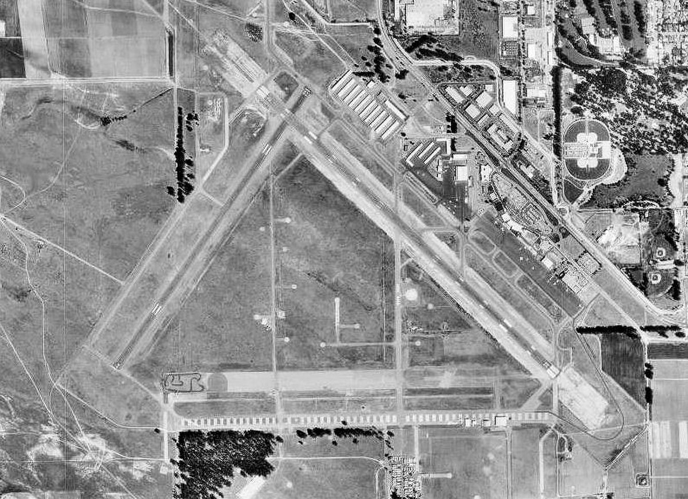

# Golden State Raceway: The Jaycees' Drag Strip at Santa Maria Airport (Santa Maria and Lompoc, Calif., 1959–77)

!!! abstract "Article record"
    **Confidence:** Medium · **Source types:** Grassroots Small-town daily (*Lompoc Record*, Lompoc, Calif.), 1969–77: meet previews, results, letters to the editor and a news brief, read as OCR on the Internet Archive; *Car Craft* strip calendars, 1959 and 1961 · **Last verified:** 2026-10-22 (Round 23-West) · **Open issues:** how Dragons, Inc., of 1959–61 connects to the Jaycees' strip ?; when the strip closed ?; the 1969 record figures are partly garbled in one later report ◐ · [How we rate this](../reference/source-standards.md)

!!! quote "In their own words"
    "Automotive competition is always a lot healthier on a facility designed for that purpose than where it sometimes ends up, on the streets of this community."

    — Martin D. U'Ren of Santa Maria, letter to the *Lompoc Record*, Dec. 17, 1975.[^lr751217]

Santa Maria had a drag strip by 1959, but most of what survives about it comes from a neighboring town's paper, the *Lompoc Record*, whose sports page carried the strip's previews and results. The story starts in a magazine calendar and ends with one reader's letter.

## Dragons and Jaycees (1959–70)

In July 1959 *Car Craft*'s list of strips included "Santa Maria, Calif.—1st Sunday. Dragons, Inc."[^cc5907] In April 1961 the same entry read "2nd Sunday. Dragons, Inc."[^cc6104]<a href="#q-1" title="Open question: see the bottom of the page">?</a> When the *Record* took up the story in February 1969, the strip had a new sponsor and a new surface. The Santa Maria Valley Jaycees presented "the second event for 1969" at "the New Santa Maria Dragstrip." Following the Winternationals, the paper said, "the new and improved local strip is beginning to build toward a 'bigtime' schedule." A car cost $4 to run and spectators paid $2.[^lr690206] Two weeks later the paper reported 111 entries at the last meet and said the strip's weather and surface were "almost identical to Bakersfield." The Jaycees had written to top racers suggesting it as a tune-up for the Bakersfield championships, with top eliminator purses "starting at $40 per round."[^lr690220]

The fields grew quickly. In March about 200 machines were expected, including Dean Shaw's AA gasser from Arroyo Grande, Ventura's Fred Notska in an A fuel dragster, and "the 'Syndicate' a 230-mph AA fueler from Reseda."[^lr690322] In April the strip held an NHRA-sanctioned Super Stock points meet for $1,000 in prize money, with "factory racing teams from Dodge, Ford and American Motors." The points leader was Bob Lambeck, "driver of the Dick Landy Dodge team entry," and local drivers Walt Zeishe of Lompoc and Tommy Johnson of the Santa Barbara Chevrollers were racing against the professionals.[^lr690410] In June Roger Gates of Reseda broke his own record with "a blown 427 Chevy in a homemade dragster that burned pump gasoline," setting a new Golden State Raceway mark of 7.50 seconds at 191.08 mph.[^lr690626]<a href="#q-2" title="Single source so far: see Open questions">◐</a> By August the paper was calling the track the **Golden State Raceway** "at the Santa Maria Airport strip." The fourth-Sunday drags had skipped July because of the county fair, and the AA-Fuel record, 7.05 seconds at 214.78 mph, belonged to Carl Olsen of Torrance, set "driving a Mickey Thompson Fuel Dragster."[^lr690813] In January 1970 the Jaycees moved the meets to the last Sunday of the month on the airport property and promised new timing clocks by February.[^lr700122] Directions that spring sent fans "west off the Orcutt Expressway, then north on Blosser."[^lr700309] That fall the Allan Hancock College Auto Club showed a bright orange Chevy II test car for which "parts and equipment were donated by various manufacturers."[^lr700918]

## Lompoc's racers (1971–77)

By the early 1970s Lompoc drivers were winning regularly at Santa Maria. In August 1971 the paper reported that "six Lompoc drag racers took honors" in front of 1,400 spectators. Bob Saucek was runner-up in Bracket Three in his Chevy II, Jim Seaman won Bracket Four in a '68 El Camino, Gene Gillespie beat Gail Allington in Bracket Five, and her husband, Skip Allington, won Bracket Six.[^lr710823] Not everyone in Lompoc approved. In 1972 a letter-writer, tired of cars with their mufflers off on Friday and Saturday nights, suggested building "a drag-strip far out of town down wind of Lompoc," adding that "maybe Ocean Avenue would get a rest."[^lr720817] In 1974 the paper photographed Gillespie, with his daughter, being congratulated by "Golden State Raceway starter Rich Riola" after winning the strip's Bracket 2 points title.[^lr740827] That November a news brief placed "the Santa Maria Dragstrip" near the south side of the airport.[^lr741114]

{ loading=lazy }

*Santa Maria Public Airport from the air, Sept. 3, 1994. U.S. Geological Survey photo, public domain, via Wikimedia Commons.*

In December 1975 Martin D. U'Ren wrote that he had learned of "the probable demise of the Golden State Raceway, with the end of the year." The airport owned the land, the Chamber of Commerce was apparently withdrawing its support, and "our dragstrip seems doomed."[^lr751217] It lasted longer than he feared. In April 1977 Skip Allington won Pro Stock at the Golden State Raceway with 11.56 seconds at 113.63 mph.[^lr770425]<a href="#q-3" title="Open question: see the bottom of the page">?</a> At Redding, a car club ran the [airport runway where Red Bluff's dragster raced](red-bluff-schafer-oil-special.md). At Santa Maria a civic club ran the strip, on land owned by an airport that could take it back.

## Open questions & disputed details

*From the detective's notebook: where the sources disagree, where we have only one, and what we are still looking for. Each item links back to its place in the story.*

**Open question.** **Who were Dragons, Inc., and did they race on the same airport strip?** *Car Craft* lists only the town, the day and the club. The *Record*'s 1969 phrase "the New Santa Maria Dragstrip" suggests an older one, but we have not found where the 1959–61 meets were held or when the Jaycees took over.[^cc5907][^lr690206] <a class="hr-q-back" href="#qr-1" title="Back to the story">↩</a>

**Single source so far.** **What exactly was Gates's record?** The June 1969 report gives 7.50 seconds at 191.08 mph, breaking his own 7.83 at 186.72. In the August preview the OCR reads "7:50 seconds at 101.08," which looks like a typesetting or OCR slip for the same mark. No timing slip or second paper confirms it.[^lr690626][^lr690813] <a class="hr-q-back" href="#qr-2" title="Back to the story">↩</a>

### Next leads

The *Santa Maria Times* for Dragons, Inc., and the strip's opening and closing; airport commission minutes on the strip lease after 1975; the "Syndicate" fueler's owners; whether Lompoc ever got the strip its letter-writer wanted. <a class="hr-q-back" href="#qr-3" title="Back to the story">↩</a>

## Sources

[^cc5907]: "Drag Strip Directory," *Car Craft*, July 1959 (vol. 7, no. 3). Scan OCR via Internet Archive. https://archive.org/details/sim_car-craft_1959-07_7_3 (accessed 2026-10-22)
[^cc6104]: Strip calendar, *Car Craft*, April 1961 (vol. 8, no. 12). Scan OCR via Internet Archive. https://archive.org/details/sim_car-craft_1961-04_8_12 (accessed 2026-10-22)
[^lr690206]: "Drag set for SM course," *Lompoc Record* (Lompoc, Calif.), Feb. 6, 1969. OCR via Internet Archive. https://archive.org/details/lompoc-record-1969-02-06 (accessed 2026-10-22)
[^lr690220]: "Drag races to be held on Sunday," *Lompoc Record*, Feb. 20, 1969. OCR via Internet Archive. https://archive.org/details/lompoc-record-1969-02-20 (accessed 2026-10-22)
[^lr690322]: "Drag races slated for tomorrow," *Lompoc Record*, Mar. 22, 1969. OCR via Internet Archive. https://archive.org/details/lompoc-record-1969-03-22 (accessed 2026-10-22)
[^lr690410]: Super Stock points meet preview, *Lompoc Record*, Apr. 10, 1969. OCR via Internet Archive. https://archive.org/details/lompoc-record-1969-04-10 (accessed 2026-10-22)
[^lr690626]: "Reseda driver breaks own record for top eliminator honors at drags," *Lompoc Record*, June 26, 1969. OCR via Internet Archive. https://archive.org/details/lompoc-record-1969-06-26 (accessed 2026-10-22)
[^lr690813]: "Drag race scheduled for Aug. 24," *Lompoc Record*, Aug. 13, 1969. OCR via Internet Archive. https://archive.org/details/lompoc-record-1969-08-13 (accessed 2026-10-22)
[^lr700122]: "Drag race season to begin," *Lompoc Record*, Jan. 22, 1970. OCR via Internet Archive. https://archive.org/details/lompoc-record-1970-01-22 (accessed 2026-10-22)
[^lr700309]: Sports car rally notice, *Lompoc Record*, Mar. 9, 1970. OCR via Internet Archive. https://archive.org/details/lompoc-record-1970-03-09 (accessed 2026-10-22)
[^lr700918]: "AHC auto club identification," *Lompoc Record*, Sept. 18, 1970. OCR via Internet Archive. https://archive.org/details/lompoc-record-1970-09-18 (accessed 2026-10-22)
[^lr710823]: Roxie Thompson, "6 Lompoc drag racers win," *Lompoc Record*, Aug. 23, 1971. OCR via Internet Archive. https://archive.org/details/lompoc-record-1971-08-23 (accessed 2026-10-22)
[^lr720817]: Letter to the editor, *Lompoc Record*, Aug. 17, 1972. OCR via Internet Archive. https://archive.org/details/lompoc-record-1972-08-17 (accessed 2026-10-22)
[^lr740827]: "Number One" (photo caption), *Lompoc Record*, Aug. 27, 1974. OCR via Internet Archive. https://archive.org/details/lompoc-record-1974-08-27 (accessed 2026-10-22)
[^lr741114]: Plane crash brief, *Lompoc Record*, Nov. 14, 1974. OCR via Internet Archive. https://archive.org/details/lompoc-record-1974-11-14 (accessed 2026-10-22)
[^lr751217]: Martin D. U'Ren, letter to the editor, *Lompoc Record*, Dec. 17, 1975. OCR via Internet Archive. https://archive.org/details/lompoc-record-1975-12-17 (accessed 2026-10-22)
[^lr770425]: "Golden State Raceway" (results), *Lompoc Record*, Apr. 25, 1977. OCR via Internet Archive. https://archive.org/details/lompoc-record-1977-04-25 (accessed 2026-10-22)
