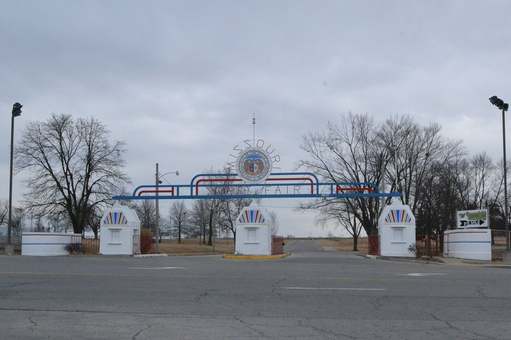

# The Big S.I.R.: Sedalia's Eleven-Year Drag Strip Chase (1958–70)

!!! abstract "Article record"
    **Confidence:** Medium · **Source types:** Grassroots small-town daily newspaper (*Sedalia Democrat*, Sedalia, Mo.): a 1956 editorial, 1962 club news, a 1968 letter to the editor and the sports pages' running coverage of 1969, read as scanned page OCR · **Last verified:** 2026-10-18 (Round 17) · **Open issues:** whether the half-built strip ever opened is not found ◐; the January 1970 review calls the promoter "George O. Weatherly Jr." and dates the lost World Points Finale to "September," while the 1969 stories list George O. Weatherly as president, his namesake Jr. as a vice president serving in Vietnam, and the finale as Oct. 3–5 ⚠; the Hamer company's side of the pull-out is not reported · [How we rate this](../reference/source-standards.md)

!!! quote "In their own words"
    "Sedalia is on the brink of growth, one way or the other."

    — **Charles Lawrence**, director of the Sedalia Chamber of Commerce, at the groundbreaking, *Sedalia Democrat*, July 23, 1969.[^sd690723]

Some towns argued about a drag strip for a season. Sedalia, Missouri, argued about one for more than a decade, and when it finally broke ground the result was half a strip.

## Round one: the private-strip idea (1956–58)

In March 1956 a *Sedalia Democrat* editorial complained that drag racing had "moved to town," after a race on West Third Street with a police car right on the racers' heels. It noted "some talk in Sedalia of establishing a private drag strip," but said taxpayers weren't willing to pay for one. If parents wanted to underwrite it, the paper said, that was "private business."[^sd560309]

By the *Democrat*'s 1969 recap, the first real attempt came in 1958, led by **Jack Couts**, later the city's park superintendent. It failed over money.[^sd690723] That was the year the [Sedalia Drag-Ons](sedalia-drag-ons.md) were writing to the paper asking for a strip.

## Round two: the oil men (1962)

On Sunday, March 4, 1962, four local car clubs and the **Iron Horsemen** motorcycle club, whose president was Don Carver, met a committee of the **Oil Men's Association**: Vic Gill (chairman), Virgil Herrick and Velmar Harms. Police Chief **Ralph Hamlin** organized the meeting.[^sd620308] Pete Daniels's report in the *Democrat* ran a drawing of a possible strip with bleachers, a pit area and parking. "The plans were drawn up by Barry Cox of the Eliminator's car club."[^sd620308] It was pointed out at the meeting that a strip had been tried about four years earlier.[^sd620308]

On March 29, 1962, Couts was elected president of a new **Sedalia Missouri Timing Association**. Sedalia Memorial Airport was named as a possible site. Then, in the 1969 paper's words, "talk died down" and "The project was scrubbed."[^sd690723]

## Round three: a preacher's letter (1968)

In December 1968 a letter to the editor came from the **Rev. Harry Koockle** (as the scan reads the name) of Route 2, Sedalia. Young people needed more to do, he wrote, and not all of them were interested in the same things. "I propose the establishment of a sanctioned 'Drag Strip' in the Sedalia area," he wrote, and he asked readers who scoffed whether they had ever been to "one of the sanctioned races in Kansas City or Springfield."[^sd681206]

## Round four: the Big S.I.R. (1969)

Five months later it suddenly happened, or seemed to.

- **May 20.** The *Democrat* reported that **George O. Weatherly** of Kansas City, his son and two other partners would build "Sedalia International Dragway" on the south edge of the Missouri State Fairgrounds.[^sd690520]
- **May 22.** Sports editor **Vaughn Hart**'s story was headlined "Against New Strip." Residents of the nearby Southwest Village neighborhood, led by attorney **Adam Fischer**, were preparing a formal complaint over noise and dust. Weatherly had hit a snag with a bipartisan committee and **Dexter Davis**, the state secretary of agriculture. The plan was for local cars on Monday and Wednesday nights, plus sanctioned American Hot Rod Association (AHRA) meets.[^sd690522]
- **May 23–27.** Davis said he would not sign the lease in the face of the opposition, and the strip would have to move.[^sd690523][^sd690527]
- **June 22.** The new site was on Highway 65 south of the city limits, "where the old 'hog barns' are currently located." All but one barn would come down at once.[^sd690622]
- **July 22.** The lease was signed. The first meet was set for Aug. 14–16, and Weatherly announced that the AHRA's **World Points Final**, "the second largest drag championship in the United States," had been moved from Kansas City International Raceway to Sedalia for Oct. 3–5. The board said it expected "more than 100,000 spectators" and an estimated 2,000 drivers.[^sd690722]

<figure markdown>
{ loading=lazy }
<figcaption markdown>The Missouri State Fair entry gate in Sedalia (photo 2018). The first site proposed for the 1969 strip was on the fairgrounds' southern edge; this photo shows the gate, not that site. Creator: 25or6to4. Date: 2018-02-03. Source: [Wikimedia Commons](https://commons.wikimedia.org/wiki/File:Missouri_State_Fair_Entry_Gate,_Sedalia,_MO.jpg). License: [CC BY-SA 4.0](https://creativecommons.org/licenses/by-sa/4.0).</figcaption>
</figure>

## Groundbreaking day

The July 23 story opened: "The idea of a drag strip has been kicked around in the Sedalia area since 1958."[^sd690723] The corporation's officers included **Lee Dorrell Jr.** (secretary-treasurer), **Lee Dorrell Sr.**, **Curtis Dorrell**, **Jerry Hamer**, **Robert Hamer**, Leonard Johnson, and **George O. Weatherly Jr.**, a vice president then serving in Vietnam.[^sd690723]

State Senator **John Ryan** said: "The new drag strip will prove its worth to the community and surrounding area just by keeping the children from hot-rodding on the streets and highways."[^sd690723] Dorrell promised that "80 to 90 percent of the meets" would be for drivers from the Sedalia and Pettis County area.[^sd690723]

The paper also gave Dorrell a backstory that matters to the [Kansas City strip](kansas-city-timing-association.md): he "was one of the planners and organizers of the first drag strip built in Missouri in 1955. That strip was built in Kansas City near the Chouteau Bridge and named the Kansas City Timing Association (KCTA)."[^sd690723]<a href="#q-1" title="Single source so far: see Open questions">◐</a> And AHRA president **Jim Tice** had told Weatherly the World Points meet had "a better than good chance" of coming to Sedalia.[^sd690723]

That summer the paper also announced a "Miss Sedalia Raceway" contest for Pettis County girls. The winner would reign for the rest of the 1969 season and all of 1970, and her prizes included a wardrobe.[^sd690801]

## Half a drag strip

On Aug. 31 the news turned. Construction had stopped. The prime builder, the **Hamer Construction Co.** of Kansas City, had, in Weatherly's words, "pulled out and moved south." He said the stockholders had paid Hamer "an amount in the five figure bracket" for the subcontracted earth-moving work, and "That money was never passed on to the subcontractors." The strip was "about one-half completed." Weatherly hoped the Howard Construction Co. of Sedalia would finish it in time to keep the World Points Finale.[^sd690831]

The 1969 stories name a Jerry Hamer and a Robert Hamer among the corporation's vice presidents, and the builder was the Hamer Construction Co. The paper never says whether they were related.[^sd690723][^sd690831]

In January 1970, Hart's look back at the year ranked it as a top story of a different kind. The Big S.I.R., he wrote, had turned out to be the big flop of the year: the strip was half finished, and "its future is still uncertain."[^sd700118]<a href="#q-2" title="Sources disagree: see Open questions">⚠</a>

We have not found whether a car ever ran on it.

**Related:** [The Sedalia Drag-Ons](sedalia-drag-ons.md); [Kansas City's 1955 strip](kansas-city-timing-association.md); other towns' strip fights in [Belleville & St. Louis](belleville-gear-jammers.md) and [Ames, Iowa](ames-drag-strip-nightcrawlers.md).<a href="#q-3" title="Open question: see the bottom of the page">?</a>

## Open questions & disputed details

*From the detective's notebook: where the sources disagree, where we have only one, and what we are still looking for. Each item links back to its place in the story.*

**Single source so far.** A 1959 AP feature names a Lee Dorrell, Kansas City policeman, as the association's president, which fits, though neither source says outright that the two are the same man.[^ap59] <a class="hr-q-back" href="#qr-1" title="Back to the story">↩</a>

**Disputed.** That review calls the promoter "George O. Weatherly Jr." and says the finale would have been in September; the 1969 stories list George O. Weatherly as president and George O. Weatherly Jr. as a vice president then in Vietnam, and they give Oct. 3–5. <a class="hr-q-back" href="#qr-2" title="Back to the story">↩</a>

### Next leads

*Sedalia Democrat* 1970–72 for the strip's fate; the Pettis County recorder for the Highway 65 lease; AHRA's 1969 World Points Finals (where it was finally held); Marshall Junction and other rejected sites. <a class="hr-q-back" href="#qr-3" title="Back to the story">↩</a>

## Sources

[^sd560309]: Editorial on drag racing, *Sedalia Democrat* (Sedalia, Mo.), March 9, 1956. Page OCR. https://archive.org/details/sedalia-democrat-1956-03-09 (accessed 2026-10-18)
[^sd620308]: Pete Daniels, "Tentative Plans for Drag-Strip," *Sedalia Democrat*, March 8, 1962. Page OCR, columns interleaved. https://archive.org/details/sedalia-democrat-1962-03-08 (accessed 2026-10-18)
[^sd681206]: Rev. Harry Koockle (name as OCR reads it), letter to the editor, *Sedalia Democrat*, Dec. 6, 1968. Page OCR. https://archive.org/details/sedalia-democrat-1968-12-06 (accessed 2026-10-18)
[^sd690520]: Drag strip bulletin, *Sedalia Democrat*, May 20, 1969. Page OCR. https://archive.org/details/sedalia-democrat-1969-05-20 (accessed 2026-10-18)
[^sd690522]: Vaughn Hart, "Against New Strip," *Sedalia Democrat*, May 22, 1969. Page OCR. https://archive.org/details/sedalia-democrat-1969-05-22 (accessed 2026-10-18)
[^sd690523]: Drag strip lease item, *Sedalia Democrat*, May 23, 1969. Page OCR. https://archive.org/details/sedalia-democrat-1969-05-23 (accessed 2026-10-18)
[^sd690527]: Drag strip relocation item, *Sedalia Democrat*, May 27, 1969. Page OCR. https://archive.org/details/sedalia-democrat-1969-05-27 (accessed 2026-10-18)
[^sd690622]: New drag strip site story, *Sedalia Democrat*, June 22, 1969. Page OCR. https://archive.org/details/sedalia-democrat-1969-06-22 (accessed 2026-10-18)
[^sd690722]: "Drag-Strip Go-Ahead Announced," *Sedalia Democrat*, July 22, 1969. Page OCR. https://archive.org/details/sedalia-democrat-1969-07-22 (accessed 2026-10-18)
[^sd690723]: Vaughn Hart, "Ground is Broken for the 'Big S.I.R.'," *Sedalia Democrat*, July 23, 1969. Page OCR. https://archive.org/details/sedalia-democrat-1969-07-23 (accessed 2026-10-18)
[^ap59]: Ed Shook, *The Kansas City Star*, via Associated Press, "Hot-Rod Racing Is Legal; Encouraged in Kansas City," *Sedalia Democrat*, April 23, 1959. Page OCR. https://archive.org/details/sedalia-democrat-1959-04-23 (accessed 2026-10-18)
[^sd690801]: Miss Sedalia Raceway contest item, *Sedalia Democrat*, Aug. 1, 1969. Page OCR. https://archive.org/details/sedalia-democrat-1969-08-01 (accessed 2026-10-18)
[^sd690831]: Construction stoppage story ("One-half Finished" photo caption), *Sedalia Democrat*, Aug. 31, 1969. Page OCR. https://archive.org/details/sedalia-democrat-1969-08-31 (accessed 2026-10-18)
[^sd700118]: Vaughn Hart, year-end sports review ("Racing Story Tops '69 Sports Scene"), *Sedalia Democrat*, Jan. 18, 1970. Page OCR, badly garbled at this passage. https://archive.org/details/sedalia-democrat-1970-01-18 (accessed 2026-10-18)
