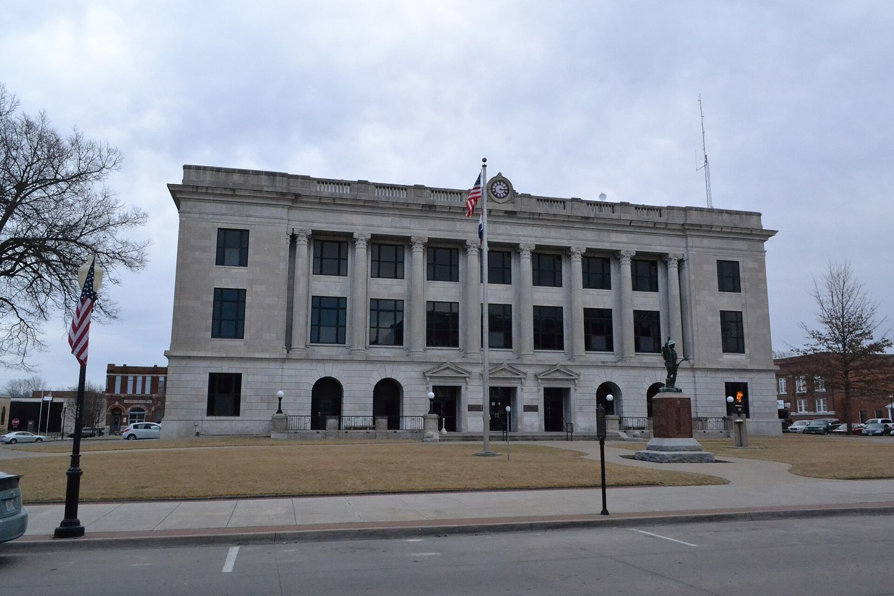

# The Sedalia Drag-Ons: Courtesy Cards, Half Fines and a Truck for a Boys' Ranch (1957–64)

!!! abstract "Article record"
    **Confidence:** Medium · **Source types:** Grassroots small-town daily newspaper (*Sedalia Democrat*, Sedalia, Mo.): club meeting notes, a sports editor's column printing the club president's letter (1958), and a Sunday feature with the club's bylaws (1964), all read as scanned page OCR · **Last verified:** 2026-10-18 (Round 17) · **Open issues:** founding date and founders not found; whether the 1962 club was the same organization revived or a new one under the old name is not stated; the club's later history after 1964 is unknown; nearly all of it comes from one paper ◐ · [How we rate this](../reference/source-standards.md)

!!! quote "In their own words"
    "We want Sedalia to be more than just a spot on the map. We want it to be known over Missouri as the safest city in the state."

    — **Jr. Vasquez**, president, the Sedalia Drag-On's, letter to sports editor D. Kelly Scruton, *Sedalia Democrat*, March 9, 1958.[^sd580309]

Sedalia, Missouri, home of the State Fair, sits in the farm country east of Kansas City. In the late 1950s it had no drag strip, and its hot rod club spent seven years trying to prove it deserved one. The club never got its strip. What it left behind in the local paper is one of the most detailed rulebooks of any small-town club we have found.

## The card under the windshield wiper
In June 1957 the **Drag-Ons** held a meeting at the courthouse, and a trip was set for the coming weekend to the Kansas City strip, which the paper described as a National Hot Rod Association strip. Soon, the paper said, motorists helped by a member would be handed a courtesy card, and it printed the wording: "You Have Been Helped By The DRAG-ONS of SEDALIA, A MOTOR CAR CLUB. Dedicated to the Safety and Courtesy of the American Highways. 'We Hope You Have a Safe Trip.'"[^sd570605] (The scan's columns are interleaved, so the wording is pieced together from the OCR.)

The same meeting heard that "not a fatal accident has ever occurred on a sanctioned drag strip," and that the only deaths had been among those racing illegally.[^sd570605] ◐ That was the club's talking point, not a statistic the paper checked.

Two weeks later the members went to the Kansas City strip, where "Many of the local boys participated." Back home on June 18 they voted that every member "must belong to the National Hot Rod Association," and they scheduled the safety check for July.[^sd570619] Kansas City's own clubs had used the same courtesy-card idea; see [The Detective Whose Son Was a Dragster](kansas-city-timing-association.md).

<figure markdown>
{ loading=lazy }
<figcaption markdown>The Pettis County Courthouse in Sedalia, where the Drag-Ons met in 1957 (photo 2018). Creator: 25or6to4. Date: 2018-02-03. Source: [Wikimedia Commons](https://commons.wikimedia.org/wiki/File:Pettis_County_Courthouse,_Sedalia,_MO.jpg). License: [CC BY-SA 4.0](https://creativecommons.org/licenses/by-sa/4.0).</figcaption>
</figure>

## Three laws and a second chance
In March 1958 *Democrat* sports editor **D. Kelly Scruton** gave his column to a letter from the club's president, **Jr. Vasquez**. The Drag-Ons, Vasquez wrote, had three laws: obey the motor vehicle laws, be courteous to other drivers and pedestrians, and "publicize the sport of drag racing in its true light."[^sd580309]

The penalty system was blunt. A member found guilty of breaking the rules "is fined by the club, but given one more chance to prove himself worthy of membership. If caught again, he is fined by the club, the city police, and disregarded as a club member."[^sd580309]

Vasquez's real point was the strip. Only a strip could take racing off the highways, he wrote, and "The citizens of Marshall have already realized this and are giving full support to their hot rod club, which is now being formed."[^sd580309] Scruton backed the idea, but he was frank about the club's start. When the Drag-Ons were first organized, he wrote, some members "failed to keep faith with these rules and regulations."[^sd580309]

## Car washes, Air Force drags and a record hop
That spring the club read and approved its constitution at its own clubhouse.[^sd580430] Sue Wilson, chairman of the Sedalia cancer drive, signed the members up, and their "Operation Simo-Wash" car wash at the Wayne Richardson Service Station on May 10 raised **$60.40** for the Cancer Society.[^sd580514]

In June 1958 the guests at a meeting were the **Push Rods** of Marshall, probably the new club Vasquez had mentioned. The Drag-Ons planned to go to drag races at **Whiteman Air Force Base** on Sunday, June 8, sponsored by the base's club, with cars expected from Kansas City and Great Bend, Kansas. They also booked a July 4 "Record Hop" at the Liberty Park Convention Hall: $1 stag, $1.50 drag.[^sd580604] For Great Bend, see [Great Bend, Kansas](great-bend-srca.md).

## Hot and cold
Then the trail goes quiet. In January 1962 Scruton wrote that drag strips were "up for discussion again" now that the Drag-Ons had revived. He added that the club "should however, keep going and quit running hot-and-cold," and noted that members had been helping stranded motorists and pushing cars out of the recent storms.[^sd620107] A week later President **Bill Bottcher** read a list of custom car shows to a meeting at the club building on East 14th, and the members called a special meeting to choose jackets.[^sd620116]

The revived club joined the 1962 push for a Sedalia strip, which is its own story: see [The Big S.I.R.](sedalia-big-sir.md). In May 1963 a trip to the Kansas City strip was rained out, and the club made plans to attend the nationals at Indianapolis, Aug. 30 to Sept. 2.[^sd630521]

## The truck for Butterfield's ranch
The best story came last. In November 1964, the *Democrat*'s Sunday feature section ran a full page by **Larry Embry** headlined "Drag-Ons Rebuild Old Car For Gift to Boys' Ranch."[^sd641115]

**Tom Butterfield** was setting up a boys' ranch near Marshall on the old Marshall Country Club property, and he had only a station wagon. "We voted it in pretty quick," said club president **Larry Rennison**. **Walter McClure**, who lived northeast of Sedalia and hadn't been able to sell his 1950 truck, gave it to the club. The members worked on it in **Dick Schultz**'s garage on East Third: new upholstery, an overhauled motor, a new bed floor and a repaint in the original color. The truck was due at the ranch in December.[^sd641115]

Embry also printed the club's rules, which had grown teeth since 1958:[^sd641115]

- **Purpose:** "to promote road safety and courtesy on American highways," and to show the public what organized hot rod clubs can do.
- **Members:** mostly in their late teens and early 20s, aged 17 to 27.
- **Tickets:** a moving violation "means a fine of one-half his court fine," and the member then had to stand trial before his fellow club members at the next meeting.
- **Wrecks:** a member in an accident had to report it, and three members investigated.
- **Expulsion:** a two-thirds vote.
- **Money and duty:** $2 to join, which covered the plaque, then 50 cents a week. Members were fined for missing meetings, and two absences in four weeks put membership at risk.
- **Inspection:** every member's car got a safety check every three months.
- **Badge:** the club insignia was a cast aluminum license plate.

The 1964 officers were Rennison (president), Gary Hayden (vice president), Dennis Smethers (secretary), Dick Schultz (treasurer), Gary Deuel (reporter) and Steve Bottcher (sergeant-at-arms).[^sd641115]

*From the detective's notebook:* the half-fine rule is the same one we found at [Belleville's Gear Jammers](belleville-gear-jammers.md) in Illinois. No source says either club got it from the other. It may have come from a common model, such as NHRA's club materials, but we haven't found that model.

**Related:** [Kansas City's strip and Timing Association](kansas-city-timing-association.md), [The Big S.I.R.](sedalia-big-sir.md), [Escanaba's Drag-n's](escanaba-dragns.md), [Stroudsburg's Ridge Runners](stroudsburg-ridge-runners.md) and [Kingston's Igniters](kingston-igniters.md).

## Next leads
The Marshall *Democrat-News* for the Push Rods; Whiteman AFB base newspaper for the June 1958 drags; Butterfield Youth Services' own history for the truck; the 1957 founding meeting.

## Sources

[^sd570605]: Drag-Ons meeting item, *Sedalia Democrat* (Sedalia, Mo.), June 5, 1957. Page OCR, columns interleaved. https://archive.org/details/sedalia-democrat-1957-06-05 (accessed 2026-10-18)
[^sd570619]: "Drag-On Clubbers Visit KC Drag Strip," *Sedalia Democrat*, June 19, 1957. Page OCR. https://archive.org/details/sedalia-democrat-1957-06-19 (accessed 2026-10-18)
[^sd580309]: D. Kelly Scruton, sports column printing a letter from Jr. Vasquez, president, the Sedalia Drag-On's, *Sedalia Democrat*, March 9, 1958. Page OCR. https://archive.org/details/sedalia-democrat-1958-03-09 (accessed 2026-10-18)
[^sd580430]: Drag-Ons meeting item, *Sedalia Democrat*, April 30, 1958. Page OCR. https://archive.org/details/sedalia-democrat-1958-04-30 (accessed 2026-10-18)
[^sd580514]: Drag-Ons car wash item, *Sedalia Democrat*, May 14, 1958. Page OCR. https://archive.org/details/sedalia-democrat-1958-05-14 (accessed 2026-10-18)
[^sd580604]: Drag-Ons meeting item, *Sedalia Democrat*, June 4, 1958. Page OCR. https://archive.org/details/sedalia-democrat-1958-06-04 (accessed 2026-10-18)
[^sd620107]: D. Kelly Scruton, sports column, *Sedalia Democrat*, Jan. 7, 1962. Page OCR. https://archive.org/details/sedalia-democrat-1962-01-07 (accessed 2026-10-18)
[^sd620116]: Drag-Ons meeting item, *Sedalia Democrat*, Jan. 16, 1962. Page OCR. https://archive.org/details/sedalia-democrat-1962-01-16 (accessed 2026-10-18)
[^sd630521]: Drag-Ons meeting item, *Sedalia Democrat*, May 21, 1963. Page OCR. https://archive.org/details/sedalia-democrat-1963-05-21 (accessed 2026-10-18)
[^sd641115]: Larry Embry, "Drag-Ons Rebuild Old Car For Gift to Boys' Ranch, Promoting Road Safety, Good Will," *Sedalia Democrat* (Sunday feature section, with the *Sedalia Capital*), Nov. 15, 1964. Page OCR. https://archive.org/details/sedalia-democrat-1964-11-15 (accessed 2026-10-18)
