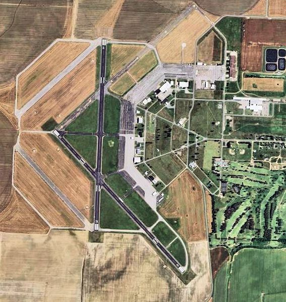

# Memphis Comes to the Bootheel: the SEMO Drag Strip at Malden Air Base (1961–71)

!!! abstract "Article record"
    **Confidence:** Medium · **Source types:** Grassroots small-town daily newspaper (*Sikeston Daily Standard*, Sikeston, Mo.): race reports, results lists and display ads, 1961–71, read as scanned page OCR; Wikipedia and a USGS photo for the airfield's history · **Last verified:** 2026-10-22 (Round 20; Easter 1966 match race, 1966 promoter contact and 1970–71 seasons added) · **Open issues:** many racers' names are mangled in the OCR, so we name only those that read cleanly; the 1965 ad's headline car reads like Ray Godman's "Bo-Weevil" but the scan is garbled ◐; Dick Belletti's name is spelled "Beltetti" in the paper ◐; the April 1966 report calls the Malden strip "Lakeland Drag Strip," the name of the Memphis track, probably a slip ◐; when the strip closed is not known (it was still racing in 1971) · [How we rate this](../reference/source-standards.md)

!!! quote "In their own words"
    "After great interest was shown throughout Southeast Missouri in drag racing, the decision was made to open the Malden Strip."

    — *Sikeston Daily Standard*, July 28, 1961.[^sk610728]

Malden, Missouri, is a small town in the Bootheel, the state's southeastern corner. It had an Air Force flight school until 1960. A year after the last class of pilots left, local drag racers and the Jaycees had a quarter-mile marked out on the back runway, and within a year Memphis cars were driving up to collect the trophies.

## From air base to drag strip (1943–61)

The field opened as **Malden Army Airfield** in January 1943 and was handed to local government in 1948. In 1951 it was reopened as **Malden Air Base**, where a civilian contractor trained Air Force pilots, and the last class finished on June 29, 1960. Today it is the city-owned Malden Regional Airport, with two runways of about 5,000 feet.[^wikimalden] By the fall of 1961 the paper was describing the base buildings as "the property of the City of Malden."[^sk610928]

<figure markdown>
{ loading=lazy }
<figcaption markdown>Malden Regional Airport from the air in 2006. The 1961 strip ran on a 3,000-foot runway "on the back of the Malden Air Base"; we have not worked out which runway that was. Creator: United States Geological Survey. Date: 2006. Source: [Wikimedia Commons](https://commons.wikimedia.org/wiki/File:Malden_Regional_Airport_2006_USGS.jpg). License: public domain (U.S. government work).</figcaption>
</figure>

The *Sikeston Daily Standard* announced that "the first running of the S.E. Mo Drag Strip at Malden" would be at noon on Sunday, July 30, 1961. It was sponsored by the **Southeast Missouri Dragsters** and the **Malden Junior Chamber of Commerce**, on "a 3,000-foot runway on the back of the Malden Air Base," reached by a turnoff one mile north of the main base gate on Highway 25. At first only stock and super stock cars would race. Drivers had to be at least 16, and "all spectators and participators will be completely covered by insurance."[^sk610728]

By August the strip was running alongside a destruction derby at Malden Speedway,[^sk610805] and drivers were coming from out of state. A mid-August report had Ron Dent of Mascoutah, Illinois, east of St. Louis, taking top honors with a B dragster.[^sk610815][^sk610911]<a href="#q-1" title="Single source so far: see Open questions">◐</a>

## The Memphis summer and the Jaycees (1962–65) { #the-memphis-summer-1962 }

The track ran again in the spring of 1962 as the "SEMO Drag Strip, Malden Air Base."[^sk620421] On July 22, 1962, 97 cars entered and 43 trophies were given. Top eliminator was **Bill Taylor of Memphis** in an AA dragster. Little eliminator was **Kenneth McKee of Memphis** in a B gas Willys "with a Chevy power plant." Middle eliminator went to **Al and Calvin Hartsfield** of South Side Oil in Malden, and stock eliminator to Andy French of Bertrand in a 1961 Dodge. Sixteen Sikeston-area drivers took trophies home, including Wade's Body Shop of Sikeston in C altered with "a 365 Chevy mill in a '39 Ford."[^sk620723] In late August the paper billed the meet as the "Malden Jaycee Drag Races."[^sk620827]

The Memphis names matter. Memphis had its own drags at an old bomber base at Halls and, from 1960, at Lakeland Dragway (see [Memphis](../places/memphis.md)). Malden is a few hours' drive north. A Sunday at an unfamiliar strip was worth the drive for a Memphis racer, and it made the Bootheel part of a Mid-South circuit.

By 1963 there was prize money. The 1963 season opened in April with too few cars for two of the five classes. The $100 top stock eliminator prize went to Andy French, now of Oran, "and his Dodge with a 426 cu. in. motor," and $40 to the Hartsfield brothers.[^sk630409] At the last meet of 1964, **Jim Satterfield of Sikeston** won top eliminator in "a 1949 Chevy powered Angelia" (that is, an English Ford Anglia), two straight in a best-of-three, for $75 and a trophy, with an 11.75-second E.T. A Memphis racer brought a Chevy-powered station wagon to "take on all challengers."[^sk641028]

By 1965 the strip had a national sanction. The opening-day ad read: "SEMO DRAGSTRIP Malden Air Base, Malden, Mo. NHRA SANCTIONED - SPONSORED BY JAYCEES," for Sunday, April 11, with trophies to all class winners and a rain phone number. The featured car was a Tennessee AA fuel dragster.<a href="#q-2" title="Single source so far: see Open questions">◐</a>

## Easter 1966 and the last seasons (1966–71) { #easter-1966-the-kingfish-and-joe-lunatis-corvair }

The Easter 1966 ad went big: "MALDEN DRAG STRIP EASTER SUNDAY JOE LUNATI'S 1966 427 CORVAIR" against "THE KINGFISH BLOWN BARRACUDA." The Sunday before, it said, Larry Reyes had run the Lakeland strip in Memphis in 9.02 seconds at 157 miles per hour for a new track record, then come back and run so hard the car stood straight up on its back bumper. "This Sunday at Malden I may take off for the moon!" Reyes promised. The strip was "Located on North Side of the Malden Airport."[^sk660408]

Hundreds came. Time trials ran until 2:30 because of the turnout, and fans were warned to get behind the starting line "because of the danger of an engine blowing up." In the first run the Kingfish beat the Corvair to the line. Then "Joe Lunati tore up his differential while warming up for the second race," so Reyes ran alone. On his next pass he broke two strip records for his class, best E.T. and top speed.[^sk660412]<a href="#q-3" title="Single source so far: see Open questions">◐</a> Joe Lunati was the Memphis racer who founded [Lunati Cams](../people/joe-lunati.md) a few years later.

A month later the ad was Ford vs. Chevy: Chester Andrews' injected fuel-burning Mustang from Orange, Texas (9.98 at 134.56) against Jim Kirby's fuel Chevy II from Festus, Mo., three out of five, with $50 eliminator purses and a $15 bike eliminator. "For further information call: Jim New … Risco, Mo." The ad also promised "The Teleflex Trick Truck Is Coming To Malden Drag Strip Soon."[^sk660506]<a href="#q-4" title="Single source so far: see Open questions">◐</a>

In June a trick truck did come<a href="#q-5" title="Single source so far: see Open questions">◐</a>: about 500 people watched Dick Belletti's "Trick Truck" try to do a wheelstand the whole quarter mile, "a feat never before done at the Malden Drag Strip." On his last run he came down about 600 feet short. The same day's results list a "Batman A-Go-Go" car and a Sikeston street racer billed only as "Mr. X."[^sk660627]<a href="#q-6" title="Single source so far: see Open questions">◐</a>

The strip outlasted the decade. In October 1970 the strip was still holding "a big altered meet" with $150 for the first-round winner.[^sk701028] Its last meet of that season, at "The Malden Dragstrip on Highway 25 North," paid $200, $100 and $50 by round; admission was $2.[^sk701114] In March 1971 the paper reported that "Southeast Missouri's drag racing season gets started at the Dragstrip Sunday as the strip opens its gates for a big racing season under the sanction of the American Hot Rod Association."[^sk710312] By then the NHRA sanction of 1965 had given way to the AHRA.

Malden fits the pattern of the old-airfield strips: a town that suddenly owned a lot of empty concrete, and a civic club willing to take the insurance risk. Compare [Akron's Fulton Airport](akron-fulton-airport.md), [Cotati](marin-cotati-strips.md) and the [Pocono strips](pocono-strips.md).<a href="#q-7" title="Open question: see the bottom of the page">?</a>

*See also:* [Hog Butcher on Weekdays, Fun Capital on Sundays](beardstown-drag-strip.md) and, in southwest Arkansas, [the Hope Drag Strip on the municipal airport](hope-airport-drag-strip.md).

*See also:* across the Ohio River, [Cedar Creek and Kentucky's hometown strips](cedar-creek-bullitt-dragway-kentucky.md), from Bowling Green to Owensboro.

## Open questions & disputed details

*From the detective's notebook: where the sources disagree, where we have only one, and what we are still looking for. Each item links back to its place in the story.*

**Single source so far.** **Who won at Malden in 1961?** The OCR of these results is garbled; we take only the name and town.[^sk610815][^sk610911] <a class="hr-q-back" href="#qr-1" title="Back to the story">↩</a>

**Single source so far.** **Was it the Bo-Weevil?** The scan reads "La;. Hodman's Rouble A Fuel Dragster, The Tennessee IV-Weevil," which looks very much like Memphis racer Ray Godman's Bo-Weevil, but we cannot read it cleanly.[^sk650409] <a class="hr-q-back" href="#qr-2" title="Back to the story">↩</a>

**Single source so far.** **Lakeland or Malden?** The report calls the strip "Lakeland Drag Strip at Malden," probably mixing it up with the Memphis track.[^sk660412] <a class="hr-q-back" href="#qr-3" title="Back to the story">↩</a>

**Single source so far.** **Who was Jim New?** Jim New is the first contact person we've found in a Malden ad; we don't yet know his role.[^sk660506] <a class="hr-q-back" href="#qr-4" title="Back to the story">↩</a>

**Single source so far.** **Was it the Teleflex truck?** The June report says a trick truck came but does not say it was the Teleflex truck the ad promised.[^sk660627] <a class="hr-q-back" href="#qr-5" title="Back to the story">↩</a>

**Single source so far.** **Belletti or Beltetti?** We use Belletti; the paper spells him "Beltetti."[^sk660627] <a class="hr-q-back" href="#qr-6" title="Back to the story">↩</a>

### Next leads

The Southeast Missouri Dragsters' officers; Jim New of Risco (1966 contact); the *Dunklin Democrat* (Kennett) and Malden's own paper; when racing at the base ended (after 1971); a 1970 news item about a "dragstrip area" north of Miner, Mo.; a firsthand account of the Memphis racers' Bootheel trips; which runway was the strip. <a class="hr-q-back" href="#qr-7" title="Back to the story">↩</a>

## Sources

[^sk610728]: "The first running of the S.E. Mo Drag Strip at Malden...," *Sikeston Daily Standard* (Sikeston, Mo.), July 28, 1961. Page OCR (quotes corrected for obvious OCR slips). https://archive.org/details/sikeston-daily-standard-1961-07-28 (accessed 2026-10-21)
[^sk610805]: Drag races and destruction derby notice, *Sikeston Daily Standard*, Aug. 5, 1961. Page OCR. https://archive.org/details/sikeston-daily-standard-1961-08-05 (accessed 2026-10-21)
[^sk610815]: "Entries Score Heavy In Races," *Sikeston Daily Standard*, Aug. 15, 1961. Page OCR, garbled. https://archive.org/details/sikeston-daily-standard-1961-08-15 (accessed 2026-10-21)
[^sk610911]: Malden drag results, *Sikeston Daily Standard*, Sept. 11, 1961. Page OCR, garbled. https://archive.org/details/sikeston-daily-standard-1961-09-11 (accessed 2026-10-21)
[^sk610928]: Malden trade school item, *Sikeston Daily Standard*, Sept. 28, 1961. Page OCR. https://archive.org/details/sikeston-daily-standard-1961-09-28 (accessed 2026-10-21)
[^sk620421]: SEMO Drag Strip display ad, *Sikeston Daily Standard*, Apr. 21, 1962. Page OCR. https://archive.org/details/sikeston-daily-standard-1962-04-21 (accessed 2026-10-21)
[^sk620723]: "Sixteen Area Drivers Take Malden Races," *Sikeston Daily Standard*, July 23, 1962. Page OCR. https://archive.org/details/sikeston-daily-standard-1962-07-23 (accessed 2026-10-21)
[^sk620827]: "Malden Jaycee Drag Races," *Sikeston Daily Standard*, Aug. 27, 1962. Page OCR. https://archive.org/details/sikeston-daily-standard-1962-08-27 (accessed 2026-10-21)
[^sk630409]: "Malden Drag Races Open," *Sikeston Daily Standard*, Apr. 9, 1963. Page OCR, columns interleaved. https://archive.org/details/sikeston-daily-standard-1963-04-09 (accessed 2026-10-21)
[^sk641028]: "The Malden Drag Strip held its final races of the season...," *Sikeston Daily Standard*, Oct. 28, 1964. Page OCR. https://archive.org/details/sikeston-daily-standard-1964-10-28 (accessed 2026-10-21)
[^sk650409]: SEMO Dragstrip display ad, *Sikeston Daily Standard*, Apr. 9, 1965. Page OCR, partly garbled. https://archive.org/details/sikeston-daily-standard-1965-04-09 (accessed 2026-10-21)
[^sk660627]: "'Trick Truck' Thrills Crowd," *Sikeston Daily Standard*, June 27, 1966. Page OCR. https://archive.org/details/sikeston-daily-standard-1966-06-27 (accessed 2026-10-21)
[^sk660408]: Malden Drag Strip Easter display ad, *Sikeston Daily Standard*, Apr. 8, 1966. Page OCR (the ad ran three times on the day's pages). https://archive.org/details/sikeston-daily-standard-1966-04-08 (accessed 2026-10-22)
[^sk660412]: "Hundreds See Kingfish Set Strip Record," *Sikeston Daily Standard*, Apr. 12, 1966. Page OCR. https://archive.org/details/sikeston-daily-standard-1966-04-12 (accessed 2026-10-22)
[^sk660506]: Malden Drag Strip display ad, *Sikeston Daily Standard*, May 6, 1966. Page OCR. https://archive.org/details/sikeston-daily-standard-1966-05-06 (accessed 2026-10-22)
[^sk701028]: "Top Drag Meet Set Sunday," *Sikeston Daily Standard*, Oct. 28, 1970. Page OCR, columns interleaved (quote corrected for OCR slips). https://archive.org/details/sikeston-daily-standard-1970-10-28 (accessed 2026-10-21)
[^sk701114]: Outdoors column item, *Sikeston Daily Standard*, Nov. 14, 1970. Page OCR. https://archive.org/details/sikeston-daily-standard-1970-11-14 (accessed 2026-10-22)
[^sk710312]: "Drag Racing To Begin Sun.," *Sikeston Daily Standard*, Mar. 12, 1971. Page OCR. https://archive.org/details/sikeston-daily-standard-1971-03-12 (accessed 2026-10-22)
[^wikimalden]: "Malden Regional Airport," Wikipedia. https://en.wikipedia.org/wiki/Malden_Regional_Airport (accessed 2026-10-21)
