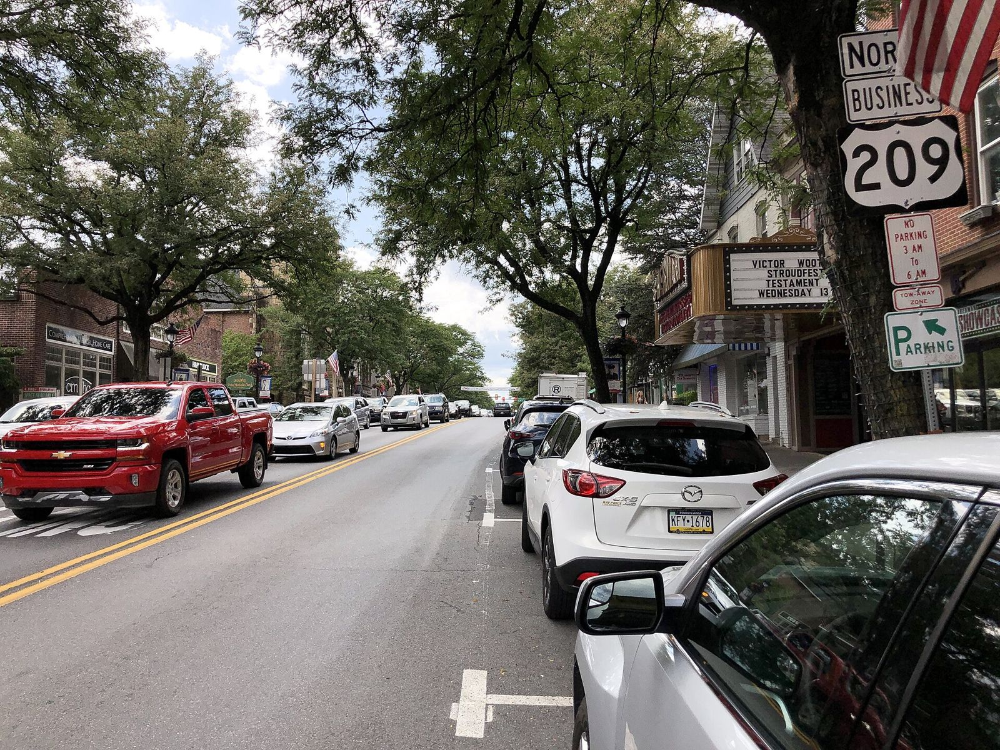

# The Ridge Runners of Stroudsburg: A Club Court, a Work Detail and a Strip They Offered to Buy (1957–64)

!!! abstract "Article record"
    **Confidence:** Medium · **Source types:** Grassroots small-town daily newspaper (*The Daily Record*, Stroudsburg, Pa.): club meeting notes, a member's report, the club's own letter to the editor with the paper's editorial reply (May 24, 1958), and a member's wife's letter quoting the club's constitution and bylaws (June 5, 1964), all read as scanned page OCR · **Last verified:** 2026-10-20 (Round 18) · **Open issues:** no club officers named in the items we read; where the half-fine rule came from ◐; whether the club ever got its strip is not found; the Allegheny County judge's first name and the National Safety Council figures in the letter are garbled in the scan, so we leave them out · [How we rate this](../reference/source-standards.md)

!!! quote "In their own words"
    "We suggest that you would spend a little more time trying to understand and help teenage drivers, work with them instead of condemning them."

    — **The Ridge Runners Hot Rod Club**, letter to the editor, *The Daily Record*, Stroudsburg, Pa., May 24, 1958.[^dr580524]

In the Pocono Mountains of eastern Pennsylvania, a hot rod club put two of its own members on trial for traffic violations and sentenced them to manual labor. Then it told a judge on the other side of the state how to do his job.

## A meeting behind 39 Broad Street

The first trace in the *Daily Record* is a notice in September 1957. "The Ridge Runners, local hot rod club," would meet at the rear of 39 Broad St. A State Police representative was to speak, the police of Stroudsburg and East Stroudsburg would attend, and the meeting was sponsored by the Junior Chamber of Commerce.[^dr570910]

By late November, member **Bernard Lawler** was writing up the meetings for the paper. He listed jackets, secret ballots ("a constructive idea of a club member himself") and "a top priority project for construction of a drag strip outside of Stroudsburg." The highlight was a recording by a radio announcer, **Dopey Duncan**, "who discussed the true meaning of hotrodding."[^dr571130]

<figure markdown>
{ loading=lazy }
<figcaption markdown>Main Street at Broad Street and North Fifth Street in Stroudsburg, 2022. The club's first meeting place was at the rear of 39 Broad St.; this photo does not show that building. Creator: Famartin. Date: 2022-08-09. Source: [Wikimedia Commons](https://commons.wikimedia.org/wiki/File:2022-08-09_14_19_06_View_south_along_U.S._Route_209_Business_(Main_Street)_at_Pennsylvania_State_Route_191_(Broad_Street-North_Fifth_Street)_in_Stroudsburg,_Monroe_County,_Pennsylvania.jpg). License: [CC BY-SA 4.0](https://creativecommons.org/licenses/by-sa/4.0).</figcaption>
</figure>

## Club court

On Dec. 11, 1957, the paper reported that two new members brought the club to 25. Then came the line that makes this club stand out: "A court was held for two members who disobeyed traffic laws during the past week and they were sentenced to a work detail."[^dr571211]

The same report said the club had been "accepted as a charter member of the National Hot Rod Assn., with headquarters in Los Angeles," with a renewal running to January 1959. The renewal came after the parent body investigated "the Monroe County club's safety record," and the club would also receive its "1958 Safety High Point Award Plaque."[^dr571211]<a href="#q-1" title="Single source so far: see Open questions">◐</a>

A week later the club planned a **safety clinic** for Feb. 11 and 16 to check members' brakes, wiring, lights, front ends, tires, appearance and exhaust systems, with a session on Pennsylvania traffic laws. "Parents are particularly invited."[^dr571218]

Club courts were common. Belleville's Gear Jammers fined their own members, and Sedalia's Drag-Ons made a ticketed member stand trial at the next meeting. A work detail is the first labor sentence we've found. See [Belleville's Gear Jammers](belleville-gear-jammers.md) and [The Sedalia Drag-Ons](sedalia-drag-ons.md).

## The letter to the judge

The strip stayed the goal. In spring 1958 the Ridge Runners voted to join the **Northeastern Pennsylvania Timing Assn.**[^dr580416] Members met at the home of **Floyd Pugh**, 562 Fifth St., to talk over a drag strip "to be constructed this Summer," and a float for the Four-County Firemen's Convention parade.[^dr580522]

Then the *Daily Record* ran an editorial quoting an Allegheny County judge named Lewis. As the club's letter quotes it, the editorial warned that a couple of hot rodders staging a drag race on a public highway were "endangering the life and limb of every pedestrian" in sight. (The scan of that passage is rough, so we quote only the clean words.) The club wrote back.[^dr580524]

The Ridge Runners described themselves as a club of 40 members "dedicated to safety on the highway," and said they "would like to have an area set aside for drag racing, which we are willing to buy."[^dr580524] They invited the judge to their Tuesday meetings to read their constitution. Some members, they wrote, wondered whether he had ever seen a drag race and stood in line for inspection, since the cars there "are much safer than some that are being built in Detroit today."[^dr580524] They proposed that the next legislature set aside areas throughout the state for drag racing, and they added the line quoted at the top of this page.[^dr580524]

The paper printed the letter on its editorial page beside a reply, "Concerning Drag Strips." The editors said they "gladly" published it and praised a group of 40 members, 30 of them teenagers, because "not one member has been involved with the law since joining the club."[^dr580524] They agreed that highway officials, safety authorities and the public should give the club's request for a strip serious consideration, but they repeated their own stand: license revocation, even jail, for anyone convicted of racing on public roads.[^dr580524]

## Races, a club car and a model contest

In June 1958 the club discussed summer drag races "under the sanction of the Northeastern Pennsylvania Timing Assn.," open to all competitors.[^dr580604] In September 1959 members were working on a club car, a committee was named to look for land for a proposed drag strip, and Capt. Charles Drummond of the Salvation Army was booked to speak.[^dr590924] That October the club announced a Sunday-morning inspection of every member's car for safety and cleanliness, at its own clubhouse.[^dr591028]

By March 1961 the Ridge Runners were judging a **model-building contest**. The *Daily Record* photo names the winners: David Smith, Allan Ravito, Mike Van Why, Herbert Leshowitz (Best in Show) and Lester Doll.[^dr610311]

The paper also covered a second Monroe County hot rod club, the **Pocono Pacers** of Mountainhome, "a hot rod club" sponsored by the YMCA, whose vice president was Frank Doll.[^dr571114] And the region did get strips, though no source we've read ties them to the Ridge Runners: by April 1964 the Mountain View drag strip in Wind Gap was opening "its fifth season of racing."[^dr640404]

## 1964: incorporated, and still asking

Six years after the letter to the judge, the club was still in business and still without a strip. On June 5, 1964, the *Daily Record* printed a letter from the wife of a member, who lived in Mount Pocono. By then the club was the **Ridge Runners Auto Club Inc. of Monroe County**. It had "received its charter from Harrisburg" and was a member of the National Hot Rod Association, she wrote, and it had **eighteen members**, fewer than half the 40 of 1958.[^dr640605] It still met every Tuesday night.

Her letter is the only place we have found the club's own rulebook quoted, and she quoted it generously (the scan is rough; we correct obvious OCR slips).[^dr640605] Under Article III, the club was "for all young men with a driving permit or license, or whose interests are of a mechanical or administrative nature." Article II gave its purpose: "to promote safe and sound driving practices on the streets and highways—to acquaint the general public with the joys of motoring as a sport, not merely as a means of transportation,— to help unveil to the public the true meaning of the 'Hot Rod'."

The penalties were specific. "Any member swearing in council meeting shall be fined twenty-five cents per word . . . to be paid on the spot." A member who got a traffic violation paid the club "up to one-half of the fine imposed by the local police department." A member caught drag racing on the highway, "whether by police or members of this organization," was fined $5 for a first offense and $25 for a second, and expelled "for a period of sixty days minimum."<a href="#q-2" title="Open question: see the bottom of the page">?</a>

The letter's real purpose was a strip, and it is told on [Where Could a Pocono Hot Rodder Race?](pocono-strips.md): she proposed that the Mount Pocono Airport Authority let the club race on its runway and keep the proceeds.

*See also:* [Where Could a Pocono Hot Rodder Race?](pocono-strips.md), [The Sedalia Drag-Ons](sedalia-drag-ons.md), [Kingston's Igniters](kingston-igniters.md), [Belleville's Gear Jammers](belleville-gear-jammers.md) and the strip debates in [March 1957: America Argues About Drag Strips](march-1957-drag-strip-survey.md).<a href="#q-3" title="Open question: see the bottom of the page">?</a>; [Tear Gas on the Runways](pennsauken-central-airport-1958.md); [Petitions, Jackets and a No-Ticket Rule](hanover-adams-county-clubs.md).

## Open questions & disputed details

*From the detective's notebook: where the sources disagree, where we have only one, and what we are still looking for. Each item links back to its place in the story.*

**Single source so far.** We have not found the award in any NHRA source. <a class="hr-q-back" href="#qr-1" title="Back to the story">↩</a>

**Open question.** That half-fine rule is the third one we have found. Belleville ran NHRA-billed drags, the Ridge Runners belonged to NHRA, and the [Sedalia Drag-Ons](sedalia-drag-ons.md) voted in 1957 that every member must belong to it. A shared NHRA model rulebook would explain the rule, but none of the three sources says so, and we have not found such a model. ◐ <a class="hr-q-back" href="#qr-2" title="Back to the story">↩</a>

--8<-- "club-fine-rules.md"

### Next leads

The Northeastern Pennsylvania Timing Association (a *Car Craft* item of December 1959 puts its booth at the NHRA's Detroit custom show; see [the Pocono strips page](pocono-strips.md)); Mountain View (Wind Gap) and Nazareth strip histories; the Allegheny County editorial's original source; club officers' names. <a class="hr-q-back" href="#qr-3" title="Back to the story">↩</a>

## Sources

[^dr570910]: Ridge Runners meeting notice, *The Daily Record* (Stroudsburg, Pa.), Sept. 10, 1957. Page OCR. https://archive.org/details/stroudsburg-daily-record-1957-09-10 (accessed 2026-10-18)
[^dr571114]: "Pocono Pacers To Meet," *The Daily Record*, Nov. 14, 1957. Page OCR. https://archive.org/details/stroudsburg-daily-record-1957-11-14 (accessed 2026-10-18)
[^dr571130]: Bernard Lawler, report of the Nov. 26 Ridge Runners meeting, *The Daily Record*, Nov. 30, 1957. Page OCR. https://archive.org/details/stroudsburg-daily-record-1957-11-30 (accessed 2026-10-18)
[^dr571211]: "Hot Rod Club Lists 25 Members," *The Daily Record*, Dec. 11, 1957. Page OCR. https://archive.org/details/stroudsburg-daily-record-1957-12-11 (accessed 2026-10-18)
[^dr571218]: "Hot Rod Club Plans For Safety Clinic," *The Daily Record*, Dec. 18, 1957. Page OCR. https://archive.org/details/stroudsburg-daily-record-1957-12-18 (accessed 2026-10-18)
[^dr580416]: Ridge Runners meeting item, *The Daily Record*, April 16, 1958. Page OCR, garbled. https://archive.org/details/stroudsburg-daily-record-1958-04-16 (accessed 2026-10-18)
[^dr580522]: Ridge Runners meeting item, *The Daily Record*, May 22, 1958. Page OCR. https://archive.org/details/stroudsburg-daily-record-1958-05-22 (accessed 2026-10-18)
[^dr580524]: Ridge Runners Hot Rod Club, letter to the editor, and editorial "Concerning Drag Strips," *The Daily Record*, May 24, 1958. Page OCR. https://archive.org/details/stroudsburg-daily-record-1958-05-24 (accessed 2026-10-18)
[^dr580604]: "Plans For Summer Drag Races," *The Daily Record*, June 4, 1958. Page OCR. https://archive.org/details/stroudsburg-daily-record-1958-06-04 (accessed 2026-10-18)
[^dr590924]: Ridge Runners meeting item, *The Daily Record*, Sept. 24, 1959. Page OCR. https://archive.org/details/stroudsburg-daily-record-1959-09-24 (accessed 2026-10-18)
[^dr591028]: "Club Plans Inspection," *The Daily Record*, Oct. 28, 1959. Page OCR. https://archive.org/details/stroudsburg-daily-record-1959-10-28 (accessed 2026-10-18)
[^dr610311]: "Awards Given" photo caption, *The Daily Record*, March 11, 1961. Page OCR. https://archive.org/details/stroudsburg-daily-record-1961-03-11 (accessed 2026-10-18)
[^dr640404]: "Open Drag Strip," *The Daily Record*, April 4, 1964. Page OCR. https://archive.org/details/stroudsburg-daily-record-1964-04-04 (accessed 2026-10-18)
[^dr640605]: Mrs. ... Heller (first name garbled in the scan), Mount Pocono, letter to the editor, "Drag Races Suggested At Pocono Airport," *The Daily Record*, June 5, 1964, p. 4. Page OCR. https://archive.org/details/stroudsburg-daily-record-1964-06-05 (accessed 2026-10-20)
